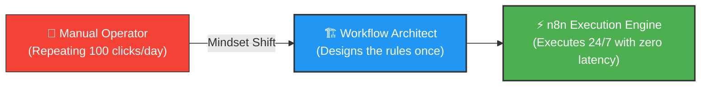
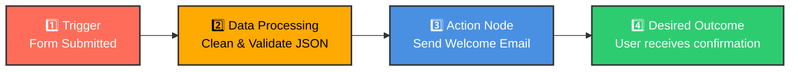
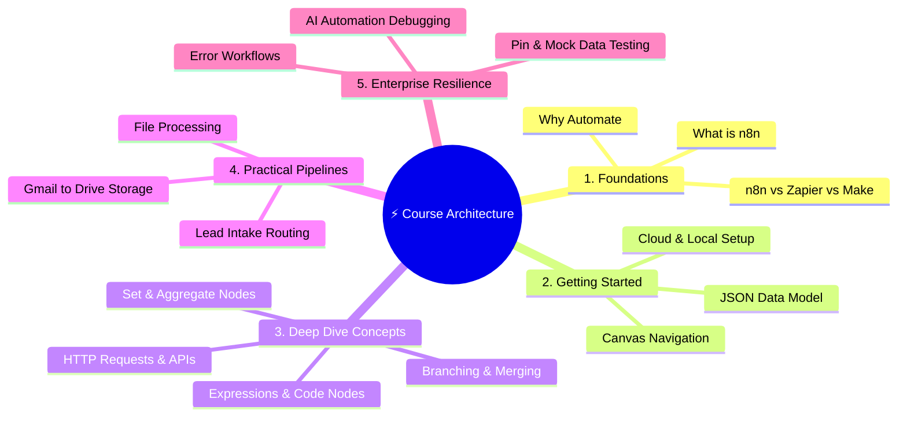
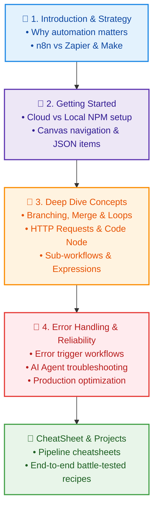

# 📘 n8n Automation: A Beginner-Friendly Introduction & Roadmap

  <a href="../README.md">⬅️ Back to Main README</a> •
  <a href="02_Chapter_What_is_Automation.md">Next: What is Automation ➡️</a> •
  <a href="https://github.com/shashilabs-io/n8n-docs">GitHub Repository</a>

---

## 🧭 How to Use This Guide

This guide is your **visual entry point** into n8n and workflow engineering. It deconstructs the fundamental principles of automation, presents real-world mental models, and sets up your structured roadmap across this documentation repository.

> [!TIP]
> **Active Learning Strategy:**
> Read the core concept first, inspect the workflow diagram, and explain the logic in your own words before moving to the n8n canvas. Don't worry about memorizing node configuration flags on your first pass!

### 🎯 Key Outcomes of this Chapter:
- Understand **why automation matters** and how to spot manual bottlenecks.
- Master the **4-part mental model** of any workflow (*Trigger &rarr; Ingest &rarr; Transform/Decide &rarr; Action*).
- Explore **three concrete everyday scenarios** (Email triage, Data pipelines, Content ops).
- Review the **comprehensive curriculum roadmap** mapped directly to this repository's folders.
- Test your comprehension with **active recall questions** and an **automation pre-flight checklist**.

---

# Chapter 1 — Why Automation Matters

Many workdays are dominated by repetitive manual tasks that are conceptually simple but painfully time-consuming: sorting inbound support emails, copy-pasting customer records across spreadsheets, checking dashboards, and manually cross-posting updates.

### 🛑 The Problem: The Cost of Manual Busywork

| Task Area | Manual Bottleneck | The Human Cost |
|---|---|---|
| **Email Overload** | Reading every notification, filtering priority leads, and manually drafting replies. | High cognitive fatigue, missed urgent inquiries, slow response times. |
| **Data Entry** | Copying values from forms/APIs into Google Sheets, Airtable, or CRM. | Frequent typos, schema mismatches, duplicate records, stale metrics. |
| **Content Ops** | Reformatting announcements across Slack, Telegram, Twitter, and Email. | Tedious copy-pasting, inconsistent formatting, delayed publishing. |

### 🚀 The Mindset Shift: From "Doer" to "System Designer"

Automation fundamentally transforms your role. Instead of manually executing every tedious step, you **architect a self-healing process**:

> [!IMPORTANT]
> **The Golden Rule of Automation:**
> Automation delivers the highest return on investment when a task is:
> 1. **Repetitive** (happens frequently).
> 2. **Rule-based** (decisions follow clear, deterministic logic).
> 3. **Verifiable** (you can objectively confirm whether the outcome succeeded).

---

# Chapter 2 — Anatomy of an Automation Workflow

At its core, a workflow is a **directed graph of interconnected nodes** that converts an incoming event into a tangible outcome.

### 🧩 The 4 Fundamental Steps

1. **Trigger:** The spark that initiates the workflow (e.g., a webhook received, a scheduled cron timer, or a new row in a sheet).
2. **Data Processing:** Reading, shaping, filtering, or calculating expressions using n8n's JSON engine.
3. **Action:** Interacting with external systems (e.g., sending an email, writing to Postgres, posting a Slack message).
4. **Outcome:** The business goal achieved with zero human delay.

### ❓ The 4 Questions to Ask Before Opening the Canvas:
1. **What starts it?** (Webhook, polling event, or fixed schedule?)
2. **What payload arrives?** (What fields are available, and are any optional/null?)
3. **What rules or decisions are required?** (Does it need an If/Switch condition or loop?)
4. **What proves it succeeded?** (A status 200 response, a Slack alert, or updated CRM record?)

---

# Chapter 3 — Three Everyday Automation Scenarios

### 📧 Scenario A: The Autonomous Email & Notification Triage
Instead of checking your inbox every 5 minutes, n8n filters incoming emails, extracts high-intent leads or alerts, and delivers an instant summary to Telegram or Slack:

| Input | Automated Work | Delivered Outcome |
|---|---|---|
| Incoming Customer Email | Parse body & subject, score sentiment, extract sender info | Telegram alert with direct action buttons |

### 📊 Scenario B: Automated Data Pipeline & Hygiene
Eliminate human copy-paste errors across sales operations:

| Input | Automated Work | Delivered Outcome |
|---|---|---|
| Google Forms / Stripe Webhook | Clean strings, validate phone format, check for duplicate emails | Clean record written to Database + CRM |

### 📢 Scenario C: Multi-Channel Content Repurposing
Write once, broadcast everywhere automatically:

| Input | Automated Work | Delivered Outcome |
|---|---|---|
| New Blog Post / YouTube Video | Extract summary, draft platform-specific snippets (Twitter, LinkedIn) | Scheduled drafts or auto-published posts |

> [!NOTE]
> **Human-in-the-Loop:** For sensitive operations (e.g. issuing refunds, sending outbound executive emails, or executing LLM actions), always insert an approval step or notification checkpoint.

---

# Chapter 4 — The Complete Course Architecture

This repository organizes your learning journey into a coherent, layered progression:

---

# Chapter 5 — Detailed Learning Roadmap

Here is how the modules in this repository build upon one another:

### Module Breakdown & Repository References:

1. **[1_n8n_Introduction/](./)**:
   - Establish the mental models, understand open-source vs proprietary SaaS, and calculate automation ROI.
2. **[2_getting started/](../2_getting%20started/)**:
   - Install locally (`npx n8n`) or via Docker, master the canvas UI, build your first welcome email, and grasp the `[{ json: {} }]` data paradigm.
3. **[3_deep dive concepts/](../3_deep%20dive%20concepts/)**:
   - Master data transformation (`Set`, `Aggregate`, `Remove Duplicates`), control flow (`If`, `Switch`, `Loop Over Items`), custom code (JavaScript/Python), and universal API integration via `HTTP Request`.
4. **[4_Error Handling/](../4_Error%20Handling/)**:
   - Harden your pipelines with dead-letter queues, automated Slack alerts on failure, and diagnostic methods for AI/LLM agent workflows.
5. **[CheatSheet/](../CheatSheet/)**:
   - Quick-reference visual architecture cards and cheat sheets for data pipeline engineers.

---

# Chapter 6 — Essential Beginner Glossary

| Term | Practical Definition in n8n |
|---|---|
| **Trigger** | The node that initiates a workflow execution upon receiving an external event, webhook, or cron schedule. |
| **Node** | A single step in a workflow that transforms data, performs a calculation, or interacts with an external service. |
| **Execution** | A single run of a workflow, capturing the exact input, output, duration, and error trace of every node. |
| **JSON Object Array** | The standard data currency of n8n: an array of items formatted as `[ { "json": { ... } } ]`. |
| **Expression** | Code snippet enclosed in `{{ ... }}` allowing dynamic access to variables, dates, and previous node data. |
| **Item Linking** | n8n's engine capability that pairs input items with corresponding output items across nodes. |
| **Pin Data** | A testing feature that freezes test payloads inside a node, eliminating repetitive API re-triggers during development. |
| **Sub-workflow** | A modular workflow executed from a parent workflow via the `Execute Workflow` node. |
| **Error Workflow** | A dedicated background workflow triggered automatically whenever another workflow encounters an unhandled exception. |

---

# Chapter 7 — Revision & Active Recall

Check your understanding before moving forward:

1. **Why is n8n favored over proprietary no-code tools for sensitive data?**
   > *Answer:* n8n is fair-code and self-hostable (via Docker/NPM), meaning data never leaves your infrastructure and you pay zero per-task penalties.
2. **What data format does every n8n node expect and output?**
   > *Answer:* An array of JSON objects: `[ { json: { ... } } ]`.
3. **Why should you "Pin Data" while building a workflow?**
   > *Answer:* It locks realistic sample data into the canvas so you can test downstream logic instantly without triggering external webhooks repeatedly.
4. **When should you build an Error Workflow?**
   > *Answer:* For all production automations, ensuring that unexpected API downtime or invalid input alerts your team immediately with execution details.

---

# Chapter 8 — Your First Automation Checklist

Before starting Chapter 2, sketch out your target workflow:

- [ ] **Target Task Identified**: What manual task wastes 30+ minutes of your week?
- [ ] **Trigger Defined**: Does it start via webhook, schedule, or polling?
- [ ] **Sample Payload Inspected**: Do you have a real example of the JSON or email data?
- [ ] **Transformations Listed**: What fields need to be mapped, renamed, or filtered?
- [ ] **Destination Confirmed**: Where should the final result be delivered?
- [ ] **Failure Strategy**: Who needs to know if the connection or API fails?

---

  <b>Next Step:</b> Dive into <a href="02_Chapter_What_is_Automation.md">Chapter 2: What is Automation?</a> or return to the <a href="../README.md">Main Documentation Hub</a>.

