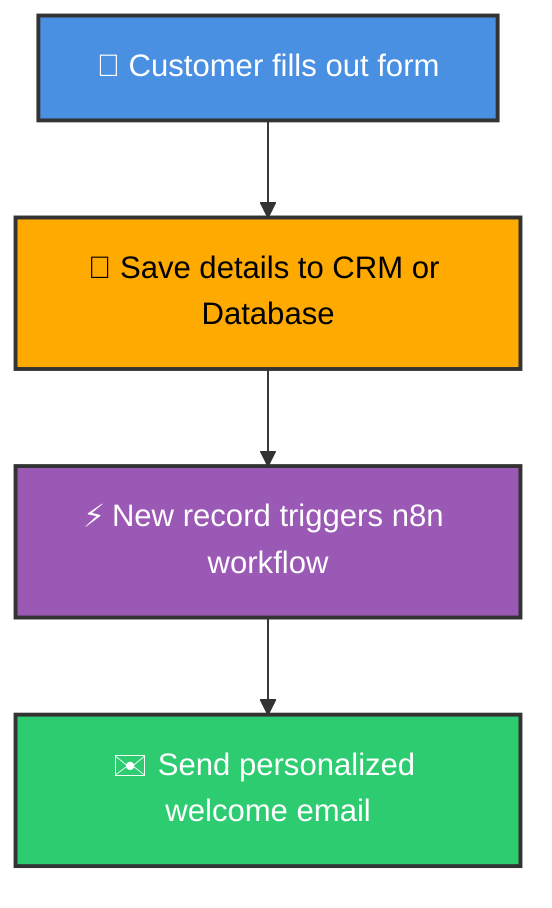
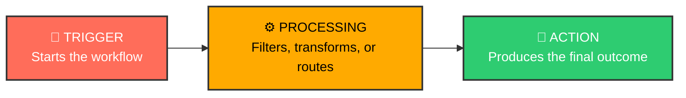
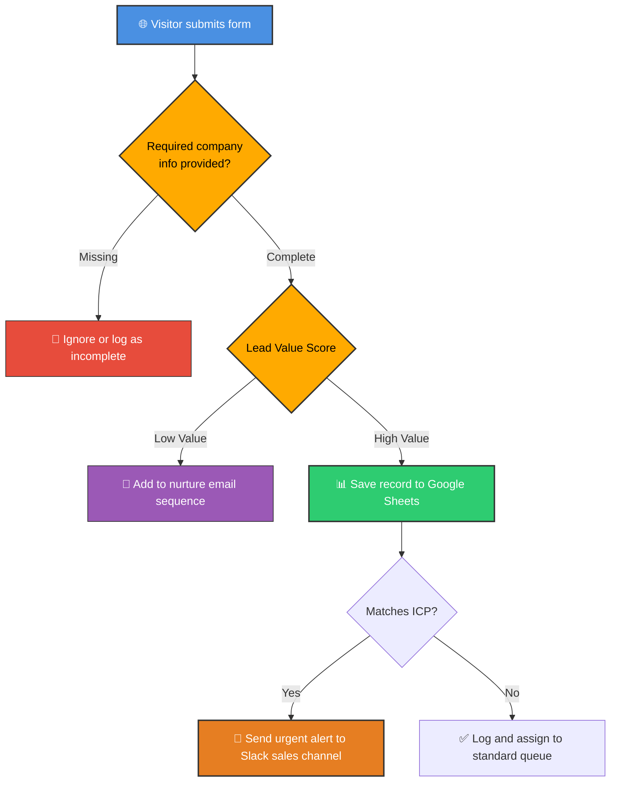
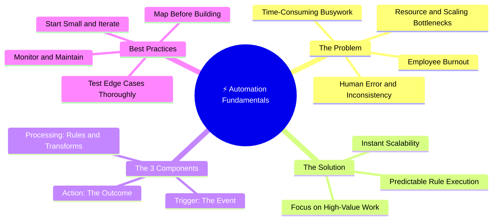

# ⚙️ What Is Automation & Why It Matters?

  <a href="01_Introduction_Beginner_Book.md">⬅️ Prev: Introduction & Roadmap</a> •
  <a href="../README.md">Main Hub</a> •
  <a href="03_Chapter_What_is_n8n.md">Next: What is n8n ➡️</a> •
  <a href="https://github.com/shashilabs-io/n8n-docs">GitHub Repository</a>

---

## 🧭 How to Use This Chapter

> [!TIP]
> **Recommended Learning Sequence:**
> Understand the problem &rarr; learn the workflow components &rarr; study the lead qualification example &rarr; apply the four best practices.

### 🎯 Learning Objectives
- Explain why repetitive manual work is inefficient and error-prone.
- Define what automation actually means in practical software engineering.
- Identify **Trigger**, **Processing**, and **Action** in any workflow.
- Trace the lead qualification branching example.
- Apply industry best practices for mapping, testing, and maintaining production workflows.

---

# 1. Why Does Automation Matter?

Consider everyday repetitive activities: sorting emails, copying spreadsheet information, updating records, and publishing social content. Manual execution creates four critical business bottlenecks:

| Problem Area | What It Means in Practice |
|---|---|
| **Subjectivity & Human Error** | People rely on intuition or get fatigued, leading to inconsistent decisions, typos, or missed records. |
| **Slow & Time-Consuming Work** | Repeated low-value steps consume dozens of hours each week that could be invested in higher-leverage goals. |
| **Resource Costs & Scaling Bottlenecks** | Handling more volume requires hiring more staff, extending shifts, or inflating budgets proportionally. |
| **Low Employee Satisfaction** | Monotonous, mechanical copy-pasting burns out team members and increases churn. |

### 🚀 How Automation Solves These Challenges

- **Data-Driven Execution:** Workflows follow input data and configured rules with 100% mathematical consistency.
- **Productivity Multiplication:** Team members shift focus toward strategy, creativity, and high-touch customer relationships.
- **Morale Boost:** Employees are liberated from repetitive administrative toil.
- **Scalability at Negligible Marginal Cost:** Automated software pipelines process 10,000 tasks as effortlessly as 10 tasks.

> [!NOTE]
> **Important Nuance:** Automation strictly executes the rules and data it receives. Flawed logic or malformed input data will simply produce bad results faster. Automation does not automatically make poor business logic correct.

---

# 2. A Real-World Example: Customer Onboarding

When a new customer signs up, a business must capture their details, record them into a CRM or spreadsheet, and deliver a personalized welcome confirmation.

### 🐌 The Manual Process
1. An employee manually requests details via email or phone.
2. The employee copy-pastes those details into a CRM or spreadsheet.
3. The employee manually writes and sends a welcome email.

### ⚡ The Automated Process
1. The customer completes a self-serve digital form.
2. Form submissions are automatically parsed and saved to the CRM or spreadsheet.
3. The creation of the record triggers a workflow that dispatches an instant welcome email.

> [!IMPORTANT]
> **What Changes?** The process becomes instant and perfectly repeatable. Staff no longer spend hours on manual data re-entry, needing only to configure and periodically monitor the workflow.

---

# 3. What Is Automation?

> **Definition:** Automation is *"a process of executing a predictable set of actions based on specific conditions."*

In plain language: digital automation performs predefined steps whenever designated conditions or triggers occur.

### 🧳 The Airport Baggage System Analogy
When a passenger checks in luggage, a scanner reads the barcode. Based on flight number, destination, and conveyor routing logic, the bag is guided along the correct physical conveyor belts directly to the aircraft.

Similarly, **digital automation** routes information between software applications according to predefined business rules.

---

# 4. The Three Core Components of a Workflow

Every automated workflow consists of three primary stages: **Trigger**, **Processing**, and **Action**.

$$\text{Event} \longrightarrow \text{Rules \& Transformation} \longrightarrow \text{Result}$$

| Component | Meaning | Concrete Examples |
|---|---|---|
| **Trigger** | The initiating event that wakes the workflow. | New email received, Stripe webhook fired, scheduled cron timer (e.g. 9 AM every Monday). |
| **Processing** | Filtering, branching, aggregating, or converting data. | Verify valid email syntax, discard spam, extract JSON fields, branch based on deal size. |
| **Action** | The tangible outcome or write operation produced. | Create Google Sheet row, upload file to Drive, notify team in Slack, dispatch webhook. |

### 🛠️ What "Processing" Entails:
- **Filtering:** Keep only items that meet a specific condition (e.g., discard empty records).
- **Segmenting & Branching:** Route data down alternate execution paths depending on boolean or string rules.
- **Transforming:** Reshape data into the structure required by downstream APIs (e.g., formatting dates or calculating totals).

---

# 5. Worked Example: Lead Qualification Workflow

A landing page form collects inquiries from prospective clients (**leads**). The automation inspects incoming information and branches intelligently:

### 📋 Lead Routing Decision Matrix

| Incoming Lead Condition | Automated Action |
|---|---|
| **Missing Company Details** | Discard or route to incomplete submission log. |
| **Low-Value Lead** | Enroll in an automated email warm-up sequence. |
| **High-Value Lead** | Store row in Google Sheets and sync with CRM. |
| **Matches Ideal Customer Profile (ICP)** | Dispatch an instant high-priority Slack alert to the sales reps. |

### 💡 Why This Example Matters:
- A real workflow can evaluate **multiple decisions** in sequence.
- Different inputs follow completely distinct branches.
- A single trigger can initiate multiple complementary actions simultaneously.
- Business rules are applied objectively and without human bias.

---

# 6. Four Best Practices for Building Automations

### 1️⃣ Map the Process Before Building
Never touch the canvas without sketching the logic first. Draw triggers, data paths, decision forks, and failure paths using flowcharts or whiteboards (Miro, draw.io, Excalidraw).

### 2️⃣ Start Small and Iterate
Build and test a single node connection first (e.g. Webhook &rarr; Log). Once validated, add filtering, followed by actions. This isolates bugs to the newest addition.

### 3️⃣ Test Thoroughly & Optimize
Deliberately test edge cases: empty strings, missing fields, duplicate emails, and special characters. An uncaught bug in an automated loop repeats at machine speed.

### 4️⃣ Monitor and Maintain
Workflows require operational observability. Configure alerts for failed runs, review execution logs, and update credentials before API tokens expire.

---

## 🚦 Pre-Launch Checklist

- [ ] Have I mapped the end-to-end process in plain language?
- [ ] Is the trigger clearly defined (Webhook vs Polling vs Cron)?
- [ ] Are validation rules and branching conditions explicit?
- [ ] Have I tested both happy-path data and malformed edge cases?
- [ ] How will failures be detected and reported (Slack alert, dead-letter queue)?
- [ ] Who is responsible for monitoring and maintaining this workflow?

---

# 7. Chapter Mind Map

---

# 8. Glossary

| Term | Practical Meaning in Automation |
|---|---|
| **Automation** | Executing predefined, predictable actions based on specific trigger conditions. |
| **Workflow** | A structured, connected sequence of steps designed to complete a digital process. |
| **Trigger** | The initial event or schedule that starts a workflow execution. |
| **Processing** | Filtering, transforming, validating, or routing data between nodes. |
| **Action** | The final task, write operation, or communication produced by a workflow. |
| **CRM** | Customer Relationship Management system (e.g., HubSpot, Salesforce) storing customer interactions. |
| **Lead** | A prospective customer who has submitted their contact details or shown interest. |
| **Lead Qualification** | Evaluating incoming data against business criteria to determine optimal follow-up. |
| **ICP** | *Ideal Customer Profile* — the specific organization size, industry, or budget a business targets. |
| **Edge Case** | An unusual, unexpected, or boundary situation (e.g., empty phone number) that could break naive logic. |
| **Production** | The live, mission-critical environment where workflows operate on real customer data. |

---

# 9. Active Recall: Check Your Understanding

<strong>1. What four core problems with manual work does this chapter identify?</strong>

Subjectivity/human error, slow repetitive tasks, resource costs and scaling bottlenecks, and low employee satisfaction.

<strong>2. What is the fundamental definition of automation?</strong>

A process of executing a predictable set of actions based on specific conditions.

<strong>3. Name the three core components of any workflow.</strong>

**Trigger**, **Processing**, and **Action**.

<strong>4. What is the difference between a Trigger and an Action?</strong>

A **Trigger** starts the workflow when an event happens; an **Action** is a task or outcome executed as a result.

<strong>5. In the lead qualification example, what happens to a low-value lead?</strong>

It is added to an automated email nurture sequence to warm it up without wasting sales rep time.

<strong>6. What happens when an incoming lead matches the Ideal Customer Profile (ICP)?</strong>

The sales team receives an immediate high-priority alert in Slack to engage while interest is hot.

<strong>7. Why must workflows be tested with edge cases before entering production?</strong>

Because in automated systems, a single uncaught bug repeats across thousands of records at machine speed.

<strong>8. What are the four industry best practices for building automations?</strong>

1. Map the process before building.
2. Start small and iterate.
3. Test thoroughly and optimize.
4. Monitor and maintain actively.

---

# 10. Summary

- **Manual repetitive work** is inherently fragile, costly, slow, and unscalable.
- **Automation** replaces manual toil with deterministic, rule-based execution.
- Every workflow follows the **Trigger &rarr; Processing &rarr; Action** mental model.
- Well-architected workflows include branching decisions to handle different tiers of data appropriately.
- High-reliability automations begin with a clear process map and rely on iterative testing and active monitoring.

---

  <b>Next Step:</b> Advance to <a href="03_Chapter_What_is_n8n.md">Chapter 3: What Is n8n?</a> or return to the <a href="../README.md">Main Hub</a>.

