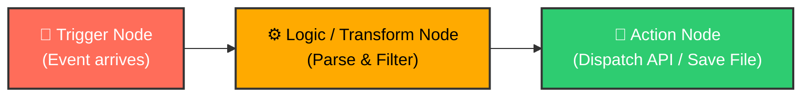
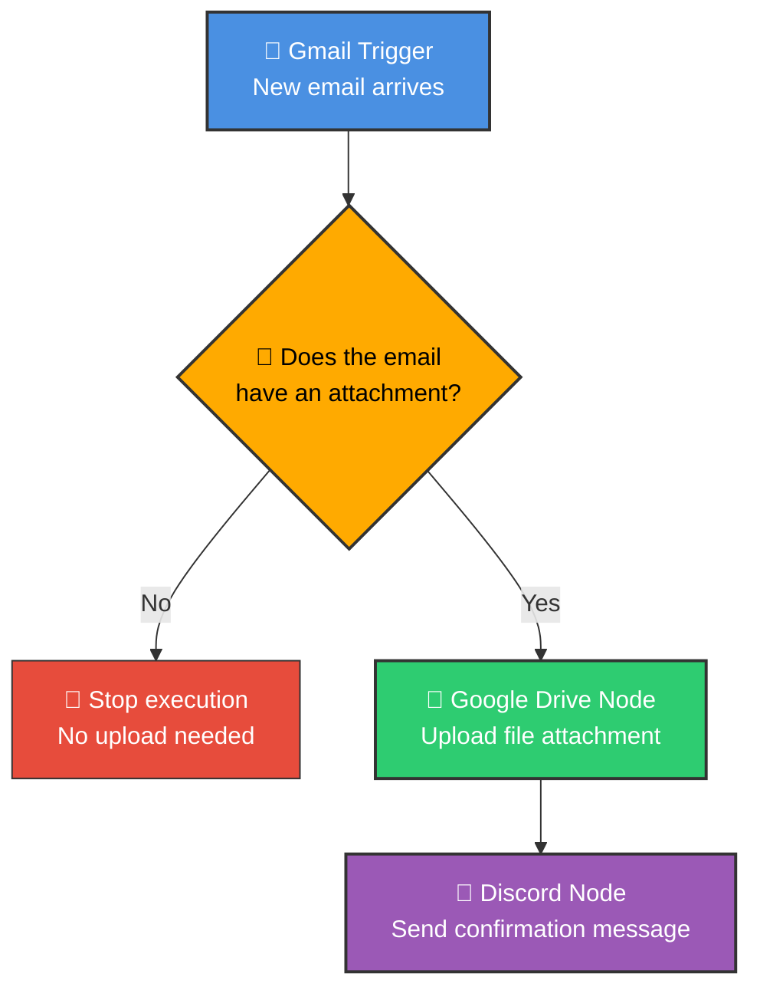
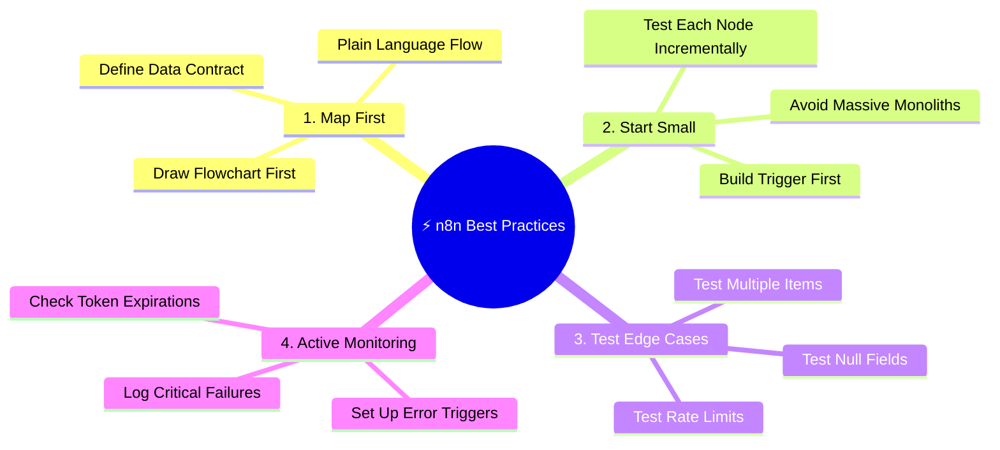

# ⚡ What Is n8n & Why Is It a Popular Automation Tool?

  <a href="02_Chapter_What_is_Automation.md">⬅️ Prev: What is Automation</a> •
  <a href="../README.md">Main Hub</a> •
  <a href="04_vs_Make_Zapier_Beginner_Guide.md">Next: n8n vs Make vs Zapier ➡️</a> •
  <a href="https://github.com/shashilabs-io/n8n-docs">GitHub Repository</a>

---

## 🧭 How to Use This Chapter

> [!TIP]
> **Goal:** Understand what n8n is, master its core building blocks (workflows, nodes, triggers), and walk through a first practical workflow that saves Gmail attachments to Google Drive and delivers a Discord notification.

### 🎯 Learning Objectives
- Explain what n8n is and does in plain language.
- Describe the three primary node categories (Trigger, Transformation/Routing, and Action).
- Understand the core architectural advantages of n8n over closed-source SaaS.
- Trace the complete **Gmail &rarr; Filter &rarr; Google Drive &rarr; Discord** pipeline.
- Understand why mapping processes in plain English before building is essential.
- Identify the limitations of basic introductory workflows and how to harden them for production.

---

# 1. What Is n8n?

**n8n** (nodal) is an **open-source, fair-code workflow automation platform** designed to connect applications, automate multi-step business logic, and orchestrate modern AI agents.

Think of n8n as an interactive visual canvas where each distinct action or integration step is represented as a **node**. Nodes are visually wired together to construct an automated **workflow**.

### 🛠️ What Can an n8n Workflow Do?
- **Event-Driven Execution:** Awaken immediately upon an incoming event (e.g. an email arriving, a Stripe charge succeeding).
- **Data Transformation:** Filter, aggregate, reshape, and clean JSON payloads across systems.
- **Cross-App Communication:** Seamlessly pass data between hundreds of pre-built integrations (databases, CRMs, chat tools, cloud storage).
- **Custom Code & APIs:** Embed raw JavaScript or Python when pre-built nodes aren't enough, or connect to any REST/GraphQL endpoint via the `HTTP Request` node.
- **AI Agent Orchestration:** Chain LLMs, vector search memory, and custom tools into production AI pipelines.

---

# 2. Why Choose n8n?

When compared with traditional tools, n8n stands out across three major architectural pillars:

| Pillar | What It Means | Practical Value |
|---|---|---|
| **Workflow-Based Pricing** | Billing (in Cloud or Enterprise) is calculated per *workflow execution* rather than penalizing you for every individual node/step. | Workflows with 20 steps cost the exact same execution credit as a 2-step workflow, making complex automation economically viable. |
| **Self-Hosting & Data Sovereignty** | Run n8n anywhere: your personal laptop, on-prem servers, Docker, Kubernetes, or the cloud. | Complete control over sensitive customer tokens and payloads; compliance with strict data-privacy regulations (GDPR, HIPAA). |
| **Code-Extensibility & AI** | Full access to JavaScript/Python, native regular expressions, complex loops, sub-workflows, and LangChain AI nodes. | You never hit a "no-code wall" when business logic demands advanced algorithms or dynamic API calls. |

---

# 3. Core Concepts: Workflows and Nodes

### 🔄 The Workflow
A **workflow** is a directed graph of connected steps configured to execute an end-to-end automated process from a trigger to a resolution.

### 🧩 The Node
A **node** is an individual building block in the workflow. Each node is responsible for a single task: listening for an event, calculating an expression, querying a database, or sending a notification.

### 🏷️ The Three Broad Node Categories

| Node Category | Primary Function | Real-World Examples |
|---|---|---|
| **Trigger Node** | Listens for an event or runs on a timer to start the execution. | *Gmail Trigger*, *Webhook*, *Schedule (Cron)*, *Stripe Trigger*. |
| **Transform & Routing Node** | Filters, reshapes, deduplicates, or branches data payloads. | *Filter Node*, *Set / Edit Fields*, *Aggregate*, *If / Switch*, *Code*. |
| **Action Node** | Executes an external write, creates a record, or sends an alert. | *Google Drive Upload*, *Slack Notification*, *Postgres Insert*, *Discord Message*. |

---

# 4. First Practical Workflow: Gmail to Google Drive & Discord

In this hands-on pipeline, three services are linked into an automated document pipeline:

1. **Gmail:** Detects an incoming email and extracts its binary attachment.
2. **Google Drive:** Automatically uploads the attachment to a designated team folder.
3. **Discord:** Sends an instant alert with the email subject confirming the save.

### 📝 The Plain-English Process Map
Always map your business logic before touching node settings:
1. *Listen for newly arrived emails in Gmail.*
2. *Check: Does this email contain an attachment?*
3. *If yes: upload the attachment file to Google Drive.*
4. *If no: end the execution without uploading.*
5. *After upload: send a message to Discord confirming file name and sender.*

### 🗺️ Visual Flowchart

---

# 5. Understanding Each Step in Depth

### Step 1: Gmail Trigger
The trigger connects to the Gmail API and fetches incoming message objects. Each incoming item includes email headers, message ID, subject, sender, timestamp, and a **binary data** section containing the file payload.
> **Core Concept:** The trigger generates the primary JSON and binary data array that fuels all downstream nodes.

### Step 2: Filter Node
The Filter node inspects the incoming data to verify that binary attachment data actually exists.
- If true: the item passes through to the next node.
- If false: the execution terminates safely.
> **Core Concept:** Filters prevent downstream nodes from crashing when required fields are missing.

### Step 3: Google Drive Node
Configured with OAuth2 credentials, the node points to a specific Google Drive folder ID. It reads the binary property generated by Gmail and writes it to cloud storage.
> **Core Concept:** Node inputs can pass binary files (PDFs, images, CSVs) just as easily as text strings.

### Step 4: Discord Notification Node
The Discord node uses **expressions** (e.g. `{{ $('Gmail Trigger').item.json.subject }}`) to interpolate data from Step 1 directly into the chat message.
> **Core Concept:** Any node in n8n can reference data from *any* previous step in the pipeline, not just the step directly before it!

---

# 6. From Simple Demo to Production Resilience

> [!WARNING]
> **A Successful Test &ne; A Production-Ready Pipeline!**
> A successful single run in the canvas proves that the happy-path works with test data. It does not guarantee resilience against real-world edge cases.

### Real-World Production Considerations:
Before deploying this workflow in an enterprise setting, test:
- **Zero Attachments:** Does the filter correctly terminate without throwing an error?
- **Multiple Attachments:** If an email contains 4 PDFs, does the workflow process all 4 or drop 3? (Mastering this requires the `Split In Batches` or `Loop Over Items` node).
- **Large Files:** Will file sizes over 25 MB exceed memory limits or require stream uploading?
- **Credential Expiry:** If the Google Drive OAuth token expires, does an Error Workflow notify the admin?

---

# 7. Best Practices for Mastering n8n

### 🚦 Pre-Flight Workflow Checklist
- [ ] Is the business process clearly documented before building?
- [ ] Is the trigger configured for the correct trigger method (polling interval or real-time webhook)?
- [ ] Are filtering rules tested for both matching and non-matching conditions?
- [ ] Are dynamic values mapped using clean expressions (`{{ $json.field }}`)?
- [ ] Are credentials scoped with the minimum necessary access permissions?
- [ ] Is there an error strategy if a downstream API fails?

---

# 8. Glossary

| Term | Beginner-Friendly Meaning |
|---|---|
| **n8n** | A fair-code workflow automation platform used to connect services and orchestrate processes. |
| **Workflow** | A directed graph of connected nodes executing an automated business process. |
| **Node** | A single modular step in a workflow (trigger, logic, or action). |
| **Trigger** | The initiating node that starts a workflow when an event happens or timer fires. |
| **Filter** | A routing node that allows only items meeting specific criteria to continue. |
| **Binary Data** | Non-text file data (images, PDFs, spreadsheets) passed between nodes in n8n. |
| **Expression** | Code snippet enclosed in `{{ ... }}` to dynamically reference variables from prior nodes. |
| **Self-Hosting** | Running n8n on your own local machine, Docker container, or virtual private cloud. |
| **Vendor Lock-in** | Inability to migrate away from a proprietary SaaS platform without losing all your automations. |

---

# 9. Active Recall — Test Your Knowledge

<strong>1. What is n8n in simple terms?</strong>

A visual workflow automation platform that connects software apps and services so multi-step processes and AI agents run automatically.

<strong>2. What are the three primary node categories in n8n?</strong>

1. **Trigger nodes** (start the workflow).
2. **Data transformation / routing nodes** (filter and reshape data).
3. **Action nodes** (interact with external tools and produce outcomes).

<strong>3. How does n8n's pricing philosophy differ from Zapier or Make?</strong>

n8n bills based on overall **workflow executions** (or is completely free to self-host), whereas Zapier and Make charge for every individual task or operation executed inside a workflow.

<strong>4. Can a downstream node in n8n access data from a node three steps prior?</strong>

**Yes!** Using n8n expressions like `{{ $('Node Name').item.json.fieldName }}`, any downstream node can reference data from any previous node in the pipeline.

<strong>5. What is the key limitation of the basic Gmail-to-Drive demo workflow?</strong>

It is configured for a single attachment and does not yet loop over multiple attachments or handle oversized file streams.

<strong>6. Why should you map a workflow in plain English before configuring nodes?</strong>

Mapping isolates business logic from technical implementation details, preventing messy designs and missed edge cases.

---

# 10. Summary

- **n8n** combines visual node-based convenience with full developer-level code control.
- Workflows are built from **Triggers**, **Transformation/Routing**, and **Actions**.
- n8n supports **both structured JSON** and **binary file handling** natively.
- Always map first, build iteratively, and stress-test edge cases before promoting workflows to production.

---

  <b>Next Step:</b> Advance to <a href="04_vs_Make_Zapier_Beginner_Guide.md">Chapter 4: n8n vs Make.com vs Zapier</a> or return to the <a href="../README.md">Main Hub</a>.

