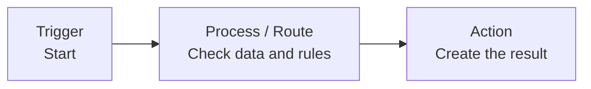
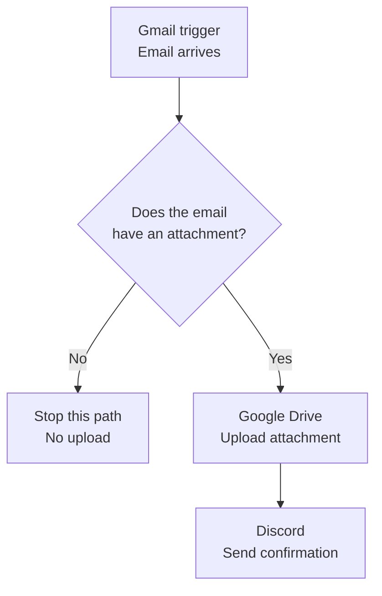

# What Is n8n, and Why Is It a Popular Automation Tool?

> **Goal:** Understand what n8n is, learn its basic building blocks, and follow a first practical workflow that saves Gmail attachments to Google Drive and sends a Discord notification.

## Learning objectives

By the end of this chapter, you should be able to:

- Explain what n8n does in simple language.
- Describe the three main node categories introduced in the lesson.
- Understand the lesson's reasons for choosing n8n.
- Trace the Gmail → Filter → Google Drive → Discord workflow.
- Explain why workflows should first be mapped in plain language.
- Identify which parts of the demo are simplified and need more work for a robust, real-world workflow.

## 1. What is n8n?

 n8n is an **open-source or source-available automation platform** for connecting apps, creating custom workflows, and building AI-powered workflows or agents. The central idea is to connect individual steps so information can move between services and tasks can run automatically.

Think of n8n as a visual workspace in which each step is represented by a **node**. Nodes are connected to form a **workflow**.

### What can a workflow do?

- Start when an event happens, such as an email arriving.
- Filter, route, or transform information.
- Move data between connected applications.
- Perform an action, such as uploading a file or sending a message.
- Use code, HTTP requests, or AI services when a workflow needs more flexibility.

> **Beginner tip:** You do not need to understand every node or expression immediately. First understand the job each step performs and how the data moves to the next step.

## 2. Why n8n?

three main reasons.

| Reason | What it means | Practical consideration |
|---|---|---|
| Workflow-based pricing | billing is based on workflow executions rather than every individual task or step. | Pricing plans can change; check the current official pricing before making a decision. |
| Hosting and control | cloud and self-hosted options, giving users different levels of control over their environment and data. | Self-hosting requires you to manage deployment, updates, security, backups, and uptime. |
| Complex workflows and AI |  branching, filtering, merging, data transformation, Code nodes, HTTP nodes, and AI integrations. | More flexibility also means you need to test logic, credentials, permissions, and error paths carefully. |

### n8n compared with Zapier and Make

Here, We have **Zapier** and **Make.com** as alternatives. Per-task or per-operation pricing can become difficult to predict in complex workflows in  Zapier and Make.com, while n8n's hosting flexibility and support for advanced logic.

## 3. Core concepts: workflows and nodes

### Workflow

A workflow is a group of connected steps designed to complete a process.

### Node

A node is an individual step in the workflow. A nodes may start the workflow, process or route data, connect to services, perform calculations or AI analysis, send messages, or save information.

### Three broad node categories

| Node category | Main purpose | Examples |
|---|---|---|
| **Trigger node** | Starts the workflow when an event or schedule occurs. | A Gmail email arrives, a Google Sheets row is added, a CRM entry appears, or a scheduled time is reached. |
| **Data transformation / routing node** | Filters, segments, routes, combines, or transforms data. | A Filter node checks whether an email has an attachment. |
| **Action node** | Performs an outcome or task. | Upload a file to Google Drive; send a message to Slack, Teams, WhatsApp, Telegram, Discord, or email; create a document or database record. |

### Mental model

A real workflow may contain several processing steps, branches, or error-handling paths.

## 4. First practical workflow: save Gmail attachments to Google Drive

The lesson's hands-on example uses three services:

- **Gmail** — detect an incoming email and access its attachment.
- **Google Drive** — store the attachment in a selected folder.
- **Discord** — send a confirmation message.

First writes the process in plain English on a sticky note. This is an important habit: map the business process before configuring individual nodes.

### The workflow plan

1. Listen for incoming emails.
2. Check whether the email has an attachment.
3. If an attachment exists, upload it to a chosen Google Drive folder.
4. Send a Discord message confirming that the attachment was saved.

### Flowchart

## 5. Understanding each step

### Step 1 — Gmail trigger

The trigger fetches an email event for testing.Opens the Gmail trigger node and inspects its output, which contains email information such as the message ID, labels, headers, subject, and body. The attachment is available in the binary data section.

**Key idea:** A trigger supplies the initial data that later nodes will use.

### Step 2 — Filter node

The Filter node checks whether attachment data exists. If the condition is satisfied, the item is kept and the workflow continues. If not, that item does not continue through the kept-item path.

**Key idea:** A filter prevents later steps from running on data that does not meet the required condition.

### Step 3 — Google Drive node

Configures Google Drive credentials, selects a file upload operation, and chooses a destination folder. The file comes from the preceding workflow data. The node's output contains properties about the uploaded file, which later nodes can use.

**Key idea:** Credentials authorize a node to access an external service. Use only the permissions the workflow needs, and never share secret credential values in notes or screenshots.

### Step 4 — Discord node

The Discord node uses information from earlier nodes—especially the email subject—to compose a confirmation message. The message is sent to the configured Discord channel.

**Key idea:** Later nodes can use data produced by earlier nodes, not only the immediately preceding step.

## 6. What does a successful test tell you?

Runs a test and checks that:

- The Gmail trigger fetched an email.
- The filter kept the email because an attachment was present.
- Google Drive uploaded the file.
- Discord received a confirmation message.
- The nodes showed successful execution in the demo.

A successful test is evidence that the tested path worked with the tested data and configuration. It does **not** prove that every possible email, attachment type, permission issue, or failure scenario is handled.

## 7. Important limitation in the demo

Note that the simple workflow uses a configured file name and does not yet robustly handle multiple attachments. A later lesson is promised for handling multiple files and making the workflow more robust.

Before relying on a similar workflow for real work, consider testing:

- Emails with no attachment.
- Emails with one attachment.
- Emails with several attachments.
- Duplicate emails or repeated executions.
- Unsupported file types or unusually large files.
- Expired or insufficient service credentials.
- Google Drive upload failures.
- Discord notification failures.

These are practical testing suggestions derived from the demo's limitations; the transcript does not claim that all of them were implemented.

## 8. Best practices for learning n8n

### Map the process first

Describe the business process in plain English before building nodes. Identify the trigger, data checks, routes, actions, and expected result. Use visual mapping tools such as Miro and draw.io.

### Start small and iterate

Build a small part of the workflow, test it, and then add the next part. This makes problems easier to isolate.

### Test and optimize thoroughly

Test the workflow before using it in production. An error in an automated process can repeat many times, so consider edge cases as well as the happy path.

### Monitor and maintain

Watch executions, investigate errors, and update the workflow when requirements change. Automation is not a one-time setup that never needs attention.

### Pre-flight checklist

- [ ] Is the workflow mapped in plain language?
- [ ] Is the trigger clear?
- [ ] Are the filtering rules and branches clear?
- [ ] Does each node receive the data it expects?
- [ ] Have I tested both matching and non-matching inputs?
- [ ] Are credentials configured securely?
- [ ] Do I know how I will notice and investigate failures?
- [ ] Have I tested multiple attachments if that use case matters?

## 9. Glossary

| Term | Beginner-friendly meaning |
|---|---|
| **n8n** | A workflow automation platform used to connect services and automate processes. |
| **Workflow** | A connected sequence of configured steps. |
| **Node** | One step in a workflow. |
| **Trigger** | A node or event that starts a workflow. |
| **Filter** | A step that allows only data meeting specified conditions to continue along a path. |
| **Data transformation** | Changing or preparing data for later steps. |
| **Credential** | Authentication information that allows a node to access a service. |
| **Binary data** | Data used for files such as attachments, rather than ordinary text fields alone. |
| **Expression** | A dynamic value or reference used in node configuration. |
| **Self-hosting** | Running the software in an environment you manage. |
| **Vendor lock-in** | Dependence on a provider that makes moving away or changing systems difficult. |

## 10. Active recall — test yourself

Try to answer before revealing the answer.

<strong>1. What is n8n?</strong>

A workflow automation platform that connects apps and services so configured steps can run automatically. The lesson also discusses building AI-powered workflows and agents.

<strong>2. What are the three broad node categories described?</strong>

Trigger nodes, data transformation/routing nodes, and action nodes.

<strong>3. What does the Filter node check in the demo?</strong>

Whether the incoming email has an attachment. The kept path continues to the upload step.

<strong>4. Which three services are used in the example?</strong>

Gmail, Google Drive, and Discord.

<strong>5. What is the limitation here ?</strong>

The simple demo does not fully handle multiple email attachments; a later lesson is promised to cover that more robust use case.

<strong>6. Does a successful test prove a workflow is production-ready?</strong>

No. It proves that the tested path worked with the tested configuration. Other inputs and failure cases still need testing.

## 11. Chapter summary

- n8n connects nodes into workflows that automate tasks across services.
- The lesson highlights hosting flexibility, its stated pricing model, and support for complex and AI-powered workflows.
- The three node categories introduced are trigger, data transformation/routing, and action.
- The practical workflow is Gmail trigger → attachment filter → Google Drive upload → Discord notification.
- The demo is intentionally basic; multiple attachments and more robust handling are left for later lessons.

**Next topic in the course:** a deeper look at the n8n interface and installation options.

