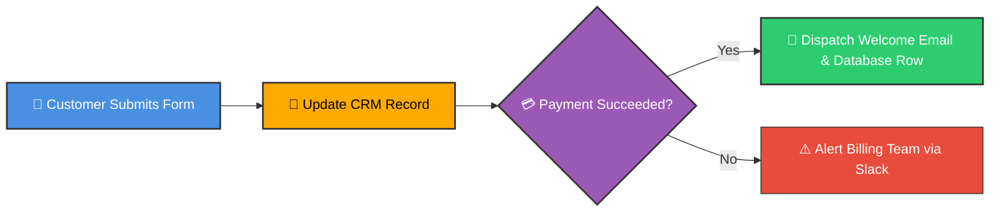
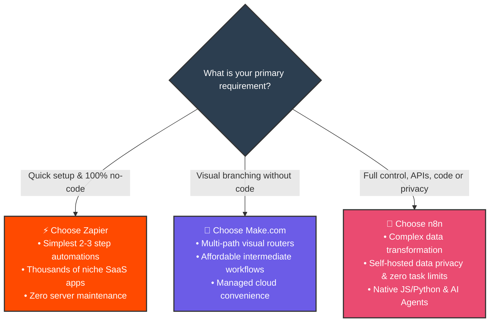
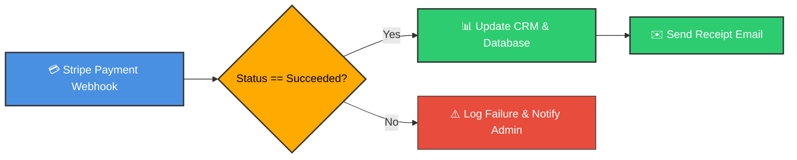

# ⚖️ n8n vs Make.com vs Zapier

  <a href="03_Chapter_What_is_n8n.md">⬅️ Prev: What is n8n</a> •
  <a href="../README.md">Main Hub</a> •
  <a href="../2_getting%20started/01_Cloud_Setup.md">Next: Getting Started (Cloud Setup) ➡️</a> •
  <a href="https://github.com/shashilabs-io/n8n-docs">GitHub Repository</a>

---

## 🧭 How to Use This Guide

> [!TIP]
> **Purpose:** Understand the core architectural differences, pricing models, and functional trade-offs between the three leading workflow automation platforms so you can choose the optimal tool for your project.

### 🎯 Key Outcomes of this Chapter:
- Master the **fundamental vocabulary** of workflow automation.
- Compare Zapier, Make.com, and n8n across **15 critical technical dimensions**.
- Evaluate the **per-task vs per-operation vs per-execution** billing models.
- Follow an interactive **decision flowchart** tailored to real business requirements.
- Analyze a worked payment-routing workflow across all three platforms.

---

# 1. The Core Problem These Tools Solve

Modern knowledge work frequently requires moving critical data between CRM records, emails, spreadsheets, cloud storage, databases, and third-party SaaS tools. Performing these transfers by hand wastes valuable engineering time and introduces avoidable human errors.

A **workflow automation tool** acts as the digital connective tissue between these services, executing rules and moving payloads without human intervention.

### 🏆 The 3 Platforms at a Glance

| Platform | Core Identity | Sweet Spot |
|---|---|---|
| **Zapier** | The pioneer of consumer-grade no-code automation. | Simple linear tasks, non-technical teams, and instant access to 7,000+ app connectors. |
| **Make.com** | Visual drag-and-drop workflow canvas with routers and filters. | Intermediate visual pipelines requiring clean multi-path branching without writing code. |
| **n8n** | Fair-code, developer-friendly automation engine with native code execution. | Complex data pipelines, custom APIs, AI agent workflows, and privacy-sensitive self-hosting. |

---

# 2. Essential Terminology

| Term | Practical Definition |
|---|---|
| **Workflow / Scenario / Zap** | A connected sequence of steps executing an automated process. |
| **Node / Module / Step** | A single block in a workflow (e.g. checking an inbox, parsing JSON, updating Postgres). |
| **Trigger** | The event that starts the execution (webhook, cron timer, or event listener). |
| **Branch / Router / Path** | Logic that evaluates conditions to send data down alternate execution paths. |
| **Loop** | Repeating an action across an array of items (e.g., iterating through 50 invoice rows). |
| **API** | Application Programming Interface allowing systems to communicate programmatically. |
| **Webhook** | Real-time HTTP push notification sent from one service to another when an event occurs. |
| **Self-Hosting** | Running an automation engine on your own server (Docker, VPS) rather than a vendor's cloud. |
| **Execution** | A single complete run of a workflow from start to finish. |
| **Error Handling** | Defined fallback routines (retries, alerting, dead-letter queues) executed when a step fails. |

---

# 3. The 15 Comparison Dimensions

### 1️⃣ Pricing Model (The Most Critical Difference)
- **Zapier (Per Task):** Charges for every single action step. A 5-node workflow processing 1,000 leads consumes **5,000 tasks**, causing costs to escalate rapidly.
- **Make.com (Per Operation):** Charges per module operation. Even simple data checks or filter evaluations count toward your quota.
- **n8n (Per Execution):** Charges based on the overall workflow run. A workflow with 25 nodes processing 1,000 items in a run counts as **1 execution**.
> [!IMPORTANT]
> When self-hosting n8n on Docker, there are **zero per-task or per-execution limits**.

---

### 2️⃣ Data Control & Hosting
- **Zapier & Make:** 100% closed-source cloud SaaS. Your data, API secrets, and customer details must traverse their hosted servers.
- **n8n:** Offers both a managed Cloud service and a **self-hosted Docker/NPM deployment**. Ideal for GDPR, HIPAA, and proprietary internal databases.

---

### 3️⃣ App Integrations
- **Zapier:** Leads the industry with 7,000+ pre-built app integrations.
- **Make.com:** Broad catalog of 1,500+ pre-built integrations with visual field mappers.
- **n8n:** 400+ native nodes, plus a universal **HTTP Request Node** that connects to *any* REST or GraphQL API on earth in minutes.

---

### 4️⃣ Handling Complex Workflows & Loops
- **Zapier:** Primarily linear; complex branching requires nested "Paths" which become expensive and clumsy.
- **Make.com:** Excellent visual routers and array aggregators.
- **n8n:** Unmatched control flow: native `If`, `Switch`, `Loop Over Items`, `Merge`, and recursive sub-workflows.

---

### 5️⃣ AI Capabilities & Agentic Orchestration
- **Zapier:** Guided AI assistants with limited prompt and memory customization.
- **Make.com:** Out-of-the-box connectors to OpenAI and Anthropic models.
- **n8n:** Enterprise LangChain architecture. Build autonomous AI agents with tools, vector memory (Pinecone, Qdrant), and custom output parsers directly on the canvas.

---

### 6️⃣ Coding Support
- **Zapier:** Basic JavaScript/Python "Code" action with strict timeout and package restrictions.
- **Make.com:** Minimal coding; relies heavily on built-in visual expression formulas.
- **n8n:** First-class code integration. Run native JS or Python across entire item batches with external npm/pip library support when self-hosted.

---

### 7️⃣ Error Handling & Self-Healing
- **Zapier:** Basic failure notifications and manual error replay.
- **Make.com:** Visual error directives (Resume, Rollback, Ignore, Commit).
- **n8n:** Dedicated **Error Trigger Workflows**. Automatically catch exceptions, log stack traces to Postgres, and dispatch instant Slack/Telegram alerts.

---

### 8️⃣ Collaboration & Workspaces
- **Zapier:** Team plans offer shared folders and central billing.
- **Make.com:** Granular organizational workspaces and team roles.
- **n8n:** Multi-user environments with Role-Based Access Control (RBAC), shared credentials, and project-level isolation.

---

### 9️⃣ User Management
- Variable across plans, but n8n's enterprise tier offers SAML/SSO and unlimited user management, while SaaS alternatives gate seat counts behind high monthly tiers.

---

### 🔟 Internal Data Storage
- **Zapier:** Zapier Tables (lightweight, convenient, but proprietary).
- **Make.com:** Data Stores (key-value storage for scenarios).
- **n8n:** In-memory execution data + native first-class nodes for PostgreSQL, MySQL, Redis, Supabase, and MongoDB.

---

### 1️⃣1️⃣ Platform Management API
- **Zapier:** Highly restricted developer API.
- **Make.com:** Robust REST API for managing scenarios and users.
- **n8n:** Comprehensive REST API to programmatically create, trigger, export, and monitor workflows from external code.

---

### 1️⃣2️⃣ Enterprise Governance
- n8n provides Git version control integration, environment variable management, audit logs, and on-premises air-gapped deployment options.

---

### 1️⃣3️⃣ Scalability & High Volume
- High-volume pipelines (e.g. 500,000 events/month) quickly become cost-prohibitive on Zapier/Make. n8n scales horizontally with worker queues powered by Redis.

---

### 1️⃣4️⃣ Community & Ecosystem
- **Zapier:** Massive generalist business community.
- **Make.com:** Thriving agency and automation consultant network.
- **n8n:** Highly technical, vibrant open-source developer forum, Discord, and public GitHub repository.

---

### 1️⃣5️⃣ Workflow Design Experience
- **Zapier:** Top-down vertical list. Clean for 3-step zaps, difficult for complex flows.
- **Make.com:** Circular node diagram. Highly visual and enjoyable.
- **n8n:** Clean horizontal Directed Acyclic Graph (DAG) canvas. Intuitive input/output data inspection side-by-side with code.

---

# 4. Master Feature Comparison Matrix

| Feature Dimension | Zapier | Make.com | n8n |
|---|---|---|---|
| **Billing Model** | Per Task (Action) | Per Operation | **Per Execution (or Free Self-Hosted)** |
| **Hosting Options** | Cloud Only | Cloud Only | **Cloud OR Self-Hosted (Docker/NPM)** |
| **Data Privacy** | Vendor Hosted | Vendor Hosted | **Full Sovereignty (On-Premises)** |
| **Prebuilt Integrations** | 7,000+ | 1,500+ | 400+ (Plus Universal HTTP Node) |
| **Complex Logic & Loops** | Basic | Moderate | **Advanced (Native Loops, Merge, Switch)** |
| **Custom Code** | Restricted JS/Python | Minimal | **Full JavaScript & Python** |
| **AI & LangChain Agents** | Basic | Moderate | **Full Agentic Tooling & Vector Memory** |
| **Error Handling** | Basic Logs | Visual Directives | **Dedicated Error Trigger Workflows** |
| **Database Connections** | Add-on Tables | Built-in Data Stores | **Direct SQL / NoSQL / Redis Nodes** |
| **Cost at High Scale** | $$$$ (Very Expensive) | $$ (Moderate) | **$ (Predictable or Zero License Fee)** |

---

# 5. Interactive Decision Guide

---

# 6. Practical Scenario: Customer Payment Follow-up

Consider a workflow that listens for a Stripe charge and routes the outcome:

- **In Zapier:** Requires multiple multi-step Zaps or Paths. Runs up task counts quickly.
- **In Make.com:** Cleanly built using a visual Router and Filter.
- **In n8n:** Easily built with an `If` node, a `Postgres` action, and an attached `Error Trigger` for maximum reliability.

---

# 7. Pre-Selection Checklist

Before locking your team into an automation vendor, review these questions:

- [ ] **Data Sensitivity:** Must data stay within your private cloud/network (HIPAA/GDPR)?
- [ ] **Execution Volume:** How many thousands of times will this run monthly?
- [ ] **Node Depth:** Do your workflows exceed 5+ steps?
- [ ] **API Extensibility:** Do you need custom headers, pagination, or unsupported endpoints?
- [ ] **Custom Logic:** Will you need JavaScript, regex, or mathematical calculations?
- [ ] **Maintenance Appetite:** Does your team have the capability to run a Docker container if self-hosting?

---

# 8. Active Recall Quiz

<strong>1. What is the fundamental billing difference between Zapier, Make, and n8n?</strong>

Zapier bills per **task** (action step), Make bills per **operation**, and n8n bills per **workflow execution** (with unlimited steps per run, or free self-hosting).

<strong>2. Which platform is best suited when customer data cannot leave your own VPC?</strong>

**n8n**, because it can be completely self-hosted on your private servers using Docker or Kubernetes.

<strong>3. If an app does not have a pre-built node in n8n, how can you still connect to it?</strong>

By using n8n's universal **HTTP Request Node** to interact directly with the app's REST or GraphQL API.

<strong>4. In what scenario would Zapier be preferred over n8n?</strong>

When a non-technical team needs a quick 2-step automation with zero infrastructure setup and requires a niche app that only Zapier supports natively.

<strong>5. What makes n8n particularly suited for building modern AI workflows?</strong>

Its native integration with the **LangChain framework**, providing visual access to LLMs, vector memory stores, document loaders, and autonomous AI agents with custom tools.

---

# 9. Key Takeaways

1. **Tool selection should be driven by architecture, not just brand recognition.**
2. **Zapier** is the easiest starting point for simple, low-volume automations.
3. **Make.com** offers visual elegance for multi-path routing.
4. **n8n** is the power tool for engineers, high-volume data pipelines, AI builders, and teams requiring data privacy and self-hosting.

---

  <b>Next Step:</b> Advance to <a href="../2_getting%20started/01_Cloud_Setup.md">Getting Started: Cloud Setup</a> or return to the <a href="../README.md">Main Hub</a>.

