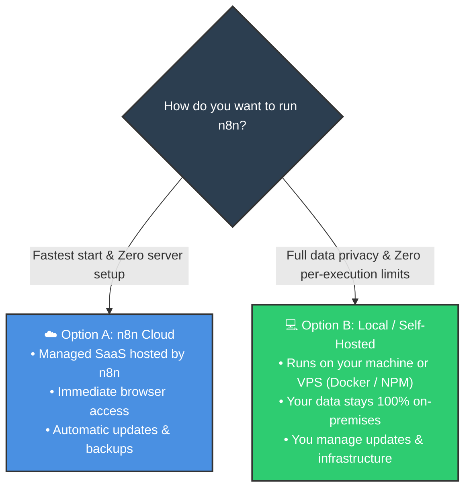
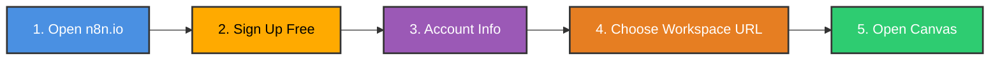
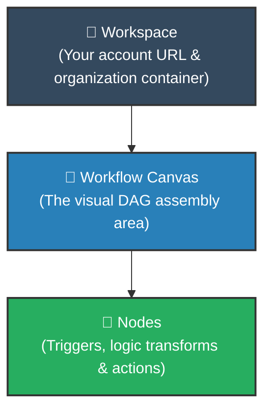

# ☁️ Setting Up n8n Cloud

  <a href="../1_n8n_Introduction/04_vs_Make_Zapier_Beginner_Guide.md">⬅️ Prev: n8n vs Make vs Zapier</a> •
  <a href="../README.md">Main Hub</a> •
  <a href="02_Local_Installation_NPM.md">Next: Local NPM Setup ➡️</a> •
  <a href="https://github.com/shashilabs-io/n8n-docs">GitHub Repository</a>

---

## 🧭 How to Use This Chapter

> [!TIP]
> **Practical Foundation:** This lesson marks the transition from conceptual automation theory to hands-on execution. You will compare the managed cloud experience with self-hosting, complete the cloud sign-up flow, and open your first workflow canvas.

### 🎯 Key Outcomes of this Chapter:
- Contrast **n8n Cloud** with **self-hosting** across maintenance, control, and setup time.
- Walk through the **8-step registration process** on n8n Cloud.
- Understand the core hierarchy: **Workspace &rarr; Workflow Canvas &rarr; Nodes**.
- Follow an interactive setup checklist and avoid common onboarding pitfalls.

---

# 1. The Two Main Ways to Use n8n

### Option A — n8n Cloud
n8n Cloud is the official hosted offering. You access and configure it entirely through a web browser without managing any backend infrastructure.

- **Advantages:**
  - **Zero Setup Time:** Open the website, register, and start automating in 2 minutes.
  - **No Infrastructure Maintenance:** Backups, upgrades, and high availability are managed automatically.
  - **Pre-configured Environment:** Built-in email dispatch and pre-configured environment credentials.
  - **Ideal for Beginners:** Focus immediately on learning nodes, logic, and data flow.
- **Trade-offs:**
  - Free trial access is time-limited; long-term use requires an active subscription.
  - Less direct control over low-level operating system packages compared to on-prem servers.

### Option B — Local or Self-Hosted n8n
Self-hosting is intended for developers, technical teams, and security-conscious organizations.

- **Advantages:**
  - **Total Data Sovereignty:** API keys, customer databases, and files never leave your VPC.
  - **Uncapped Executions:** No monthly execution caps or per-workflow surcharges.
  - **Custom Extensions:** Install custom npm packages or Python modules directly into your container.
- **Responsibilities:**
  - You are responsible for server provisioning, reverse proxies (SSL), backups, memory tuning, and version upgrades.

---

# 2. Cloud vs Self-Hosting: Side-by-Side Comparison

| Dimension | n8n Cloud | Local / Self-Hosted n8n |
|---|---|---|
| **Initial Setup** | Instant registration via browser | Install via `npx n8n` or Docker container |
| **Infrastructure Management** | 100% handled by n8n team | Handled by you or your DevOps team |
| **Beginner Friendliness** | **Highest** (No terminal required) | Moderate (Requires basic CLI / Docker comfort) |
| **Data Residency & Privacy** | Stored on n8n Cloud servers | **100% Local / On-Premises** |
| **Maintenance Burden** | Zero server maintenance | Requires managing updates, backups & security |
| **Best Suited For** | Beginners & teams wanting zero ops | Engineers, privacy compliance & high volume |

> [!NOTE]
> **Decision Rule:** If your immediate goal is to learn workflow building with minimum friction, start with **n8n Cloud** (or quick local `npx n8n`). You can easily export workflows as JSON and import them into a self-hosted instance at any time!

---

# 3. Step-by-Step: Registering for n8n Cloud

### Step 1 — Open the Official Website
Navigate to **[n8n.io](https://n8n.io/)** in your web browser.

### Step 2 — Select the Free Start Option
Click **Get started for free** or **Start free trial** on the homepage.

### Step 3 — Complete Registration Details
Fill in your registration details:
- Full Name
- Work or personal email
- Secure password
- Unique workspace/instance name

> [!WARNING]
> Your workspace name will become part of your public access URL (e.g. `yourname.app.n8n.cloud`). Choose a clean name and do not include confidential or sensitive company identifiers.

### Step 4 — Review Trial Terms
New sign-ups typically receive a **14-day free trial** without requiring upfront payment information. Always review the current terms displayed on the sign-up page.

### Step 5 — Complete Onboarding Preferences
Indicate your role, team size, and coding comfort level. These responses optimize your starter template recommendations.

### Step 6 — Team Invites (Optional)
You can invite collaborators or click **Skip** if you are learning independently.

### Step 7 — Launch the Workspace
Click **Go to workspace**. Your dedicated n8n instance will initialize and load into your browser.

### Step 8 — Open the Canvas
Click the **+ Create workflow** button. You are now inside the visual canvas and ready to add your first node.

---

# 4. Three Core Concepts to Know Before Building

1. **Workspace:** The overarching administrative environment where your workflows, credentials, community templates, and execution histories are organized.
2. **Workflow Canvas:** The infinite interactive grid where you visually connect nodes using drag-and-drop handles.
3. **Node:** A modular step on the canvas responsible for listening for an event, altering data, or executing an external API call.

---

# 5. Pre-Flight Cloud Setup Checklist

- [ ] Can access the official n8n website without network blocks.
- [ ] Registered with a valid, accessible email address.
- [ ] Created and securely stored a master password.
- [ ] Picked a clean, non-confidential workspace name for your URL.
- [ ] Completed sign-up and confirmed your email address.
- [ ] Opened your workspace dashboard successfully.
- [ ] Clicked **Create workflow** and verified that the blank canvas loads.

---

# 6. Common Setup Gotchas & Troubleshooting

| Symptom | Likely Cause | Solution |
|---|---|---|
| **Registration page differs from video** | n8n frequently updates its UI and website flow. | Follow the current on-screen buttons; the underlying steps remain the same. |
| **Email domain rejected** | Some free trial flows restrict disposable email providers. | Use a standard Gmail, Outlook, or corporate work email domain. |
| **Workspace name unavailable** | The chosen subdomain is already claimed globally. | Append a unique identifier, city, or team acronym. |
| **Canvas fails to load** | Browser extension (ad blocker or privacy shield) blocking WebSockets. | Temporarily disable aggressive script blockers for your `*.n8n.cloud` domain. |

---

# 7. Active Recall Quiz

<strong>1. What is the single biggest benefit of n8n Cloud for a beginner?</strong>

It provides an instant browser-accessible canvas with zero server configuration, software installation, or DevOps maintenance.

<strong>2. What is one major reason an enterprise might choose self-hosted n8n over Cloud?</strong>

To maintain strict data sovereignty, ensuring that sensitive customer data, internal database queries, and private tokens never leave their internal network.

<strong>3. Why does your choice of workspace name matter during Cloud registration?</strong>

The workspace name directly forms your public subdomain URL (e.g. `companyname.app.n8n.cloud`), making it visible in webhook URLs and browser address bars.

<strong>4. If you start on n8n Cloud, are you locked into Cloud forever?</strong>

**No.** Workflows in n8n can be exported as simple JSON files with a single click and seamlessly imported into any self-hosted instance (or vice versa).

---

# 8. Key Takeaways

- You now know the functional differences between **n8n Cloud** and **Self-Hosted** deployments.
- You have the steps required to register for n8n Cloud and reach the workflow canvas.
- The fundamental hierarchy is **Workspace &rarr; Canvas &rarr; Nodes**.

---

  <b>Next Step:</b> Learn how to run n8n on your own machine in <a href="02_Local_Installation_NPM.md">Chapter 2: Local Installation via NPM</a> or jump directly to <a href="03_Interface.md">Chapter 3: Mastering the Interface</a>.

