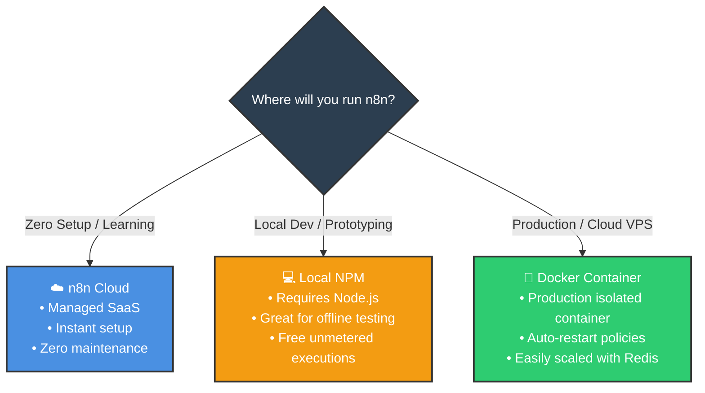
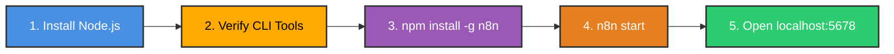

# 💻 Installing n8n Locally with npm

<p align="center">
  <a href="01_Cloud_Setup.md">⬅️ Prev: Cloud Setup</a> •
  <a href="../README.md">Main Hub</a> •
  <a href="03_Interface.md">Next: Mastering the Interface ➡️</a> •
  <a href="https://github.com/shashilabs-io/n8n-docs">GitHub Repository</a>
</p>

---

## 🧭 How to Use This Chapter

> [!TIP]
> **Developer Setup:** This guide covers installing and running n8n on your own local development workstation using Node.js and `npm`. You will gain complete environmental control, unmetered execution quotas, and offline-friendly workflow testing.

### 🎯 Key Outcomes of this Chapter:
- Understand the trade-offs between **Cloud**, **Local NPM**, and **Docker** deployments.
- Verify your local environment (**Node.js** and **npm**).
- Execute the global installation and launch the local engine on `localhost:5678`.
- Complete the initial local Owner account setup.
- Learn version management, upgrade practices, and production security precautions.

---

# 1. Deployment Models: Cloud vs Local NPM vs Docker



### ⚖️ Trade-Off Summary

| Dimension | n8n Cloud | Local NPM Setup | Production Docker |
|---|---|---|---|
| **Runtime Management** | Hosted service manages infrastructure | You manage your machine's Node.js runtime | Container engine manages isolated runtime |
| **Prerequisites** | Modern web browser | Node.js (v18+) & npm | Docker Engine / Docker Compose |
| **Execution Limits** | Subject to plan tier quotas | **100% Unmetered & Free** | **100% Unmetered & Free** |
| **Security Responsibility** | Managed by n8n security team | Local machine user permissions | Container isolation, reverse proxy, SSL |
| **Best Used For** | Beginners & zero-ops teams | **Prototyping, testing & offline work** | **24/7 Production workflows & VPS** |

> [!WARNING]
> **Local Dev &ne; 24/7 Production:**
> Running `n8n start` on your laptop is fantastic for building and testing workflows. However, if your computer sleeps, restarts, or loses power, scheduled triggers will pause. For mission-critical 24/7 production, deploy using Docker on a virtual private server (VPS).

---

# 2. Prerequisites & Verification

Before installing, ensure your environment meets the minimum requirements:
1. **Operating System:** Windows (PowerShell/WSL), macOS, or Linux.
2. **Node.js:** Active LTS version (Node.js 18.x or 20.x recommended).
3. **NPM:** Distributed automatically with Node.js.

### Check Current Installed Versions:
Open your terminal (PowerShell, Terminal, or Bash) and execute:

```bash
node -v
npm -v
```

If version numbers print (e.g. `v20.11.0` and `10.2.4`), your system is ready. If not, download and install the LTS release from [nodejs.org](https://nodejs.org/).

---

# 3. Step-by-Step Installation Walkthrough



### Step 1 — Install n8n Globally via npm
Run the global installation command in your terminal:

```bash
npm install -g n8n
```

*(On macOS or Linux, if you encounter `EACCES` permission errors, configure an npm user directory or run with standard non-root directory permissions).*

> [!TIP]
> **Want to test without installing globally?**
> You can launch a temporary one-off instance using `npx`:
> ```bash
> npx n8n
> ```

### Step 2 — Start the n8n Server
Once installation completes, launch the daemon:

```bash
n8n start
```

Your terminal will initialize the SQLite database (stored in `~/.n8n/`) and display:
```text
Editor is now accessible via:
http://localhost:5678
```

### Step 3 — Open the Web Interface
Open your web browser and navigate to:
👉 **`http://localhost:5678`**

### Step 4 — Create the Local Owner Account
On your first visit, n8n prompts you to establish the primary **Instance Owner**:
- Enter your name, admin email, and a secure password.
- Complete the quick onboarding questionnaire.

> [!IMPORTANT]
> Keep your terminal window open! If you close the terminal or press `Ctrl + C`, the local n8n server process terminates immediately.

---

# 4. Essential CLI Command Reference

| Command | Action |
|---|---|
| `node -v` | Prints installed Node.js runtime version. |
| `npm -v` | Prints installed npm package manager version. |
| `npm install -g n8n` | Globally installs the latest stable release of n8n. |
| `npx n8n` | Runs n8n temporarily without permanent global installation. |
| `n8n start` | Boots the local workflow engine and web server. |
| `npm update -g n8n` | Upgrades global n8n installation to the newest stable release. |
| `npm install -g n8n@1.70.0` | Installs a pinned, specific version of n8n. |

---

# 5. Version Upgrades & Maintenance

When upgrading n8n:
1. **Stop the running instance:** Press `Ctrl + C` in your terminal.
2. **Back up your database:** Copy your SQLite file located at `~/.n8n/database.sqlite` (or export your workflows via the UI).
3. **Run the update command:**
   ```bash
   npm update -g n8n
   ```
4. **Restart n8n:**
   ```bash
   n8n start
   ```

---

# 6. Common Local Troubleshooting Scenarios

| Issue | Cause | Solution |
|---|---|---|
| **`command not found: n8n`** | Global npm bin directory is missing from your system `PATH`. | Reopen your terminal or add the npm global prefix to your system environment variables. |
| **`EACCES: permission denied`** | Insufficient write permissions in global `node_modules`. | Configure npm to use a directory in your home folder or use a Node version manager like `nvm`. |
| **`Port 5678 already in use`** | A previously launched n8n instance or other daemon is bound to port 5678. | Kill the existing process or launch on a different port: `PORT=5679 n8n start`. |
| **Browser displays "Connection Refused"** | The terminal process crashed or was terminated. | Return to terminal, check logs, and run `n8n start` again. |

---

# 7. Production & Security Best Practices

When transitioning from local testing to self-hosted production:
- **Protect Credentials:** Never commit workflow JSON files containing raw API keys to public repositories.
- **Set Up SSL/TLS:** Always place n8n behind a reverse proxy (e.g. Nginx, Caddy, or Cloudflare Tunnel) with HTTPS.
- **Set Encryption Keys:** Define `N8N_ENCRYPTION_KEY` in your environment so credentials stay encrypted in the database.
- **Automate Backups:** Schedule daily snapshots of your database and `.n8n` directory.

---

# 8. Active Recall Quiz

<details>
<summary><strong>1. What is the difference between Node.js and npm?</strong></summary>

**Node.js** is the JavaScript runtime that executes code outside a browser; **npm** is the package manager used to install and distribute Node.js applications like n8n.
</details>

<details>
<summary><strong>2. What does the `-g` flag do during `npm install -g n8n`?</strong></summary>

It installs the package **globally** onto your system path, allowing you to run the `n8n` command from any directory in your terminal.
</details>

<details>
<summary><strong>3. What default URL is used to access the local n8n canvas?</strong></summary>

**`http://localhost:5678`** (`localhost` points to your internal loopback network address `127.0.0.1`).
</details>

<details>
<summary><strong>4. What happens to your workflows if you press `Ctrl + C` in the terminal running n8n?</strong></summary>

The n8n process shuts down immediately. Workflows will cease running until you restart the server with `n8n start`. (Your saved workflows and credentials remain stored safely on disk).
</details>

<details>
<summary><strong>5. Where does local n8n store its database and settings by default?</strong></summary>

In your user profile home directory under the hidden folder **`~/.n8n/`** (specifically in `database.sqlite`).
</details>

---

# 9. Key Takeaways

- Local NPM installation provides a fast, unmetered environment for building and debugging workflows.
- Launching requires just two commands: `npm install -g n8n` followed by `n8n start`.
- The terminal process must remain active for the server to stay online.
- For permanent 24/7 cloud production, Docker containers provide superior reliability and isolation.

---

<p align="center">
  <b>Next Step:</b> Master the visual canvas in <a href="03_Interface.md">Chapter 3: The n8n Interface & Workspace</a> or return to the <a href="../README.md">Main Hub</a>.
</p>
