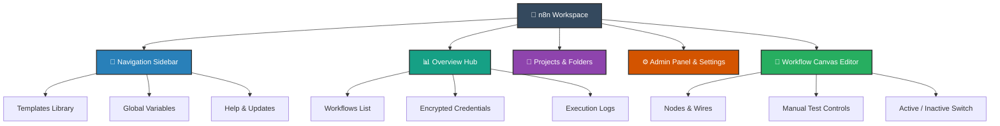
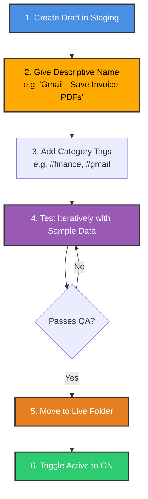
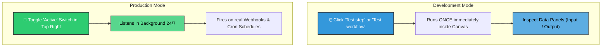
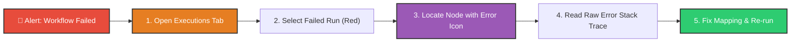

# 🖥️ The n8n Interface: A Complete Beginner’s Guide

<p align="center">
  <a href="02_Local_Installation_NPM.md">⬅️ Prev: Local NPM Setup</a> •
  <a href="../README.md">Main Hub</a> •
  <a href="04_Node_Types.md">Next: Understanding Node Types ➡️</a> •
  <a href="https://github.com/shashilabs-io/n8n-docs">GitHub Repository</a>
</p>

---

## 🧭 How to Use This Chapter

> [!TIP]
> **Interface Mastery:** The n8n interface is your command center for designing, organizing, executing, and diagnosing automated pipelines. Mastering canvas navigation, execution logs, credentials, and settings removes 90% of beginner friction.

### 🎯 Key Outcomes of this Chapter:
- Navigate the **5 primary interface areas** (Sidebar, Projects, Overview, Admin, Canvas).
- Implement a professional **project & folder organization hierarchy**.
- Configure critical workspace settings (timezones, release channels, auto-save policies).
- Differentiate between **Manual Testing** and **Production Activation**.
- Master **Execution Logs** to debug failed runs and inspect raw JSON payloads.

---

# 1. The Big Picture: Interface Architecture

The n8n workspace is organized into five interconnected regions:



---

# 2. Overview: Your Workspace Home

The **Overview** is your central dashboard. When logging in, it presents a consolidated view of your active workflows, configured credentials, and recent execution runs.

| Section | Primary Function | When to Use |
|---|---|---|
| **Workflows** | Listing of all automated processes. | Create, edit, tag, search, or toggle active status. |
| **Credentials** | Encrypted authentication profiles. | Connect OAuth2 tokens, API keys, and database passwords securely. |
| **Executions** | Historical log of every single run. | Audit outputs, inspect payload shapes, and troubleshoot error stack traces. |
| **Projects** | Top-level containers for workspaces. | Separate client work, marketing workflows, and backend data pipelines. |
| **Folders** | Sub-directories inside a project. | Tidy up development drafts, live pipelines, and scratch tests. |

> [!SECURITY]
> **Credentials Protection:** API keys and credentials are encrypted inside n8n's database. Never hardcode private keys into raw workflow fields or export files with decrypted secrets.

---

# 3. Projects & Folders: Professional Organization

As your workflows scale from 3 to 100+, structured organization prevents chaos. 

### 📁 Recommended Hierarchy

```text
n8n Workspace
├── 📁 Client / Production Project
│   ├── 📂 Live Pipelines (Active)
│   └── 📂 Staging & QA
├── 📁 Internal Operations
│   ├── 📂 Slack Bots
│   └── 📂 Data Syncs
└── 📁 Playground & Learning
    ├── 📂 Course Exercises
    └── 📂 Templates to Explore
```

### 🏷️ Workflow Lifecycle Flow



---

# 4. The Admin Panel & Core Settings

The Admin Panel provides operational control over your n8n deployment:

| Setting Category | Practical Purpose |
|---|---|
| **Dashboard / Status** | Check CPU/Memory health, worker status, and uptime. |
| **Release Channel / Version** | Verify whether you are running a stable LTS release or testing prereleases. |
| **Usage & Executions** | Track monthly consumed execution quotas and storage limits. |
| **Billing & Plans** | Manage Cloud subscriptions, team seats, and tier features. |
| **Timezone Management** | Set the global default clock used by Cron and Schedule triggers. |

> [!WARNING]
> **Timezone Mismatch Hazard:**
> If your workflow is set to trigger at **09:00 AM**, but your workspace defaults to UTC (`UTC+0`) instead of your local time (e.g. IST `UTC+5:30`), your scheduled reports will trigger hours off-target! Always verify your timezone in settings.

---

# 5. Templates: Accelerating Development

n8n features a built-in repository of thousands of verified community templates:

```mermaid
flowchart LR
    A["🔍 Search Template Library"] --> B["📥 Import to Canvas"]
    B --> C["🔑 Connect Your Credentials"]
    C --> D["🧪 Test with Mock Data"]
    D --> E["🚀 Deploy to Production"]

    style A fill:#4A90E2,stroke:#333,stroke-width:2px,color:#fff
    style B fill:#FFAA00,stroke:#333,stroke-width:2px,color:#000
    style C fill:#9B59B6,stroke:#333,stroke-width:2px,color:#fff
    style D fill:#E67E22,stroke:#333,stroke-width:2px,color:#fff
    style E fill:#2ECC71,stroke:#333,stroke-width:2px,color:#fff
```



> [!NOTE]
> An imported template is a structural starting point, not an instant production deployment. You must configure your own credentials, map field names, and verify API rate limits.

---

# 6. Manual Testing vs Production Activation

One of the most frequent beginner misconceptions is confusing **Test step** with **Activating**:



> [!IMPORTANT]
> **Always Save Before Leaving:**
> Testing a workflow does **not** automatically save changes to the database! Always press `Ctrl + S` (or `Cmd + S`) after editing.

---

# 7. Execution Logs: The Primary Debugging Hub

Every single run of a workflow generates an **Execution Record**:



### Execution History Settings

| Setting | Purpose | Recommended Setting |
|---|---|---|
| **Save Failed Executions** | Preserves error logs and payloads when a node fails. | **Always Enabled** (Vital for production diagnostics). |
| **Save Successful Executions** | Keeps logs of completed runs. | Enabled during launch; prune periodically in high-volume systems to save disk space. |
| **Save Manual Executions** | Saves test runs launched from the canvas. | Enabled during development. |
| **Workflow Timeout** | Automatically stops hanging runs (e.g. slow external APIs). | Configure for external API pipelines (e.g. 300s). |

---

# 8. Importing & Exporting Workflows

Workflows in n8n are completely portable JSON objects:
- **Duplicate:** Clones a workflow instantly for safe experimentation.
- **Download / Export:** Downloads the entire workflow definition as a `.json` file.
- **Import from File:** Restores a workflow from JSON with nodes, positions, and expressions intact.
- **Import from URL:** Pulls workflow JSON directly from public URLs (e.g. GitHub raw files).

> [!TIP]
> Credentials are automatically stripped from exported workflow JSON files, making them safe to share publicly.

---

# 9. Workspace Mastery Checklist

- [ ] Can navigate comfortably between Sidebar, Overview, and Canvas.
- [ ] Understand the difference between Projects (workspaces) and Folders.
- [ ] Verified that workspace default timezone matches your business operations.
- [ ] Tested saving workflows with `Ctrl + S` / `Cmd + S`.
- [ ] Know how to inspect Input and Output data panels inside a node.
- [ ] Understand that testing in canvas does not activate a background listener.
- [ ] Can locate execution history and read error messages on failed runs.

---

# 10. Active Recall Quiz

<details>
<summary><strong>1. What is the fundamental difference between testing a workflow and activating it?</strong></summary>

Testing runs the workflow **once** on demand using test data inside the canvas. Activating turns on the background listener, enabling the workflow to run automatically whenever real triggers or webhooks fire.
</details>

<details>
<summary><strong>2. Why is configuring the workspace timezone critical?</strong></summary>

Scheduled triggers (Cron nodes) rely directly on the timezone setting. If misconfigured, daily or hourly runs will execute at the wrong time.
</details>

<details>
<summary><strong>3. Where should you look first when an active workflow fails in production?</strong></summary>

In the **Executions tab**. It records the exact failing run, the specific node that threw the exception, the input data it received, and the complete error trace.
</details>

<details>
<summary><strong>4. Are API credentials included when exporting a workflow to a JSON file?</strong></summary>

**No.** n8n strips secret credential keys from JSON exports for security. Only the credential name and node configuration are exported.
</details>

---

# 11. Key Takeaways

- The **Overview** aggregates workflows, credentials, and executions.
- Use **Projects and Folders** early to keep workflows organized by client, department, or status.
- Testing, saving, and activating are distinct operations.
- The **Executions Tab** is your most important tool for debugging and system health.

---

<p align="center">
  <b>Next Step:</b> Master the anatomy of nodes in <a href="04_Node_Types.md">Chapter 4: Node Types</a> or return to the <a href="../README.md">Main Hub</a>.
</p>
