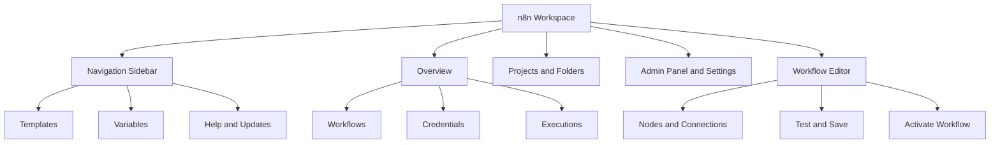
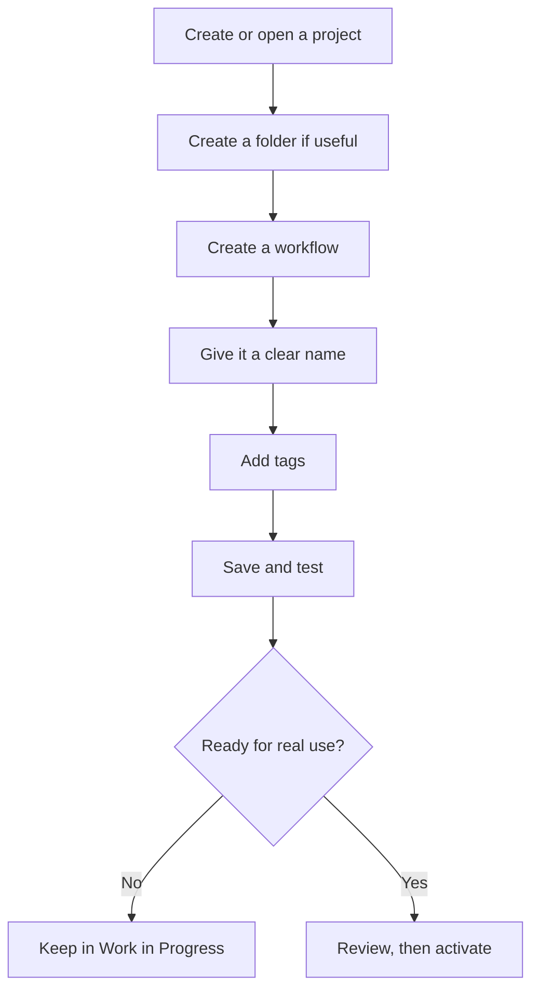
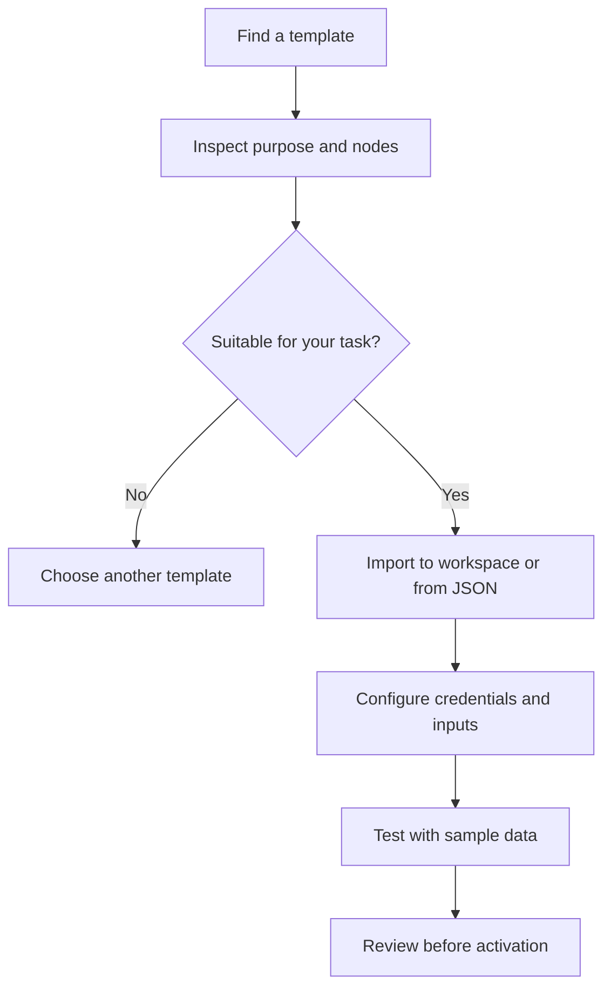
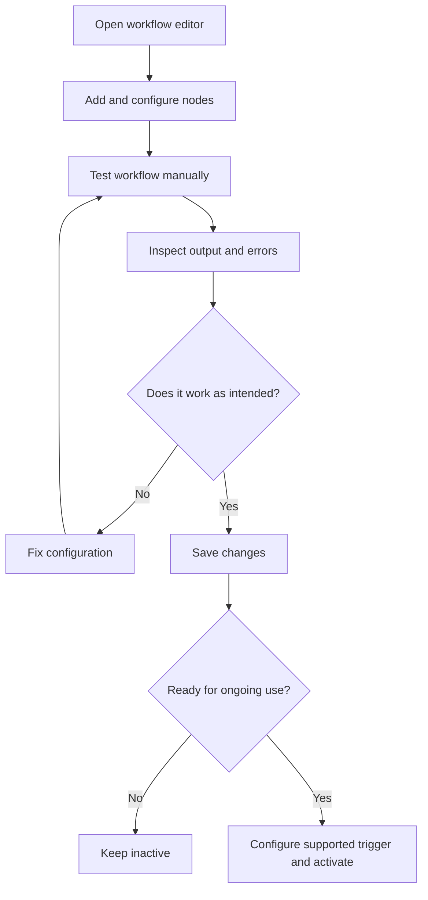
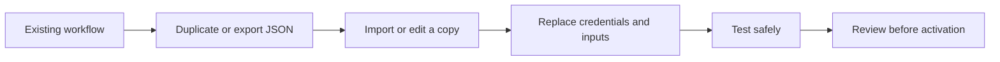

# The n8n Interface: A Complete Beginner’s Guide
## Workspace, projects, settings, templates, executions, and workflow controls

The n8n interface is the control centre for creating, organizing, running, and monitoring automations. Once you understand where the main tools are located, it becomes much easier to build workflows and troubleshoot them.


## 1. The big picture

The interface can be understood as five connected areas:

1. **Navigation sidebar** — move between the overview, projects, templates, variables, help, and other resources.
2. **Projects and folders** — organize workflows by purpose or team.
3. **Overview** — see workflows, credentials, and executions available to you.
4. **Admin Panel and settings** — manage workspace status, plan information, timezone, and account options.
5. **Workflow editor** — build and configure automations on the canvas.

### Interface map



---

## 2. Overview: your workspace home

The **Overview** is the central place to browse the items available in your workspace. Depending on your access and version, it can show workflows, credentials, and execution history.

Use the Overview to:
- find a workflow you want to edit;
- see whether a workflow is active or inactive;
- open credentials and execution records;
- create a workflow;
- create or select a project to keep related work together.

A new workspace may look empty. That is normal: the lists fill up as you create workflows, configure credentials, and run tests.

### Common sections at a glance

| Section | What it is for | When you use it |
|---|---|---|
| Workflows | Your automation definitions | Create, edit, organize, and activate automations |
| Credentials | Saved authentication details for services | Connect n8n to apps and APIs without placing secrets directly in workflow fields |
| Executions | Records of workflow runs | Inspect outputs and investigate failures |
| Projects | Containers for related workflows | Separate work by purpose, team, or client |
| Folders | Subdivisions within a project | Keep drafts, live workflows, and learning examples tidy |

**Security principle:** credentials are sensitive. Share access only with people who need it, and never paste secret keys into public notes or screenshots.

---

## 3. Projects and folders: keep workflows organized

A **project** groups related workflows. A **folder** organizes workflows within a project. They help prevent a workspace from becoming a long, confusing list.

### Example organization

```text
Workspace
├── Personal Project
│   ├── Work in Progress
│   ├── Live Automations
│   └── n8n Course
│       ├── Lesson 1
│       └── Lesson 2
└── Inspiration Project
    ├── Templates
    ├── Useful Examples
    └── Ideas to Try
```

### A practical naming strategy

- **Work in Progress** — unfinished workflows being developed or tested.
- **Live Automations** — workflows used for real tasks.
- **Learning / Course** — practice workflows and lesson exercises.
- **Inspiration** — examples and templates you may adapt later.

Projects and folder availability can depend on the plan and your permissions. If you cannot create another project, check your current plan and workspace permissions.

### Workflow organization flow



**Good naming example:** `Gmail - Save Invoice Attachments` is more useful than `Workflow 7`.

---

## 4. The Admin Panel

The **Admin Panel** provides workspace-level information and settings. Depending on the hosting method and plan, it may show a dashboard, workspace status, version information, usage, and plan controls.

| Admin area | Purpose |
|---|---|
| Dashboard / overview | Review workspace information and usage |
| Open workspace | Return to the workflow workspace |
| Workspace status | Check whether the hosted workspace is online |
| Version | See the n8n version or release channel available in that environment |
| Usage / executions | Understand how much workflow usage has been consumed |
| Plan and billing | Review plan, payment, or upgrade options |
| Workspace settings | Configure shared settings such as timezone |

The exact layout differs between n8n Cloud and self-hosted installations. Some controls may only exist on certain plans or deployment types.

### Workspace restart

A restart is similar to restarting an application service. It may help recover a hosted workspace that has become unresponsive, but it should not be your first response to every failed workflow. First inspect the execution details and error messages when possible. On a self-hosted instance, restart procedures depend on how n8n was deployed.

---

## 5. Workspace settings: version and timezone

### Version

Software releases can differ in stability and available features. Stable releases are generally the safer default for normal use; beta or prerelease versions may expose features earlier but can be less predictable.

Do not change versions casually on a workspace that runs important automations. Check compatibility and release notes before upgrading.

### Timezone

Timezone settings affect time-based triggers and schedules. If a workflow should run at 7:00 a.m. in India, its configured timezone needs to match that intention.

There may be a workspace-level timezone and a workflow-level override. A workflow override can be useful when one workspace serves people or processes in different regions.

**Example:** a daily report intended for 7:00 a.m. India Standard Time should not accidentally be scheduled using a different region’s clock.

### Timezone checklist

- [ ] Confirm the intended local time.
- [ ] Confirm the timezone used by the workspace.
- [ ] Check whether the workflow overrides that timezone.
- [ ] Test the schedule before relying on it for a business-critical task.

---

## 6. Templates: start from a working example

Templates are reusable workflow examples. They can help you learn how nodes are connected and how a common automation is structured.

A typical template workflow is:

1. Open the template library.
2. Search or filter for a relevant use case.
3. Inspect the workflow description and diagram.
4. Import it into your workspace or export/copy it as a JSON file if that option is available.
5. Review every node, credential, URL, and action before running it.
6. Test it with safe sample data.

### Template import path



**Important:** an imported template is not automatically ready for production. It may require credentials, configuration, updated APIs, or changes to fit your process.

---

## 7. Variables and shared values

Variables store values that can be reused in workflow logic. Some n8n versions and plans provide global variables that can be shared across workflows; other values may be scoped to a single workflow or feature.

Examples of values you might reuse:
- a department name;
- a non-secret environment label such as `development`;
- a threshold used by multiple steps.

Do not use ordinary variables as a substitute for a secure credential store. Passwords, API keys, and tokens should be managed through credentials or a suitable secret-management mechanism.

Plan access and exact variable capabilities can change, so check the feature availability in your own workspace.

---

## 8. Personal settings, users, and API access

Personal settings may include profile information, password changes, and two-factor authentication. Enable two-factor authentication when it is available, especially for an account that can access business workflows or credentials.

Depending on the plan and permissions, workspace settings may also provide:
- user and project sharing;
- API key creation;
- external secrets;
- environments;
- single sign-on (SSO), directory integrations, or log streaming.

### What is an n8n API key?

An API key allows an external program to access supported n8n API operations. For example, another application might trigger or inspect a workflow programmatically if the API supports that action and the key has suitable permissions.

Treat API keys like passwords:
- never publish them in source code or public repositories;
- store them securely;
- grant only the required access;
- revoke and rotate them if exposed.

Some advanced controls are plan-dependent. Confirm availability and permissions before designing a workflow around them.

---

## 9. The workflow editor and canvas

The **canvas** is where you assemble a workflow. Each step is represented by a **node**, and connections show how data moves between nodes.

A workflow editor commonly lets you:
- name a workflow and add tags;
- add nodes;
- connect and configure nodes;
- test a workflow manually;
- inspect execution results;
- save changes;
- activate the workflow when its trigger supports production execution;
- adjust canvas zoom and layout.

### Manual trigger vs active workflow

A manual test starts a run when you explicitly ask n8n to test the workflow. A production workflow typically uses an appropriate event, schedule, webhook, or other trigger and must be activated for ongoing automatic operation.



**Remember:** testing is not the same as activating. A successful manual test proves only that the tested run worked with the data and conditions used in that test.

### Save your work

Save after making changes. Do not assume that a successful test automatically saves every edit. If you navigate away before saving, you may lose recent changes.

---

## 10. Executions: see what happened

An **execution** is one run of a workflow. Execution records help you inspect data and understand why a workflow succeeded or failed.

A useful debugging routine is:

1. Open the workflow’s execution history.
2. Select the relevant run.
3. Find the node where the problem occurred.
4. Inspect the input, output, and error details.
5. Correct the node or data mapping.
6. Run another test.
7. Save the corrected workflow.

Execution retention and search features can depend on plan, configuration, and version. Avoid storing unnecessary sensitive data in execution history, and follow your organization’s retention requirements.

### Execution settings

Workflow settings may include options for saving successful, failed, and manual executions, as well as execution timeouts or error-workflow configuration. Use them deliberately:

| Setting | Why it matters |
|---|---|
| Save failed executions | Helps diagnose errors after a run fails |
| Save successful executions | Helps audit or inspect successful runs, but may retain data |
| Save manual executions | Useful when debugging test runs |
| Timeout | Limits how long a run can continue before being stopped, when configured and supported |
| Error workflow | Routes failures into a separate workflow for notification or handling |

Exact names and behaviour may differ across versions. Check current documentation before relying on a setting for critical operations.

---

## 11. Tags, duplicate, move, export, and import

Workflow management menus can provide actions such as:
- **Tags:** label workflows so they can be filtered.
- **Duplicate:** create a copy to experiment without changing the original.
- **Move to folder:** keep related workflows together.
- **Download/export:** save a workflow definition as JSON.
- **Import from file:** load a previously exported workflow.
- **Import from URL:** load a workflow from a supported URL.
- **Delete:** remove a workflow.

### Safe workflow reuse



JSON exports contain workflow configuration. They may expose internal logic, URLs, or other configuration details, so store and share them carefully. Credentials are generally managed separately, but always inspect an export before sharing it.

---


## 12. A beginner’s workspace checklist

- [ ] I can find the Overview and open a workflow.
- [ ] I understand the difference between projects and folders.
- [ ] I can name and tag a workflow.
- [ ] I know where credentials are managed.
- [ ] I can find execution history and inspect a run.
- [ ] I understand the workspace timezone.
- [ ] I know how to save and manually test a workflow.
- [ ] I understand that activation is different from testing.
- [ ] I can identify template import and JSON export/import options.
- [ ] I protect credentials, API keys, and exported workflow files.

---

## 13. Active-recall quiz

1. What is the purpose of the Overview page?
2. How are projects different from folders?
3. Why does timezone matter for scheduled workflows?
4. What is a workflow execution?
5. What is the difference between manually testing and activating a workflow?
6. Why should an imported template be inspected before activation?
7. What should you inspect when a workflow fails?
8. Why should API keys and credential details be protected?
9. What is the purpose of exporting a workflow as JSON?
10. Name three settings that can affect workflow execution or debugging.

### Answer key

1. It provides a central view of accessible workflows, credentials, and executions.
2. Projects group related work; folders organize workflows inside a project.
3. Schedules use time and timezone settings, so a mismatch can make a workflow run at the wrong local time.
4. One run of a workflow.
5. A manual test is started explicitly; activation enables ongoing production behaviour for supported triggers.
6. It may need credentials, configuration changes, or safer test data.
7. The execution record, failing node, input/output, and error message.
8. They can grant access to workflows, data, or external services.
9. To transfer, back up, or reuse workflow configuration.
10. Examples: timezone, timeout, saved execution settings, error workflow, or version.

---

## 14. Key takeaways

- The Overview, projects, and folders help you find and organize automation work.
- The Admin Panel and settings control workspace-level information such as status, plan, version, and timezone.
- Templates can accelerate learning, but they must be reviewed and configured before use.
- The canvas is where nodes are connected and tested.
- Executions are the primary place to investigate what happened during a run.
- Testing, saving, and activation are different actions.
- Credentials, API keys, execution data, and exported JSON files should be handled carefully.

**Recommended practice:** create a project called `n8n Learning`, add folders for `Practice`, `Templates`, and `Completed`, and build a small manual-trigger workflow. Test it, inspect its execution, save it, and only then explore activation with a suitable trigger.
