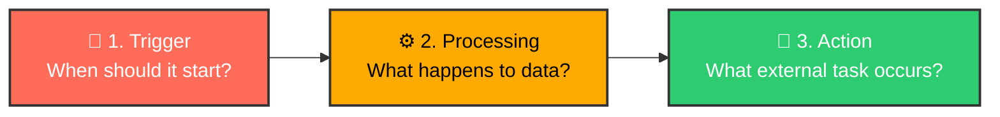
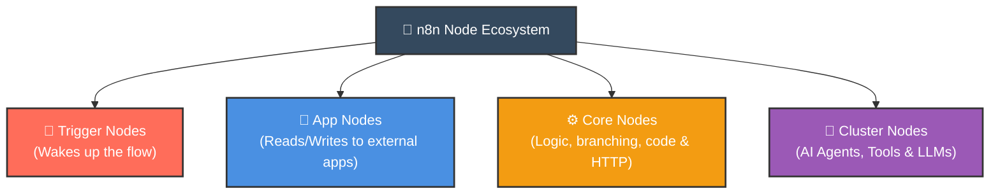
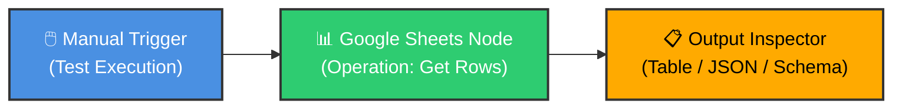
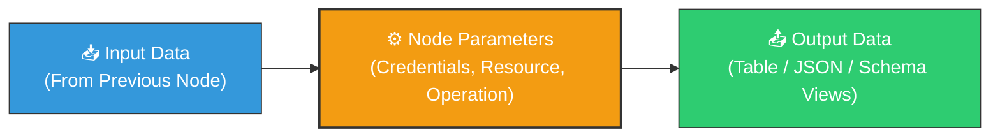

# 🧩 n8n Node Types Explained

  <a href="03_Interface.md">⬅️ Prev: Mastering the Interface</a> •
  <a href="../README.md">Main Hub</a> •
  <a href="05_First_Workflow_Welcome_Email.md">Next: Your First Workflow ➡️</a> •
  <a href="https://github.com/shashilabs-io/n8n-docs">GitHub Repository</a>

---

## 🧭 How to Use This Chapter

> [!TIP]
> **Node Architecture:** Nodes are the foundational building blocks of every automation. Understanding the distinction between Triggers, App Nodes, Core Transform Nodes, and AI Cluster Nodes enables you to construct clean, modular, and resilient workflows without guessing.

### 🎯 Key Outcomes of this Chapter:
- Master the **4 primary node categories** in n8n.
- Build a hands-on data retrieval pipeline: **Manual Trigger &rarr; Google Sheets (Get Rows)**.
- Navigate the **Node Configuration Panel** (Resource, Operation, Authentication, Settings).
- Inspect execution data across **Table, JSON, and Schema** views.
- Accelerate development by 10x using **Pinned Data** and test overrides.

---

# 1. What Is a Node?

A **node** is a self-contained functional step in an n8n workflow. Each node receives incoming items, executes a specific operation (e.g. querying a database, calculating a formula, or dispatching an email), and emits the resulting output items to downstream nodes.

$$\text{Trigger (The Event)} \longrightarrow \text{Process (Rules \& Filters)} \longrightarrow \text{Action (The Write / API Call)}$$

---

# 2. The Four Node Categories

n8n organizes its vast node library into four distinct functional families:

| Category | Primary Role | Concrete Examples |
|---|---|---|
| **1. Trigger Nodes** | Initiates workflow execution upon a webhook, schedule, or event. | *Webhook*, *Schedule (Cron)*, *Stripe Trigger*, *Manual Trigger*. |
| **2. App / Action Nodes** | Interacts directly with external third-party services. | *Google Sheets*, *Slack*, *Airtable*, *HubSpot*, *PostgreSQL*, *AWS S3*. |
| **3. Core Logic Nodes** | Manipulates data structure, evaluates logic, or executes custom code. | *If / Switch*, *Filter*, *Set (Edit Fields)*, *Aggregate*, *Code (JS/Python)*. |
| **4. Cluster Nodes** | Combines interconnected components into complex agentic behaviors. | *AI Agent*, *OpenAI Chat Model*, *Window Memory*, *Vector Store Tool*. |

---

# 3. Step-by-Step Anatomy: The 4 Categories in Depth

### 2.1 Trigger Nodes: Controlling Activation
A trigger node determines *when* the canvas executes.
- **Manual Trigger:** Initiates a run only when you click "Test workflow" (ideal for testing).
- **Scheduled Trigger (Cron):** Fires automatically on time intervals (e.g. daily at 8:00 AM).
- **Webhook Trigger:** Exposes an instant HTTP endpoint listening for real-time third-party pushes.
- **App Event Trigger:** Polls or hooks into app events (e.g. `Gmail: On New Email Received`).

### 2.2 App / Action Nodes: The Operation Pattern
Selecting an application integration is only step one. You must always choose a specific **Resource** and **Operation**:
- *App:* Google Sheets
- *Resource:* Document / Sheet
- *Operation:* `Append row`, `Get many rows`, `Update row`, or `Clear sheet`.

### 2.3 Core Nodes: Data & Flow Control
Core nodes process data without being tied to a single external proprietary service:
- **Filter:** Discards items that fail a condition (e.g. `orderTotal > 100`).
- **Edit Fields (Set):** Adds, modifies, renames, or strips JSON properties.
- **Code Node:** Executes custom vanilla JavaScript or Python when pre-built UI nodes fall short.
- **HTTP Request:** Connects to any arbitrary REST or GraphQL API.

### 2.4 Cluster Nodes: AI & Agentic Systems
Cluster nodes represent a paradigm shift in n8n. Rather than a linear pipe, sub-nodes plug directly into the root cluster:
- An **AI Agent node** receives sub-connections for a **Language Model** (OpenAI/Anthropic), **Memory** (Window buffer), and **Tools** (Google Calendar search, Database query).

---

# 4. Hands-on Tutorial: Read Rows from Google Sheets

Build your first functional data extraction pipeline:

1. **Add Manual Trigger:** Click `+` on the canvas and choose **Manual Trigger**.
2. **Add Google Sheets:** Connect a wire to a new **Google Sheets** node.
3. **Configure Operation:** Set Resource to *Document* and Operation to *Get Rows*.
4. **Authenticate:** Select or connect your Google OAuth2 credentials.
5. **Select Spreadsheet:** Pick your target Google Sheet and specific Tab name.
6. **Execute:** Click **Test step**.
7. **Inspect the Data:** Observe the returned array of row objects in the right-hand panel!

---

# 5. The Node Configuration Panel & Output Views

When you double-click any node, its configuration modal opens:

### 👁️ The 3 Output Views

| View Mode | What It Shows | Best Used For |
|---|---|---|
| **Table View** | Clean spreadsheet-like grid with columns and rows. | Rapid human inspection of tabular data. |
| **JSON View** | Raw array of JSON objects (`[{ "json": {...} }]`). | Debugging nested structures, data types, and syntax. |
| **Schema View** | Summary of property keys, data types (string, number, boolean). | Verifying data contracts before mapping downstream nodes. |

---

# 6. Advanced Node Settings You Must Know

Inside every node's **Settings tab**, four critical execution switches exist:

| Setting | Functionality | Production Recommendation |
|---|---|---|
| **Always Output Data** | Emits an empty item `{}` even if 0 records were found. | Enable when downstream nodes must run regardless of query results. |
| **Execute Once** | Executes the node only once for the entire batch, instead of once per item. | Enable for bulk notifications (e.g. send one Slack message for 50 records). |
| **Retry On Fail** | Automatically re-attempts execution up to 5 times with backoff. | **Always enable** for volatile external HTTP APIs and rate-limited endpoints. |
| **On Error** | Determines behavior on exception (`Stop Workflow`, `Continue`, or `Route to Error Branch`). | Choose `Continue (Using Error Output)` for resilient batch pipelines. |

---

# 7. Pinning Data: 10x Faster Development

> [!TIP]
> **What is Pinning?**
> Clicking the **Pin Data** icon on a node freezes its output data inside the canvas.
> 
> In subsequent tests, downstream nodes read this frozen payload instantly **without making real API calls to Google Sheets, Stripe, or Gmail again**.

### Rules for Safe Pinning:
1. Pin data during layout, field mapping, and expression writing.
2. Unpin data before final production deployment to ensure live dynamic payloads flow properly.

---

# 8. Common Beginner Traps & How to Avoid Them

| Mistake | Consequence | Professional Fix |
|---|---|---|
| **Selecting App, but wrong Operation** | Node executes an unexpected action (e.g. `Append` instead of `Update`). | Double check the *Operation* dropdown carefully. |
| **Generic Node Names** | Workflow becomes unreadable with 10 nodes called `Google Sheets`. | Rename nodes to their explicit job: `Fetch Unpaid Invoices`. |
| **Ignoring Data Types** | A string `"100"` fails a numerical comparison `> 50`. | Use expressions with type casting: `{{ Number($json.price) > 50 }}`. |
| **Testing with Pinned Stale Data** | Workflow works in tests but fails in production because schema changed. | Always run a final end-to-end unpinned test with live inputs. |

---

# 9. Active Recall Quiz

<strong>1. What are the four broad categories of nodes in n8n?</strong>

1. **Trigger Nodes** (Start the workflow).
2. **App / Action Nodes** (Interact with external services).
3. **Core Nodes** (Logic, branching, data transforms, and HTTP).
4. **Cluster Nodes** (AI agents, LLM memory, and tool bindings).

<strong>2. What is the difference between an Application and an Operation?</strong>

The **Application** identifies the service being contacted (e.g. Google Sheets), while the **Operation** specifies the exact task performed (e.g. *Get Rows*, *Append Row*, *Delete Row*).

<strong>3. What does "Pinning Data" do inside the node output panel?</strong>

It freezes the current test output payload in memory so you can build and test downstream nodes instantly without re-fetching data from external APIs.

<strong>4. When should you toggle the "Execute Once" setting on a node?</strong>

When a node receives multiple items (e.g. 20 customers) but you want the action to execute only **one time** (e.g. sending a single summary Slack alert rather than 20 individual messages).

---

# 10. Key Takeaways

- Workflows are built from **Trigger**, **Transform**, and **Action** nodes.
- Always configure the specific **Operation** and inspect data across **Table, JSON, and Schema** views.
- Leverage **Pin Data** to speed up canvas development safely.
- Use descriptive node naming to make workflows self-documenting.

---

  <b>Next Step:</b> Build an end-to-end automated email pipeline in <a href="05_First_Workflow_Welcome_Email.md">Chapter 5: Your First Workflow (Welcome Email)</a> or return to the <a href="../README.md">Main Hub</a>.

