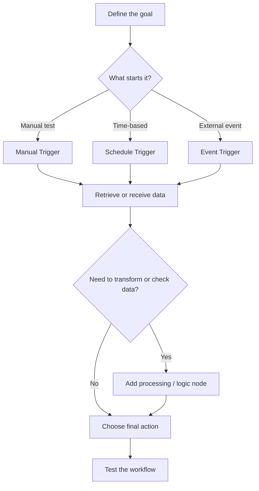
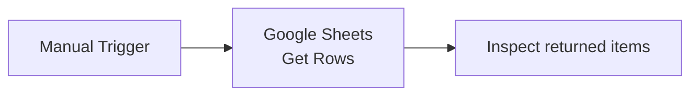
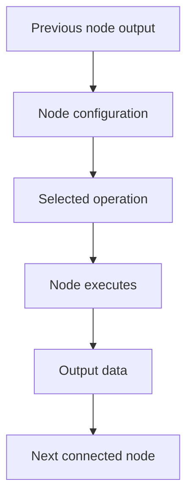
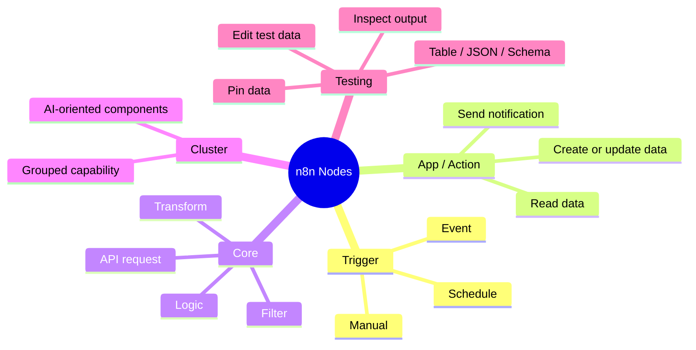

# n8n Node Types Explained
## A beginner-friendly guide to triggers, app/action nodes, core nodes, and cluster nodes

### Learning objectives

By the end of this chapter, you should be able to:

- Explain what a node is and how nodes form a workflow.
- Distinguish trigger nodes, app/action nodes, core nodes, and cluster nodes.
- Build a simple workflow that starts with a manual trigger and retrieves rows from Google Sheets.
- Recognize the main parts of a node’s configuration panel.
- Inspect execution output, understand a data schema at a basic level, and use pinned data while testing.

---

## 1. What is a node?

A **node** is a building block in an n8n workflow. Each node performs a particular job: starting a workflow, retrieving information, transforming data, applying logic, or sending information to another service.

A workflow is a connected sequence of nodes. A common pattern is:

1. **Trigger** — decides when the workflow starts.
2. **Processing** — prepares, checks, or transforms the data.
3. **Action** — carries out a task, often in an external application.

**Example:** When a customer submits a form, a workflow could receive the submission, check the information, and add the customer to a spreadsheet.

The exact nodes depend on the task. Some workflows have only a few nodes; others have many branches and processing steps.

## 2. The four node categories

The source lesson groups n8n nodes into four broad categories. These labels are useful for understanding their roles, although a node’s actual capabilities depend on the specific node and operation you choose.

| Category | Main role | Typical examples |
|---|---|---|
| **Trigger nodes** | Start a workflow when an event occurs or a schedule/manual test starts it | Form submission, new email, schedule, manual trigger |
| **App/action nodes** | Interact with an external application or service | Read or update Google Sheets, send a Slack message, send an email |
| **Core nodes** | Perform general workflow logic or data operations without being primarily an integration with one external app | Filter or transform data, make a generic API request, apply logic |
| **Cluster nodes** | Combine connected nodes into a grouped capability | AI Agent-style functionality and related AI components |

The terms *app node* and *action node* can overlap in everyday explanations: an application integration may offer several operations, such as reading, creating, updating, or deleting records. In practice, focus on what the selected node operation does.

### 2.1 Trigger nodes: deciding when to start

A **trigger node** starts a workflow. Think of it as an alarm clock: it determines when the workflow should wake up and begin its work.

Common examples include:

- A new email arrives.
- Someone submits a website form.
- A new row appears in a spreadsheet.
- A new message is received in a team chat.
- A schedule reaches a configured time.
- You manually start a test run.

A manual trigger is particularly useful while learning because you choose when to run the workflow. It is different from an event-based trigger, which waits for a real event, or a schedule trigger, which runs according to a configured schedule.

### 2.2 App/action nodes: interacting with services

App/action nodes connect a workflow to an application or service. Depending on the selected operation, a node might:

- Retrieve records from a spreadsheet.
- Add or update a row.
- Send an email.
- Post a notification to a team channel.
- Read or write information in a database.

Choosing an application is only part of the setup. You usually also select an **operation**. For example, a Google Sheets integration may offer operations to retrieve rows, append rows, update rows, or work with a spreadsheet in another way.

### 2.3 Core nodes: working with data and logic

Core nodes help control the workflow or work with its data. Examples described in the source include filtering, setting or modifying values, code-based transformations, and generic API requests.

A few useful concepts:

- **Filter:** lets matching data continue according to a condition.
- **Set/Edit Fields-style operation:** adds or changes fields in an item.
- **Code:** allows custom transformation logic when built-in operations are insufficient.
- **HTTP/API request:** communicates with a service through an API when an appropriate integration or operation is not being used.

For example, a workflow could retrieve orders and then keep only orders whose total is greater than a chosen threshold. The condition and field names must match the actual data in your workflow.

### 2.4 Cluster nodes: grouped capabilities

A **cluster node** represents a group of connected components working together to provide a specific capability. AI-related functionality, such as an AI agent with connected tools or model components, is one example.

For a first workflow, it is enough to recognize the category. Start by becoming comfortable with triggers, application integrations, and basic data operations before exploring more complex AI-oriented configurations.

## 3. How to choose the right node

Ask these questions in order:

1. **What should start the workflow?** Choose a suitable trigger.
2. **Where does the data come from?** Choose the application or source.
3. **Does the data need checking or changing?** Add processing or logic nodes.
4. **What final result do you want?** Choose the action that produces it.

## 4. Build a first workflow: retrieve rows from Google Sheets

This example uses a **Manual Trigger** followed by a Google Sheets operation that retrieves rows. It is a learning workflow: the manual trigger lets you test the sequence on demand.

### Workflow overview

### Step 1 — Create a workflow

Open your n8n workspace and create a new workflow. Give it a descriptive name, such as **Read Orders from Google Sheets**.

### Step 2 — Add a Manual Trigger

Add a Manual Trigger as the first node. When you use the workflow’s test control, this node starts the test execution.

A manual trigger is useful for learning and debugging. For a workflow that must run automatically in production, choose a trigger appropriate to the real requirement.

### Step 3 — Add the Google Sheets node

Use the plus button after the trigger and search for **Google Sheets**. Select the integration, then choose the operation that retrieves rows from a sheet. The exact labels may vary across n8n versions.

### Step 4 — Connect credentials

Select an existing Google Sheets credential or create a new one. If creating a credential, follow the authorization flow and review the permissions being requested before granting access.

Credentials allow n8n to authenticate with the external service. Do not paste secret tokens or passwords into ordinary workflow fields, and do not share credential details in screenshots.

### Step 5 — Select the spreadsheet and sheet

Configure the node by selecting:

- The spreadsheet/document containing the data.
- The specific sheet or tab inside that document.
- Any optional filters needed to limit which rows are retrieved.

For the first test, use a sample spreadsheet you control and leave filters unset if you want to retrieve the available rows.

### Step 6 — Test the node

Run the node or test the workflow. If the connection and configuration are correct, the node should return the rows available to it.

Do not assume the output will always contain a particular number of rows. The result depends on the spreadsheet contents, permissions, selected operation, filters, and current configuration.

### Step 7 — Inspect the output

The node output area can help you understand what happened. Depending on the interface and node, you may be able to inspect data in table, JSON, or schema views.

| View | What it helps you understand |
|---|---|
| **Table** | Records arranged in rows and columns |
| **JSON** | The structured data passed between nodes |
| **Schema** | The fields the output contains and the general shape of the data |

A **schema** describes the structure of the data. For example, an order record might contain an order ID, customer name, email address, status, and order date. Your actual fields depend on the spreadsheet.

## 5. Understand the node configuration panel

When you open a node, its configuration panel lets you choose credentials, resources, operations, and other parameters.

Think of the node as a small unit of work:

- **Input:** data received from the previous node, if any.
- **Configuration:** the operation and options you selected.
- **Execution:** n8n performs the configured operation.
- **Output:** the result that can be passed to the next node.

A node that retrieves information may not require meaningful input from the previous node. A node that updates a record may depend on fields received from earlier nodes.

### Rename nodes clearly

A descriptive node name makes a workflow easier to read. For example, rename a generic Google Sheets node to **Get Orders Data**. The name should explain the node’s purpose, not merely repeat the application name.

### Settings you may encounter

The source lesson introduces settings such as:

- **Always Output Data:** controls whether a node can provide output even when its normal result is empty; understand the exact behavior shown in your current n8n version.
- **Execute Once:** changes how often the node operation runs in relation to incoming items.
- **Retry On Fail:** configures retry behavior when execution fails.
- **On Error:** determines how execution should proceed when the node encounters an error, where supported.

These settings affect workflow behavior. Do not enable them automatically; choose them according to the problem you are solving. Their exact labels and available options can vary by version and node.

## 6. Test data, edit output, and pin data

Testing is easier when you can inspect the output of each node instead of running the entire workflow blindly.

### Inspect and paginate results

If a node returns many items, the output viewer may let you change the page size and move through the records. This is a display feature; it does not necessarily change how many records the node retrieved.

### Edit output for testing

Some n8n testing interfaces let you edit or mock node output. This can help you test how later nodes behave with a particular input. Treat edited output as test data, not as proof that the original external system contains those values.

### Pin data

**Pinned data** lets you reuse a captured node output during subsequent tests, rather than fetching the same data again each time. It can save time when testing downstream nodes.

Use pinned data thoughtfully:

- It represents a saved test output, which may become stale if the source data changes.
- A workflow tested with pinned data may behave differently when it runs with fresh data.
- Before relying on a workflow, test the relevant path with realistic, current input and verify the final result.

## 7. A complete mental model

A reliable beginner workflow usually follows this mental model:

**Start → Retrieve → Process → Act → Verify**

Not every workflow needs every stage. The important thing is to identify the trigger, understand the data moving between nodes, configure each operation, and test the result.

## 8. Common beginner mistakes

| Mistake | Why it causes trouble | Better approach |
|---|---|---|
| Choosing an action before deciding how the workflow starts | The workflow may not run when expected | Decide the trigger first |
| Selecting an app but not the right operation | The node may perform a different task than intended | Read the operation name carefully |
| Forgetting credentials or permissions | The external service may reject the request | Verify the account connection and required access |
| Assuming output fields without inspecting data | Later nodes may reference fields that do not exist | Inspect table, JSON, or schema output |
| Renaming every node with generic labels | The workflow becomes hard to understand | Use purpose-based names |
| Treating pinned data as live data | Tests may pass with outdated examples | Re-test with fresh input before production use |
| Ignoring error settings | A failed node may stop or alter the workflow unexpectedly | Decide how failures should be handled |

## 9. Practice exercise

Create a workflow with a Manual Trigger and a Google Sheets node that retrieves rows from a sample spreadsheet.

Checklist:

- [ ] Create and name a workflow.
- [ ] Add a Manual Trigger.
- [ ] Add the Google Sheets integration.
- [ ] Connect a credential and select a spreadsheet and sheet.
- [ ] Test the node.
- [ ] Inspect the returned output.
- [ ] Rename the node to describe its purpose.
- [ ] Try pinning test output, then consider what might change if the spreadsheet changes.

### Knowledge check

1. What is the main responsibility of a trigger node?
2. What is the difference between selecting an application and selecting an operation?
3. What does a schema tell you about output data?
4. Why can pinned data speed up testing?
5. Why should pinned data not be treated as a guarantee of live production behavior?

**Answers**

1. It determines when the workflow starts.
2. The application identifies the integration; the operation specifies the task to perform through it.
3. It describes the structure and fields of the data.
4. It allows captured output to be reused while testing downstream nodes.
5. It may be stale or differ from fresh input, so the workflow should be tested with realistic current data.

## Chapter summary

- Nodes are the building blocks of n8n workflows.
- Trigger nodes start workflows; app/action nodes interact with services; core nodes handle general logic and data work; cluster nodes group components into a capability.
- A practical first workflow is **Manual Trigger → Google Sheets: Get Rows**.
- Credentials, resource selection, operation selection, and node settings determine how an integration behaves.
- Output views help you inspect returned records and understand their schema.
- Editing or pinning output is useful for testing, but fresh data should be used to verify real workflow behavior.
