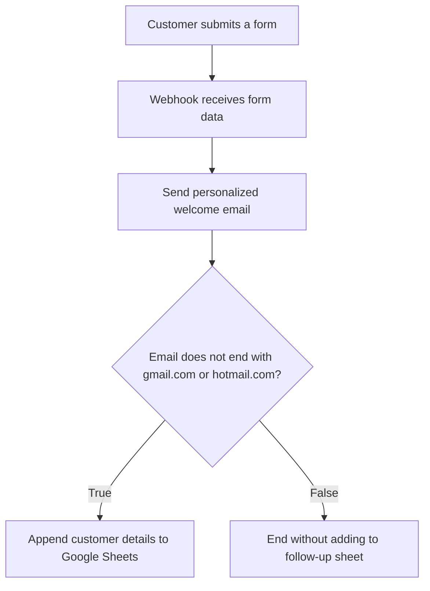
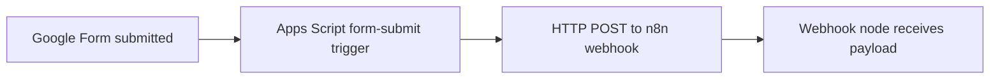
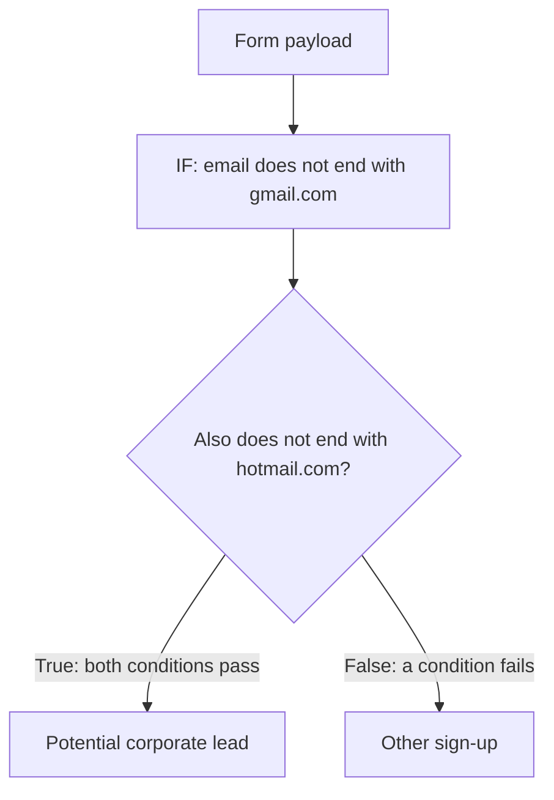

# Build Your First n8n Workflow
## Automatically send welcome emails and route corporate sign-ups

### Learning objectives

By the end of this chapter, you will be able to:

- Explain the purpose of a webhook trigger.
- Connect a form submission to an n8n workflow.
- Send a personalized email using data received from the form.
- Use an IF node to route different kinds of sign-ups.
- Append selected customer details to Google Sheets.
- Test a workflow, inspect its data, and avoid common mapping mistakes.

> **Important:**  Google Forms sends data to an n8n Webhook using Google Apps Script. Other form services may offer their own webhook integrations. Exact interface labels can vary by n8n version.

---

## 1. The business problem

Imagine a business receives new sign-ups through a form. A person currently has to notice each new response, send a welcome email, and record some customers for follow-up. This work is repetitive and can be automated.

The workflow in this chapter does three things:

1. Receives a submitted form.
2. Sends a personalized welcome email to the submitted email address.
3. Checks the email domain and adds sign-ups that pass the chosen condition to a Google Sheet for follow-up.

### Workflow at a glance



This is a teaching example, not a complete business-email verification system. The domain rule is deliberately simple and should not be treated as a reliable way to prove that an email address belongs to a company.

## 2. Understand the workflow components

| Component | Purpose in this workflow |
|---|---|
| **Google Form** | Collects first name, last name, email, and role |
| **Google Apps Script** | Sends the form submission to the webhook URL |
| **Webhook node** | Receives the incoming HTTP request and starts the workflow |
| **Email action node** | Sends a welcome message using values from the submission |
| **IF node** | Checks the email string and sends data down a true or false branch |
| **Google Sheets action** | Appends selected form fields to a follow-up spreadsheet |

## 3. Step 1 — Create the workflow and webhook

Create a new workflow in n8n and add a **Webhook** trigger. A webhook gives an external service a URL to call when an event occurs.

For this example, the form submission is sent as an HTTP **POST** request because the workflow needs to receive data.

### Test URL versus production URL

| URL type | Purpose |
|---|---|
| **Test URL** | Used while testing the workflow. In the approach shown, the webhook must be listening for a test event before the request arrives. |
| **Production URL** | Used when the workflow is configured and activated for real submissions. The external form integration must use the production URL. |

A frequent testing mistake is calling the test URL while the webhook is not listening. In that situation, the test request may not be registered. Start listening for a test event, then submit the form while the listener is active.

### Webhook setup checklist

- [ ] Add a Webhook node.
- [ ] Select the POST method for the incoming form data.
- [ ] Copy the test URL for testing.
- [ ] Start listening for a test event.
- [ ] Send a form submission and inspect the received payload.
- [ ] When ready for production, activate/configure the workflow and update the external integration to use the production URL.

## 4. Step 2 — Send Google Forms submissions to the webhook

The example uses Google Apps Script because the approach in the supplied lesson does not rely on a direct built-in Google Forms webhook option.

The general data flow is:



The Apps Script needs to send the submitted form data to the URL stored in its configuration. Set up a form-submission trigger in Apps Script so the handler runs when the form is submitted.

**Do not paste a live webhook URL or secrets into public documents.** Test URLs and production URLs serve different purposes; replace the URL in the script when switching environments.

The supplied transcript does not include the actual Apps Script source code, so this chapter does not invent a complete script. Use the code associated with your own form integration and verify that the field names in its payload match the fields used in n8n.

## 5. Step 3 — Add an email action

After the Webhook node, add an email-sending action. The lesson uses an AWS SES email action, but the same general workflow idea can be implemented with another supported email provider or SMTP configuration.

Configure the email node with:

- A connected credential for the email service.
- The send-email operation.
- A subject, such as **Welcome!**
- A message body.
- A sender address authorized by the email provider.
- A recipient address taken from the submitted form.

Credentials and sender-domain setup depend on the provider. Review permissions and keep access keys, passwords, and tokens private. For real business use, verify that the sending service is configured to deliver mail reliably and that the sender address is authorized.

### Personalize the message

Instead of writing a fixed message such as `Hello,`, insert the submitted person's first name dynamically.

Example message:

> Hello, [first name],
>
> Thanks for signing up! We have received your details and are happy to welcome you.
>
> Best regards,  
> The Team

The bracketed first name represents a value from the incoming form data; it is not meant to be sent literally.

### n8n expressions

In n8n, an **expression** lets a node configuration use data from the workflow rather than a fixed value. In the supplied example, the incoming payload contains fields under `body`, such as `firstName` and `email`.

An expression can reference a value conceptually like this:

```text
{{ $json.body.firstName }}
{{ $json.body.email }}
```

These examples assume the incoming data has the same `body.firstName` and `body.email` structure. Inspect your actual webhook output and adjust field names and paths to match it. Dragging a field from the input panel into a compatible parameter can help n8n create the expression.

| Email field | Value to configure |
|---|---|
| **To** | The email address from the submitted form |
| **Subject** | A fixed subject, e.g. `Welcome!` |
| **Body** | A message that includes the submitted first name |
| **From** | A sender address authorized by the configured service |

## 6. Step 4 — Add an IF node to route sign-ups

The example classifies a sign-up as a potential corporate lead when the email does **not** end with `gmail.com` and does **not** end with `hotmail.com`.



For this rule, the conditions should be joined with **AND**:

- Email does not end with `gmail.com`.
- Email does not end with `hotmail.com`.

Both conditions must be true for the record to go down the true branch.

### Important limitation

This is only a rough example. It may classify many non-corporate domains as corporate, and it may miss free email providers other than Gmail and Hotmail. A company may also use Gmail or another hosted email service. A production workflow should use a more carefully designed rule and should not claim to verify a company's identity based only on this check.

### Read data from the correct node

The email action's output may contain only information about the send operation, such as a status or message ID. The original form fields are available from the webhook node's output.

If the IF node needs the submitted email address, make sure its expression refers to the **webhook data**, not an unrelated output from the email-sending action. Inspect the actual node data and choose the correct source.

## 7. Step 5 — Add qualifying sign-ups to Google Sheets

Connect a Google Sheets node to the **true** output of the IF node. Choose the operation that appends a row to the follow-up sheet.

The target spreadsheet in the example has columns like:

- First name
- Last name
- Email
- Role

Connect the appropriate Google Sheets credential, select the spreadsheet and sheet, and map each destination column to the corresponding field from the webhook payload.

### Manual mapping versus automatic mapping

| Mapping method | What it means | What to check |
|---|---|---|
| **Manual mapping** | Choose the source value for each destination column | Confirm each column references the intended webhook field |
| **Automatic mapping** | n8n attempts to match incoming field names to sheet columns | Confirm the incoming item contains the expected fields and structure |

**Beginner recommendation:** use manual mapping while learning. It makes the source of each value explicit and helps prevent accidentally writing the email action's response into customer columns.

Example mapping (adjust paths to match the real payload):

| Google Sheets column | Source value |
|---|---|
| First name | Webhook → `body.firstName` |
| Last name | Webhook → `body.lastName` |
| Email | Webhook → `body.email` |
| Role | Webhook → `body.role` |

Do not assume these exact capitalization conventions are present in every form. The form, Apps Script payload, and sheet headings must agree.

## 8. Test the full workflow

Test one stage at a time before testing the complete process.

1. Put the Webhook node into test-listening mode.
2. Submit a test form.
3. Verify that the webhook receives the expected fields.
4. Check that the email action uses the intended recipient and personalized name.
5. Test with an address that meets the IF rule and verify the true branch.
6. Test with an address that fails the rule and verify the false branch.
7. Confirm that only the intended customer fields are appended to the spreadsheet.
8. Check the final email and sheet row before switching to production.

Use test addresses and data you control. Avoid sending messages to people who have not agreed to receive them.

## 9. Troubleshooting guide

| Symptom | Likely cause to inspect | What to do |
|---|---|---|
| Webhook request is not registered | Test listener is inactive, or the wrong URL is being called | Start listening and confirm the test URL; use the production URL only for the active production workflow |
| Webhook receives no expected fields | Apps Script payload shape or field names differ | Inspect the webhook output and compare its keys with the configured expressions |
| Welcome email contains literal placeholder text | The value was entered as fixed text instead of a working expression | Use a dynamic expression and verify the preview |
| Email goes to the wrong address | Recipient field references the wrong property | Map the recipient from the webhook's email field |
| IF node chooses the unexpected branch | Conditions, AND/OR logic, or field path is wrong | Inspect the input and test each condition against sample addresses |
| Sheet receives a message ID or status instead of customer details | Mapping uses the email node output or automatic mapping does not fit the payload | Map each sheet column explicitly from the webhook data |
| No row appears in the sheet | The record went down the false branch, credentials are wrong, or sheet/column selection is incorrect | Inspect the IF branch, credentials, selected sheet, and append-row output |

## 10. Ideas to extend the workflow

Once the basic version works, consider these extensions:

- Add qualifying leads to a CRM.
- Notify a sales or marketing channel when a potential corporate lead signs up.
- Improve the email-domain classification rule.
- Add a delay before sending a follow-up message.
- Add validation and error handling for missing or malformed form fields.
- Store processing status so repeated webhook deliveries do not create duplicate follow-up rows.

Each extension should be tested independently before being used in a live workflow.

## 11. Practice exercise

Build the workflow with your own test form and spreadsheet.

- [ ] Create a webhook trigger using POST.
- [ ] Send a test form submission to it.
- [ ] Add a personalized welcome email action.
- [ ] Use expressions for the recipient and first name.
- [ ] Add an IF node with two conditions joined by AND.
- [ ] Connect the true branch to a Google Sheets append-row action.
- [ ] Manually map first name, last name, email, and role.
- [ ] Test one email that passes the rule and one that fails.
- [ ] Confirm the email and spreadsheet output are correct.

### Knowledge check

1. What role does the webhook play?
2. Why must the test URL and production URL be treated differently?
3. Why is an expression useful in the email body?
4. Why should the two “does not end with” conditions use AND for this rule?
5. Why might automatic mapping place the wrong values in a spreadsheet?
6. Does a non-Gmail, non-Hotmail address prove that a lead is a corporate customer?

**Answers**

1. It receives an external HTTP request and triggers the workflow.
2. The test URL is used for testing with a listening test webhook; the production URL is used for the activated production workflow.
3. It inserts values from the submitted form so the email can be personalized.
4. Both conditions must be true for the address to pass the stated rule.
5. The incoming item may contain the email action's response rather than the original form fields, or field names may not match the columns.
6. No. It is only a rough classification rule and does not verify company identity.

## Chapter summary

The workflow connects a form submission to a webhook, sends a personalized welcome email, checks the email string with an IF node, and appends qualifying details to Google Sheets. The most important implementation lessons are to test the webhook with the correct URL, use expressions for dynamic values, reference the original webhook payload when necessary, and map spreadsheet columns deliberately. The email-domain check is only an example and should be strengthened before production use.
