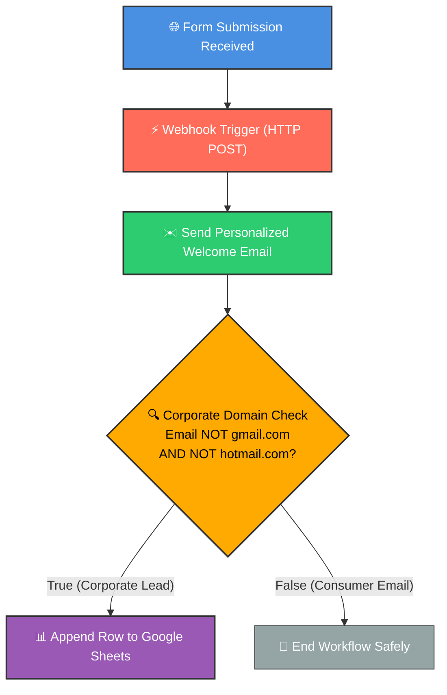
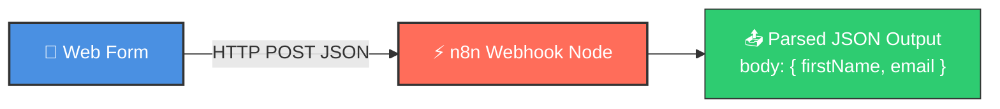
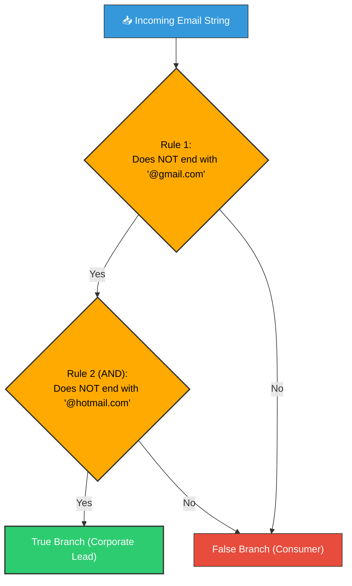

# ✉️ Build Your First n8n Workflow: Automated Welcome Email & Lead Routing

<p align="center">
  <a href="04_Node_Types.md">⬅️ Prev: Node Types</a> •
  <a href="../README.md">Main Hub</a> •
  <a href="06_Understanding_Data.md">Next: Understanding Data ➡️</a> •
  <a href="https://github.com/shashilabs-io/n8n-docs">GitHub Repository</a>
</p>

---

## 🧭 How to Use This Chapter

> [!TIP]
> **Hands-On Blueprint:** In this practical tutorial, you will assemble an end-to-end production automation from scratch: capturing form submissions via Webhooks, dispatching personalized welcome emails, evaluating conditional logic with an `If` node, and appending qualified corporate leads into Google Sheets.

### 🎯 Key Outcomes of this Chapter:
- Set up and understand the difference between **Test Webhook URLs** and **Production Webhook URLs**.
- Capture incoming HTTP `POST` payloads from web forms.
- Interpolate dynamic recipient variables using n8n expressions (`{{ $json.body.firstName }}`).
- Route execution paths using **Boolean logic (`AND` conditions)** in an `If` node.
- Avoid the common trap of accidentally mapping the email node's response into Google Sheets columns.

---

# 1. The Real-World Business Scenario

Manual lead handling causes slow response times, missed high-value opportunities, and tedious data entry. This workflow automates three key operations:

1. **Instant Ingestion:** Catches form submissions the millisecond a user clicks Submit.
2. **Personalized Confirmation:** Delivers a dynamic welcome email addressed to the lead's first name.
3. **Automated Lead Routing:** Checks the email domain: if it appears to be a corporate address (non-free email provider), it appends the lead's details into a high-priority Google Sheet for sales follow-up.



---

# 2. Workflow Components Breakdown

| Component | Node / Tool | Role in Pipeline |
|---|---|---|
| **Intake Form** | Google Form / Typeform / Tally | Captures First Name, Last Name, Email, and Job Role. |
| **Ingestion Trigger** | **Webhook Node** (POST) | Receives the JSON payload and wakes up the workflow. |
| **Outbound Email** | **Email / SES / Gmail Node** | Sends a customized welcome email using dynamic expressions. |
| **Decision Engine** | **If Node** | Evaluates string conditions using boolean `AND` rules. |
| **Data Storage** | **Google Sheets Node** | Writes qualified corporate lead rows for sales reps. |

---

# 3. Step 1: Configuring the Webhook Trigger

Add a **Webhook Node** to your canvas. When an external service pushes data to n8n, this node acts as the listening ear.



### ⚠️ Test URL vs Production URL: The Golden Rule

| Webhook URL Type | When to Use | How It Behaves |
|---|---|---|
| **Test URL**<br/>`.../webhook-test/...` | During development & canvas testing. | **Only active for 120 seconds** while you click *"Listen for test event"*. Disappears after one test run! |
| **Production URL**<br/>`.../webhook/...` | Live production after toggling Active to ON. | **Always active 24/7** in the background. Does not require the canvas to be open. |

> [!CAUTION]
> **The #1 Beginner Trap:**
> Putting the *Test URL* into your live form and expecting it to work days later. The test URL will return `404 Webhook not found` unless you explicitly click the test button in the editor!

---

# 4. Step 2: Personalizing the Welcome Email

Add an **Email Sending Node** (e.g. Gmail, AWS SES, or standard SMTP) immediately following the Webhook:

### Dynamic Expression Mapping
Never hardcode fixed customer values. Use n8n's expression syntax:

```javascript
// Map recipient email
{{ $json.body.email }}

// Dynamic Subject
Welcome to the platform, {{ $json.body.firstName }}!
```

### Example Email Body:
```text
Hello {{ $json.body.firstName }},

Thank you for requesting access! We've received your details for {{ $json.body.role }}.
Our team is reviewing your workspace and will follow up shortly.

Best regards,
The Customer Success Team
```

| Email Field | Expression / Configuration |
|---|---|
| **To** | `{{ $json.body.email }}` |
| **Subject** | `Welcome, {{ $json.body.firstName }}!` |
| **From** | `team@yourdomain.com` (Authorized Sender) |
| **Body Type** | Plain Text or HTML |

---

# 5. Step 3: Conditional Routing with the If Node

Connect an **If Node** after the email action. Configure it to route potential corporate leads to your sales spreadsheet:



### ⚙️ If Node Settings:
- **Combine Rules:** Set to **AND** (All conditions must be satisfied).
- **Condition 1:** String &rarr; `{{ $('Webhook').item.json.body.email }}` &rarr; **Does not end with** &rarr; `@gmail.com`
- **Condition 2:** String &rarr; `{{ $('Webhook').item.json.body.email }}` &rarr; **Does not end with** &rarr; `@hotmail.com`

> [!IMPORTANT]
> **Source Node Reference:**
> Notice that the expression explicitly reads from `$('Webhook')` rather than the preceding email node. The email node output contains `{ messageId: '...' }`, not the user's original email address!

---

# 6. Step 4: Appending Leads to Google Sheets

Connect a **Google Sheets Node** to the **True branch** of the If node.

- **Resource:** Document
- **Operation:** Append row
- **Spreadsheet:** Select your Sales Leads sheet.
- **Mapping Mode:** Choose **Map Each Column Manually**.

### 📋 Field Mapping Configuration

| Target Sheet Column | Source Expression (from Webhook) |
|---|---|
| **First Name** | `{{ $('Webhook').item.json.body.firstName }}` |
| **Last Name** | `{{ $('Webhook').item.json.body.lastName }}` |
| **Email** | `{{ $('Webhook').item.json.body.email }}` |
| **Role** | `{{ $('Webhook').item.json.body.role }}` |
| **Timestamp** | `{{ $now.toISO() }}` |

---

# 7. Step-by-Step Testing & Verification Routine

Always test each node individually before testing end-to-end:

1. **Step 1:** Put Webhook node into *"Listen for test event"* mode.
2. **Step 2:** Submit your test form with sample data: `john@acmecorp.com`.
3. **Step 3:** Confirm the Webhook turns green and displays the JSON payload.
4. **Step 4:** Execute the Email node and confirm the email arrives in your inbox.
5. **Step 5:** Execute the If node and verify that `john@acmecorp.com` routes to the **True** branch.
6. **Step 6:** Execute the Google Sheets node and verify that a new row appears in your spreadsheet.
7. **Step 7:** Re-test with `sarah@gmail.com` and verify that the If node routes to **False** (no sheet row added).

---

# 8. Troubleshooting Common Errors

| Symptom | Root Cause | Fix |
|---|---|---|
| **`404 Webhook not found`** | Test URL was called without clicking *"Listen for test event"*, or workflow is inactive. | Either click the test button in canvas or activate the workflow and use the Production URL. |
| **Email has literal text `{{ $json.body.firstName }}`** | Entered in fixed-text mode instead of Expression mode. | Click the expression toggle `{{}}` on the input parameter before pasting. |
| **Sheet gets message ID instead of customer name** | Sheet column mapped from preceding Email node instead of Webhook. | Update the expression to reference `$('Webhook').item.json.body...`. |
| **If node routes all emails to True** | Combined with `OR` instead of `AND`. | Change condition joiner to **AND**. |

---

# 9. Active Recall Quiz

<details>
<summary><strong>1. Why must you switch from the Test URL to the Production URL before launching?</strong></summary>

The **Test URL** is temporary and only responds while you are manually listening in the editor. The **Production URL** runs 24/7 in the background when the workflow is activated.
</details>

<details>
<summary><strong>2. Why should the two domain exclusion checks use `AND` instead of `OR`?</strong></summary>

Because an email address cannot be both `@gmail.com` and `@hotmail.com` simultaneously. Using `OR` would result in every single email evaluating to `true`.
</details>

<details>
<summary><strong>3. If an intermediate node only outputs `{ success: true }`, how do downstream nodes access the original form data?</strong></summary>

By using cross-node expressions: `{{ $('Webhook').item.json.body.fieldName }}`.
</details>

<details>
<summary><strong>4. Why is manual column mapping recommended over automatic mapping in Google Sheets?</strong></summary>

Manual mapping gives you explicit, predictable control over exactly which incoming properties write into specific sheet columns, preventing accidental schema corruption.
</details>

---

# 10. Key Takeaways

- Webhooks provide real-time, event-driven workflow initiation.
- Expressions allow dynamic data interpolation across any prior node in the workflow.
- Boolean logic (`If` node) enables sophisticated lead qualification and multi-path routing.
- Always perform a pre-flight test with both qualifying and non-qualifying inputs before activating in production.

---

<p align="center">
  <b>Next Step:</b> Master n8n's foundational data engine in <a href="06_Understanding_Data.md">Chapter 6: Understanding Data in n8n</a> or return to the <a href="../README.md">Main Hub</a>.
</p>
