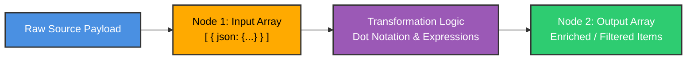
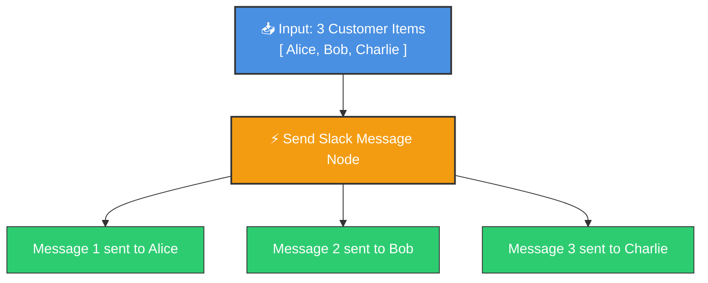
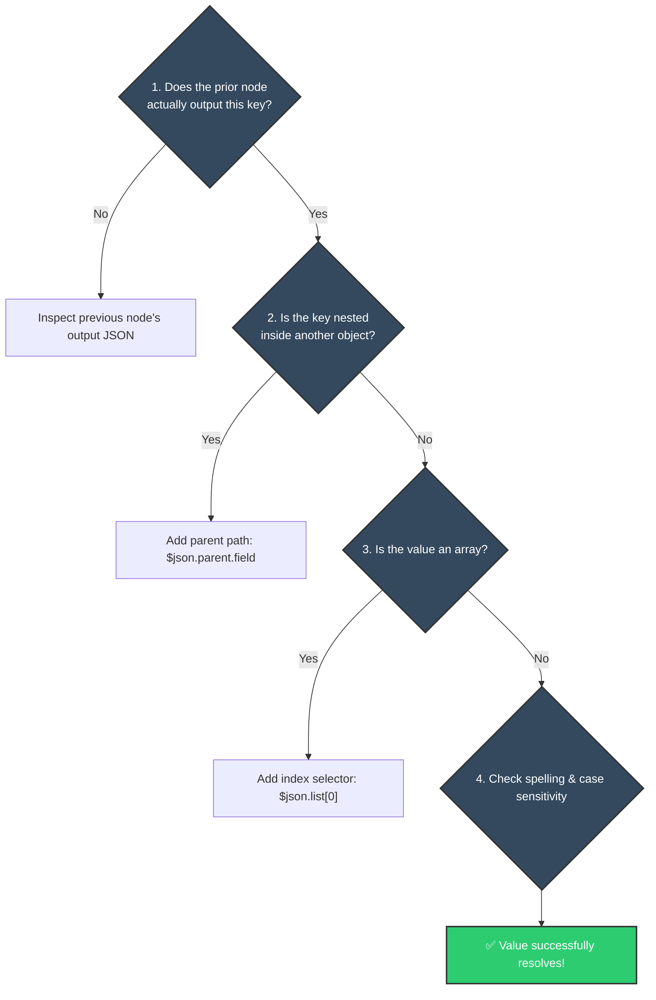

# 📊 Understanding Data in n8n: JSON, Lists, and Items Explained

<p align="center">
  <a href="05_First_Workflow_Welcome_Email.md">⬅️ Prev: Your First Workflow</a> •
  <a href="../README.md">Main Hub</a> •
  <a href="../3_deep%20dive%20concepts/01_Branching_Workflows.md">Next: Deep Dive (Branching) ➡️</a> •
  <a href="https://github.com/shashilabs-io/n8n-docs">GitHub Repository</a>
</p>

---

## 🧭 How to Use This Chapter

> [!TIP]
> **The Data Engine:** 90% of workflow bugs stem from misunderstanding how data is structured and passed between nodes. In this chapter, you will master the three foundational primitives of n8n: **JSON Objects**, **Arrays (Lists)**, and the **List-of-Objects Item Model**.

### 🎯 Key Outcomes of this Chapter:
- Understand **JSON syntax** (Key-Value pairs, data types, nested structures).
- Differentiate between **Objects `{}`** and **Arrays `[]`**.
- Master **Dot Notation** and **Zero-based Array Indexing** (`[0]`).
- Internalize n8n's **List-of-Items Paradigm**: `[{ json: {...} }]`.
- Debug broken expressions with precision by tracing data flow across nodes.

---

# 1. Why Understanding Data Structure Matters

In traditional manual workflows, humans easily recognize context. In automated software pipelines, machines demand strict structural contracts. If an expression references `email` instead of `Email`, or ignores a nested level like `body.customer.email`, the pipeline breaks silently.



### The 3 Core Data Primitives:
1. **JSON:** The structured text format used to represent key-value data.
2. **Arrays (Lists):** Ordered collections of values or objects contained within `[]`.
3. **Items:** The individual records that n8n streams from node to node.

---

# 2. What Is JSON?

**JSON** stands for **JavaScript Object Notation**. It is the universal standard for exchanging structured data across the modern web.

### Key-Value Pairs
Information is stored inside curly braces `{}` as paired labels and values:

```json
{
  "orderNumber": "ORD-10023",
  "customerName": "Jane Doe",
  "totalPrice": 499.50,
  "isPaid": true
}
```

- `"orderNumber"` is the **Key** (the label).
- `"ORD-10023"` is the **Value** (the data stored under that label).

### Nested JSON Objects
A value can itself be another nested JSON object:

```json
{
  "orderNumber": "ORD-10023",
  "customer": {
    "name": "Jane Doe",
    "contact": {
      "email": "jane@example.com",
      "phone": "+1-555-0199"
    }
  }
}
```

To read Jane's email address, follow the nested path from left to right:
$$\text{customer} \longrightarrow \text{contact} \longrightarrow \text{email}$$

---

# 3. What Is an Array (List)?

When an order contains multiple products, or an API returns 50 customers, items are stored in an **Array** represented by square brackets `[]`:

```json
{
  "orderNumber": "ORD-10023",
  "items": [
    {
      "name": "Mechanical Keyboard",
      "price": 120,
      "quantity": 1
    },
    {
      "name": "Wireless Mouse",
      "price": 60,
      "quantity": 2
    }
  ]
}
```

### 🆚 Object `{}` vs Array `[]`

| Syntax | Data Structure | How to Access Values |
|---|---|---|
| **Curly Braces `{}`** | **Object** (Key-Value properties) | Accessed by **Key Name** using dot notation: `.customerName` |
| **Square Brackets `[]`** | **Array** (Ordered list of elements) | Accessed by **Index Position** starting at 0: `[0]` |

---

# 4. Accessing Values: Dot Notation & Zero-Based Indexing

> [!IMPORTANT]
> **Zero-Based Indexing Rule:**
> In computer science, array counting begins at **0**, not 1!
> - First item: `[0]`
> - Second item: `[1]`
> - Third item: `[2]`

### 🔍 Reading from Left to Right:

Suppose you have this dataset in an expression variable called `data`:

```json
{
  "company": "Acme Corp",
  "departments": [
    {
      "name": "Engineering",
      "lead": "Alice"
    },
    {
      "name": "Marketing",
      "lead": "Bob"
    }
  ]
}
```

```javascript
// Access the company name
data.company  // Returns: "Acme Corp"

// Access the first department object
data.departments[0]  // Returns: { name: "Engineering", lead: "Alice" }

// Access the team lead of the second department
data.departments[1].lead  // Returns: "Bob"
```

---

# 5. The n8n "List-of-Items" Engine

In n8n, **every node receives an array of items and outputs an array of items**:

```json
[
  {
    "json": {
      "id": 1,
      "name": "Alice"
    }
  },
  {
    "json": {
      "id": 2,
      "name": "Bob"
    }
  }
]
```

### 🔁 Automatic Item-by-Item Looping
If a trigger or database node outputs **10 items**, a downstream action node (such as *Send Slack Message*) will **automatically run 10 times**—once for each individual item—without requiring a manual `for` loop!



> [!NOTE]
> Inside any node, `{{ $json.fieldName }}` automatically resolves to the current item being processed in that loop cycle.

---

# 6. Step-by-Step Data Flow Debugging Ladder

When a node emits `undefined` or an expression fails, follow this diagnostic checklist:



---

# 7. Common Data Mistakes & How to Fix Them

| Mistake | Why It Breaks | How to Fix |
|---|---|---|
| **Using `[1]` for the first element** | Arrays are zero-indexed; `[1]` fetches the second element. | Always use `[0]` to read the first array item. |
| **Omitting parent nesting** | Attempting `$json.email` when the payload is `{ body: { email: "..." } }`. | Trace full hierarchy: `$json.body.email`. |
| **Case-Sensitivity Mismatches** | JSON keys are strictly case-sensitive (`firstName` &ne; `firstname`). | Inspect the raw JSON view to copy exact capitalization. |
| **Applying dot notation to an array directly** | `items.price` fails if `items` is a list `[...]`. | Target a specific index: `items[0].price`. |
| **Assuming all items have identical schema** | Item 1 may have an address, but Item 2 may omit it (`null`). | Use optional chaining: `{{ $json.user?.address?.city ?? 'N/A' }}`. |

---

# 8. Practical Practice Exercise

Given this incoming order payload:

```json
{
  "orderNumber": "ORD-9901",
  "customer": {
    "name": "David Miller",
    "tier": "VIP"
  },
  "cart": [
    {
      "product": "Ultrawide Monitor",
      "price": 650
    },
    {
      "product": "Monitor Arm",
      "price": 85
    }
  ]
}
```

<details>
<summary><strong>Question 1: How do you access the customer's tier?</strong></summary>

```javascript
$json.customer.tier  // Output: "VIP"
```
</details>

<details>
<summary><strong>Question 2: How do you access the product name of the second item in the cart?</strong></summary>

```javascript
$json.cart[1].product  // Output: "Monitor Arm"
```
</details>

<details>
<summary><strong>Question 3: How do you access the price of the first item in the cart?</strong></summary>

```javascript
$json.cart[0].price  // Output: 650
```
</details>

<details>
<summary><strong>Question 4: What is the data type of `cart`?</strong></summary>

It is an **Array** (enclosed by `[]`) containing two **Objects** (enclosed by `{}`).
</details>

---

# 9. Key Takeaways

- **JSON** uses `{}` for objects (key-value pairs) and `[]` for arrays (ordered lists).
- **Dot notation** traverses nested object properties (`$json.parent.child`).
- **Array indexing** is zero-based: the first element is always `[0]`.
- n8n processes data as an **array of items**, executing downstream action nodes automatically for every item in the batch.
- Always inspect the **JSON output panel** of a node before writing expressions from memory.

---

<p align="center">
  <b>Next Step:</b> Advance to Module 3 in <a href="../3_deep%20dive%20concepts/01_Branching_Workflows.md">Chapter 1: Branching Workflows</a> or return to the <a href="../README.md">Main Hub</a>.
</p>
