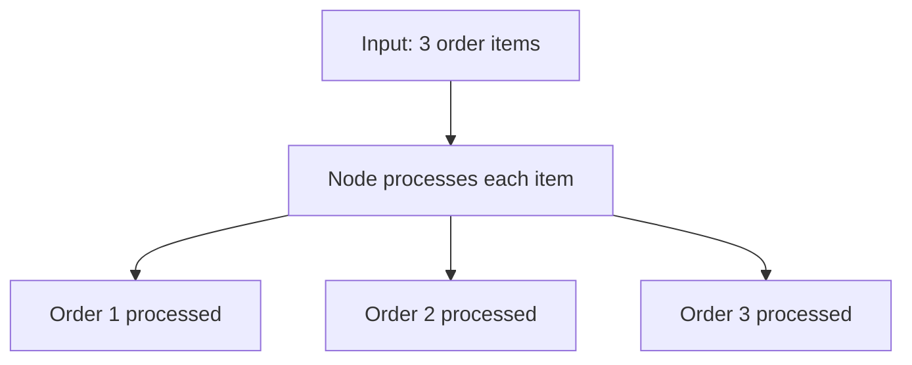
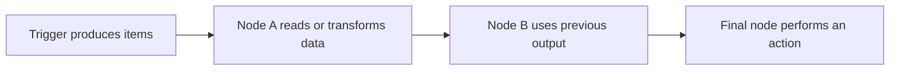

# Understanding Data in n8n
## JSON, Lists, and Items in n8n Explained

This lesson explains how data is structured in n8n, how it moves from one node to another, and how to access values inside JSON objects and arrays. These are foundational concepts for building, modifying, and troubleshooting automation workflows.

---

## 1. Why understanding data matters

Have you ever built an automation and discovered that data was missing, incorrectly formatted, or different from what you expected? These problems often occur because the workflow is not reading or passing data in the way you intended.

In n8n, data passes between nodes. To work with it confidently, understand three concepts:

- **JSON:** a structured format for representing data.
- **Lists (arrays):** a way to store multiple values or objects together.
- **Items:** the individual units of data n8n processes as a workflow runs.

## 2. What is JSON?

JSON stands for **JavaScript Object Notation**. It is a widely used text format that applications use to exchange structured information.

Imagine placing an online order. The system may need to store an order number, customer name, address, products, prices, quantities, and order status. A table can represent this information, but products may have different properties. A smartphone may have a screen size and storage capacity, while a T-shirt may have a size, colour, and material.

JSON makes it possible to represent both kinds of product in a structured but flexible format.

### Key-value pairs

JSON stores information as **key-value pairs**:

```json
{
  "orderNumber": "ORD00001",
  "customerName": "John Doe",
  "status": "Shipped"
}
```

- `orderNumber`, `customerName`, and `status` are **keys**.
- `ORD00001`, `John Doe`, and `Shipped` are their **values**.

A key acts like a label; the value is the information stored under that label.

### A nested object

An order can contain another object describing its product:

```json
{
  "orderNumber": "ORD00001",
  "customerName": "John Doe",
  "order": {
    "product": {
      "name": "Smartphone",
      "type": "Smartphone",
      "screenSize": "6.5 inches",
      "capacity": "128 GB",
      "price": 499,
      "quantity": 1,
      "status": "Shipped"
    }
  }
}
```

Here, `order` is an object inside the main object, and `product` is another object nested inside `order`. This is called **nested data**.

### Why use JSON instead of only tables?

A table has a fixed set of columns. JSON can represent objects with different properties while keeping the information structured.

For example:

- A smartphone might have `screenSize` and `capacity`.
- A T-shirt might have `colour`, `material`, and `size`.

The objects do not need identical properties. This flexibility is one reason JSON is useful for exchanging data between applications and services.

> **Remember:** JSON is structured, not unstructured text. Its keys and values let applications identify the meaning of each piece of data.

## 3. What is a list or array?

Sometimes an order contains more than one product. Instead of storing only one product object, JSON can store multiple product objects in a **list**, also called an **array**.

Square brackets `[]` indicate an array. Curly braces `{}` indicate an object.

```json
{
  "orderNumber": "ORD00003",
  "customerName": "John Doe",
  "order": {
    "products": [
      {
        "name": "Smartphone",
        "type": "Smartphone",
        "screenSize": "6.5 inches",
        "capacity": "128 GB",
        "price": 499,
        "quantity": 1
      },
      {
        "name": "Avengers T-shirt",
        "colour": "Red",
        "material": "Cotton",
        "size": "Medium",
        "price": 19,
        "quantity": 2
      }
    ]
  }
}
```

The `products` array contains two objects. A comma separates one array element from the next. The smartphone object and the T-shirt object can have different properties.

Lists are useful for collections such as:

- A list of customers
- A list of orders
- A list of products in one order
- A list of transactions

### Object versus array

| Notation | Meaning | Example |
|---|---|---|
| `{}` | An object containing named properties | `{"name": "Smartphone"}` |
| `[]` | An array containing ordered elements | `[{"name": "Phone"}, {"name": "T-shirt"}]` |

An object lets you access a value by its key. An array lets you select an element by its index.

## 4. How to access JSON values

Two techniques are especially important:

1. **Dot notation** accesses a property by its key.
2. **Array indexing** selects an element by its position.

Array indexes start at **0**, not 1.

Suppose a variable called `orders` contains an array of order objects:

```json
[
  {
    "orderNumber": "ORD00001",
    "customerName": "John Doe",
    "order": {
      "product": {
        "name": "Smartphone",
        "price": 499
      }
    }
  },
  {
    "orderNumber": "ORD00002",
    "customerName": "John Doe",
    "order": {
      "product": {
        "name": "Avengers T-shirt",
        "price": 19
      }
    }
  }
]
```

### Access the first and second orders

```text
orders[0]
```

Selects the first order.

```text
orders[1]
```

Selects the second order.

To access the first order's order number:

```text
orders[0].orderNumber
```

To access the second order's customer name:

```text
orders[1].customerName
```

### Access a nested property

To access the name of the product in the first order:

```text
orders[0].order.product.name
```

Read the expression from left to right:

1. `orders[0]` selects the first order.
2. `.order` enters the nested `order` object.
3. `.product` enters the product object.
4. `.name` reads the product name.

To access the price in the second order:

```text
orders[1].order.product.price
```

The same pattern works for deeper nested objects: select the object or array element, then continue through its properties.

### Access products in one order

If `orderData` represents a single order whose `order.products` field is an array, you can access its first product like this:

```text
orderData.order.products[0].name
```

And its second product's price like this:

```text
orderData.order.products[1].price
```

The important difference is whether the outer data is an array of orders or one order object containing an array of products.

## 5. How n8n processes items

In n8n, data is handled as **items**. An item is an individual unit of data processed by a node. If a node receives multiple items, the node generally applies its configured operation to those incoming items and produces output items.

For example, suppose a workflow receives three orders:



If a trigger produces several order items, later nodes can process each order separately. A node might apply the same transformation to each item, such as reading a field or preparing a message.

The number and shape of output items can depend on the node and operation. The key beginner concept is that n8n workflows pass collections of items between nodes, rather than treating all records as one undifferentiated block.

## 6. Following data through a workflow

A useful way to debug a workflow is to inspect the data at the node where it first appears and then follow it through later nodes.



When a value is missing or incorrect, check:

1. Does the previous node actually output the field?
2. Is the field nested inside an object such as `body` or `order`?
3. Is the data an array, meaning you may need an index?
4. Does the property name match the actual output, including spelling and capitalization?
5. Is the next node receiving the data you expect?

In n8n expressions, the exact path depends on the structure of the incoming data. Inspect the actual output before writing a path from memory.

## 7. Common mistakes

| Mistake | Why it fails | What to check |
|---|---|---|
| Using index `1` for the first array element | Array indexes start at `0` | Use `[0]` for the first element |
| Using dot notation without selecting an array element | An array position may be needed first | Select an index such as `[0]` |
| Forgetting nested object levels | The value is deeper in the structure | Follow each parent property in order |
| Guessing a property name | The actual key may use different spelling or capitalization | Inspect the JSON output |
| Assuming every object has identical properties | Different product types may have different fields | Check which properties exist on that item |
| Treating all incoming records as one object | n8n commonly processes data as individual items | Inspect the number and shape of items at each node |

## 8. Practice examples

Use this data for the questions below:

```json
{
  "orderNumber": "ORD00003",
  "customerName": "John Doe",
  "order": {
    "products": [
      {
        "name": "Smartphone",
        "price": 499
      },
      {
        "name": "Avengers T-shirt",
        "price": 19
      }
    ]
  }
}
```

**Try to answer before reading the solutions.**

1. Which expression accesses the order number?
2. Which expression accesses the first product's name?
3. Which expression accesses the second product's price?
4. What does `products[0]` mean?
5. What is the difference between an object and an array?

### Solutions

1. `orderNumber`
2. `order.products[0].name`
3. `order.products[1].price`
4. The first product in the array, because indexing starts at zero.
5. An object stores named properties; an array stores ordered elements.

## 9. Lesson recap

- JSON stands for JavaScript Object Notation and is used to exchange structured data.
- JSON objects use curly braces and key-value pairs.
- JSON arrays use square brackets and can contain multiple items.
- Dot notation accesses properties; array indexes select elements, starting from zero.
- Nested data is accessed by following each level of the structure.
- n8n processes workflow data as items that pass from one node to another.
- When data looks wrong, inspect the node output and verify the exact structure and property names before changing expressions.

The next practical step is to follow a real workflow execution and inspect how data changes as it moves through the nodes.
