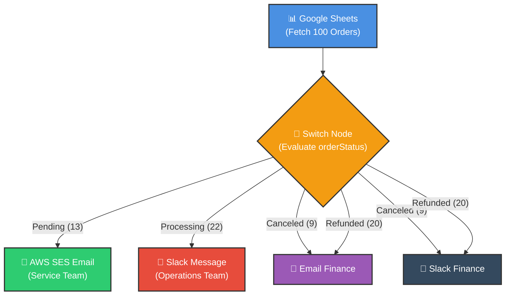
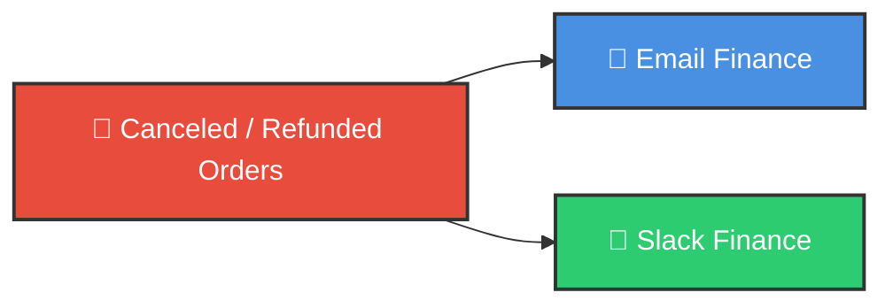

# 🔀 How Branching Works in n8n Workflows
## Smart Automations with Multiple Paths

<p align="center">
  <a href="../2_getting%20started/06_Understanding_Data.md">⬅️ Prev: Understanding Data</a> •
  <a href="../README.md">Main Hub</a> •
  <a href="02_Merge_Node.md">Next: Merge Node ➡️</a> •
  <a href="https://github.com/shashilabs-io/n8n-docs">GitHub Repository</a>
</p>

---

## 🧭 How to Use This Chapter

> [!TIP]
> **Dynamic Routing:** Real-world workflows are rarely linear. Understanding how to branch execution paths using the Switch node and dispatch concurrent actions enables you to build robust, multi-destination pipelines without creating tangled spaghetti automations.

### 🎯 Key Outcomes of this Chapter:
- Explain why branching is essential in a real business workflow.
- Fetch and inspect order records from Google Sheets in n8n.
- Internalize why n8n represents data as a list of items.
- Configure a **Switch** node to route items deterministically by order status.
- Use expressions such as `{{ $json.orderStatus }}` to access properties per item.
- Send targeted emails and Slack messages from distinct branches.
- Master the difference between **Routing items to different paths (Type A)** and **Sending the same items down multiple paths (Type B)**.

---

## 📸 Workflow Architecture Preview




---

# 1. The Business Problem: Processing Orders Manually

The lesson begins with a business scenario. A person manually reviews orders that have not yet been shipped or delivered. Each order can be in a different state, and the team must take the appropriate action.

| Order Status | Business Need | Automated Action in the Lesson |
|---|---|---|
| **Pending** | Customer-service staff need to investigate missing information and help release the order for processing. | Send an email to the service team. |
| **Processing** | Some high-priority orders have been waiting for a few days and should be expedited. | Send a Slack message to the operations team. |
| **Canceled** | Finance needs an official record and a notification. | Send an email and a Slack message to finance. |
| **Refunded** | Finance needs an official record and a notification. | Send an email and a Slack message to finance. |

When this work is done manually, a person has to inspect each order, decide which team should be contacted, send the message, and keep track of what has already been done. This can take hours and can introduce mistakes.

**Goal:** Automate the process in n8n without writing a custom program for the workflow.

> [!NOTE]
> The lesson uses sample order data. The team names, channels, email destinations, and credentials in a real workflow must be replaced with your own configured resources.
> 
> 🔗 **Sample Data Folder:** [Google Drive Mock Orders Data](https://drive.google.com/drive/folders/1FgKXJklEj_nsZB0JAtVguaXtXK8CEQGk)  
> Access all mock data from this folder. For this lesson we will be using `Mock_Orders_Data`.

---

# 2. Start a Workflow and Choose a Trigger

Create a new workflow in the n8n canvas.

Start with a **Manual Trigger** so the workflow can be tested on demand. For a recurring business process, a **Schedule Trigger** is a better production candidate. For example, it could run every day at 9:00 a.m., 10:00 a.m., or another time appropriate for the business.

- **Manual Trigger:** Useful while building and testing.
- **Schedule Trigger:** Useful when the workflow should run automatically on a schedule.

The lesson continues with Manual Trigger for testing.

---

# 3. Fetch Orders from Google Sheets

The sample Google Sheet is called **Mock Order Data**. It contains 100 data records, excluding the header, with fields such as:

- `Order ID`
- `First name`
- `Last name`
- `Customer email`
- `Order status`
- `Order date`

Add a **Google Sheets** node and configure it to fetch rows.

### Configuration Sequence Shown in the Lesson

1. Select the Google Sheets credential already connected to n8n.
2. Choose the resource for a sheet within a document.
3. Set the operation to **Get Row(s)**.
4. Choose the document from the connected account's list.
5. Select the **Mock Order Data** document and its sheet.
6. Leave filters unset to fetch all 100 sample records.
7. Click **Test step**.

The output should contain the fetched records. n8n lets you inspect the result in **JSON** view or **Table** view. Table view is convenient for row-and-column data; JSON view shows the underlying objects and their properties.

### A Key Idea: n8n Processes Lists of Items

In the lesson, the Google Sheets node returns 100 items. In n8n, data passed between nodes is represented as a list of items—even when only one item is present.

Conceptually, the data looks like this:

```json
[
  {
    "orderId": "ORD001",
    "firstName": "Asha",
    "lastName": "Kumar",
    "customerEmail": "customer@example.com",
    "orderStatus": "Pending",
    "orderDate": "2026-10-01"
  },
  {
    "orderId": "ORD002",
    "firstName": "Ravi",
    "lastName": "Singh",
    "customerEmail": "another@example.com",
    "orderStatus": "Processing",
    "orderDate": "2026-10-02"
  }
]
```

Each item represents an object. The workflow can evaluate each order separately, using the order-status property to decide what should happen next.

### Accessing a Property with an Expression

The lesson introduces `{{ $json }}` as a shorthand for the current item being processed. To access one of its properties, use dot notation:

```text
{{ $json.orderStatus }}
```

This expression means: “Get the `orderStatus` property from the current item.”

Use `$input.item` to refer to the current input item. The important practical point is that the expression is evaluated in the context of the item currently being processed.

> [!IMPORTANT]
> Use the exact property name shown in your node's output. If your Google Sheets column is named `Order Status`, the expression may need to match that actual field name rather than `orderStatus`.

---

# 4. Why Use a Switch Node?

An **If** node is suitable when a condition has two outcomes: true or false. The lesson needs to handle four order statuses—pending, processing, canceled, and refunded.

You could chain multiple If nodes, but the workflow would become harder to follow. A **Switch** node allows you to define several routing rules in one place and create a separate output for each matching status.

Add a **Switch** node after Google Sheets.

### Configure the Routing Rules

For each rule, compare the current item's order-status value with a text value.

| Rule # | Value to Compare Against | Suggested Output Name |
|---|---|---|
| **1** | `pending` | `Pending Orders` |
| **2** | `processing` | `Processing Orders` |
| **3** | `canceled` | `Canceled Orders` |
| **4** | `refunded` | `Refunded Orders` |

In the expression field, select or enter the order-status property. The lesson uses the comparison “value 1 is equal to value 2,” with the status text entered as the comparison value.

An expression for the first value could look like:

```text
{{ $json.orderStatus }}
```

Then compare it with `pending`. Repeat the rule for the other statuses.

### Rename Outputs Clearly

Try to rename each output. If the outputs remain named “Output 0,” “Output 1,” and so on, it becomes difficult to tell which status each branch represents.

Use names that communicate the rule, such as **Pending Orders** and **Refunded Orders**. Clear names make the canvas easier to understand and maintain.

### Test and Interpret the Counts

In the demonstration, the Switch node routes:
- **13 items** to pending
- **22 items** to processing
- **9 items** to canceled
- **20 items** to refunded

These counts total 64, not 100. The remaining records have other statuses, such as **shipped** or **delivered**, which are not covered by the four rules. Your own counts will depend on the data in your sheet.

### Fallback Output and Ignore Case

The Switch node provides additional options:

- **Fallback output:** Determines what happens to an item that matches none of the configured rules. The lesson leaves it unconfigured so unmatched items are ignored for this exercise. In a real workflow, you may instead route unmatched records to a review path or log them.
- **Ignore Case:** Useful when a status may be written with different capitalization, such as `refunded`, `Refunded`, or `REFUNDED`.

Test the node after configuring these options and confirm that the expected items reach each output.

---

# 5. Branch 1 — Email the Service Team About Pending Orders

For the **Pending Orders** output, we will be using an Amazon SES email node that is already configured. A standard Send Email node with SMTP configuration is another possible approach.

The email setup includes:
- An email-sending operation.
- A subject that identifies the order, including its order ID.
- A simple text body explaining that the order is pending.
- A sender address, such as a no-reply address.
- A recipient address for the service team—ideally a distribution list shared by the team.

> [!TIP]
> We recommend a group mailbox rather than sending the notification to only one individual, so the appropriate team members can see it.

After configuring the node, click **Test step**. The Output shows message IDs and checks the inbox to confirm delivery.

**Result:** Pending orders can be sent to the service team automatically rather than being identified and emailed manually.

---

# 6. Branch 2 — Send a Slack Message for Processing Orders

For the **Processing Orders** output, the lesson adds a **Slack** node.

Before this node can send messages, your Slack workspace must be connected to n8n and the required credentials configured.

The demonstrated configuration is:

1. Choose the Slack credential.
2. Select the **Message** resource.
3. Select the **Send** operation.
4. Choose a channel rather than an individual user, so the operations team can monitor it together.
5. Select the channel for high-priority processing orders.
6. Enter a simple text message that identifies the order and asks the team to review or expedite it.
7. Test the node.

The demonstration routes 22 processing items through the Slack node. Each item is processed, and the node sends the configured message for that item.

The lesson mentions that Slack messages can also use blocks or attachments, but it uses a simple text message here.

**Result:** The operations team receives Slack notifications for processing orders that need attention.

---

# 7. Branches 3 and 4 — Notify Finance About Canceled and Refunded Orders

Canceled and refunded orders require **two actions**:
1. Send an email record to finance.
2. Send a Slack notification to the finance channel.

The lesson reuses the email and Slack nodes by copying them and connecting the **Canceled Orders** and **Refunded Orders** outputs to both action nodes.

This creates two outgoing connections from each of these Switch outputs:

- `Canceled Orders` &rarr; `Email`
- `Canceled Orders` &rarr; `Slack`
- `Refunded Orders` &rarr; `Email`
- `Refunded Orders` &rarr; `Slack`

Configure the email subject and body so finance can identify the canceled/refunded order. Configure the Slack node to post in the channel used for canceled and refunded orders. Then test both nodes.

In the demonstration:
- **9 canceled items** are sent through the actions.
- **20 refunded items** are sent through the actions.
- The email node processes both groups, for 29 items in total.
- The Slack node likewise receives items from both inputs.

The key point is that a canceled or refunded item should reach **both** the email action and the Slack action.

---

# 8. The Two Types of Branching Explained

This is the main architectural concept of the lesson:

### Type A: Route Different Items Down Different Paths (Conditional Routing)

The Switch node examines each order's status and sends it to the matching output.

```text
Google Sheets
      |
    Switch
   /  |  |  \
Pending Processing Canceled Refunded
   |       |       |        |
 Email    Slack   Finance   Finance
```

- Pending items go to the pending output.
- Processing items go to the processing output.
- Canceled items go to the canceled output.
- Refunded items go to the refunded output.

The purpose is to **separate items according to their values** so different groups receive different actions.

### Type B: Send the Same Items to Multiple Actions (Multiplexing)

For canceled and refunded orders, each item must trigger both an email and a Slack message.



```text
Canceled Orders ──┬──> Email Finance
                  └──> Slack Finance

Refunded Orders ──┬──> Email Finance
                  └──> Slack Finance
```

Here, an item is not choosing only one action. It is connected to multiple paths so that both actions can be performed.

| Branching Model | Primary Mechanism | Core Question Answered |
|---|---|---|
| **Type A: Routing** | Switch / If Nodes | *"Which specific path should this item take?"* |
| **Type B: Multiple Actions** | Multiple Outgoing Wires | *"Which actions should all execute for this item?"* |

This distinction helps you design more complex n8n workflows without creating a long chain of nested conditions.

---

# 9. Workflow Recap

The workflow built in the lesson follows this sequence:

1. **Manual Trigger** starts a test run.
2. **Google Sheets** fetches the sample order records.
3. **Switch** evaluates each item's order status.
4. **Pending** &rarr; email the service team.
5. **Processing** &rarr; send a Slack message to operations.
6. **Canceled** &rarr; email finance and post to Slack.
7. **Refunded** &rarr; email finance and post to Slack.
8. **Unmatched statuses** are ignored in this demonstration.

For daily production use, the Manual Trigger could be replaced by a Schedule Trigger. Before enabling the workflow, verify the source sheet, status spelling, credentials, recipients, Slack channels, and how unmatched statuses should be handled.

---

# 10. Common Mistakes & Troubleshooting

| Problem | What to Check |
|---|---|
| **Some orders do not appear in any of the four branches** | They may have another status, such as `shipped` or `delivered`, or their text may not match the rule. |
| **A rule does not match due to capitalization** | Enable **Ignore Case** in Switch settings or normalize the status values. |
| **The output labels are confusing** | Rename each Switch output to a meaningful status name instead of `Output 0`. |
| **Email actions fail** | Verify the email credentials, sender, recipient, and sending-service configuration. |
| **Slack messages fail** | Verify the Slack credential, channel selection, and bot permissions. |
| **Only one action happens for canceled/refunded items** | Check that both the email and Slack nodes are connected to both relevant Switch outputs. |
| **The total branch count is less than the input count** | Some items may not match any configured rule; inspect unmatched statuses. |

---

# 11. Practice Exercise

The lesson's homework is to improve the combined canceled/refunded message.

> [!IMPORTANT]
> **Task:** Make the notification say the correct status for each order:
> - For a canceled order: say that the order was canceled.
> - For a refunded order: say that the order was refunded.
> 
> Do not use the generic phrase “canceled/refunded” for both.

### Suggested Approach:
1. Inspect the data available in the incoming item.
2. Use the status property in an expression to make the message dynamic.
3. Test with at least one canceled order and one refunded order.
4. Verify the email and Slack outputs both contain the correct status.

---

# 12. Active Recall Quiz

<details>
<summary><strong>1. Why is a Switch node a better fit than a single If node for the four statuses in this lesson?</strong></summary>

Switch can define several routing rules and output paths in one node, whereas an If node only supports binary (true/false) branching.
</details>

<details>
<summary><strong>2. Why does n8n represent even one record as a list of items?</strong></summary>

n8n uses a consistent list-of-items structure (`[{ json: {...} }]`) between all nodes so data handling remains uniform whether processing 1 item or 10,000 items.
</details>

<details>
<summary><strong>3. What does <code>{{ $json.orderStatus }}</code> access?</strong></summary>

It reads the `orderStatus` property from the JSON object of the item currently being processed.
</details>

<details>
<summary><strong>4. Why should Switch outputs be renamed?</strong></summary>

Clear, descriptive names (e.g. `Pending Orders`) make the canvas self-documenting and easier to maintain than generic defaults like `Output 0`.
</details>

<details>
<summary><strong>5. What is the purpose of a fallback output?</strong></summary>

It defines what happens to items that match none of the configured rules, allowing them to be routed to error handling, logs, or an alternative path.
</details>

<details>
<summary><strong>6. What does Ignore Case help prevent?</strong></summary>

It prevents comparison failures when status capitalization varies in source data (e.g., `refunded`, `Refunded`, or `REFUNDED`).
</details>

<details>
<summary><strong>7. Which action is configured for pending orders?</strong></summary>

An email sent to the service team.
</details>

<details>
<summary><strong>8. Which action is configured for processing orders?</strong></summary>

A Slack message posted to the operations team channel.
</details>

<details>
<summary><strong>9. Why do canceled and refunded orders connect to two action nodes?</strong></summary>

Finance requires both an official email record and an instant Slack notification for audit and operational visibility.
</details>

<details>
<summary><strong>10. What is the difference between routing items and sending items down multiple paths?</strong></summary>

Routing chooses a single matching path for an item based on conditions; multiple-action branching sends the exact same item to more than one action concurrently.
</details>

---

# 13. Key Takeaways

- A **Switch** node makes multi-condition routing readable and organized.
- **Multiple outgoing connections** let one group of items trigger more than one action simultaneously.
- Always inspect your property names in the incoming data panel to ensure expressions match exact keys.
- Label outputs and nodes explicitly to maintain self-documenting canvases.
- Together, these patterns let you automate practical business processes—such as order monitoring, team notifications, and finance records—using n8n's visual workflow canvas.

---

<p align="center">
  <b>Next Step:</b> Learn how to merge diverging data streams in <a href="02_Merge_Node.md">Chapter 2: The Merge Node</a> or return to the <a href="../README.md">Main Hub</a>.
</p>
