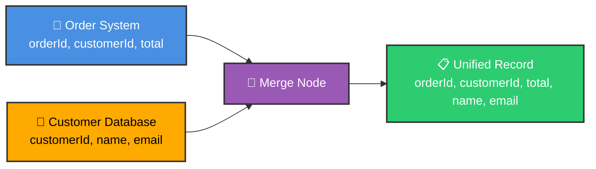
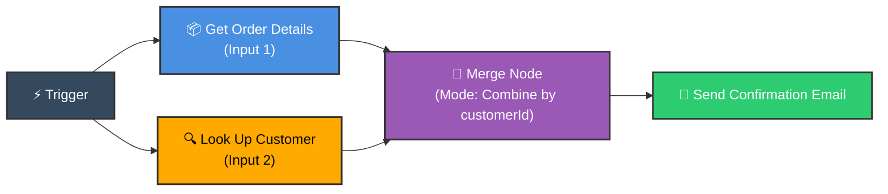
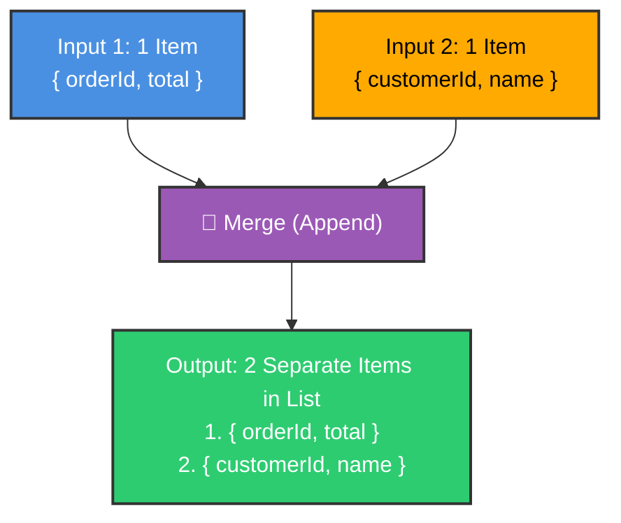
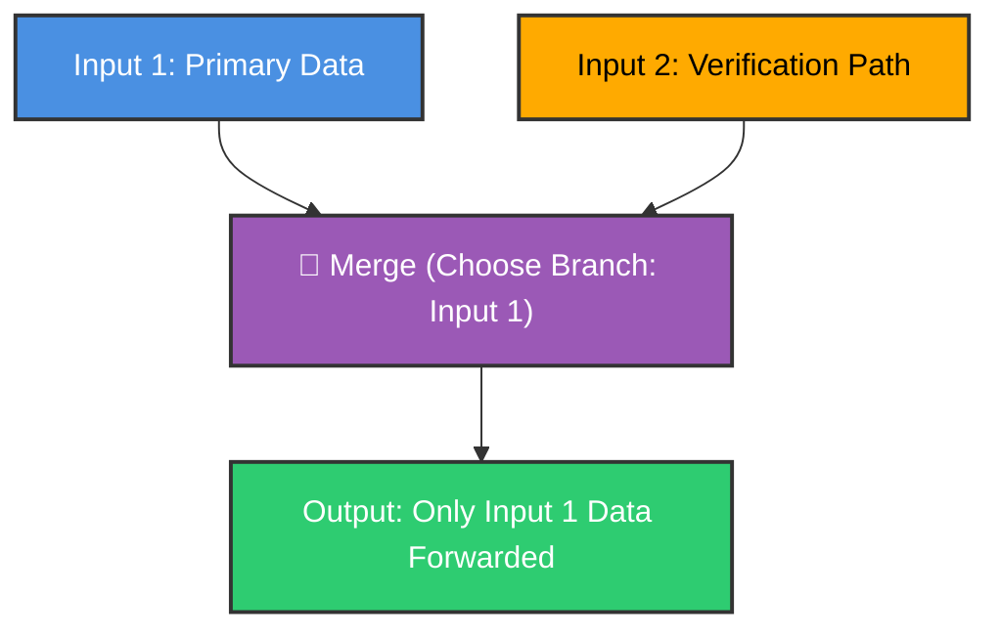

# 🔀 How to Use the Merge Node in n8n
## A Practical Guide with an End-to-End Example

<p align="center">
  <a href="01_Branching_Workflows.md">⬅️ Prev: Branching Workflows</a> •
  <a href="../README.md">Main Hub</a> •
  <a href="03_Set_Node.md">Next: Set / Edit Fields Node ➡️</a> •
  <a href="https://github.com/shashilabs-io/n8n-docs">GitHub Repository</a>
</p>

---

## 🧭 How to Use This Chapter

> [!TIP]
> **Stream Convergence:** Whenever workflows split into separate branches to query different databases or APIs, the **Merge Node** is the critical junction that stitches the data back together. Understanding how and when to use **Append**, **Combine**, and **Choose Branch** prevents silent data corruption and missing fields.

### 🎯 Key Outcomes of this Chapter:
- Explain why workflows need to unify divergent streams of data.
- Master the three primary Merge modes: **Append**, **Combine**, and **Choose Branch**.
- Configure two-input node merges (**Input 1** and **Input 2**).
- Prevent data mismatches by understanding matching keys, position indexing, and field collisions.
- Build an end-to-end enrichment pipeline: **Order Data + Customer Database &rarr; Merged Confirmation Email**.

---

# 1. The Business Problem: Disparate Data Sources

Imagine you run an online store. When a new order arrives, your workflow receives two kinds of information from different systems:

1. **Order details** from your store system: `orderId`, `customerId`, and `total`.
2. **Customer details** from your CRM/database: `customerId`, `name`, and `email`.

The order system knows *what* the customer bought, but lacks contact details. The customer database knows *who* the customer is, but has no knowledge of this specific purchase.



### The Payload Transformation

**Input 1 (Order Path):**
```json
{
  "orderId": "ORD-1042",
  "customerId": "C-17",
  "total": 2499
}
```

**Input 2 (Customer Lookup Path):**
```json
{
  "customerId": "C-17",
  "name": "Aarav Sharma",
  "email": "aarav@example.com"
}
```

**Desired Combined Output:**
```json
{
  "orderId": "ORD-1042",
  "customerId": "C-17",
  "total": 2499,
  "name": "Aarav Sharma",
  "email": "aarav@example.com"
}
```

This is the problem the **Merge** node solves: bringing disparate data streams together into a single structured output.

---

# 2. Workflow Architecture Overview

A typical enrichment workflow layout:



Both paths supply data to the Merge node's two input terminals: **Input 1** and **Input 2**.

> [!IMPORTANT]
> A Merge node does not automatically guess which records belong together. You must configure the correct **Mode** and **Matching Criteria** to match your data structure.

---

# 3. Step-by-Step Setup: Adding the Merge Node

1. Add the upstream nodes that retrieve your two distinct datasets.
2. Add a **Merge** node to the canvas from the node library.
3. Connect the primary dataset (e.g. order details) to **Input 1**.
4. Connect the secondary dataset (e.g. customer lookup) to **Input 2**.
5. Open the Merge configuration panel and review the **Mode** dropdown.
6. Choose the mode matching your intended data outcome (**Append**, **Combine**, or **Choose Branch**).
7. Test both upstream nodes first, then test the Merge node to inspect its output payload.

---

# 4. Mode 1: Append

### What It Does
**Append** places items from both inputs into a single combined list of items. It **does not** merge properties into one combined object.



**Input 1:**
```json
[
  { "orderId": "ORD-1042", "total": 2499 }
]
```

**Input 2:**
```json
[
  { "customerId": "C-17", "name": "Aarav Sharma" }
]
```

**Output with Append:**
```json
[
  { "orderId": "ORD-1042", "total": 2499 },
  { "customerId": "C-17", "name": "Aarav Sharma" }
]
```

> [!NOTE]
> There are now **two items** in the output list. The two objects have **not** merged into a single object.

### When to Use Append
Use Append when collecting records from different sources into a single stream for uniform downstream processing (e.g., aggregating leads from both Facebook Ads and Google Ads into one queue).

---

# 5. Mode 2: Combine

### What It Does
**Combine** pairs items between Input 1 and Input 2 and merges their properties into unified output items. You must specify how records are matched.

| Combine Strategy | Matching Mechanism | Best Use Case |
|---|---|---|
| **Matching Fields** | Pairs items where a specified key (e.g. `customerId`) has matching values. | Merging database queries, API lookups, and relational joins. |
| **Position** | Pairs item 1 with item 1, item 2 with item 2, based strictly on array index. | When both sources are guaranteed to be sorted identically. |

### Strategy A: Combine by Matching Fields

Returning to the online store example, both paths share a common key: `customerId`.

```json
// Input 1 (Order):
{ "orderId": "ORD-1042", "customerId": "C-17", "total": 2499 }

// Input 2 (Customer):
{ "customerId": "C-17", "name": "Aarav Sharma", "email": "aarav@example.com" }
```

Configure the Merge node to match `customerId` in Input 1 with `customerId` in Input 2. Because both values equal `"C-17"`, the node merges their keys into one record.

> [!TIP]
> **Why Unique Keys Matter:** If Input 1 contains `C-17` and Input 2 contains `C-29`, they will not match. Always use immutable identifiers (like UUIDs or IDs) rather than names, as multiple people can share identical names.

### Strategy B: Combine by Position

Position-based matching pairs items according to index order:

| Input 1 Position | Input 2 Position | Pairing Result |
|---|---|---|
| First Item (`[0]`) | First Item (`[0]`) | Pair 1 |
| Second Item (`[1]`) | Second Item (`[1]`) | Pair 2 |
| Third Item (`[2]`) | Third Item (`[2]`) | Pair 3 |

> [!WARNING]
> **Position Matching Pitfall:** If Input 1 is sorted by `orderDate` while Input 2 is sorted by `customerName`, position matching will combine completely unrelated records. Prefer **Matching Fields** whenever possible.

---

# 6. Handling Field Name Collisions

What happens if both inputs contain a property with the exact same name?

**Input 1:**
```json
{
  "orderId": "ORD-1042",
  "status": "processing"
}
```

**Input 2:**
```json
{
  "customerId": "C-17",
  "status": "active"
}
```

Both records use the key `status` to mean completely different things. When merged, one value will overwrite the other depending on input priority.

> [!IMPORTANT]
> **Best Practice:** Rename ambiguous fields upstream before merging:
> - Rename Input 1's field to `orderStatus`
> - Rename Input 2's field to `customerStatus`
> 
> This ensures no data is lost or overwritten during the merge step.

---

# 7. Mode 3: Choose Branch

### What It Does
**Choose Branch** routes data from only **one selected input** forward to downstream nodes, discarding or ignoring the other input.



### Contrast: Combine vs Choose Branch
- **Combine:** Synthesizes related data from both inputs into merged records.
- **Choose Branch:** Acts as a gatekeeper, passing through only the chosen branch's payload once upstream execution completes.

---

# 8. Hands-on Tutorial: Order Enrichment Pipeline

Follow these steps to build the complete pipeline:

### Step 1 — Ingest the Order
Use a trigger or test source returning an order object:
```json
{
  "orderId": "ORD-1042",
  "customerId": "C-17",
  "total": 2499
}
```

### Step 2 — Look Up the Customer
Query your database or CRM using `customerId = C-17` to retrieve:
```json
{
  "customerId": "C-17",
  "name": "Aarav Sharma",
  "email": "aarav@example.com"
}
```

### Step 3 — Configure the Merge Node
- Connect the Order node output to **Input 1**.
- Connect the Customer lookup node output to **Input 2**.
- Select Mode: **Combine**.
- Select Combine By: **Matching Fields**.
- Set Input 1 Field: `customerId` & Input 2 Field: `customerId`.

### Step 4 — Test and Verify Output
Execute the Merge node and inspect the JSON output panel:
```json
{
  "orderId": "ORD-1042",
  "customerId": "C-17",
  "total": 2499,
  "name": "Aarav Sharma",
  "email": "aarav@example.com"
}
```

### Step 5 — Dispatch the Enriched Message
Connect the Merge node to an Email node. You can now compose dynamic personalized emails referencing both datasets:

> *"Hi {{ $json.name }}, your order #{{ $json.orderId }} has been received. Order total: ₹{{ $json.total }}."*

---

# 9. Mode Comparison Cheat Sheet

| Mode | Core Purpose | Memory Rule |
|---|---|---|
| **Append** | Combines items from both inputs into a single list. | *One list, separate items.* |
| **Combine** | Pairs items and merges their properties together. | *Match records and fuse fields.* |
| **Choose Branch** | Passes data strictly from one selected input. | *Pick one path to proceed.* |

---

# 10. Common Mistakes & Troubleshooting

| Symptom | Probable Cause | Solution |
|---|---|---|
| **Output has 2 separate items instead of 1 merged record** | Selected **Append** instead of **Combine**. | Switch mode to **Combine** with matching keys. |
| **Merge node returns empty matched output** | Key values don't match or have mismatched casing/types (e.g. `17` vs `"17"`). | Ensure keys match exact values and data types. |
| **Wrong customer paired with order** | Position matching was used on unsorted lists. | Switch to **Matching Fields** on unique identifiers. |
| **Some items vanish after merge** | Unmatched records are discarded based on join settings. | Review whether an inner or outer join behavior is intended. |
| **One input is empty** | Upstream node failed to produce output. | Test upstream nodes individually to confirm they emit data. |
| **Data overwritten unexpectedly** | Identical field names collided during merge. | Rename conflicting fields upstream using an **Edit Fields (Set)** node. |

---

# 11. Practice Exercises & Active Recall

### Exercise A: Predict the Result

**Input 1:**
```json
[
  { "id": 1, "product": "Keyboard" },
  { "id": 2, "product": "Mouse" }
]
```

**Input 2:**
```json
[
  { "id": 1, "price": 1500 },
  { "id": 2, "price": 700 }
]
```

<details>
<summary><strong>1. What is the output when using Append mode?</strong></summary>

Append returns a list of 4 separate items:
```json
[
  { "id": 1, "product": "Keyboard" },
  { "id": 2, "product": "Mouse" },
  { "id": 1, "price": 1500 },
  { "id": 2, "price": 700 }
]
```
It does not merge keys into single objects.
</details>

<details>
<summary><strong>2. What is the output when using Combine by matching <code>id</code>?</strong></summary>

Combine produces 2 merged objects:
```json
[
  { "id": 1, "product": "Keyboard", "price": 1500 },
  { "id": 2, "product": "Mouse", "price": 700 }
]
```
</details>

<details>
<summary><strong>3. Why is position matching risky here if Input 2 is sorted by price descending?</strong></summary>

Position matching pairs items by list index. The Keyboard (`id: 1`) would be paired with the highest price Mouse (`price: 1500`), creating corrupted data records.
</details>

---

### Exercise B: Support Desk Merge Design

A support workflow receives:
- **Input 1:** `{ "ticketId": "T-81", "customerId": "C-17", "issue": "Login problem" }`
- **Input 2:** `{ "customerId": "C-17", "name": "Aarav Sharma", "plan": "Pro" }`

<details>
<summary><strong>Solution: How should the Merge node be configured?</strong></summary>

Set Mode to **Combine**, choose **Matching Fields**, and map `customerId` from Input 1 to `customerId` from Input 2.
</details>

---

### Exercise C: Field Collision Resolution

Input 1 has `status: "open"` for a ticket. Input 2 has `status: "active"` for a customer account.

<details>
<summary><strong>Solution: How should you resolve this collision?</strong></summary>

Rename the fields upstream using an Edit Fields (Set) node to `ticketStatus` and `customerStatus` before the merge to prevent value overwrite.
</details>

---

# 12. Key Takeaways

- Use **Append** when you need one unified list containing items from both inputs.
- Use **Combine** when you need to enrich records by joining related fields.
- Use **Choose Branch** when you only need to continue execution with data from one selected input.
- Always use stable unique identifiers (like `id` or `uuid`) when joining records.
- Rename conflicting field names upstream to avoid silent data overwrites.

---

<p align="center">
  <b>Next Step:</b> Master data transformation in <a href="03_Set_Node.md">Chapter 3: The Set / Edit Fields Node</a> or return to the <a href="../README.md">Main Hub</a>.
</p>
