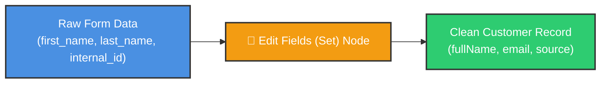
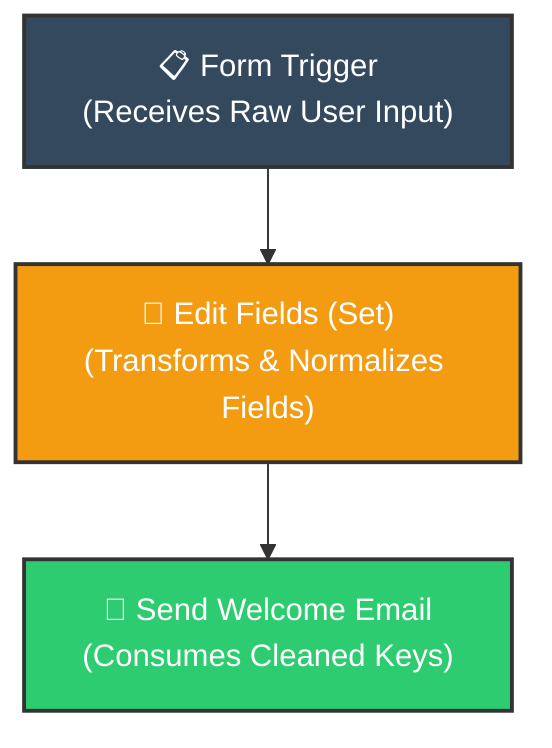
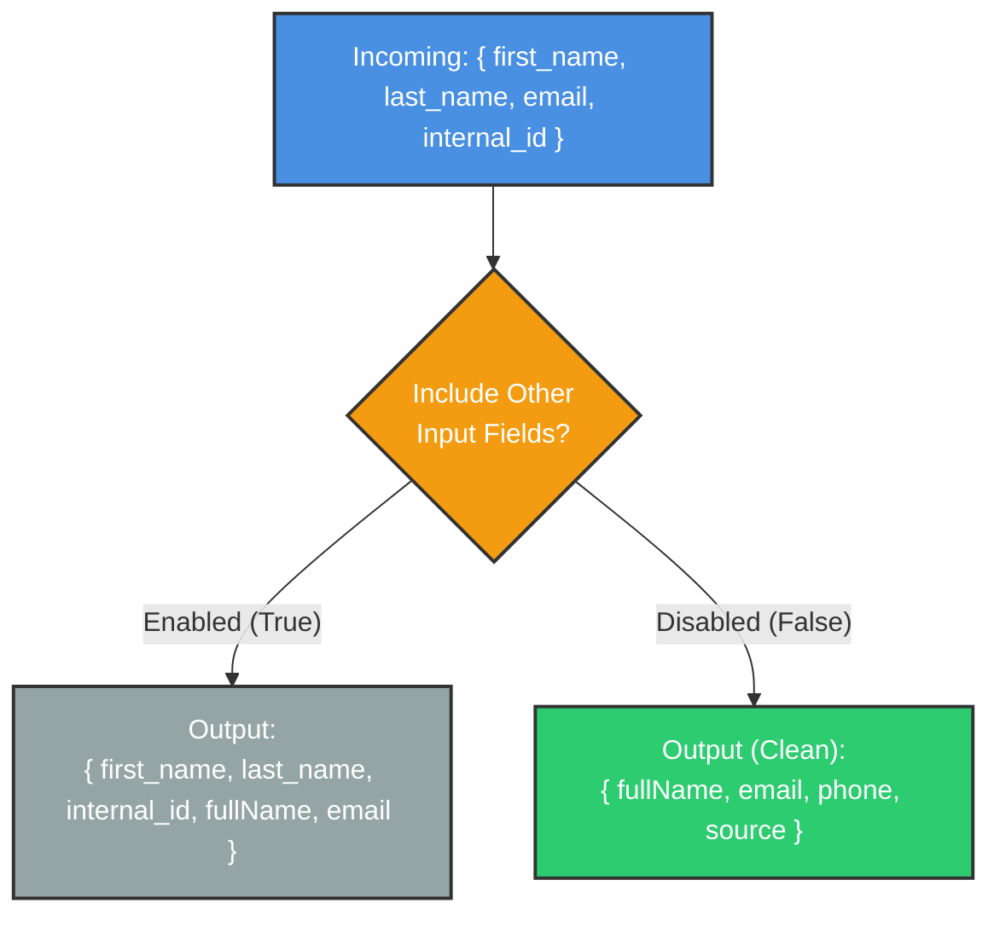

# 📝 How to Use the Set / Edit Fields Node in n8n
## Reshaping, Cleaning, and Mapping Workflow Data

<p align="center">
  <a href="02_Merge_Node.md">⬅️ Prev: Merge Node</a> •
  <a href="../README.md">Main Hub</a> •
  <a href="04_Aggregate_Node.md">Next: Aggregate Node ➡️</a> •
  <a href="https://github.com/shashilabs-io/n8n-docs">GitHub Repository</a>
</p>

---

## 🧭 How to Use This Chapter

> [!TIP]
> **Data Hygiene:** In modern data automation, incoming payloads rarely match downstream API schemas. The **Edit Fields (Set)** node acts as your primary data transformer—enabling you to construct composite keys, strip sensitive or unnecessary fields, normalize naming conventions, and cast data types with zero custom code.

### 🎯 Key Outcomes of this Chapter:
- Understand why workflows need to reshape data between triggers and destination actions.
- Use the **Edit Fields (Set)** node to add, update, rename, or drop JSON properties.
- Choose between manual field mapping and JSON-style configuration modes.
- Master the **Include Other Input Fields** toggle to control data leakage vs preservation.
- Build a hands-on data preparation pipeline: **Raw Form Submission &rarr; Cleaned Customer Record &rarr; Welcome Email**.

---

# 1. The Business Problem: Mismatched Data Contracts

Imagine a user signs up on your learning platform. Your web form produces a raw payload like this:

```json
{
  "first_name": "Riya",
  "last_name": "Verma",
  "email_address": "riya@example.com",
  "phone_number": "9876543210",
  "internal_form_id": "FORM-8821",
  "submitted_at": "2026-10-12T09:15:00Z"
}
```

While the data is valid, downstream nodes (like CRM systems or marketing tools) often require a different contract:
- `fullName` instead of separate first/last names
- `email` instead of `email_address`
- A static `source: "website"` tag
- `signupDate` instead of `submitted_at`
- Removal of internal metadata like `internal_form_id`



Passing messy, unrenamed data downstream increases brittle field mappings and causes silent failures. The **Edit Fields (Set)** node solves this by serving as the data shaping filter of your pipeline.

---

# 2. Where the Set / Edit Fields Node Fits



The trigger captures incoming user inputs. The Edit Fields node normalizes properties into the exact schema desired. The downstream email or database node consumes only the standardized values.

> [!NOTE]
> The Edit Fields node does not contact external services or send messages itself. It strictly shapes in-memory JSON data for subsequent nodes.

---

# 3. Adding and Configuring the Node

1. Open your workflow in the n8n canvas editor.
2. Search for and add the **Edit Fields (Set)** node.
   *(In older n8n versions this node is labeled **Set**; in newer releases it is labeled **Edit Fields**).*
3. Connect it directly after the data source node.
4. Select your preferred configuration mode: **Manual Mapping** or **JSON Mode**.

In manual mode, you add individual field rows defining:
- **Field Name:** The target property name in the output object.
- **Type:** String, Number, Boolean, Array, or Object.
- **Value:** Fixed text or a dynamic expression.

---

# 4. Adding Derived Fields: Generating `fullName`

Suppose your input contains separate `first_name` and `last_name` properties, but your email template expects a single `fullName` field.

### Configuration:
- **Name:** `fullName`
- **Type:** `String`
- **Value (Expression):**
  ```javascript
  {{ $json.first_name + " " + $json.last_name }}
  ```

### Resulting Output:
```json
{
  "fullName": "Riya Verma"
}
```

Expressions evaluate dynamically for every item processed in the current batch.

> [!TIP]
> Always verify the exact case and spelling of source keys in your input panel. If the source field is `First_Name`, an expression referencing `first_name` evaluates to `undefined`.

---

# 5. Renaming and Remapping Fields

A frequent pipeline requirement is translating legacy or proprietary field names into clean, standard schema keys:

| Original Input Key | Desired Standardized Key | Expression to Apply |
|---|---|---|
| `email_address` | `email` | `{{ $json.email_address }}` |
| `submitted_at` | `signupDate` | `{{ $json.submitted_at }}` |
| `phone_number` | `phone` | `{{ $json.phone_number }}` |

This mapping creates a clean output interface for downstream nodes without altering the upstream source data.

---

# 6. Preserving vs Stripping Other Input Fields

One of the most consequential configurations in the Edit Fields node is the **Include Other Input Fields** setting.



### Option A — Keep Other Input Fields (Enabled)
The output retains all original fields alongside newly created or mapped fields.
- **Best for:** Exploratory workflow development where downstream nodes may still require unmapped attributes.

### Option B — Keep Only Defined Fields (Disabled)
The output strips every property not explicitly created within this node.
- **Best for:** Production API calls, database inserts, and webhook payloads requiring strict, predictable, sanitized schemas.

```json
// Clean Sanitized Output:
{
  "fullName": "Riya Verma",
  "email": "riya@example.com",
  "phone": "9876543210",
  "source": "website",
  "signupDate": "2026-10-12T09:15:00Z"
}
```

> [!IMPORTANT]
> When disabling "Include Other Input Fields", internal tokens (like `internal_form_id`) are stripped. If a downstream node relies on an unmapped field, that node will fail. Always test and inspect the node output panel after toggling this option!

---

# 7. Hands-on Tutorial: Customer Ingestion Pipeline

### Step 1 — Inspect Incoming Data
Execute the trigger step to produce a test payload with `first_name`, `last_name`, and `email_address`.

### Step 2 — Attach Edit Fields (Set)
Place the Edit Fields node directly after the trigger.

### Step 3 — Define Normalized Fields

| Output Field | Type | Value / Expression | Notes |
|---|---|---|---|
| `fullName` | String | `{{ $json.first_name + " " + $json.last_name }}` | Concatenates names |
| `email` | String | `{{ $json.email_address }}` | Remaps email |
| `phone` | String | `{{ $json.phone_number }}` | Remaps phone |
| `source` | String | `website` | Hardcoded literal |
| `signupDate` | String | `{{ $json.submitted_at }}` | Remaps timestamp |

### Step 4 — Toggle Schema Cleanliness
Turn **Include Other Input Fields** to **Off** to discard `internal_form_id`.

### Step 5 — Test and Validate
Click **Test step** and inspect the output in JSON view. Confirm that the full name, email, and date values are properly formatted.

### Step 6 — Connect Downstream Email Node
Add a Send Email node referencing the mapped fields:
- **To:** `{{ $json.email }}`
- **Subject:** `Welcome to the Platform, {{ $json.fullName }}!`
- **Body:**
  ```text
  Hi {{ $json.fullName }},

  Welcome to our learning platform! We're glad you're here.
  ```

---

# 8. JSON-Style Configuration

For experienced developers or bulk transformations, some n8n versions support direct JSON input mode:

```json
{
  "fullName": "={{ $json.first_name + ' ' + $json.last_name }}",
  "email": "={{ $json.email_address }}",
  "phone": "={{ $json.phone_number }}",
  "source": "website",
  "signupDate": "={{ $json.submitted_at }}"
}
```

> [!NOTE]
> In raw JSON mode, prepend expressions with `=` so n8n interprets brackets dynamically rather than as literal string values.

---

# 9. Common Mistakes & Troubleshooting

| Symptom | Probable Cause | Fix |
|---|---|---|
| `fullName` displays as `undefined undefined` | Property names in expressions don't match the input keys. | Inspect input JSON and match keys exactly (e.g. `firstName` vs `first_name`). |
| Expression renders literally (`{{ ... }}`) | Field is in Fixed text mode instead of Expression mode. | Click the Expression toggle button (`FX`) on the input field. |
| Upstream fields disappeared | "Include Other Input Fields" was toggled off. | Explicitly add needed fields to the mapping or re-enable the toggle. |
| Downstream node throws `field not found` | The downstream node is still referencing the old unmapped key. | Update downstream references to use the newly mapped output field name. |
| Value type converted to string | Incorrect type selected in the dropdown. | Select Number or Boolean explicitly in the field type selector. |

---

# 10. When to Use Edit Fields (Set)

Use Edit Fields when you need to:
- Construct composite fields (e.g. `fullName`, full address strings).
- Rename or normalize field names across APIs.
- Inject static metadata (e.g. `environment: "production"`, `source: "form"`).
- Filter out sensitive, internal, or bloated properties before sending payloads externally.
- Format clean records for emails, databases, and third-party webhooks.

---

# 11. Practice Exercises & Active Recall

### Exercise A: Display Name Creation

**Input:**
```json
{
  "firstName": "Kabir",
  "lastName": "Das",
  "email": "kabir@example.com"
}
```

<details>
<summary><strong>Task: How do you configure a displayName field containing "Kabir Das"?</strong></summary>

Create a String field named `displayName` with the expression:
```javascript
{{ $json.firstName + " " + $json.lastName }}
```
</details>

---

### Exercise B: Clean Order Record

**Input:**
```json
{
  "order_id": "ORD-205",
  "customer_email": "meera@example.com",
  "amount": 1800,
  "debug_token": "TEMP-XYZ"
}
```

<details>
<summary><strong>Task: Configure the node to output orderId, email, and amount, dropping debug_token.</strong></summary>

1. Map `orderId` to `{{ $json.order_id }}`
2. Map `email` to `{{ $json.customer_email }}`
3. Map `amount` to `{{ $json.amount }}`
4. Set **Include Other Input Fields** to **Off** so `debug_token` is discarded.
</details>

---

### Exercise C: Field Preservation Logic

<details>
<summary><strong>Question: If you add fullName to a record and a downstream node requires the original email_address, what setting must you verify?</strong></summary>

You must verify that **Include Other Input Fields** is turned **On**, OR explicitly define a mapped output field for `email_address`. If disabled, unmapped original fields will be excluded from the node output.
</details>

---

# 12. Key Takeaways

- The **Edit Fields (Set)** node is n8n's primary data-shaping tool.
- Use expressions with `{{ $json.fieldName }}` to generate dynamic values from incoming items.
- Control output schema cleanliness with the **Include Other Input Fields** setting.
- Always inspect the node's JSON output panel to verify property names and data types before wiring downstream actions.

---

<p align="center">
  <b>Next Step:</b> Learn how to group and summarize data in <a href="04_Aggregate_Node.md">Chapter 4: The Aggregate Node</a> or return to the <a href="../README.md">Main Hub</a>.
</p>
