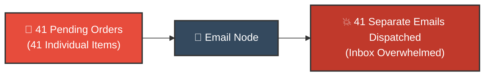
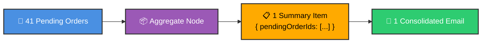
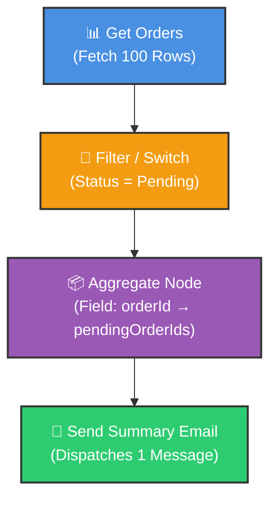

# 📦 How to Use the Aggregate Node in n8n
## Summarizing and Batching Multi-Item Streams

<p align="center">
  <a href="03_Set_Node.md">⬅️ Prev: Set / Edit Fields Node</a> •
  <a href="../README.md">Main Hub</a> •
  <a href="05_Remove_Duplicates_Node.md">Next: Remove Duplicates Node ➡️</a> •
  <a href="https://github.com/shashilabs-io/n8n-docs">GitHub Repository</a>
</p>

---

## 🧭 How to Use This Chapter

> [!TIP]
> **Batching vs Looping:** By default, n8n executes downstream actions once per incoming item. When processing 50 leads or 100 pending orders, connecting them straight to Slack or Email dispatches 50 to 100 individual messages. The **Aggregate Node** condenses an entire stream of items into a single summary payload.

### 🎯 Key Outcomes of this Chapter:
- Explain why workflows need to collapse many incoming items into a single summary item.
- Aggregate selected JSON properties into an array.
- Understand the structural difference between `N` individual items vs `1` item holding an array.
- Dispatch single consolidated notifications (e.g. daily summaries) instead of high-frequency spam.
- Learn why aggregation does **not** replace filtering or remove duplicates automatically.

---

# 1. The Business Problem: Notification Spam

Imagine an e-commerce store with dozens of pending orders requiring manual review. A workflow runs every morning to alert customer support.

If there are 41 pending orders, connecting the query directly to an Email or Slack node triggers **41 separate notifications**:



A far better operational pattern is to send **one summary email** containing the full list of pending order IDs:



> [!IMPORTANT]
> **Aggregation is Not Deduplication:** The Aggregate node groups data; it does **not** make values unique. If an order ID appears multiple times in the source items, it will appear multiple times in the resulting array.

---

# 2. Understanding the Data Structure Shift

Suppose an upstream node outputs three pending orders:

```json
[
  { "orderId": "ORD-001", "status": "pending" },
  { "orderId": "ORD-002", "status": "pending" },
  { "orderId": "ORD-003", "status": "pending" }
]
```

Each object is a separate item in n8n's item array. If directly wired to an action node, the action runs 3 times.

### The Aggregated Result

When you aggregate the `orderId` property into `pendingOrderIds`:

```json
[
  {
    "pendingOrderIds": [
      "ORD-001",
      "ORD-002",
      "ORD-003"
    ]
  }
]
```

### Notice the Two Structural Levels:
1. **The Outer Array (`[...]`):** Still contains n8n items, but now contains **only 1 item**.
2. **The Inner Array:** The property `pendingOrderIds` holds the array of extracted strings.

Because downstream action nodes execute once per item in the outer array, the downstream node now executes **exactly once**.

---

# 3. Step-by-Step Workflow Setup



### Configuration Steps

1. Add an **Aggregate** node after your Filter or Switch node.
2. Select the mode for aggregating **Selected Fields** (rather than all item data).
3. Set the target field to aggregate: `orderId`.
4. Name the output field `pendingOrderIds`.
5. Click **Test step** and inspect the output schema.

| Metric | Before Aggregation | After Aggregation |
|---|---|---|
| **Item Count** | 41 Input Items | 1 Output Item |
| **Data Shape** | Individual order objects | One object containing an array of IDs |
| **Downstream Executions** | 41 Email calls | 1 Consolidated Email call |

---

# 4. Using Aggregated Data in Downstream Actions

Connect the Aggregate node directly to your Email or Slack node.

### Subject Configuration:
```text
Pending Orders Summary ({{ $now.toFormat('yyyy-MM-dd') }})
```

### Body Configuration:
```text
Hello Team,

The following pending orders require immediate customer verification:

{{ $json.pendingOrderIds.join(', ') }}

Total Pending: {{ $json.pendingOrderIds.length }}
```

> [!TIP]
> Use `.join('\n• ')` or `.join(', ')` in your JavaScript expressions to format raw arrays into bullet points or clean comma-separated lists for human readability.

---

# 5. Aggregation Modes Compared

The Aggregate node supports two primary approaches:

| Mode | Behavior | Best Used For |
|---|---|---|
| **Aggregate Selected Fields** | Extracts specific fields into dedicated arrays (e.g. `orderIds`). | Lean summaries, notification alerts, ID lookups. |
| **Aggregate All Item Data** | Gathers the entire object structure of all items into an array of objects. | Passing complete raw datasets to sub-workflows or bulk APIs. |

---

# 6. Critical Architecture: Filter Before Aggregating

Suppose operations needs an alert for **high-priority pending orders**.

> [!WARNING]
> Checking only `priority == "high"` is dangerous. A high-priority order might already be shipped, delivered, or canceled!

The filtering logic must evaluate both criteria:

$$\text{Priority} = \text{"high"} \quad \mathbf{AND} \quad (\text{Status} = \text{"pending"} \;\mathbf{OR}\; \text{Status} = \text{"processing"})$$

**Why this matters:** The Aggregate node blindly summarizes whatever records reach it. If upstream logic leaks delivered orders, your summary will mislead the operations team.

---

# 7. Common Mistakes & Troubleshooting

| Symptom | Probable Cause | Fix |
|---|---|---|
| **Email node still sends 40+ messages** | Upstream items bypassed the Aggregate node, or Aggregate was configured to output individual items. | Ensure Aggregate node output contains only 1 item before wiring to Email. |
| **The aggregated list is empty** | Field name in Aggregate settings doesn't match the incoming JSON property name. | Match property casing exactly (e.g. `orderId` vs `order_id`). |
| **Output shows raw JSON `[object Object]`** | Array was not formatted for string display. | Use expressions like `{{ $json.pendingOrderIds.join(', ') }}`. |
| **Duplicate IDs appear in summary** | Source data contains duplicate entries. | Insert a **Remove Duplicates** node prior to aggregation. |
| **Summary includes completed orders** | Upstream filter condition was incomplete or missing. | Tighten filter criteria before the Aggregate node. |

---

# 8. Practice Exercises & Active Recall

### Exercise A: Output Prediction

**Input:**
```json
[
  { "ticketId": "T-10", "team": "Support" },
  { "ticketId": "T-11", "team": "Support" },
  { "ticketId": "T-12", "team": "Support" }
]
```

<details>
<summary><strong>Task: What is the output when aggregating ticketId into ticketIds?</strong></summary>

```json
[
  {
    "ticketIds": ["T-10", "T-11", "T-12"]
  }
]
```
Three incoming items become one item containing an array of three strings.
</details>

---

### Exercise B: Reducing Alert Fatigue

<details>
<summary><strong>Task: A workflow currently fires 25 individual emails for 25 pending orders. Where do you place the Aggregate node?</strong></summary>

Place the Aggregate node directly after the pending orders filter and before the Email node. Aggregate `orderId` into `pendingOrderIds`, so the Email node fires only once with the full list.
</details>

---

### Exercise C: Root Cause Analysis

<details>
<summary><strong>Problem: An aggregated summary sent to operations includes already-delivered orders. What went wrong?</strong></summary>

The upstream filter checked priority (e.g. `priority == "high"`) but omitted the status condition (`status == "pending"`). Aggregation only collects the items passed to it; filtering must enforce business constraints upstream.
</details>

---

### Exercise D: Deduplication Logic

<details>
<summary><strong>Question: If your aggregated list contains ORD-001 twice, did the Aggregate node fail?</strong></summary>

No. The Aggregate node's job is solely grouping items, not deduplication. To ensure unique values, insert a **Remove Duplicates** node before aggregation.
</details>

---

# 9. Key Takeaways

- The **Aggregate** node condenses multiple incoming items into a single item containing array collections.
- It prevents email/Slack notification spam by converting item-by-item actions into single summary dispatches.
- Downstream actions execute once for each item in the outer array.
- **Rule of Thumb:** Filter to select &rarr; Deduplicate to ensure uniqueness &rarr; Aggregate to collect.

---

<p align="center">
  <b>Next Step:</b> Eliminate duplicate data in <a href="05_Remove_Duplicates_Node.md">Chapter 5: The Remove Duplicates Node</a> or return to the <a href="../README.md">Main Hub</a>.
</p>
