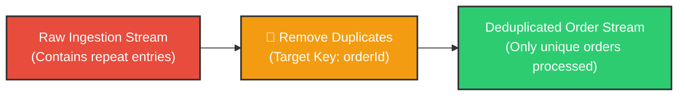
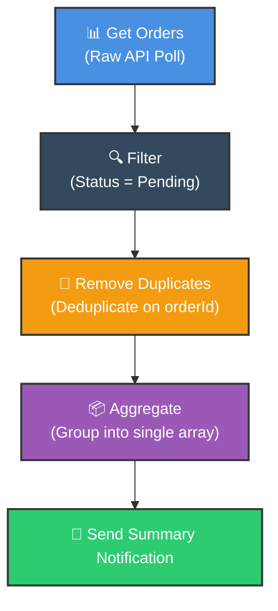

# 🧹 How to Use the Remove Duplicates Node in n8n
## A Practical Guide to Cleaning Repeated Records

<p align="center">
  <a href="04_Aggregate_Node.md">⬅️ Prev: Aggregate Node</a> •
  <a href="../README.md">Main Hub</a> •
  <a href="06_Google_Forms_Webhook.md">Next: Webhooks & Google Forms ➡️</a> •
  <a href="https://github.com/shashilabs-io/n8n-docs">GitHub Repository</a>
</p>

---

## 🧭 How to Use This Chapter

> [!TIP]
> **Data Idempotency:** Duplicate records pollute CRMs, trigger duplicate billing events, and trigger redundant customer notifications. Understanding how to configure the **Remove Duplicates Node**—and distinguishing between in-batch deduplication and cross-execution history—ensures data consistency across automated pipelines.

### 🎯 Key Outcomes of this Chapter:
- Understand why duplicate records arise in real-world automation pipelines.
- Configure the **Remove Duplicates** node using targeted properties vs entire objects.
- Differentiate between **Within-Batch** deduplication and **Cross-Execution** persistent tracking.
- Distinguish between true duplicate orders vs legitimate multiple orders from the same customer.
- Build resilient pipelines: **Ingest &rarr; Filter &rarr; Deduplicate &rarr; Aggregate &rarr; Dispatch**.

---

# 1. The Business Problem: What Counts as a Duplicate?

Consider these incoming e-commerce orders:

```json
[
  { "orderId": "ORD-001", "customerEmail": "riya@example.com" },
  { "orderId": "ORD-002", "customerEmail": "kabir@example.com" },
  { "orderId": "ORD-001", "customerEmail": "riya@example.com" },
  { "orderId": "ORD-003", "customerEmail": "riya@example.com" }
]
```

There are two distinct types of repetition occurring here:
1. `ORD-001` appears twice: This represents a true duplicate order record (likely an ingestion retry error).
2. `riya@example.com` appears across two distinct orders (`ORD-001` and `ORD-003`): This is **not** a duplicate order—one loyal customer simply placed multiple purchases.



> [!IMPORTANT]
> **Business Rule Definition:** What constitutes a duplicate depends strictly on your business rule.
> - **One record per purchase:** Compare `orderId`.
> - **One marketing notification per user:** Compare `customerEmail`.

The **Remove Duplicates** node identifies and prunes redundant records according to your chosen comparison criteria.

---

# 2. Where the Node Fits in Pipeline Architecture

A standard data cleaning and notification pipeline:



> [!TIP]
> **Placement Matters:** Always deduplicate **before** aggregating. If you aggregate items into an array first, the Remove Duplicates node sees only 1 item and will not inspect inside the nested array.

---

# 3. Adding and Configuring the Node

1. Insert the **Remove Duplicates** node directly after the source or filter node.
2. Open the node configuration panel.
3. Choose the comparison scope:
   - **Compare Entire Item:** Items are considered duplicates only if all properties are 100% identical.
   - **Compare Selected Fields:** Items are considered duplicates if specified keys (e.g. `orderId`) match.
4. Execute the node with test data and inspect surviving records.

---

# 4. Example 1: Deduplicating Order Records

**Incoming Raw Payload:**
```json
[
  { "orderId": "ORD-001", "amount": 1200 },
  { "orderId": "ORD-002", "amount": 700 },
  { "orderId": "ORD-001", "amount": 1200 },
  { "orderId": "ORD-003", "amount": 450 }
]
```

Configuring the node to compare by `orderId`:

**Cleaned Output Stream:**
```json
[
  { "orderId": "ORD-001", "amount": 1200 },
  { "orderId": "ORD-002", "amount": 700 },
  { "orderId": "ORD-003", "amount": 450 }
]
```

The second occurrence of `ORD-001` is safely dropped.

### Partial vs Complete Matches
Consider these two records:
```json
[
  { "orderId": "ORD-010", "status": "pending" },
  { "orderId": "ORD-010", "status": "processing" }
]
```
- If comparing by **orderId**: They are considered duplicates (the second record is dropped).
- If comparing by **all fields**: They are treated as distinct records because `status` differs.

---

# 5. Example 2: One Notification Per Customer

Suppose customer support wants to dispatch a single daily reminder per customer, regardless of how many orders they have open:

**Input:**
```json
[
  { "orderId": "ORD-101", "customerEmail": "riya@example.com" },
  { "orderId": "ORD-102", "customerEmail": "riya@example.com" },
  { "orderId": "ORD-103", "customerEmail": "kabir@example.com" }
]
```

Configuring deduplication on `customerEmail`:

**Result:**
```json
[
  { "orderId": "ORD-101", "customerEmail": "riya@example.com" },
  { "orderId": "ORD-103", "customerEmail": "kabir@example.com" }
]
```

> [!WARNING]
> **Information Loss Warning:** Notice that `ORD-102` was discarded. If downstream processes need all order IDs for Riya, do **not** simply drop duplicates on email. Instead, group and aggregate orders by customer before emailing!

---

# 6. In-Batch vs Cross-Execution Tracking

| Scope | Operational Scope | Typical Use Case |
|---|---|---|
| **Within Current Input** | Removes duplicates strictly within the current run's item array. | Cleaning multi-row spreadsheet imports or webhook bursts. |
| **Across Executions** | Keeps persistent state of seen IDs to discard records seen in previous runs. | Scheduled polling triggers (e.g. RSS feeds, new CRM leads). |

> [!NOTE]
> For critical financial transactions (e.g. Stripe charges, database ledger entries), do not rely solely on workflow node memory. Always combine with database unique constraints and API idempotency keys.

---

# 7. Testing Your Deduplication Strategy

Always test with an intentional edge-case dataset:
1. One record that appears identically twice.
2. Two records with the same email but different order IDs.
3. Two records with the same ID but conflicting status fields.

Inspect the output panel:
- Did the node retain the first copy or the latest copy?
- Did distinct orders from the same customer survive where intended?
- Is the item count exactly as predicted?

---

# 8. Common Mistakes & Troubleshooting

| Symptom | Probable Cause | Fix |
|---|---|---|
| **Legitimate customer orders missing** | Deduplicated on `customerEmail` instead of `orderId`. | Switch target field to `orderId`. |
| **Duplicates still slip through** | Target field name has casing mismatch or space differences. | Verify property spelling in the node output panel. |
| **Wrong record retained** | Node keeps first item by default; needed the latest updated status. | Sort items by timestamp descending before the deduplication step. |
| **Array values inside an item are not deduplicated** | Node operates on items, not elements inside a nested array. | Use a Code node or transform array elements before deduplicating. |
| **Same record processes again on tomorrow's run** | Persistent cross-execution tracking was disabled. | Enable persistent history or write processed IDs to a database. |

---

# 9. Practice Exercises & Active Recall

### Exercise A: Order Record Hygiene

**Input:**
```json
[
  { "orderId": "A-1", "total": 500 },
  { "orderId": "A-2", "total": 700 },
  { "orderId": "A-1", "total": 500 }
]
```

<details>
<summary><strong>Task: Which field should you use to ensure one record per purchase?</strong></summary>

Use `orderId`. This strips the duplicate `A-1` record while preserving distinct purchases like `A-2`.
</details>

---

### Exercise B: Customer Notification Routing

**Input:**
```json
[
  { "orderId": "B-1", "email": "sam@example.com" },
  { "orderId": "B-2", "email": "sam@example.com" },
  { "orderId": "B-3", "email": "lee@example.com" }
]
```

<details>
<summary><strong>Task: What is the comparison key for one email per customer, and what is the potential tradeoff?</strong></summary>

The comparison key is `email`. The tradeoff is that order `B-2` is dropped completely. If Sam needs an itemized receipt of both orders, aggregate orders by customer instead of dropping duplicates.
</details>

---

### Exercise C: Array vs Item Deduplication

**Input:**
```json
{
  "orderIds": ["A-1", "A-1", "A-2"]
}
```

<details>
<summary><strong>Question: Will a standard Remove Duplicates node deduplicate the array above?</strong></summary>

No. The Remove Duplicates node evaluates separate incoming n8n items (`[{...}, {...}]`). Because this is a single item with a nested array, the node sees only 1 item and passes it through unchanged. You must use JavaScript expressions (e.g. `[...new Set($json.orderIds)]`) or split items first.
</details>

---

# 10. Key Takeaways

- The **Remove Duplicates** node cleans redundant items based on exact fields or complete object schemas.
- Deduplication is only as good as the rule defined: differentiate between duplicate transactions vs duplicate customers.
- Deduplicate items **before** aggregating them into summary arrays.
- For recurring scheduled workflows, consider cross-execution tracking or database-backed idempotency checks.

---

<p align="center">
  <b>Next Step:</b> Connect external forms in <a href="06_Google_Forms_Webhook.md">Chapter 6: Google Forms & Webhooks</a> or return to the <a href="../README.md">Main Hub</a>.
</p>
