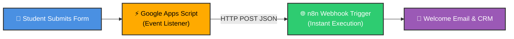
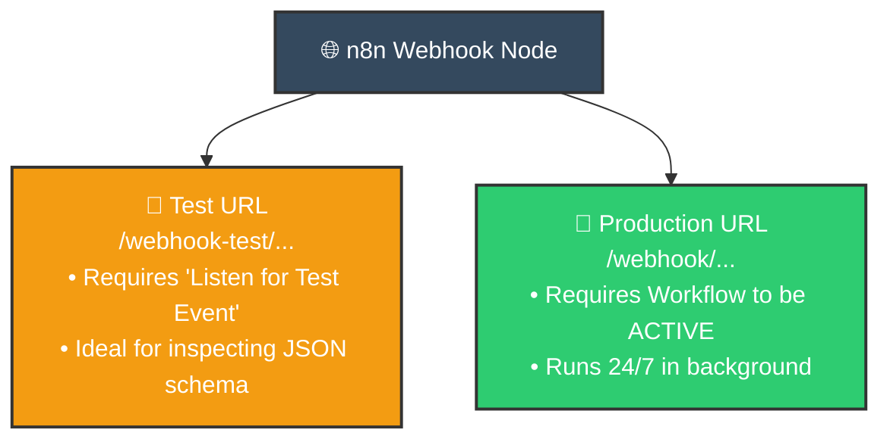

# 🌐 Connecting Google Forms to n8n via Webhooks
## Instant Event-Driven Ingestion with Google Apps Script

<p align="center">
  <a href="05_Remove_Duplicates_Node.md">⬅️ Prev: Remove Duplicates Node</a> •
  <a href="../README.md">Main Hub</a> •
  <a href="07_Quick_Start_Multi_App_Lead_Management.md">Next: Multi-App Lead Management ➡️</a> •
  <a href="https://github.com/shashilabs-io/n8n-docs">GitHub Repository</a>
</p>

---

## 🧭 How to Use This Chapter

> [!TIP]
> **Event-Driven Architecture:** Polling a spreadsheet every 10 minutes introduces latency and burns execution quota. Using Google Apps Script to fire a direct HTTP POST request to an **n8n Webhook Node** transforms form submissions into instant, real-time trigger events.

### 🎯 Key Outcomes of this Chapter:
- Understand the 3-part event pipeline: **Google Forms &rarr; Apps Script &rarr; n8n Webhook**.
- Create and configure an HTTP POST **Webhook** node in n8n.
- Deploy an `onFormSubmit` script inside Google Apps Script to forward responses in JSON.
- Master the difference between **Test URLs** (development/listening) and **Production URLs** (activated).
- Debug common webhook delivery failures, CORS issues, and payload nesting structures.

---

# 1. The Business Problem: Real-Time Form Submissions

Imagine you run an online course and use Google Forms to collect student registrations. Every time a student submits a registration, you want n8n to execute immediately:
- Send an instant personalized welcome email.
- Insert the student into a centralized CRM or database.
- Alert your team in Slack.



Google Forms cannot natively send webhooks to arbitrary URLs without intermediary code. A lightweight **Google Apps Script** acts as the trigger bridge, capturing submission answers and dispatching them via `UrlFetchApp` directly to your n8n webhook URL.

---

# 2. Understanding the Three Core Components

| Component | Operational Role | Key Responsibility |
|---|---|---|
| **Google Forms** | Front-end input UI | Captures user responses (`fullName`, `email`, `course`). |
| **Google Apps Script** | Serverless event runner | Captures form event, serializes answers into JSON, and dispatches HTTP POST. |
| **n8n Webhook Node** | Ingestion gateway | Exposes a secure endpoint URL, decodes JSON payload, and wakes up the canvas. |

Think of the **Webhook node** as an open door into your n8n canvas, and **Apps Script** as the messenger delivering the envelope.

---

# 3. Configuring the Webhook Node in n8n

1. Open your n8n workflow canvas.
2. Add a **Webhook** node as your starting trigger.
3. Set **HTTP Method** to `POST` (since the script will send a request body payload).
4. Note the two URL options provided by n8n:
   - **Test URL:** Used while building, inspecting data, and debugging.
   - **Production URL:** Used once the workflow is toggled **Active**.



> [!IMPORTANT]
> **Test vs Production URLs:** Never put the Test URL into production code. The Test URL only responds when you have manually clicked "Listen for test event" inside the editor. For 24/7 reliability, you must use the Production URL and toggle the workflow switch to **Active**.

---

# 4. Preparing the Google Form

Create a form containing your target questions:

| Question Title | Expected Answer Type | Example Payload |
|---|---|---|
| **Full Name** | Short answer | `Riya Verma` |
| **Email Address** | Short answer | `riya@example.com` |
| **Course** | Multiple choice / Dropdown | `n8n Automation Basics` |

Link your form to a Google Sheet (via the *Responses* tab) to enable spreadsheet-bound trigger automation.

---

# 5. Writing the Google Apps Script

In your form's linked Google Sheet, click **Extensions &rarr; Apps Script**. Replace any existing code with the following snippet:

```javascript
// Replace with your n8n Webhook URL (Test URL first, Production URL later)
var POST_URL = "https://your-n8n-instance.com/webhook-test/your-unique-path";

function onSubmit(e) {
  var form = FormApp.getActiveForm();
  var allResponses = form.getResponses();
  var latestResponse = allResponses[allResponses.length - 1];
  var response = latestResponse.getItemResponses();
  
  var payload = {};
  for (var i = 0; i < response.length; i++) {
    var question = response[i].getItem().getTitle();
    var answer = response[i].getResponse();
    payload[question] = answer;
  }

  var options = {
    "method": "post",
    "contentType": "application/json",
    "payload": JSON.stringify(payload)
  };

  UrlFetchApp.fetch(POST_URL, options);
}
```

### Key Elements of the Script:
- `POST_URL`: The destination webhook URL from n8n.
- `latestResponse.getItemResponses()`: Dynamically extracts each question title and user answer.
- `UrlFetchApp.fetch()`: Google's native HTTP client that performs the outbound POST.
- `contentType: "application/json"`: Informs n8n to parse the incoming body as structured JSON automatically.

---

# 6. Configuring the Apps Script Trigger

Writing the function is not enough—you must bind it to the form submission trigger:

1. In the Apps Script sidebar, click the **Triggers (Clock)** icon.
2. Click **Add Trigger** (bottom right).
3. Choose the function to run: `onSubmit`.
4. Select event source: **From form** (or **From spreadsheet**).
5. Select event type: **On form submit**.
6. Click **Save** and grant the required Google account permissions.

> [!WARNING]
> If you omit this step, the script will never execute automatically when a user submits the form.

---

# 7. End-to-End Testing Procedure

Follow this verification order to isolate issues:

### Step 1 — Arm n8n's Listener
In n8n, open the Webhook node and click **Listen for test event**. The canvas will display a waiting state.

### Step 2 — Submit Test Form
Open your Google Form in a new tab and submit realistic sample data.

### Step 3 — Inspect Incoming Webhook Data
Within seconds, the Webhook node in n8n will turn green. Click on it to inspect the incoming payload:

```json
{
  "headers": { ... },
  "params": {},
  "query": {},
  "body": {
    "Full Name": "Riya Verma",
    "Email Address": "riya@example.com",
    "Course": "n8n Automation Basics"
  }
}
```

> [!NOTE]
> Incoming form values are located inside `$json.body`. Downstream expressions can reference them via `{{ $json.body["Full Name"] }}` or `{{ $json.body["Email Address"] }}`.

### Step 4 — Switch to Production
1. In n8n, toggle the workflow switch in the top bar to **Active**.
2. Copy the **Production URL** from the Webhook node.
3. Update `POST_URL` in the Google Apps Script editor and save.
4. Submit another form entry to verify live unattended execution!

---

# 8. Common Problems & Troubleshooting

| Problem | Root Cause | Solution |
|---|---|---|
| **Webhook never triggers in test mode** | n8n was not actively in "Listen for test event" mode when the form was submitted. | Click "Listen for test event" *before* submitting the form. |
| **Script execution fails in Apps Script** | Permissions were not authorized or trigger wasn't created. | Check Apps Script *Executions* tab for error stack traces; re-authorize permissions. |
| **Workflow works in test, fails in production** | Script is still pointing to the `webhook-test` URL, or workflow is inactive. | Update script to the Production URL and verify workflow is toggled **Active**. |
| **Questions missing from payload** | Questions were added or edited after trigger creation. | Re-save the form and verify question title strings. |
| **Network timeout / 403 Forbidden** | Self-hosted n8n instance is behind a firewall or lacks a public SSL certificate. | Ensure your n8n instance URL is publicly accessible from Google's servers. |

---

# 9. Security & Production Best Practices

- **Protect Your Webhook URL:** Anyone who knows an unauthenticated webhook URL can send forged data.
- **Add Authentication / Headers:** Include a custom header token in Apps Script options (e.g. `headers: { "x-secret-key": "my-token" }`) and validate it in n8n.
- **Data Validation:** Always attach an **Edit Fields** or **Filter** node immediately after the webhook to sanitize inputs before downstream processing.

---

# 10. Practice Exercises & Active Recall

<details>
<summary><strong>1. Why is an Apps Script required between Google Forms and n8n?</strong></summary>

Google Forms does not natively provide outbound HTTP webhooks. Apps Script acts as the intermediary event listener that catches the submission and issues an HTTP POST to n8n.
</details>

<details>
<summary><strong>2. What is the fundamental difference between a Webhook Test URL and a Production URL?</strong></summary>

The Test URL (`/webhook-test/...`) only listens on demand when you click "Listen for test event" in the editor. The Production URL (`/webhook/...`) runs persistently in the background whenever the workflow is active.
</details>

<details>
<summary><strong>3. Under which JSON property does the Webhook node place incoming form data?</strong></summary>

Incoming form answers are stored inside `$json.body` (e.g. `$json.body["Full Name"]`).
</details>

<details>
<summary><strong>4. Why did a live production workflow stop receiving responses after testing was finished?</strong></summary>

The Apps Script was likely left configured with the temporary Test URL rather than being updated with the persistent Production URL.
</details>

---

# 11. Key Takeaways

- The **Webhook** node transforms n8n into a real-time event receiver.
- Use Google Apps Script `UrlFetchApp` with an `onFormSubmit` trigger to bridge Google Forms to n8n.
- Always validate the pipeline using the **Test URL** first, then switch to the **Production URL** and activate the workflow.
- Normalize incoming field names using an **Edit Fields (Set)** node immediately downstream.

---

<p align="center">
  <b>Next Step:</b> Build an end-to-end multi-app pipeline in <a href="07_Quick_Start_Multi_App_Lead_Management.md">Chapter 7: Multi-App Lead Management</a> or return to the <a href="../README.md">Main Hub</a>.
</p>
