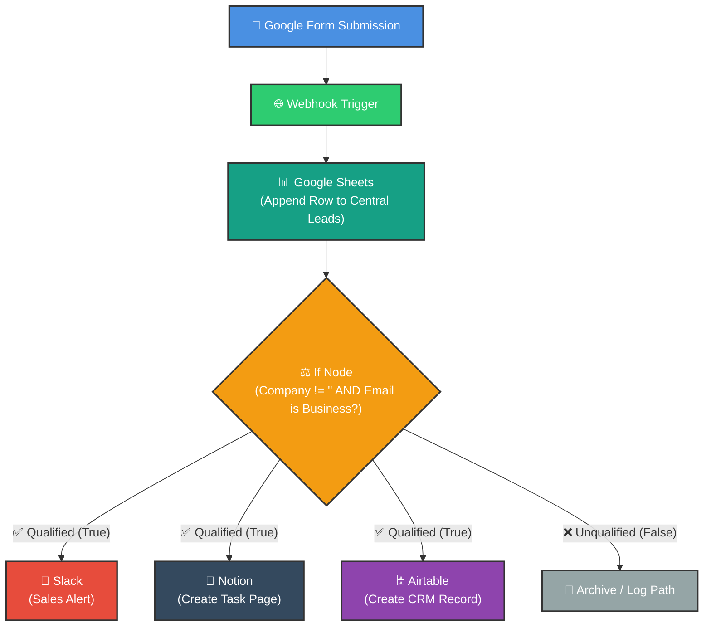
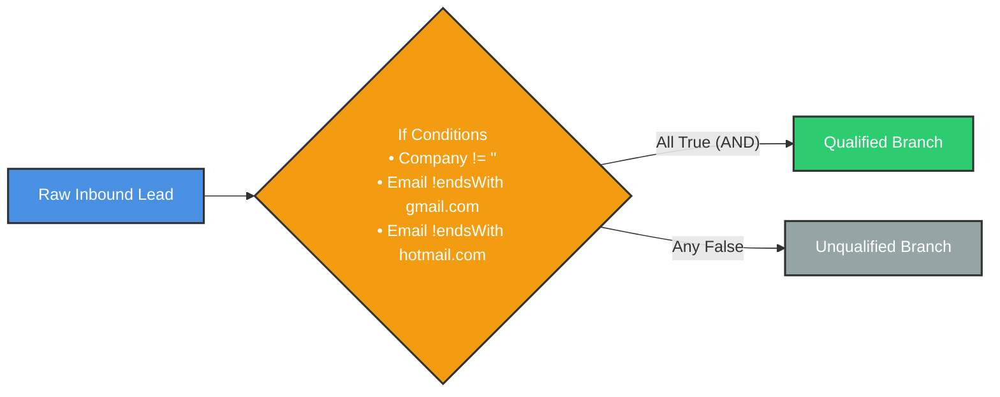

# 🚀 Multi-App Lead Management: Forms, Sheets, Slack, Notion & Airtable
## Connecting Disparate Cloud Apps into a Unified CRM Pipeline

<p align="center">
  <a href="06_Google_Forms_Webhook.md">⬅️ Prev: Google Forms & Webhooks</a> •
  <a href="../README.md">Main Hub</a> •
  <a href="08_Master_Conditional_Logic.md">Next: Conditional Logic (If / Switch) ➡️</a> •
  <a href="https://github.com/shashilabs-io/n8n-docs">GitHub Repository</a>
</p>

---

## 🧭 How to Use This Chapter

> [!TIP]
> **Orchestration Power:** Most businesses suffer from "SaaS fragmentation"—customer leads arrive in Google Forms, team communications live in Slack, tasks belong in Notion, and client data rests in Airtable. This chapter walks through an end-to-end automation blueprint that ingests, logs, qualifies, alerts, and records leads across 5 distinct platforms in under 2 seconds.

### 🎯 Key Outcomes of this Chapter:
- Understand how n8n acts as an event-driven orchestration bridge between disparate SaaS APIs.
- Ingest live form submissions via an HTTP POST **Webhook** node.
- Append raw records directly to a master **Google Sheets** spreadsheet.
- Route leads through an **If** node using business qualification heuristics.
- Dispatch targeted **Slack** notifications for hot inbound leads.
- Dynamically generate task pages in a **Notion** workspace database.
- Create structured CRM customer records inside **Airtable** using Personal Access Tokens (PAT).

---

# 1. The Business Problem: Manual SaaS Sprawl

Imagine a fast-growing business collecting inquiries from multiple Google Forms. Without automation, sales staff are burdened with manual busywork:

1. Constantly check email for form submission notifications.
2. Copy and paste answers into a master Google Sheet.
3. Manually evaluate whether the lead is a business lead or personal inquiry.
4. Notify sales reps in Slack.
5. Create a follow-up task card inside Notion.
6. Create or update the contact in Airtable CRM.

This manual process takes 15–20 minutes per lead, delays response time, and causes data entry errors.



---

# 2. Step 1: Ingest Form Data with Webhook

1. Add a **Webhook** node set to `POST`.
2. Copy the **Test URL** and insert it into your Google Apps Script `onSubmit` handler.
3. Arm n8n by clicking **Listen for test event**.
4. Submit a test form response with sample values:
   - First Name: `Dheeraj`
   - Last Name: `Sharma`
   - Email: `dheeraj@example.com`
   - Company Name: `Example Ltd`
   - Role: `Owner`
5. Inspect the incoming JSON payload in n8n.

> [!NOTE]
> Always verify that your form question titles match the incoming property keys inside `$json.body`.

---

# 3. Step 2: Append Every Lead to Google Sheets

The Google Sheet serves as the master audit log of all inquiries, whether qualified or not.

### Configuration Sequence:
1. Connect a **Google Sheets** node directly after the Webhook.
2. Select your connected Google OAuth2 credential.
3. Set Resource to **Document / Sheet** and Operation to **Append Row**.
4. Map the spreadsheet columns:

| Spreadsheet Column | Mapped JSON Expression |
|---|---|
| **First Name** | `{{ $json.body["First Name"] }}` |
| **Last Name** | `{{ $json.body["Last Name"] }}` |
| **Email** | `{{ $json.body["Email Address"] }}` |
| **Company Name** | `{{ $json.body["Company Name"] }}` |
| **Role** | `{{ $json.body["Role"] }}` |

> [!WARNING]
> **Append vs Append or Update:** Selecting *Append or Update Row* requires a unique matching column to identify existing rows. For simple lead ingestion, always choose **Append Row** to avoid configuration errors.

---

# 4. Step 3: Qualify the Lead with an If Node

Not all inquiries warrant immediate sales interruption. An **If** node evaluates qualification criteria:



### Conditions to Configure:
1. `{{ $json.body["Company Name"] }}` **is not empty**
2. `{{ $json.body["Email Address"] }}` **does not end with** `gmail.com`
3. `{{ $json.body["Email Address"] }}` **does not end with** `hotmail.com`

Set the condition combination rule to **ALL (AND)**. Only leads satisfying every rule pass to the True branch.

---

# 5. Step 4A: Sales Alert via Slack

On the True (qualified) branch, add a **Slack** node to notify the sales team in real time.

- **Resource:** `Message`
- **Operation:** `Send`
- **Channel:** `#leads-inbound`
- **Message Content:**
  ```text
  🚨 *New Qualified Lead Alert!*
  • *Name:* {{ $json["First Name"] }} {{ $json["Last Name"] }}
  • *Email:* {{ $json["Email"] }}
  • *Company:* {{ $json["Company Name"] }}
  • *Role:* {{ $json["Role"] }}
  ```

---

# 6. Step 4B: Create Follow-Up Task in Notion

Add a **Notion** node concurrently to track follow-up tasks.

### A. Notion Integration Setup
1. In Notion, go to **Settings &rarr; Connections &rarr; Develop or manage integrations**.
2. Create an **Internal Integration Token** and save it in n8n credentials.
3. Open the target Notion Database and click **••• &rarr; Connections &rarr; Connect to [Your Integration]**.

> [!IMPORTANT]
> Merely creating an integration token does not grant access. You **must explicitly share** the database page with the integration inside Notion, or the database will not appear in n8n.

### B. Configure Notion Node
- **Resource:** `Database Page`
- **Operation:** `Create`
- **Database:** Select your Sales Tasks database.
- **Title:** `Follow up: {{ $json["Company Name"] }}`
- **Properties:** Set `Status` to `"Not Started"` and `Priority` to `"High"`.
- **Page Content:** Insert bullet blocks with customer contact details.

---

# 7. Step 4C: Create CRM Customer Record in Airtable

Connect an **Airtable** node on the qualified branch to maintain customer records.

### A. Authentication & Scopes (Least Privilege)
Create an Airtable Personal Access Token (PAT) with restricted scopes:
- `data.records:read`
- `data.records:write`
- `schema.bases:read`
- **Access:** Grant access **only** to your specific CRM base (never all workspaces).

### B. Configure Airtable Node
- **Resource:** `Record`
- **Operation:** `Create`
- **Base:** `Sales CRM`
- **Table:** `Customers`
- **Fields Mapping:**
  - Name: `{{ $json["First Name"] + " " + $json["Last Name"] }}`
  - Email: `{{ $json["Email"] }}`
  - Company: `{{ $json["Company Name"] }}`
  - Status: `Lead`

> [!WARNING]
> **Field Type Mismatch:** If Airtable uses a Single-Select field for `Role` with values `["Owner", "Manager"]`, an incoming free-text value like `"founder"` will cause an API error. Ensure dropdown choices in your form strictly match Airtable field options.

---

# 8. Troubleshooting Checklist

| Symptom | Probable Cause | Actionable Fix |
|---|---|---|
| **Webhook receives nothing** | Test listener not armed or wrong URL configured. | Start listening in n8n *before* submitting test form; verify URL. |
| **Google Sheets errors on execution** | Operation set to *Append or Update Row* without match column. | Switch operation to **Append Row**. |
| **Notion database not found** | Integration lacks page permissions. | Click Notion page menu `••• &rarr; Connections` and add the integration. |
| **Airtable rejects creation** | Field-type conflict (e.g. invalid select value or number string). | Inspect field types in Airtable and normalize values in n8n. |
| **Airtable credential unauthorized** | PAT expired or missing required scopes. | Regenerate PAT with `data.records:write` and `schema.bases:read`. |

---

# 9. Practice Exercises & Active Recall

<details>
<summary><strong>1. Why does the Webhook trigger use the HTTP POST method?</strong></summary>

The form integration pushes a structured request body payload to n8n, which requires an HTTP POST request.
</details>

<details>
<summary><strong>2. What is the difference between "Append Row" and "Append or Update Row" in Google Sheets?</strong></summary>

"Append Row" unconditionally adds a new record to the end of the sheet. "Append or Update Row" looks for an existing record matching a key field; if found, it updates that row instead of creating a duplicate.
</details>

<details>
<summary><strong>3. If a lead arrives with no company name, which branch will it take in our qualification If node?</strong></summary>

It will take the False (unqualified) branch, because the condition requires Company Name to be non-empty.
</details>

<details>
<summary><strong>4. Why must you share a Notion page with an integration even after adding the token to n8n?</strong></summary>

Notion follows a strict permission model. An integration token has zero access until an administrator explicitly connects it to specific pages or databases.
</details>

<details>
<summary><strong>5. Why is principle of least privilege important when generating Airtable tokens?</strong></summary>

Restricting access to only the specific base and necessary scopes prevents accidental data exposure or damage across other company databases if the token is compromised.
</details>

---

# 10. Key Takeaways

- n8n acts as an enterprise glue layer, connecting Google Forms, Sheets, Slack, Notion, and Airtable seamlessly.
- Log all raw incoming events first (Google Sheets) before applying destructive or conditional filtering.
- Route qualified leads concurrently to multiple downstream tools (**Type B branching**).
- Practice least-privilege security when granting API tokens for Notion and Airtable.

---

<p align="center">
  <b>Next Step:</b> Master complex branching logic in <a href="08_Master_Conditional_Logic.md">Chapter 8: Conditional Logic (If / Switch)</a> or return to the <a href="../README.md">Main Hub</a>.
</p>
