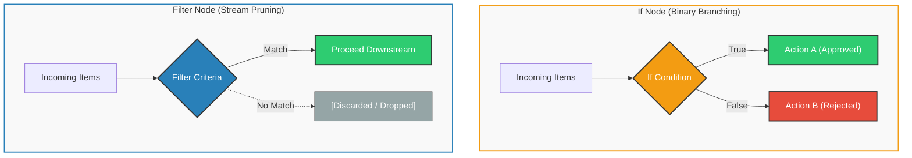
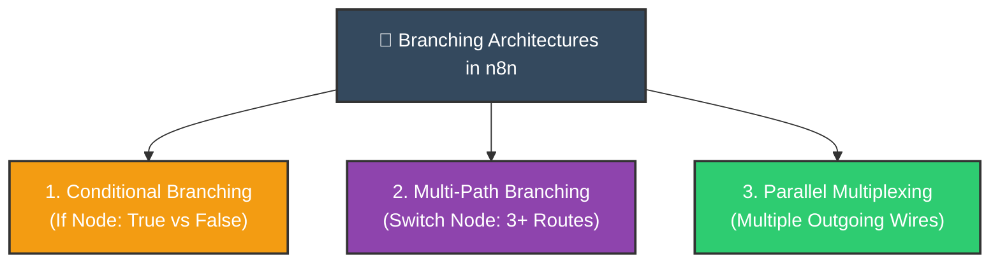
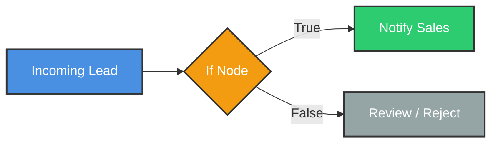
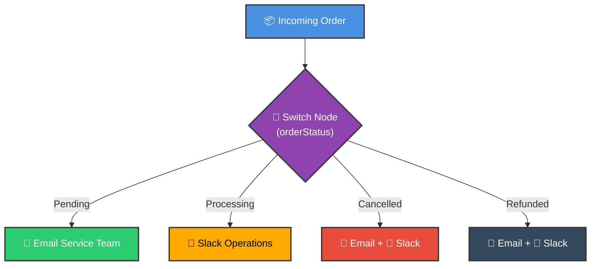
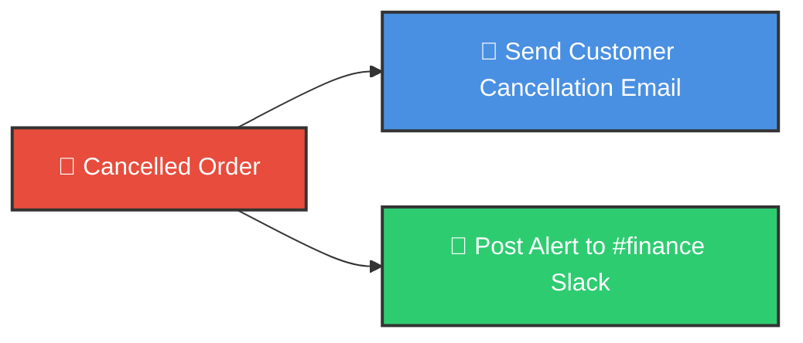
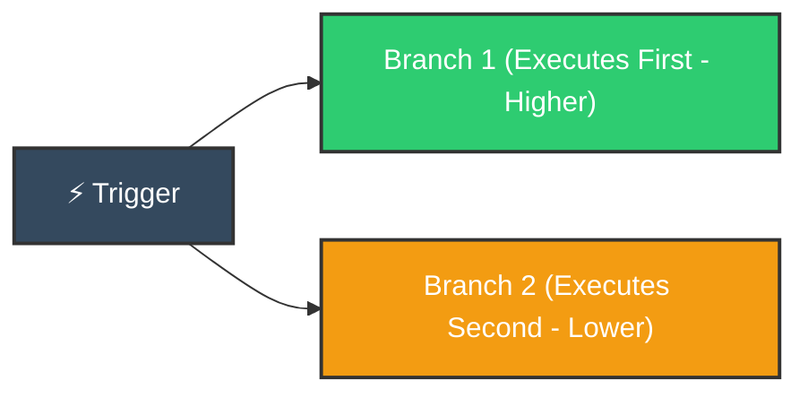
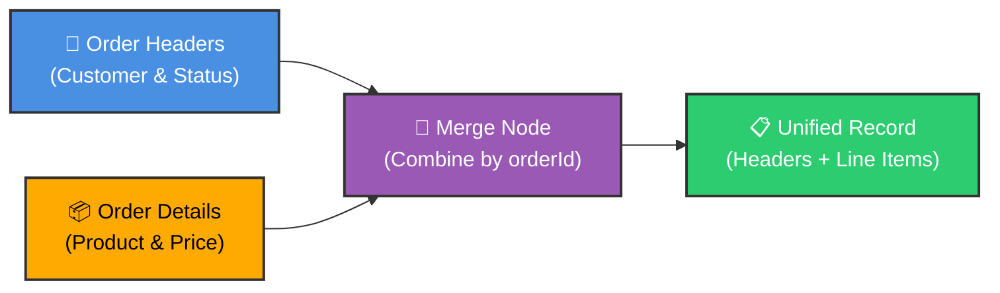
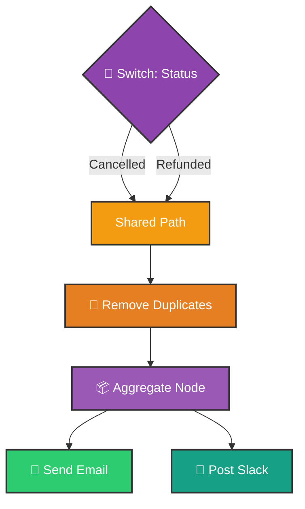

# ⚖️ Master Conditional Logic in n8n
## If-Else, Execution Order, Branching Strategies & Merging

<p align="center">
  <a href="07_Quick_Start_Multi_App_Lead_Management.md">⬅️ Prev: Multi-App Lead Management</a> •
  <a href="../README.md">Main Hub</a> •
  <a href="09_Loop_Over_Items_Node.md">Next: Loop Over Items Node ➡️</a> •
  <a href="https://github.com/shashilabs-io/n8n-docs">GitHub Repository</a>
</p>

---

## 🧭 How to Use This Chapter

> [!TIP]
> **Deterministic Decision Engines:** Automation without conditional logic is just a fragile script. By mastering the differences between binary **If** evaluation, destructive **Filter** pruning, multi-path **Switch** routing, and canvas execution sequence, you can build self-routing workflows that handle complex business edge cases reliably.

### 🎯 Key Outcomes of this Chapter:
- Contrast the behavioral differences between the **If** node and the **Filter** node.
- Master the three foundational branching patterns: **Conditional**, **Multi-Path**, and **Parallel**.
- Understand n8n's canvas **Execution Order** (Top-to-Bottom, Left-to-Right).
- Join relational data across disparate branches using the **Merge** node.
- Refactor messy duplicate workflows into high-efficiency unified execution pipelines.

---

# 1. Understanding Conditional Logic

Conditional logic enables automated pipelines to make intelligent decisions based on runtime data:
- *If* a support ticket is marked **Urgent**, notify the on-call engineer; *otherwise*, queue it in the standard inbox.
- *If* a customer clicked an email link within 24 hours, send a discount coupon; *otherwise*, enroll them in a re-engagement drip.
- *If* an invoice exceeds $10,000, request executive approval; *otherwise*, auto-charge Stripe.

---

# 2. If Node vs. Filter Node: Architectural Differences

Both nodes evaluate conditional expressions, but handle non-matching items fundamentally differently:

| Feature | If Node | Filter Node |
|---|---|---|
| **Outputs** | **Two separate branches** (`True` and `False`) | **Single output branch** (Matching items only) |
| **Non-matching Items** | Routed to the `False` branch for alternative actions | Silently discarded from the workflow stream |
| **Ideal Scenario** | When both outcomes require distinct actions (e.g. Approved vs Rejected) | When discarding invalid or irrelevant items permanently |



### Lead Qualification Example

Suppose an inbound lead is qualified when:
- `company_name` **is not empty**
- `email` **does not end with** `gmail.com`
- `email` **does not end with** `hotmail.com`

```text
company_name is not empty
AND email does not end with "gmail.com"
AND email does not end with "hotmail.com"
```

- With **If**: Qualified leads flow to the `True` branch (Slack alert + CRM insert), while personal emails flow to the `False` branch (archive sheet or nurturing sequence).
- With **Filter**: Qualified leads continue; personal emails are deleted from the run.

---

# 3. The Three Types of Branching



### Type 1: Conditional Branching (Binary)
Splits execution based on a boolean condition:


### Type 2: Multi-Path Branching (Categorical)
Routes items to distinct destinations based on multiple possible values using a **Switch** node:


### Type 3: Parallel Branching (Multiplexing)
Dispatches the exact same item down multiple wires concurrently to trigger several independent actions:


---

# 4. Canvas Execution Order Explained

When multiple branches diverge, understanding execution order is vital—especially if one branch writes to a database that another branch immediately reads.

### n8n Canvas Execution Priority:
1. **Branches execute sequentially** (one complete branch finishes before the next begins).
2. **Top-to-Bottom Priority:** Higher branches on the visual canvas execute before lower branches.
3. **Left-to-Right Priority:** When branches sit at equal vertical height, the leftmost branch executes first.



> [!WARNING]
> **Do Not Rely Strictly on Visual Layout for Data Dependencies:** If Branch B strictly requires data generated by Branch A, do not rely on spatial positioning alone. Use explicit wiring or a **Merge** node to enforce deterministic execution ordering!

---

# 5. Merging Data Across Divergent Branches

A **Merge** node synchronizes and unifies data flowing from separate branches.

### Practical Scenario: Order Header & Line Items
Two separate queries retrieve components of an order:

**1. Order Header (Input 1):**
```json
[
  { "orderId": "ORD-101", "firstName": "Riya", "lastName": "Verma", "status": "pending" }
]
```

**2. Order Details (Input 2):**
```json
[
  { "orderId": "ORD-101", "productName": "Keyboard", "quantity": 1, "totalPrice": 1200 }
]
```

### Merging by Common Key (`orderId`):


```json
// Unified Output:
[
  {
    "orderId": "ORD-101",
    "firstName": "Riya",
    "lastName": "Verma",
    "status": "pending",
    "productName": "Keyboard",
    "quantity": 1,
    "totalPrice": 1200
  }
]
```

> [!NOTE]
> If one order contains 3 line items in Input 2, the Merge node produces 3 enriched output records (a standard 1-to-Many relational join).

---

# 6. Workflow Optimization: Unifying Shared Paths

Instead of duplicating identical notification nodes across branches, converge shared logic into a consolidated processing pipeline:



This pattern drastically reduces canvas clutter and ensures message templates remain consistent in a single place.

---

# 7. Common Mistakes & Troubleshooting

| Symptom | Probable Cause | Fix |
|---|---|---|
| **Items take unexpected If path** | Comparison logic set to OR instead of AND (or vice versa). | Check condition combination rules (ALL vs ANY). |
| **Non-matching items vanished** | Used a **Filter** node instead of an **If** node. | Replace Filter with If so non-matching items enter the False branch. |
| **Switch outputs don't match rules** | Text casing mismatch (e.g. `Pending` vs `pending`). | Enable **Ignore Case** in Switch settings. |
| **Merge produces duplicate rows** | Matching key has multiple matches on both inputs (Cartesian product). | Ensure the matching key is unique on at least one side. |
| **Downstream node executes before data is ready** | Branches relied on visual layout rather than explicit Merge sync. | Insert a **Merge** node in **Choose Branch** or **Combine** mode. |

---

# 8. Practice Exercises & Active Recall

<details>
<summary><strong>1. If you need to route qualified leads to sales and unqualified leads to a review queue, do you use If or Filter?</strong></summary>

Use **If**, because both outcomes require dedicated downstream execution paths. Filter permanently drops non-matching items.
</details>

<details>
<summary><strong>2. An order pipeline routes pending, processing, cancelled, and refunded orders to separate teams. Which node is best?</strong></summary>

Use a **Switch** node, which supports 4+ distinct categorical output branches in a single node.
</details>

<details>
<summary><strong>3. Every cancelled order must trigger both an email receipt and a Slack alert. What branching pattern is this?</strong></summary>

**Parallel Multiplexing** (Type 3). Connect multiple outgoing wires from the cancelled branch to both action nodes.
</details>

<details>
<summary><strong>4. One input contains customer details; another contains purchase lines. Both share orderId. Which node combines them?</strong></summary>

The **Merge** node, configured to **Combine** on matching field `orderId`.
</details>

<details>
<summary><strong>5. An order with 3 line items produces 3 merged records after merging by orderId. Did the Merge node fail?</strong></summary>

No! In relational data joins (1-to-Many), joining 1 order with 3 line items correctly produces 3 enriched items.
</details>

---

# 9. Key Takeaways

- **If** provides binary True/False branching; **Filter** removes non-matching items from the stream.
- **Switch** handles multi-path categorization cleanly without nested nodes.
- Canvas execution flows **Top-to-Bottom**, then **Left-to-Right**.
- Use the **Merge** node to combine data streams across branches by unique keys.
- Consolidate shared downstream actions to keep workflows lean and maintainable.

---

<p align="center">
  <b>Next Step:</b> Master iterative processing in <a href="09_Loop_Over_Items_Node.md">Chapter 9: The Loop Over Items Node</a> or return to the <a href="../README.md">Main Hub</a>.
</p>
