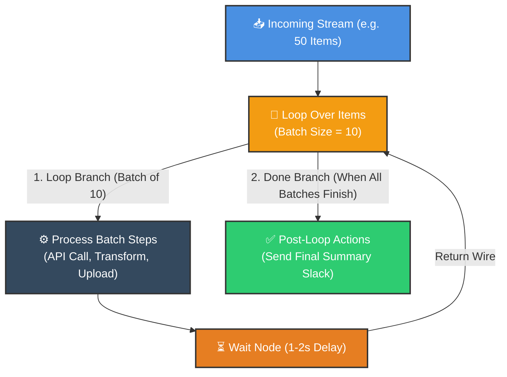
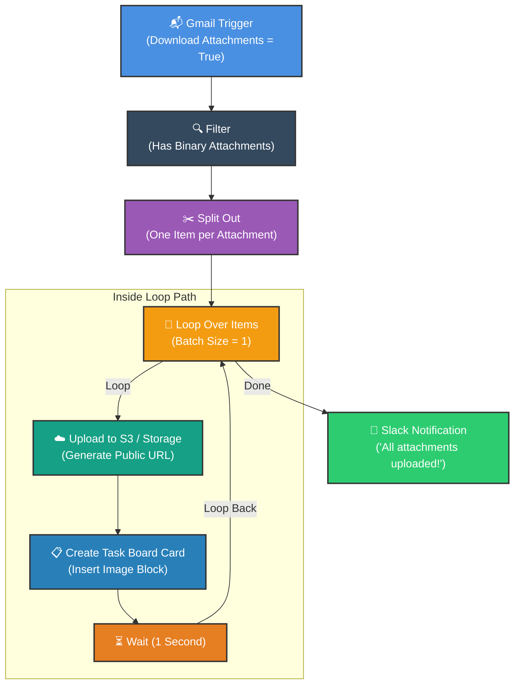

# 🔁 How to Use the Loop Over Items Node in n8n
## Batch Processing, Rate Limit Throttling & Controlled Iterations

  <a href="08_Master_Conditional_Logic.md">⬅️ Prev: Conditional Logic</a> •
  <a href="../README.md">Main Hub</a> •
  <a href="10_Master_Error_Handling.md">Next: Master Error Handling ➡️</a> •
  <a href="https://github.com/shashilabs-io/n8n-docs">GitHub Repository</a>

---

## 🧭 How to Use This Chapter

> [!TIP]
> **Controlled Iteration:** n8n natively processes all items in a stream concurrently or sequentially without pausing. But when external APIs enforce strict rate limits (e.g. 5 requests per second) or when processing massive binary files, uncontrolled throughput causes HTTP `429 Too Many Requests` crashes. The **Loop Over Items** node provides chunked batching and throttle controls.

### 🎯 Key Outcomes of this Chapter:
- Understand the mechanics of the **Loop Over Items** node (**Loop** vs **Done** outputs).
- Know when standard list processing suffices vs when an explicit loop is required.
- Configure chunked **Batch Sizes** (`1`, `10`, `50`).
- Prevent API throttling by inserting a **Wait** node inside the iteration cycle.
- Build a file-processing pipeline: **Gmail Trigger &rarr; Split Attachments &rarr; Loop Batch &rarr; S3 Upload &rarr; Task Card Creation**.
- Avoid common loop traps (infinite loops, unreturned loop wires, dynamic binary key mismatches).

---

# 1. What Is a Loop in n8n?

A loop repeats a sequence of actions for a collection of items in controlled chunks.

The **Loop Over Items** node splits an incoming array of items into batches of size `N`, emitting each batch through its **Loop** output. Once all batches have executed, execution continues through the **Done** output.

### When to Use Explicit Loops:
- **Rate-Limited APIs:** Enforce controlled pauses (e.g. 1 request per second) between calls.
- **Large Batches:** Process 1,000 records in bite-sized chunks of 50 to prevent memory spikes.
- **Heavy Binary Processing:** Upload massive files one by one to avoid network saturation.
- **Sequential Multi-Step Jobs:** Perform a complete multi-node sequence for Item 1 before touching Item 2.

---

# 2. Do You Always Need a Loop Node?

**No.** In standard n8n workflows, most nodes already process every incoming item automatically!

| Scenario | Use Standard Execution | Use Loop Over Items |
|---|---|---|
| Updating 100 rows in Google Sheets | ✅ Yes (native node handles items) | ❌ Unnecessary |
| Transforming 50 items with Edit Fields | ✅ Yes (in-memory instant processing) | ❌ Unnecessary |
| Calling an API that allows max 2 req/sec | ❌ No (fires all 50 items at once) | ✅ **Yes** (Loop + Wait node) |
| Uploading 5 heavy email attachments | ❌ Risk of timeout / memory overload | ✅ **Yes** (Batch size = 1) |

> [!NOTE]
> Use Loop Over Items when you need **temporal control** (rate throttling) or **chunked batching**. For regular data transforms, standard n8n item flow is faster and cleaner.

---

# 3. How to Configure the Node

1. Insert **Loop Over Items** after your data source.
2. Set **Batch Size**:
   - `1`: Iterates strictly one item at a time (ideal for heavy files or strict rate limits).
   - `10`–`50`: Ideal for bulk API operations.
3. Connect the **Loop** output terminal to your processing steps.
4. **Critical:** Connect the final node of your loop sequence **back** into the input terminal of **Loop Over Items**.
5. Connect the **Done** output terminal to actions that should only execute after every batch is completed (e.g. final summary alerts).

> [!IMPORTANT]
> **The Return Wire:** If you forget to connect the last node in the loop path back to the Loop Over Items node, the loop will execute only the first batch and stop!

---

# 4. Hands-on Blueprint: Processing Email Attachments

Suppose an email arrives with multiple image attachments that must be uploaded to storage and linked on a team task board.

### Execution Steps:
1. **Gmail Trigger:** Receives incoming email with attachments enabled in binary mode.
2. **Filter:** Discards emails that have no binary attachments.
3. **Split Out:** Converts a single email containing 5 attachments into 5 distinct items.
4. **Loop Over Items (Batch Size = 1):** Takes one attachment per cycle.
5. **Upload & Card Creation:** Uploads the binary stream, grabs the public URL, and attaches it to the task card.
6. **Wait Node:** Pauses for 1 second to respect API limits.
7. **Done Branch:** Fires a Slack notification after all 5 attachments are processed.

---

# 5. Why and How to Add a Wait Node

External APIs often return HTTP `429 Too Many Requests` when hit with bursts of requests.

Adding a **Wait node** inside the loop path introduces a deterministic breathing room:
- **Operation:** Wait
- **Wait Amount:** `1` or `2`
- **Unit:** Seconds

> [!WARNING]
> A 1-second pause helps prevent burst throttling, but does not guarantee immunity from daily or hourly quota caps. Always consult the target service's API quota documentation.

---

# 6. Common Problems & Troubleshooting

| Symptom | Probable Cause | Fix |
|---|---|---|
| **Loop only processes 1 batch and stops** | Missing return wire from the last step back to Loop Over Items. | Connect the output of the last loop step back into the Loop node. |
| **"Done" path triggers immediately** | Wires are inverted (Done wired to loop actions instead of Loop). | Verify that the repeated steps connect to **Loop**, and final steps to **Done**. |
| **Upload node throws "Binary property not found"** | Property name was hardcoded as `attachment_0`, but subsequent items use dynamic keys. | Inspect the item's binary keys in the output inspector and use dynamic references. |
| **Still receiving HTTP 429 errors** | Wait time is too short or batch size is too large for the API's quota. | Increase the Wait duration (e.g. from 1s to 3s) or reduce Batch Size to 1. |
| **Infinite loop running on canvas** | An inner node is emitting newly generated items directly back into the loop input. | Ensure the return wire only feeds completion tokens back to the Loop node. |

---

# 7. Best Practices for Loop Hygiene

- **Test with Small Batches:** Always test with 2 or 3 items before executing a 500-item batch.
- **Filter Early:** Drop invalid items before entering the loop to avoid wasting API quota.
- **Protect Binary Data:** Never upload private files to unauthenticated public file dumps.
- **Keep Summaries in Done:** Never place aggregate or summary notifications inside the loop branch unless you intend to receive an alert per iteration.

---

# 8. Practice Exercises & Active Recall

### Exercise 1: Customer Record Batching
A Google Sheets node outputs 45 customer items that must be submitted to an API in chunks of 15.

<strong>Questions: What batch size, how many iterations, and where does the final summary connect?</strong>

- **Batch Size:** `15`
- **Iterations:** 3 iterations (15 + 15 + 15)
- **Final Summary:** Connect to the **Done** output terminal.

---

### Exercise 2: Rate Limit Prevention
Your workflow processes 100 items, and the destination API enforces a strict limit of 1 call per second.

<strong>Questions: Which node introduces the delay, and what else should you consider?</strong>

Insert a **Wait** node set to 1 second inside the loop path before wiring back to Loop Over Items. Also verify whether the API enforces concurrency limits across other team members or workflows.

---

### Exercise 3: Dynamic Binary Key Troubleshooting
The first file uploads successfully, but the second fails with `attachment_0 missing`.

<strong>Question: What caused this failure and how do you resolve it?</strong>

The email node assigned sequential property keys (`attachment_0`, `attachment_1`, etc.). Hardcoding `attachment_0` breaks on subsequent items. Use dynamic binary key expressions or normalize binary keys before the loop.

---

# 9. Key Takeaways

- The **Loop Over Items** node provides chunked batching and throttle control over item processing.
- The **Loop** branch executes repeated steps; the **Done** branch executes once after all batches finish.
- Always connect the last step of the loop cycle **back** to the Loop Over Items node.
- Combine with a **Wait** node to easily avoid HTTP 429 rate limit penalties.

---

  <b>Next Step:</b> Build self-healing workflows in <a href="10_Master_Error_Handling.md">Chapter 10: Master Error Handling</a> or return to the <a href="../README.md">Main Hub</a>.

