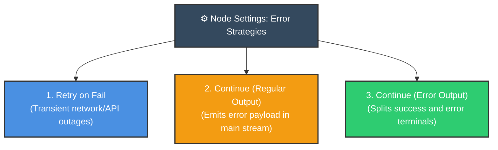
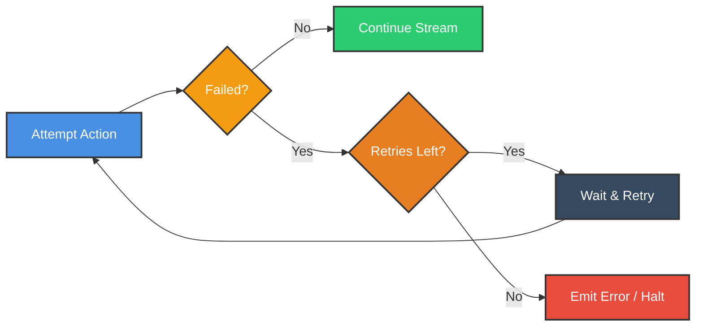
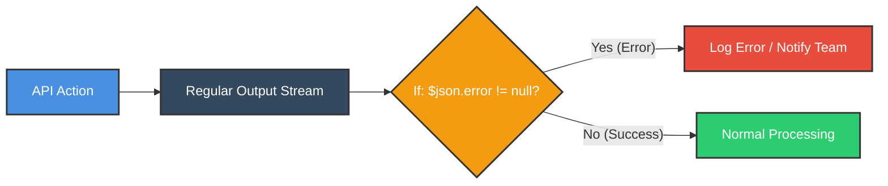
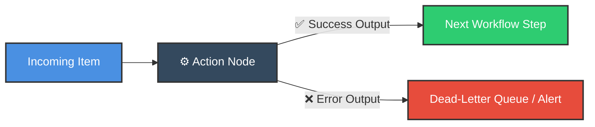
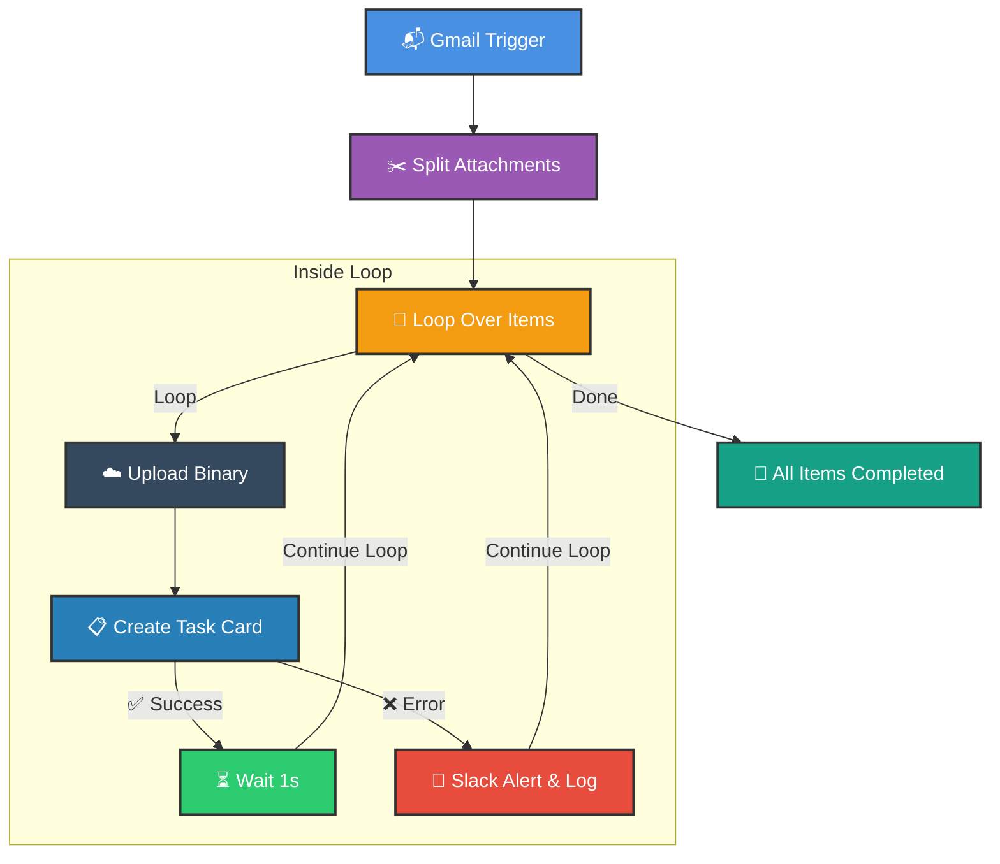

# 🛡️ Master Error Handling in n8n
## Resilient Workflows That Gracefully Recover from Failures

<p align="center">
  <a href="09_Loop_Over_Items_Node.md">⬅️ Prev: Loop Over Items Node</a> •
  <a href="../README.md">Main Hub</a> •
  <a href="11_How_to_Optimize_Workflows.md">Next: Workflow Optimization ➡️</a> •
  <a href="https://github.com/shashilabs-io/n8n-docs">GitHub Repository</a>
</p>

---

## 🧭 How to Use This Chapter

> [!TIP]
> **Defensive Architecture:** Production automation runs into dirty data, network blips, expired tokens, and third-party rate limits. A fragile workflow crashes entirely on the first failure, leaving remaining items stranded. A resilient n8n workflow distinguishes between transient blips (retrying with exponential backoff) and fatal errors (dead-letter logging, alerting, and continuing execution).

### 🎯 Key Outcomes of this Chapter:
- Internalize the philosophy of defensive automation: handling failures without hiding errors.
- Master the difference between **Transient Faults** (network drops) vs **Permanent Failures** (schema / format rejections).
- Configure node-level recovery settings: **Retry On Fail** and **On Error** policies.
- Compare **Continue (Regular Output)** vs **Continue (Using Error Output)**.
- Build fault-tolerant batch loops where an invalid item is recorded while subsequent items continue processing.
- Structure actionable incident notifications (embedding item IDs, timestamps, and stack traces).

---

# 1. Why Error Handling Is Mandatory

In production environments, external APIs and data sources will inevitably fail:
- Stripe drops a connection during high traffic.
- Google Sheets reaches its per-minute read quota.
- A user uploads a `.pdf` to an image-only pipeline.
- An expired OAuth2 token rejects an API call.

```mermaid
flowchart TD
    subgraph FRAGILE["❌ Default Unhandled Workflow"]
        A1["Item 1 (Success)"] --> A2["Item 2 (Fails: Invalid Type)"]
        A2 -->|💥 Crash| A3["[Workflow Halts Completely]"]
        A3 -.->|Never Processed| A4["Item 3 & Item 4 Lost"]
    end

    subgraph RESILIENT["✅ Fault-Tolerant Workflow"]
        B1["Item 1 (Success)"] --> B2["Item 2 (Fails)"]
        B2 -->|Error Branch| LOG["📝 Dead-Letter Log & Alert"]
        B2 -->|Continue Loop| B3["Item 3 (Success)"]
        B3 --> B4["Item 4 (Success)"]
    end

    style FRAGILE fill:#FDEDEC,stroke:#E74C3C,stroke-width:2px
    style RESILIENT fill:#EAFAF1,stroke:#2ECC71,stroke-width:2px
    style A2 fill:#E74C3C,stroke:#333,stroke-width:2px,color:#fff
    style A3 fill:#C0392B,stroke:#333,stroke-width:2px,color:#fff
    style B2 fill:#F39C12,stroke:#333,stroke-width:2px,color:#fff
    style LOG fill:#E74C3C,stroke:#333,stroke-width:2px,color:#fff
    style B3 fill:#2ECC71,stroke:#333,stroke-width:2px,color:#fff
    style B4 fill:#2ECC71,stroke:#333,stroke-width:2px,color:#fff
```



> [!IMPORTANT]
> **Error Handling $\neq$ Error Hiding:** Handling an error does not mean silently swallowing it. It means preventing total workflow crashes while creating clear audit trails and incident alerts for engineering teams.

---

# 2. Real-World Scenario: The Unsupported Attachment

Imagine an email workflow that processes nine attachments by creating an image card for each on a Kanban task board. The first eight attachments are PNGs, but the ninth is a PDF invoice.

When the node tries to create an image block for the PDF, the API throws an HTTP `400 Bad Request`.
- **Default Behavior:** Workflow aborts. The previous items might be incomplete, and no alert is triggered explaining why.
- **Resilient Behavior:**
  1. The eight valid images are uploaded.
  2. The PDF is captured on the error output, logged in an audit sheet, and a Slack alert is dispatched: *"Invoice.pdf skipped: unsupported format."*
  3. The workflow successfully terminates with full visibility.

---

# 3. The Three Node-Level Recovery Strategies



### Strategy 1: Retry On Fail
Best for transient failures (temporary network blips, 502 Bad Gateway, rate throttling).

- **Location:** Node Settings &rarr; **Retry On Fail** toggle.
- **Max Tries:** Typically `3` to `5`.
- **Wait Between Tries:** `1000ms`–`5000ms`.



> [!WARNING]
> **Never retry permanent schema errors:** If an API rejects a request due to missing fields or bad syntax, retrying 5 times will only waste execution quota and delay completion.

---

### Strategy 2: Continue (Using Regular Output)
The node does not stop execution when an item fails; instead, it outputs an error object in the standard item array. Downstream, an **If** node inspects whether `error` exists:



---

### Strategy 3: Continue (Using Error Output)
The cleanest, most readable pattern. The node gains two distinct physical output connectors:
- **Upper Terminal (Success):** Emits cleanly processed items.
- **Lower Terminal (Error):** Emits items that encountered errors along with stack trace metadata.



---

# 4. Fault-Tolerant Loop Architecture

When iterating through a list of items inside a **Loop Over Items** node, an error on item 4 must not abort items 5 through 10:



### Notice the Critical Wiring:
Both the **Success** branch (after Wait) and the **Error** branch (after Logging/Alert) reconnect back to the **Loop Over Items** input. This ensures that whether an item succeeds or fails, the loop continues to process the remaining items!

---

# 5. Designing Actionable Incident Alerts

Generic error alerts like *"An error occurred in workflow"* force developers to dig through raw execution logs. Good alerts provide instant diagnosis context:

### ❌ Poor Alert:
```text
Workflow failure detected. Check executions.
```

### ✅ High-Context Alert:
```text
🚨 Task Board Upload Failed!
• Workflow: CRM Attachment Ingest
• Item ID: ORD-90412
• File Name: invoice_receipt.pdf
• Target API: Notion Database API
• Error Code: 400 Bad Request
• Message: "Property 'image' expects mime type image/*, received application/pdf"
• Action Taken: Item logged to #dead-letter-sheet. Workflow continuing.
```

> [!TIP]
> Use expression references like `{{ $json.error.message }}` or `{{ $json.error.description }}` to pull exact stack trace information directly into Slack or Email messages.

---

# 6. Common Mistakes to Avoid

| Anti-Pattern | Operational Consequence | Engineering Fix |
|---|---|---|
| **Retrying every single failure** | Wastes execution quotas on permanent input errors. | Retry only network drops and 5xx errors; filter schema issues. |
| **Silent continuation** | "Workflow Completed" status hides silent business data loss. | Always attach a logger or notification node to the error output. |
| **Missing loop return wire** | Loop halts permanently after the first failed item. | Wire the error notification node back into Loop Over Items. |
| **Leaking credentials in alerts** | Exposing API secrets or customer PII in Slack channels. | Sanitize payloads before embedding them in alert messages. |

---

# 7. Production Readiness Checklist

Before activating critical customer-facing workflows:
- [ ] Valid happy-path items process completely.
- [ ] Injected bad items (e.g. malformed JSON, wrong file type) route to the error branch.
- [ ] Retries are capped at a reasonable limit (3–5 max).
- [ ] Error messages output concrete item IDs and reason strings.
- [ ] Loops continue executing subsequent items after a single failure.
- [ ] No sensitive authentication headers or passwords leak into alert notifications.

---

# 8. Practice Exercises & Active Recall

### Exercise 1: Transient vs Permanent Failures
An external API call returns HTTP `503 Service Unavailable`.
<details>
<summary><strong>Question: What strategy should be applied and why?</strong></summary>

Enable **Retry On Fail** with an exponential backoff interval (e.g. 3 retries, 2 seconds apart). HTTP 503 indicates temporary server overload that typically clears quickly.
</details>

---

### Exercise 2: Schema Rejection
A database insert node fails with `Column 'email' cannot be null`.
<details>
<summary><strong>Question: Should you configure Retry On Fail here?</strong></summary>

No! Retrying the identical payload will repeatedly fail. The item must be routed to an error output, logged, and validated upstream with an **Edit Fields** or **Filter** node.
</details>

---

### Exercise 3: Fault-Tolerant Looping
In a batch of 10 items, Item #4 fails.
<details>
<summary><strong>Question: How do you ensure items 5 through 10 still execute?</strong></summary>

Set the action node's **On Error** setting to **Continue (using error output)**. Wire the error output to a logging/alert node, and connect the logging node's output back into the **Loop Over Items** return terminal.
</details>

---

### Exercise 4: Contextual Alerting
<details>
<summary><strong>Question: Name 4 essential metadata fields that should be included in an engineering error alert.</strong></summary>

1. Unique item identifier (e.g. `orderId`, `customerId`).
2. Exact error message or HTTP status code returned by the node.
3. Timestamp of failure.
4. Action taken (e.g. *"Logged to dead-letter queue; processing continued"*).
</details>

---

# 9. Key Takeaways

- **Error handling** transforms brittle automations into enterprise-grade, resilient pipelines.
- Use **Retry On Fail** for transient network/server glitches; use **On Error** routing for data-level failures.
- **Continue (using error output)** cleanly bifurcates success and failure streams on the canvas.
- Reconnect both success and failure branches back to **Loop Over Items** to keep batch processing alive.
- Provide rich, actionable context in alert notifications to make debugging instant.

---

<p align="center">
  <b>Next Step:</b> Optimize pipeline performance in <a href="11_How_to_Optimize_Workflows.md">Chapter 11: Workflow Optimization</a> or return to the <a href="../README.md">Main Hub</a>.
</p>
