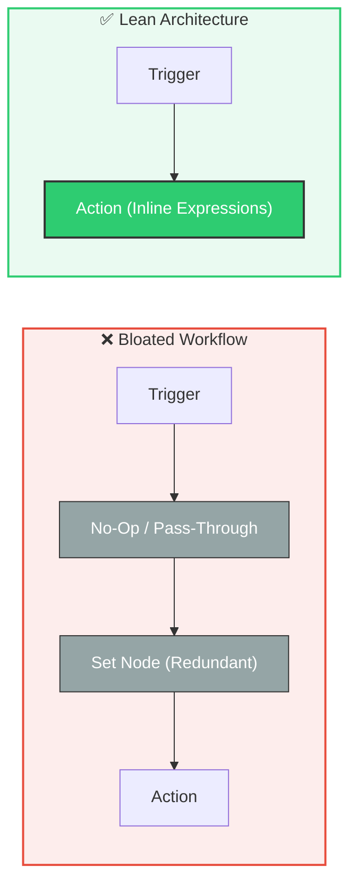
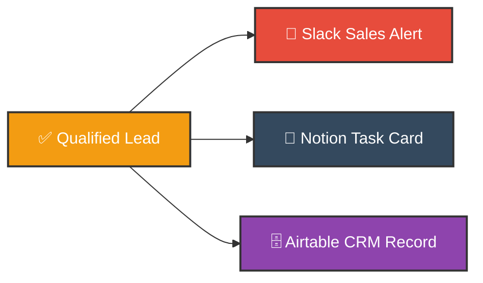
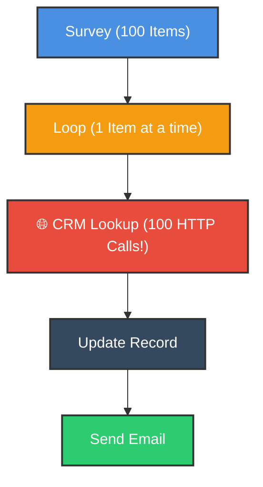
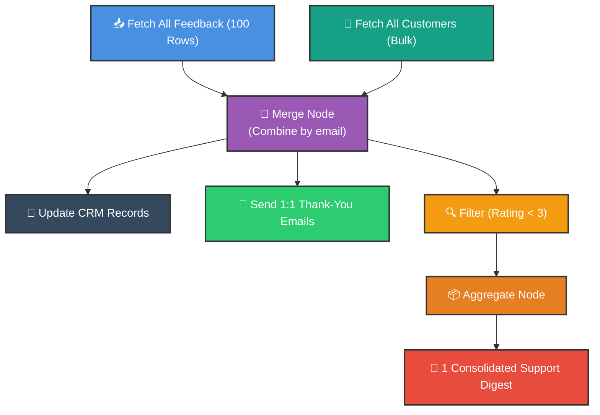

# ⚡ How to Optimize Workflows in n8n
## Speed, Resource Hygiene, Batching & High-Performance Architecture

  <a href="10_Master_Error_Handling.md">⬅️ Prev: Master Error Handling</a> •
  <a href="../README.md">Main Hub</a> •
  <a href="12_How_to_Use_Expressions_in_n8n.md">Next: Expressions & Functions ➡️</a> •
  <a href="https://github.com/shashilabs-io/n8n-docs">GitHub Repository</a>

---

## 🧭 How to Use This Chapter

> [!TIP]
> **Performance Engineering:** A beginner's automation queries an API 100 times inside a loop, fires 100 separate alert emails, and drags execution time into minutes while hitting rate limits. An optimized n8n workflow batches queries, runs independent branches in parallel, condenses alerts, and cuts node executions by over 50%.

### 🎯 Key Outcomes of this Chapter:
- Audit and eliminate redundant or pass-through nodes to reduce runtime memory.
- Identify and execute independent SaaS actions in **Parallel Branches**.
- Solve the $N+1$ query problem by fetching datasets in bulk and joining locally with the **Merge** node.
- Leverage **Batch/Bulk APIs** instead of item-by-item HTTP round-trips.
- Distinguish between node execution count vs total wall-clock runtime.
- Apply the 10-point workflow optimization checklist before production deployment.

---

# 1. Eliminating Redundant Nodes

Every node placed on the n8n canvas adds JSON serialization overhead, state persistence, and memory allocation.

### Node Audit Questions:
1. Does this node meaningfully transform, filter, route, store, or dispatch data?
2. Can this calculation be achieved using inline JavaScript expressions in the target node?
3. Is an unnecessary pass-through or placeholder node lingering from testing?

> [!IMPORTANT]
> **Clarity vs Over-Optimization:** Fewer nodes is not automatically better if combining steps makes the workflow brittle, unreadable, or impossible to debug. Eliminate *unnecessary work*, not essential validation or modularity.

---

# 2. Running Independent Tasks in Parallel

If multiple actions depend on the same trigger data and do not depend on each other, wire them as **parallel branches** rather than chaining them sequentially:

### Sequential vs. Parallel Comparison:
- **Sequential Chaining:** Wait for Slack (500ms) &rarr; then wait for Notion (800ms) &rarr; then wait for Airtable (700ms) = **2,000ms**.
- **Parallel Multiplexing:** Fires all three independent HTTP dispatches simultaneously = **~800ms total wall-clock time**.

> [!WARNING]
> Use parallel branching strictly when operations are genuinely independent. If Airtable needs the `pageId` produced by Notion, those steps must remain strictly sequential.

---

# 3. Reducing API Calls: Solving the $N+1$ Query Anti-Pattern

A classic architectural trap is querying an external database or CRM inside an item loop.

### ❌ The $N+1$ Query Anti-Pattern (100 Items = 100 Network Calls)
For every single survey response, the workflow makes a dedicated network call to look up the matching customer:

$$\text{1 Trigger} + \text{100 Customer Lookups} + \text{100 CRM Updates} + \text{100 Emails} + \text{38 Alerts} = \mathbf{339\text{ API Requests}}$$

### ✅ The Optimized Bulk-Fetch Architecture (2 Network Calls)
Fetch all survey items, fetch all customers once in bulk, and join them in-memory using a **Merge** node:

---

# 4. Leveraging Bulk and Batch APIs

Many enterprise APIs (Airtable, HubSpot, Salesforce, Postgres) support bulk operations.

| Request Paradigm | API Round-Trips | Rate-Limit Pressure | Speed |
|---|---|---|---|
| **Single Record per Request** | 100 requests for 100 rows | Severe (risk of HTTP 429) | Slow (~30–60s) |
| **Batch API (10 rows/chunk)** | 10 requests for 100 rows | Negligible | Fast (~2–4s) |
| **Bulk API (All in 1 Payload)** | 1 request for 100 rows | Minimal | Instant (~500ms) |

> [!TIP]
> Whenever updating databases or spreadsheet rows, inspect the node's **Operation** dropdown for **Append Many**, **Update Many**, or **Bulk Upsert**.

---

# 5. Case Study: Customer Feedback Processing

A company receives 100 customer satisfaction surveys per day. 38 responses include low ratings ($< 3$).

### Benchmark Results:

| Metric | Original Naive Design | Optimized Architecture | Reduction |
|---|---|---|---|
| **Customer Lookup Calls** | 100 individual requests | 1 bulk query | **-99% calls** |
| **Support Alerts** | 38 separate Slack pings | 1 aggregated digest | **-97% noise** |
| **Total Node Executions** | ~441 executions | ~206 executions | **-53% overhead** |
| **Execution Risk** | High (rate-limit throttling) | Minimal | **Production-grade** |

### What Remained 1-to-1?
- **Personalized Thank-You Emails:** Kept individual because each customer must receive their own message without leaking recipient emails to other customers.

---

# 6. Production Optimization Checklist

Before pushing high-volume workflows to production:
- [ ] **Audit Nodes:** Removed dead, pass-through, and debug nodes.
- [ ] **Parallelize:** Wired independent SaaS actions in parallel branches.
- [ ] **Bulk Fetch:** Replaced per-item API lookups with a single bulk fetch joined via **Merge**.
- [ ] **Batch Writes:** Enabled batch/bulk mode on database and CRM update nodes.
- [ ] **Alert Aggregation:** Grouped high-frequency alerts into aggregated digests.
- [ ] **Privacy Check:** Ensured individual customer emails are not merged into shared messages.
- [ ] **Rate Limits:** Verified API quota consumption under peak load.

---

# 7. Common Optimization Traps

| Mistake | Operational Pitfall | Solution |
|---|---|---|
| **Parallelizing dependent steps** | Race condition: Node B executes before Node A creates the required record. | Only parallelize tasks with zero shared dependencies. |
| **Assuming fewer nodes = faster** | A single poorly tuned code node or slow API call can still bottleneck a 2-node flow. | Measure network response times and API latency. |
| **Group-emailing private alerts** | Exposes customer email addresses in CC/BCC headers. | Always keep customer-facing communications 1-to-1. |
| **Ignoring batch size limits** | Airtable enforces max 10 records per batch request. | Chunk larger arrays using **Loop Over Items** before calling bulk APIs. |

---

# 8. Practice Exercises & Active Recall

<strong>1. What is a redundant node? Give an example.</strong>

A node that executes without transforming data, filtering, or adding value—such as an empty Set node or a pass-through placeholder left over from testing.

<strong>2. When is it appropriate to use parallel branches?</strong>

When multiple actions share the same trigger/upstream payload and do not depend on one another's completion or output data.

<strong>3. Why is bulk-fetching customer records and merging locally faster than looping 100 lookups?</strong>

It eliminates 99 network round-trips, avoids API rate limits, and completes the relational join instantly in local memory.

<strong>4. In the survey case study, why were thank-you emails still sent individually?</strong>

Each customer expects a personal email, and batching would expose customer email addresses to other survey respondents.

<strong>5. If 38 feedback responses have ratings below 3, how do you prevent 38 Slack notifications?</strong>

Filter for `rating < 3`, pass matching items through an **Aggregate** node to condense them into a single summary array, and dispatch one consolidated digest.

---

# 9. Key Takeaways

- Optimize for **correctness, maintainability, and real network latency**—not just vanity node counts.
- Eliminate $N+1$ query loops by fetching in bulk and joining with the **Merge** node.
- Wire independent notifications and logging tasks into **Parallel Branches**.
- Use **Aggregate** to turn high-frequency operational alerts into clean executive digests.
- Always verify API batch size caps before sending large arrays to bulk endpoints.

---

  <b>Next Step:</b> Master JavaScript expressions and data parsing in <a href="12_How_to_Use_Expressions_in_n8n.md">Chapter 12: Expressions & Functions</a> or return to the <a href="../README.md">Main Hub</a>.

