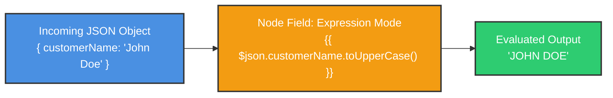
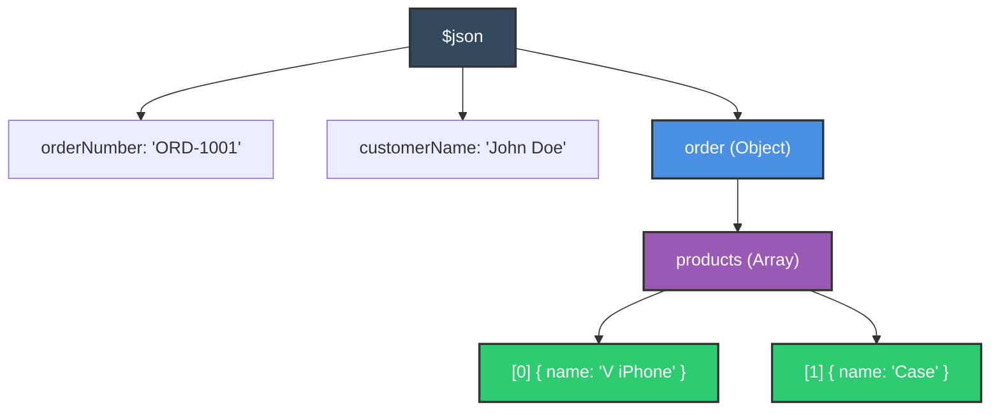
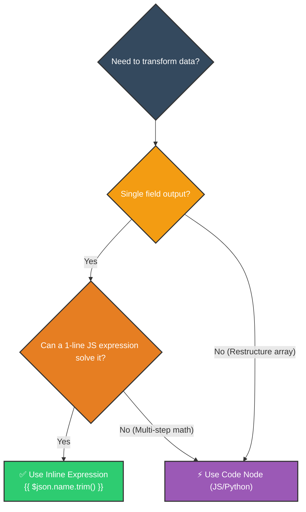

# 🧬 How to Use Expressions in n8n
## Dynamic Field Interpolation, Built-in Methods & Data Traversal

<p align="center">
  <a href="11_How_to_Optimize_Workflows.md">⬅️ Prev: Workflow Optimization</a> •
  <a href="../README.md">Main Hub</a> •
  <a href="13_How_to_Use_Code_Node_in_n8n.md">Next: The Code Node (JS & Python) ➡️</a> •
  <a href="https://github.com/shashilabs-io/n8n-docs">GitHub Repository</a>
</p>

---

## 🧭 How to Use This Chapter

> [!TIP]
> **Low-Code Agility:** You don't need a heavy Code node for every data tweak. n8n expressions let you execute inline JavaScript, format Luxon timestamps, extract domains, and traverse deeply nested JSON trees directly inside any node input field.

### 🎯 Key Outcomes of this Chapter:
- Toggle node input fields between **Fixed** text and **Expression** mode.
- Traverse objects, arrays, and lists using `$json` dot and bracket notation.
- Access earlier canvas nodes deterministically using `$('Node Name').item.json`.
- Utilize built-in n8n helpers like `.extractDomain()` and `$ifEmpty()`.
- Format dates and calculate time differences using Luxon (`$now.toFormat()`).
- Know the exact architectural threshold: when to use an Expression vs when to spin up a **Code Node**.

---

# 1. What Are Expressions?

Expressions allow you to calculate dynamic values directly inside node settings without writing external scripts.



| Context | When to Choose | Example |
|---|---|---|
| **Expression Field** | Inline string interpolation, math, date formatting, and field remapping. | `{{ $json.first_name + " " + $json.last_name }}` |
| **Code Node** | Multi-line algorithms, looping over nested arrays, or external API parsing. | Complex JavaScript / Python scripts with state variables. |

---

# 2. Fixed vs Expression Mode

Every configurable property in an n8n node has a mode toggle:
- **Fixed:** Static string (e.g. `support@company.com`) that never changes between executions.
- **Expression (`FX`):** Dynamic JavaScript evaluated per item wrapped in double curly brackets `{{ ... }}`.

```text
{{ $json.customerName }}
```

> [!NOTE]
> Anything outside the double curly braces `{{ ... }}` is treated as literal text. For example:
> `Welcome {{ $json.name }}, your order ID is #{{ $json.orderId }}.`

---

# 3. Traversing Payloads with `$json`

Consider this nested customer payload:

```json
{
  "orderNumber": "ORD-1001",
  "customerName": "John Doe",
  "email": "john@example.com",
  "order": {
    "products": [
      { "name": "V iPhone", "quantity": 1 },
      { "name": "Case", "quantity": 2 }
    ]
  }
}
```



### Access Examples:

| Target Property | Dot Notation Syntax | Evaluated Output |
|---|---|---|
| Top-level String | `{{ $json.customerName }}` | `"John Doe"` |
| Top-level Bracket | `{{ $json["email"] }}` | `"john@example.com"` |
| Nested First Array Item | `{{ $json.order.products[0].name }}` | `"V iPhone"` |
| Nested Second Array Item | `{{ $json.order.products[1].quantity }}` | `2` |

> [!IMPORTANT]
> Array indexing is zero-based: `[0]` accesses the first element, `[1]` accesses the second element.

---

# 4. Referencing Upstream Nodes

While `$json` accesses the immediate incoming item, you can reach back to earlier nodes across your canvas using the `$('Node Name')` syntax:

```javascript
{{ $('Fetch Customer').item.json.email }}
```

Or when referencing an item paired by execution index:
```javascript
{{ $('Google Sheets').first().json.spreadsheetId }}
```

---

# 5. Native n8n Helpers & String Methods

n8n includes custom string and data manipulation helpers directly within the expression engine:

### Extracting Email Domains:
```javascript
// Built-in n8n helper:
{{ $json.email.extractDomain() }}  // Returns: "example.com"

// Vanilla JavaScript split:
{{ $json.email.split("@")[1] }}    // Returns: "example.com"
```

### Handling Missing Data with Fallbacks:
Prevent downstream null-pointer errors with `$ifEmpty()`:
```javascript
{{ $ifEmpty($json.email, "no-reply@example.com") }}
```
Or standard JavaScript nullish coalescing:
```javascript
{{ $json.email ?? "no-reply@example.com" }}
```

---

# 6. Date & Time Operations with Luxon

n8n integrates Luxon natively. The global variables `$now` and `$today` provide rich date manipulation:

### Date Formatting:
```javascript
// ISO Format:
{{ $now.toFormat("yyyy-MM-dd") }}        // Output: "2026-10-19"

// European Format:
{{ $now.toFormat("dd-MM-yyyy HH:mm") }}   // Output: "19-10-2026 16:30"
```

### Date Differences (Time Elapsed):
```javascript
// Days elapsed since Jan 1st:
{{ $now.diff(DateTime.fromISO("2026-01-01"), "days").days }}

// Add 7 days to trial expiration:
{{ $now.plus({ days: 7 }).toFormat("yyyy-MM-dd") }}
```

> [!WARNING]
> In Luxon formatting strings, lowercase `dd` represents day of month (`01`-`31`), while uppercase `DD` represents day of year (`001`-`365`). Always verify the preview output in the expression editor!

---

# 7. Expression vs. Code Node Decision Matrix



### Move to a Code Node When:
- Writing multi-line logic or declaring intermediate `let` / `const` variables.
- Using loops (`for`, `while`) or complex recursion.
- Modifying binary file buffers or hashing cryptographic tokens.

---

# 8. Common Errors & Troubleshooting

| Symptom | Root Cause | Solution |
|---|---|---|
| `[undefined]` output | Property name has typo or casing mismatch. | Check the source JSON panel for exact casing (`orderId` vs `OrderId`). |
| `Cannot read properties of undefined (reading 'name')` | Attempted to access nested property on empty object. | Use optional chaining: `{{ $json.order?.products?.[0]?.name }}`. |
| Expression renders literally (`{{ ... }}`) | The input field is in Fixed text mode. | Click the **FX** toggle to activate Expression mode. |
| `SyntaxError: Unexpected token` | Multi-line statements or invalid brackets inside expression. | Keep expressions to single-line returns, or move logic to a **Code** node. |

---

# 9. Practice Exercises & Active Recall

<details>
<summary><strong>1. Write an expression to access the customerName property of the incoming item.</strong></summary>

```javascript
{{ $json.customerName }}
```
</details>

<details>
<summary><strong>2. How do you access the product name of the first item in order.products array?</strong></summary>

```javascript
{{ $json.order.products[0].name }}
```
</details>

<details>
<summary><strong>3. What does $json.email.split("@")[1] return for test@company.com?</strong></summary>

It returns `"company.com"`.
</details>

<details>
<summary><strong>4. How do you provide a fallback value if $json.phoneNumber is empty?</strong></summary>

```javascript
{{ $ifEmpty($json.phoneNumber, "Not Provided") }}
// Or:
{{ $json.phoneNumber ?? "Not Provided" }}
```
</details>

<details>
<summary><strong>5. When should you choose a Code node instead of an inline expression?</strong></summary>

When your transformation requires multiple lines of code, variable declarations, complex array loops, custom regex algorithms, or multi-step error branching.
</details>

---

# 10. Key Takeaways

- Expressions allow dynamic data interpolation directly within node settings.
- Use `$json` for the current item and `$('Node Name').item.json` for earlier canvas nodes.
- Array indexing starts at index `0`.
- Take advantage of Luxon (`$now`, `$today`) for reliable date arithmetic and formatting.
- When expressions become multi-line and messy, refactor into a dedicated **Code Node**.

---

<p align="center">
  <b>Next Step:</b> Write bespoke JavaScript & Python algorithms in <a href="13_How_to_Use_Code_Node_in_n8n.md">Chapter 13: The Code Node</a> or return to the <a href="../README.md">Main Hub</a>.
</p>
