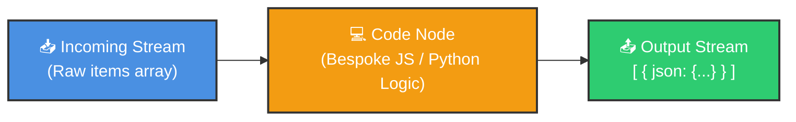
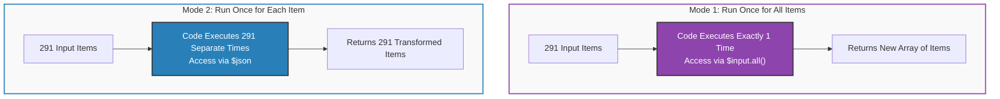
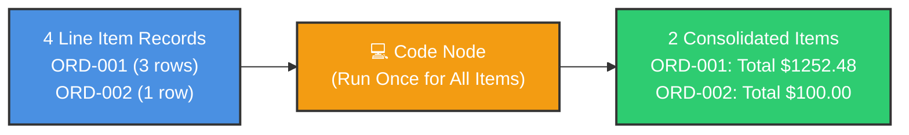

# 💻 How to Use the Code Node in n8n
## Bespoke JavaScript & Python Logic, Data Reshaping & Aggregations

<p align="center">
  <a href="12_How_to_Use_Expressions_in_n8n.md">⬅️ Prev: Expressions & Functions</a> •
  <a href="../README.md">Main Hub</a> •
  <a href="14_n8n_Item_Linking.md">Next: Item Linking Deep Dive ➡️</a> •
  <a href="https://github.com/shashilabs-io/n8n-docs">GitHub Repository</a>
</p>

---

## 🧭 How to Use This Chapter

> [!TIP]
> **Pro-Code Freedom:** While expressions handle single-field values, complex business rules often demand loops, custom mathematical aggregations, regex parsing, and multi-step data manipulation. The **Code Node** gives you a full JavaScript (V8) or Python sandbox inside your pipeline with zero compilation steps.

### 🎯 Key Outcomes of this Chapter:
- Understand when to graduate from expressions to the **Code Node**.
- Master the two core execution modes: **Run Once for All Items** vs **Run Once for Each Item**.
- Master n8n's data contract: returning arrays of `{ json: { ... } }` objects.
- Group and aggregate multi-row line items into consolidated order totals.
- Safely enrich records using object spread syntax (`...item.json`).
- Understand sandbox boundaries and external npm/pip module limitations.

---

## 📸 Code Node Interface


---

# 1. Supported Languages & Use Cases

n8n supports two runtime scripting languages inside the Code node:
- **JavaScript (Node.js / V8)** — Native, instant, and recommended for fast object transformations.
- **Python (Pyodide)** — Ideal for data science, regex, and statistical parsing.



### Ideal Scenarios for the Code Node:
- Calculating running totals, tax brackets, or currency conversions.
- Grouping relational line-items by foreign key (`orderId`).
- De-duplicating nested child arrays inside complex objects.
- Constructing bespoke JSON schemas required by legacy external APIs.

---

# 2. Execution Modes: All Items vs Each Item

Choosing the correct execution mode is the single most important setting in the Code node:



| Execution Mode | Execution Frequency | Data Accessor | Ideal Use Case |
|---|---|---|---|
| **Run Once for All Items** | Executes **1 time** total | `$input.all()` | Aggregation, grouping, sorting, filtering whole batches. |
| **Run Once for Each Item** | Executes **$N$ times** (once per item) | `$json` | 1-to-1 data cleaning, calculating single fields. |

---

# 3. Data Access Patterns

### In "Run Once for All Items" Mode:
Access all incoming records via `$input.all()`. It returns an array of objects, each wrapping its data inside `.json`:

```javascript
const items = $input.all();

for (const item of items) {
  const orderId = item.json.orderId;
  const totalPrice = item.json.totalPrice;
}
```

### In "Run Once for Each Item" Mode:
Directly read and modify properties on the global `$json` object:

```javascript
const orderId = $json.orderId;
const totalPrice = $json.totalPrice;
```

---

# 4. The Mandatory n8n Output Contract

> [!IMPORTANT]
> **The Output Rule:** Downstream n8n nodes require an array of objects where each object possesses a `json` property.

### ✅ Valid Output (Array of Item Objects):
```javascript
return [
  {
    json: {
      fruit: "apple",
      quantity: 2
    }
  },
  {
    json: {
      fruit: "carrot",
      quantity: 1
    }
  }
];
```

### ❌ Invalid Output (Will Cause Node Error):
```javascript
// DO NOT DO THIS:
return { fruit: "apple", quantity: 2 }; // Missing outer array and json key!
return ["apple", "carrot"];              // Plain strings without json wrapper!
```

Even if returning only one single result item, wrap it inside an array:
```javascript
return [{ json: { message: "Task completed successfully" } }];
```

---

# 5. Hands-on Blueprint: Aggregating Order Line Items

Imagine joining order headers with product rows. One order may have multiple line-item rows:

**Raw Input (4 Rows, 2 Unique Orders):**
```json
[
  { "orderId": "ORD-001", "totalPrice": 769.60 },
  { "orderId": "ORD-001", "totalPrice": 256.02 },
  { "orderId": "ORD-001", "totalPrice": 226.86 },
  { "orderId": "ORD-002", "totalPrice": 100.00 }
]
```



### The Aggregation Script:
Set the Code node to **Run Once for All Items**:

```javascript
const items = $input.all();
const orderTotals = {};

for (const item of items) {
  const orderId = item.json.orderId;
  const price = Number(item.json.totalPrice ?? 0);

  if (!orderId) {
    continue;
  }

  if (orderTotals[orderId] === undefined) {
    orderTotals[orderId] = 0;
  }

  orderTotals[orderId] += price;
}

// Map back to the required n8n output structure:
return Object.entries(orderTotals).map(([orderId, total]) => ({
  json: {
    orderId,
    orderTotal: Number(total.toFixed(2))
  }
}));
```

**Clean Aggregated Output:**
```json
[
  { "orderId": "ORD-001", "orderTotal": 1252.48 },
  { "orderId": "ORD-002", "orderTotal": 100.00 }
]
```

---

# 6. Enriching Existing Records with Object Spread

If your goal is to keep all incoming fields and simply append a calculated property, use the JavaScript spread operator (`...item.json`):

```javascript
return $input.all().map(item => ({
  json: {
    ...item.json,
    processedAt: new Date().toISOString(),
    status: "verified"
  }
}));
```

This guarantees that zero upstream properties are accidentally lost or overwritten.

---

# 7. Code Node Limitations & Sandbox Boundaries

| Boundary | Restriction Details | Recommended Architecture |
|---|---|---|
| **External npm / pip Packages** | Restricted in n8n Cloud environments by default for security. | Use native JavaScript/Python methods or configure environment variables in self-hosted instances. |
| **HTTP / API Calls** | The Code node should not make outbound network calls (`fetch` / `axios`). | Use dedicated **HTTP Request** nodes to benefit from credential encryption and auto-retries. |
| **Direct Filesystem Access** | Cannot write arbitrary files to disk (`fs.writeFile`). | Use the **Read/Write Files from Disk** or cloud storage nodes. |

---

# 8. Common Mistakes & Troubleshooting

| Bug | Cause | Fix |
|---|---|---|
| `Cannot read property 'json' of undefined` | Trying to access `$json` while in *Run Once for All Items* mode. | Use `$input.all()` in All Items mode, or switch mode to *Run Once for Each Item*. |
| Output shows `[object Object]` without fields | Returned raw objects without `{ json: { ... } }` structure. | Wrap returned objects in `{ json: data }`. |
| Dropped original fields | Overwrote the item without spreading `...item.json`. | Spread existing properties: `{ ...item.json, newProp: value }`. |
| Missing numbers in calculations | Strings like `"100"` concatenated instead of added (`"100" + "50" = "10050"`). | Cast to numbers explicitly: `Number(item.json.price)`. |

---

# 9. Practice Exercises & Active Recall

<details>
<summary><strong>1. What is the fundamental difference between the two Code node execution modes?</strong></summary>

"Run Once for All Items" executes once with the full dataset available via `$input.all()`. "Run Once for Each Item" executes independently for every incoming item via `$json`.
</details>

<details>
<summary><strong>2. In JavaScript, which helper gives you access to the entire array of incoming items?</strong></summary>

```javascript
$input.all()
```
</details>

<details>
<summary><strong>3. Why must returned data be formatted as an array of { json: {...} } objects?</strong></summary>

Because n8n's internal data engine enforces an array-of-items contract across all nodes. Failing to wrap output in `{ json: ... }` causes downstream nodes to fail.
</details>

<details>
<summary><strong>4. How do you enrich an item with processed: true without losing existing fields?</strong></summary>

```javascript
return $input.all().map(item => ({
  json: {
    ...item.json,
    processed: true
  }
}));
```
</details>

<details>
<summary><strong>5. Should you make external HTTP calls inside the Code node?</strong></summary>

No. Use n8n's dedicated **HTTP Request** node. It provides visual configuration, credential encryption, proxy support, and automatic error handling.
</details>

---

# 10. Key Takeaways

- Use the **Code Node** when transformations require multi-line algorithms, loops, or complex data joins.
- Choose **Run Once for All Items** for aggregations and datasets; choose **Run Once for Each Item** for item-level transforms.
- Always return an array of objects wrapping properties in `json`: `[{ json: { ... } }]`.
- Use the spread operator (`...item.json`) to preserve upstream fields.
- Delegate HTTP and disk operations to dedicated n8n nodes.

---

<p align="center">
  <b>Next Step:</b> Master data lineage and paired inputs in <a href="14_n8n_Item_Linking.md">Chapter 14: n8n Item Linking</a> or return to the <a href="../README.md">Main Hub</a>.
</p>
