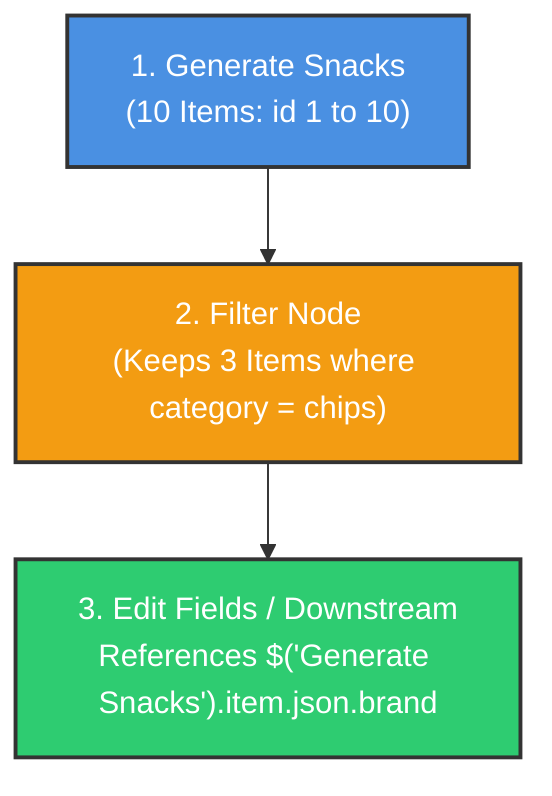
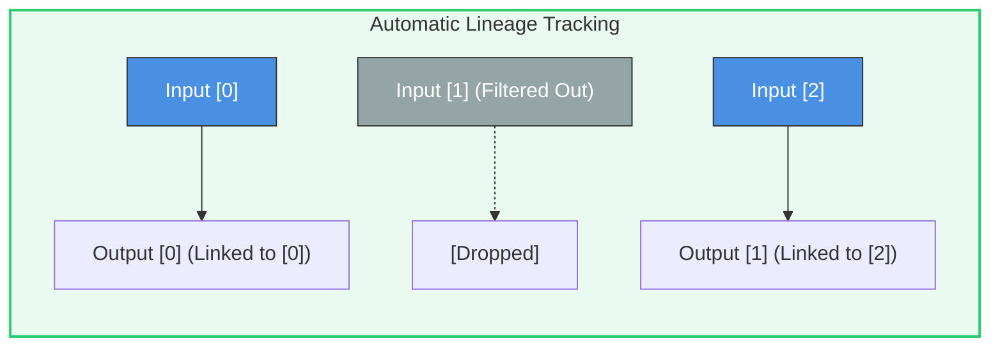
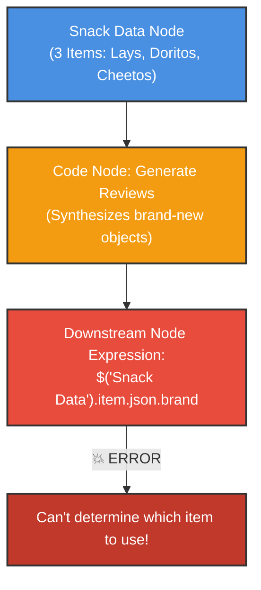
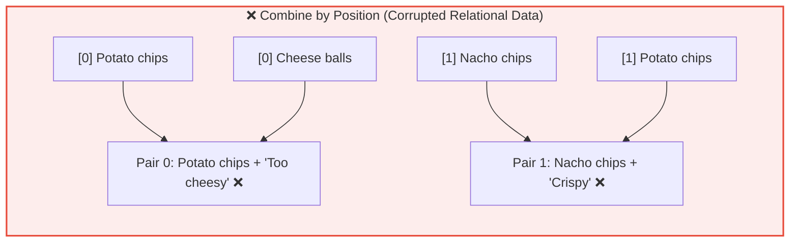
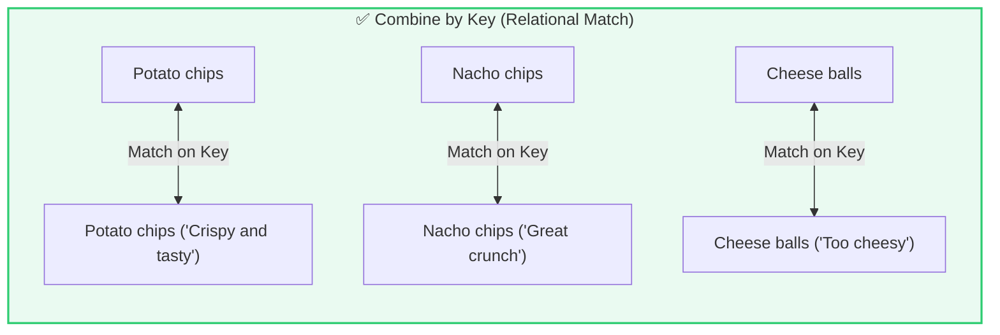

# 🔗 n8n Item Linking Deep Dive
## How Data Relationships & Paired Items Flow Between Nodes

<p align="center">
  <a href="13_How_to_Use_Code_Node_in_n8n.md">⬅️ Prev: The Code Node</a> •
  <a href="../README.md">Main Hub</a> •
  <a href="15_n8n_HTTP_Request_Node.md">Next: HTTP Request Node ➡️</a> •
  <a href="https://github.com/shashilabs-io/n8n-docs">GitHub Repository</a>
</p>

---

## 🧭 How to Use This Chapter

> [!TIP]
> **Data Lineage:** Ever encountered the dreaded error: *"Can't determine which item to use"*? In n8n, every item carries invisible metadata linking it back to the exact input item from which it originated. Understanding **Item Linking** and the **`pairedItem`** construct allows you to trace data lineages across complex branch joins, custom scripts, and downstream expressions without losing reference integrity.

### 🎯 Key Outcomes of this Chapter:
- Understand n8n's foundational data unit: the **Item** and its lineage chain.
- Identify when n8n links items automatically vs when linkage breaks.
- Debug the *"Can't determine which item to use"* expression failure.
- Explicitly bind synthesized output records to source inputs using **`pairedItem: { item: index }`**.
- Understand why **Combine by Position** in Merge nodes creates silent, catastrophic data corruption when arrays are unsorted.

---

# 1. What Is an Item in n8n?

An **item** is the atomic data unit that flows through n8n wires. Nodes consume one or many items, process them, and emit output items:

```json
[
  {
    "json": {
      "id": 1,
      "product": "Potato chips",
      "brand": "Lays",
      "category": "chips"
    }
  },
  {
    "json": {
      "id": 2,
      "product": "Nacho chips",
      "brand": "Doritos",
      "category": "chips"
    }
  }
]
```

---

# 2. What Is Item Linking?

**Item linking** is the internal reference architecture that enables an item in Node 5 to reach back and retrieve properties from Node 1, even if intermediate nodes modified or dropped items along the way.



Even though the Filter node discarded 7 items, n8n's item linking ensures that Item #1 in the Filter output correctly maps back to Item #1 from the original generator, rather than pulling values from a discarded row.

---

# 3. When Does n8n Maintain Links Automatically?

| Transformation Pattern | Linking Mechanism | Reliability |
|---|---|---|
| **1-to-1 Transformations** (Set / Edit Fields, Crypto) | Automatic | 100% deterministic |
| **Filtering / Pruning** (Filter, If Node) | Automatic (preserves source indices) | 100% deterministic |
| **1-to-Many Splitting** (Split Out) | Automatic (child items all link to parent) | High |
| **Synthesized Custom Records** (Code Node generating brand new objects) | **Manual linkage required** (`pairedItem`) | Breaks unless explicitly linked |



---

# 4. What Breaks Item Linking?

Suppose you generate new mock reviews for your filtered snacks inside a Code node. The script returns an array of new objects:



Because the Code node instantiated fresh objects from scratch without declaring their ancestry, n8n loses track of which review corresponds to which original snack!

---

## 📸 Item Linking in n8n Canvas


---

# 5. Restoring Lineage with `pairedItem`

To fix this, supply the `pairedItem` property alongside `json` when generating new objects inside a Code node:

```javascript
const output = [
  {
    json: {
      productName: "Potato chips",
      review: "Crispy and tasty"
    },
    pairedItem: {
      item: 0  // Explicitly binds this output to Input Item [0]
    }
  },
  {
    json: {
      productName: "Cheese balls",
      review: "A little too cheesy"
    },
    pairedItem: {
      item: 2  // Explicitly binds this output to Input Item [2]
    }
  }
];

return output;
```

### Dynamic Index Tracking in Loops:
When iterating in a Code node, bind the loop index `i`:

```javascript
return $input.all().map((item, index) => ({
  json: {
    reviewSummary: `Verified purchase of ${item.json.product}`
  },
  pairedItem: {
    item: index
  }
}));
```

> [!IMPORTANT]
> The index passed to `pairedItem: { item: index }` refers to the zero-based index of the **immediate input items** received by this Code node, not necessarily the original ID from 4 nodes back.

---

# 6. Pitfalls in the Merge Node: Position vs Key Matching

Consider combining snack records with customer reviews:

**Input 1 (Snacks List):**
1. `Potato chips`
2. `Nacho chips`
3. `Cheese balls`

**Input 2 (Reviews List - Arrived in Different Order):**
1. `Cheese balls` (*"Too cheesy"*)
2. `Potato chips` (*"Crispy and tasty"*)
3. `Nacho chips` (*"Great crunch"*)

### ❌ What Happens with "Combine by Position":
The Merge node blindly joins items based on row index:



The workflow runs without throwing a single error, but your data is completely corrupted!

### ✅ What Happens with "Combine by Matching Fields":
Configure the Merge node to match `product` on Input 1 with `productName` on Input 2:



> [!WARNING]
> **Position is Not Identity:** Never use position-based matching unless both streams are guaranteed to be sorted identically by design. Always prefer stable unique keys (e.g. `productId`, `orderId`).

---

# 7. Common Mistakes & Troubleshooting

| Symptom | Probable Cause | Fix |
|---|---|---|
| `Can't determine which item to use` | Code node returned fresh objects without `pairedItem`. | Attach `pairedItem: { item: index }` to every emitted object. |
| Expressions pull the wrong user's email | Combined streams by position on unsorted arrays. | Switch Merge node mode to **Combine by Matching Fields**. |
| `pairedItem` refers to wrong row | Assigned database ID instead of the 0-based input array index. | Use the array loop index `index`, not the record's primary key. |
| Upstream reference returns null | Target node hasn't executed or was bypassed by an If branch. | Inspect the execution trace to confirm node ran on the active branch. |

---

# 8. Practice Exercises & Active Recall

<details>
<summary><strong>1. What does Item Linking allow n8n to determine?</strong></summary>

It allows n8n to trace an output item back to the exact input item from which it originated, ensuring upstream expressions resolve to corresponding records.
</details>

<details>
<summary><strong>2. Why does a Code node synthesizing new objects cause a "paired item" error downstream?</strong></summary>

Because n8n cannot guess which original input item corresponds to a newly constructed object unless explicitly informed via `pairedItem`.
</details>

<details>
<summary><strong>3. In pairedItem: { item: 2 }, what does the number 2 represent?</strong></summary>

It represents the third input item (zero-indexed) received by the current node.
</details>

<details>
<summary><strong>4. Why is "Combine by Position" dangerous in a Merge node?</strong></summary>

If the two lists are sorted differently, position matching blindly pairs unrelated records together, silently corrupting data without throwing an error.
</details>

<details>
<summary><strong>5. You have productId in both streams. Why is matching on productId better than matching on productName?</strong></summary>

Because IDs are immutable and unique, whereas display names can contain typos, casing differences, or duplicate values.
</details>

---

# 9. Key Takeaways

- An **item** is n8n's fundamental data unit; **item linking** tracks parent-child ancestry.
- Standard filter, set, and transform nodes maintain item links automatically.
- When generating new objects in a **Code node**, attach `pairedItem: { item: index }` to maintain lineage.
- Always prefer **Matching Fields** over **Position** when joining datasets in the **Merge** node.

---

<p align="center">
  <b>Next Step:</b> Connect to any REST or GraphQL endpoint in <a href="15_n8n_HTTP_Request_Node.md">Chapter 15: The HTTP Request Node</a> or return to the <a href="../README.md">Main Hub</a>.
</p>
