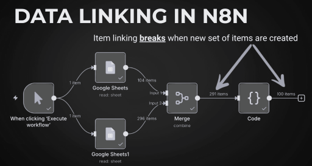

# Chapter 14: Item Linking in n8n
## How Data Relationships Flow Between Nodes

## Learning Objectives
By the end of this chapter, you will be able to:
- Explain what an item and item linking mean in n8n.
- Recognize when n8n can maintain item links automatically.
- Understand why newly created items may lose their connection to input items.
- Use `pairedItem` to link newly created output items to their input items.
- Avoid incorrect data combinations in the Merge node.
- Choose matching fields instead of position when records may be in different orders.

## 1. What Is an Item in n8n?
An **item** is one unit of data processed by a node. A node can receive one item or many items, process them, and produce output items.

For example, a workflow might produce these snack items:

```json
[
  {
    "json": {
      "id": 1,
      "product": "Potato chips",
      "brand": "Lays",
      "category": "chips"
    }
  },
  {
    "json": {
      "id": 2,
      "product": "Nacho chips",
      "brand": "Doritos",
      "category": "chips"
    }
  }
]
```

Each object in the array represents a separate item. In n8n's Code node, returned items are typically wrapped in an object with a `json` property.

## 2. What Is Item Linking?
**Item linking** is the relationship that lets n8n trace an output item back to the input item or items from which it came.

Imagine a workflow with these nodes:

```text
Generate Snacks (10 items)
        |
        v
Filter: category = "chips" (3 items)
        |
        v
Edit Fields: create a message using brand and product
```

The Filter node keeps three snack items and discards the other seven. If item linking is preserved, a later node can still refer to data from the appropriate earlier item.

Item linking matters when expressions reference data from previous nodes. If n8n cannot determine which earlier item corresponds to the current item, the expression may fail or resolve to the wrong record.

## 3. When Does n8n Link Items Automatically?
n8n can maintain item links automatically in many common transformations. The important patterns are:

| Input and output pattern | Typical linking behavior |
|---|---|
| One input item produces one output item | Output links to that input |
| One input item produces multiple output items | Outputs link to the same input |
| Multiple inputs and the same number of outputs, kept in corresponding order | n8n can link items by their correspondence |
| The number of items changes, or an entirely new set of items is created | Automatic linking may not be sufficient; explicit pairing may be needed |

Do not rely only on item counts. The key question is whether n8n can identify which input item produced each output item. Filtering or transforming existing items can preserve links, while creating unrelated output records can make the relationship ambiguous.

## 4. Example One: Generate and Filter Snack Data

Suppose a Code node generates ten snack items. Each item includes an ID, product, brand, and category. A Filter node keeps only items whose category is `chips`, leaving three records:

- Potato chips — Lays
- Nacho chips — Doritos
- Cheese balls — Cheetos

An Edit Fields node can then create a message such as:

```text
We love Lays potato chips.
```

This works when the current item remains linked to the correct snack record.

### What goes wrong when new records are created?
Now suppose another Code node creates new review records for the filtered snacks. The output might contain a product name and a review, but the output items may no longer have a clear link to the original snack items.

A later expression might try to combine:
- `brand` from the earlier **Generate Snacks** node
- `productName` and `review` from the new **Generate Dummy Reviews** node

If n8n cannot determine which original snack belongs to a review, it can show an error indicating that paired item data is unavailable or that it cannot determine which item to use.

The problem is not necessarily that the values are missing. The problem is that the relationship between the new review item and its source snack has not been defined clearly enough.



## 5. Using `pairedItem` in the Code Node

When a Code node creates new output items, `pairedItem` can explicitly identify the input item associated with each output item.

Conceptually, the output item contains:
- `json`: the new data
- `pairedItem`: the input item index that this output came from

Example TypeScript-style illustration of the structure:

```typescript
const output = [
  {
    json: {
      productName: "Potato chips",
      review: "Crispy and tasty"
    },
    pairedItem: {
      item: 0
    }
  },
  {
    json: {
      productName: "Cheese balls",
      review: "A little too cheesy"
    },
    pairedItem: {
      item: 2
    }
  }
];

return output;
```

**Important:** The `item` value refers to the index of the input item to this Code node, not automatically to the original item number from an earlier node. Confirm the Code node's actual input order before assigning indexes. If a node filters items before the Code node, indexes such as `0`, `1`, and `2` refer to the filtered node's input items.

When creating outputs in a loop, track the input index for each output and attach the correct `pairedItem` reference. Do not assign indexes merely because they look similar to product IDs or output positions.

## 6. Example Two: Combining Data with the Merge Node

A Merge node can combine two streams:
- **Input 1:** filtered snack records, containing fields such as `product`, `brand`, and `category`
- **Input 2:** review records, containing fields such as `productName` and `review`

Suppose the snack stream is ordered like this:

| Position | Product |
|---:|---|
| 1 | Potato chips |
| 2 | Nacho chips |
| 3 | Cheese balls |

But the review stream is ordered differently:

| Position | Product name | Review |
|---:|---|---|
| 1 | Cheese balls | Too cheesy for me |
| 2 | Potato chips | Crispy and tasty |
| 3 | Nacho chips | Great crunch |

### Why “Combine by Position” can be wrong
If the Merge node combines by position, it pairs the first item from Input 1 with the first item from Input 2, the second with the second, and so on.

That can create incorrect combinations:

| Snack record | Review record | Result |
|---|---|---|
| Potato chips | Cheese balls | Incorrect match |
| Nacho chips | Potato chips | Incorrect match |
| Cheese balls | Nacho chips | Incorrect match |

The workflow may run successfully while producing semantically incorrect data. This can be harder to notice than an explicit error.

### Better option: Match using a field
When the records contain a shared identifier or a reliable matching value, configure the Merge node to match on that field rather than position.

For example:
- Input 1 field: `product`
- Input 2 field: `productName`
- Enable the setting that allows the fields to have different names, if available in the node version being used.

The intended matches are then:
- `product = "Potato chips"` ↔ `productName = "Potato chips"`
- `product = "Nacho chips"` ↔ `productName = "Nacho chips"`
- `product = "Cheese balls"` ↔ `productName = "Cheese balls"`

Whenever possible, use a stable unique identifier (such as a product ID or order ID) instead of a display name. Names can be duplicated, changed, or formatted differently.

## 7. Practical Rules to Remember

1. **An item is one record.** A node may receive and return multiple items.
2. **Item linking is about relationships, not just values.** Two records with matching-looking fields are not automatically the same record.
3. **Creating new output items requires care.** Add explicit pairing when n8n cannot infer the source relationship.
4. **`pairedItem` points to an input item index.** Use the correct index for the current node's input.
5. **Position is not identity.** Combining records by position is only safe when both input streams are deliberately aligned.
6. **Prefer matching keys for Merge operations.** A stable unique ID is usually safer than product names.
7. **Check both errors and results.** A workflow can execute without errors and still combine the wrong records.

## 8. Troubleshooting Checklist

### Error: “Can't determine which item to use”
- Identify the expression that references a previous node.
- Inspect the current node's input and output item counts.
- Check whether a Code node created a new set of records.
- Ensure every output record is paired with the correct input item when required.
- Re-run the node and inspect the output data.

### Merge output contains the wrong product and review
- Check whether the Merge node is using **Combine by Position**.
- Compare the order of records in both input streams.
- If order differs, match on a common field or stable identifier.
- Verify the output record-by-record before using it downstream.

### A `pairedItem` reference seems wrong
- Remember that its index refers to the input items of the node creating the output.
- Do not confuse array indexes, product IDs, and item positions.
- If the node filters or reorders items, map each output to the correct source input.

## 9. Practice Questions

1. What does item linking allow n8n to determine?
2. Why can a newly created set of Code node outputs cause a paired-item error?
3. In `pairedItem: { item: 2 }`, what does `2` refer to?
4. Why can merging by position produce incorrect records?
5. When is matching by a field safer than matching by position?
6. You have `productId` in both input streams. Which field would usually be preferable for matching: `productId` or a product display name? Why?

### Answer Key
1. It allows n8n to trace an output item to the input item or items it came from.
2. n8n may not be able to infer which input record corresponds to each newly created output record.
3. The third input item to the node creating the output, using zero-based indexing.
4. The two streams may have different orders, so items at the same position may refer to different records.
5. When the records may be ordered differently but share a reliable common field.
6. `productId`, assuming it is stable and unique, because display names can be duplicated or changed.

## Chapter Summary

Item linking helps n8n preserve relationships between data as it passes through nodes. Many ordinary transformations maintain links automatically, but creating new output items can require explicit `pairedItem` references. In Merge operations, combining by position is risky when the input streams are ordered differently. Match records using a shared, preferably unique field, and inspect the output to ensure the relationships remain correct.


