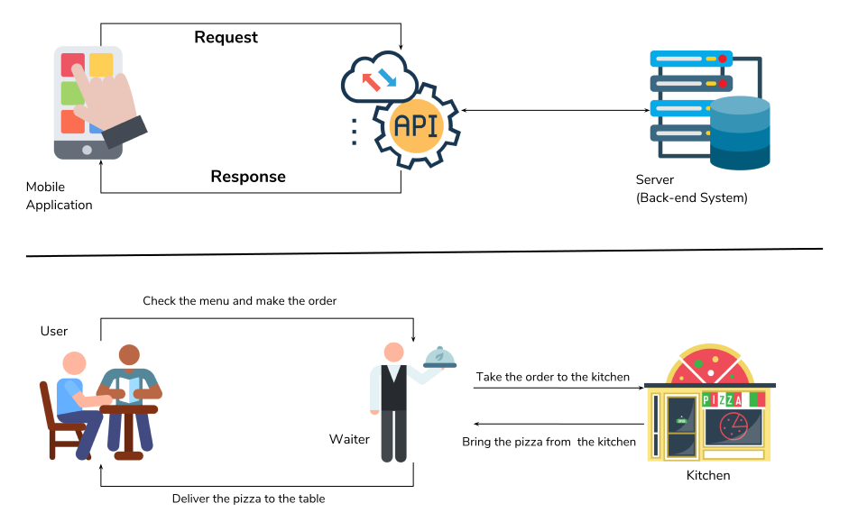
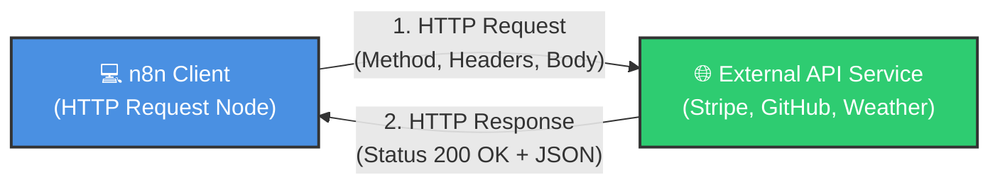
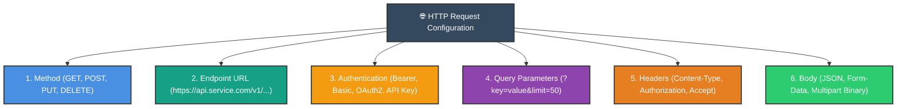
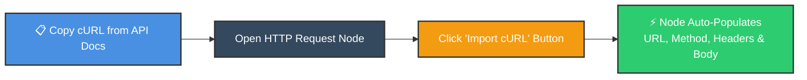

# 🌐 Using the HTTP Request Node in n8n
## Connect Any REST or GraphQL API to Your Automated Pipelines

<p align="center">
  <a href="14_n8n_Item_Linking.md">⬅️ Prev: Item Linking Deep Dive</a> •
  <a href="../README.md">Main Hub</a> •
  <a href="16_Auto_Save_Gmail_Attachments_to_Google_Drive.md">Next: Gmail Attachments to Drive ➡️</a> •
  <a href="https://github.com/shashilabs-io/n8n-docs">GitHub Repository</a>
</p>

---

## 🧭 How to Use This Chapter

> [!TIP]
> **Universal Connectivity:** When n8n doesn't have an off-the-shelf node for a niche SaaS service or private internal microservice, the **HTTP Request Node** gives you full REST & GraphQL client capabilities. You can configure endpoints, headers, authentication mechanisms, multipart uploads, and cURL imports with visual ease.

### 🎯 Key Outcomes of this Chapter:
- Contrast the behavioral differences between polling an **API** vs receiving a **Webhook**.
- Configure request properties: **Method** (`GET`, `POST`, `PUT`, `DELETE`), **URL**, **Headers**, and **Body**.
- Manage API authentication safely (Bearer tokens, Basic Auth, OAuth2, API Keys in Headers vs Query).
- Accelerated setup: import raw **cURL commands** directly into node configurations.
- Parse structured JSON responses vs raw binary file downloads.
- Handle pagination schemas (cursor-based, page-number, and offset).

---

## 📸 HTTP Request Node Overview



---

# 1. What Is an API?

An **API (Application Programming Interface)** allows two distinct software systems to exchange data or trigger actions via structured HTTP requests.



### Concrete Examples:
- **Weather API:** Send coordinates &rarr; Receive temperature and rainfall forecast.
- **Payment Gateway:** Send customer token &rarr; Receive charge confirmation.
- **Internal Database:** Query customer ID &rarr; Receive account record.

---

# 2. API Request vs. Webhook

| Dimension | API Request (Pull / Push) | Webhook (Event-Driven) |
|---|---|---|
| **Initiator** | n8n actively calls the external service when needed. | External service calls n8n when an event happens. |
| **Analogy** | Making a phone call to ask a question. | Receiving an alert or SMS notification. |
| **Typical Role** | Fetching records, updating status, creating resources. | Triggering a workflow when an order is placed or payment succeeds. |

---

# 3. Anatomy of an HTTP Request in n8n



### 3.1 HTTP Methods
- `GET`: Retrieve data without modifying state on the server.
- `POST`: Submit new payloads or create new resources.
- `PUT` / `PATCH`: Update or partially replace an existing resource.
- `DELETE`: Request resource removal.

### 3.2 Authentication Models
Never hardcode API keys into plain URL strings if headers or n8n credentials can be used instead:
- **Bearer Token:** `Authorization: Bearer <your-secret-token>`
- **Basic Auth:** Base64-encoded `username:password`
- **OAuth2:** n8n automatically handles token refreshing and scopes.
- **Header Auth:** Custom keys like `X-API-Key: secret_123`

> [!CAUTION]
> Always store API keys in **n8n Encrypted Credentials** rather than writing them as plaintext strings inside node fields. Never commit credentials to public Git repositories!

### 3.3 Query Parameters vs Headers vs Body
- **Query Parameters:** Key-value pairs appended to the URL string (`?location=Paris&units=metric`).
- **Headers:** Metadata regarding format and authentication (`Content-Type: application/json`).
- **Body:** Data payload sent during `POST` or `PUT` calls (JSON, XML, or file buffers).

---

# 4. Instant Setup: Importing cURL Commands

Most developer documentation provides pre-formatted `cURL` commands for their endpoints. You can import these directly into n8n in one click:



### Example cURL:
```bash
curl -X POST https://api.example.com/v1/leads \
  -H "Authorization: Bearer my_secret_token" \
  -H "Content-Type: application/json" \
  -d '{"name": "Riya", "email": "riya@example.com"}'
```

Pasting this command into **Import cURL** automatically extracts the `POST` method, URL endpoint, headers, and JSON body parameters!

---

# 5. Advanced HTTP Capabilities

### 5.1 Downloading Binary Files
To download a file (PDF, image, audio) rather than JSON:
- Set **Response Format** to `File / Binary Data`.
- The downloaded file is stored inside n8n's `$binary` tab, ready to be attached to emails or uploaded to Google Drive.

### 5.2 Following Redirects
If an API redirects requests (HTTP `301` / `302`), enable **Follow Redirects** under node options to automatically follow target destination URLs.

### 5.3 Pagination Handling
APIs divide bulk results into pages:
- **Page Numbering:** `?page=1&per_page=50`
- **Cursor/Token:** `?cursor=eyJhbGciOi...`
- Use the **Loop Over Items** node or native pagination settings in the HTTP node to iterate until no more records remain.

---

# 6. Common Mistakes & Troubleshooting

| Error Code | Common Cause | Fix |
|---|---|---|
| **401 Unauthorized** | Token missing, expired, or invalid header prefix. | Ensure Bearer prefix is included or re-authenticate credential. |
| **403 Forbidden** | Token lacks required scope/permission for this resource. | Verify API scopes in provider's developer console. |
| **400 Bad Request** | Request body JSON syntax invalid or missing required field. | Check API documentation schema requirements. |
| **404 Not Found** | Incorrect endpoint URL, typo in path, or resource doesn't exist. | Double check exact API base URL and version path. |
| **429 Too Many Requests** | Exceeded rate limit quota. | Insert a **Wait** node or reduce request frequency. |

---

# 7. Practice Exercises & Active Recall

<details>
<summary><strong>1. What does API stand for?</strong></summary>

Application Programming Interface.
</details>

<details>
<summary><strong>2. What is the fundamental difference between an API request and a webhook?</strong></summary>

An API request is initiated by n8n to pull or push data on demand; a webhook is an inbound notification sent to n8n when an event occurs in an external app.
</details>

<details>
<summary><strong>3. Which HTTP method is standard for retrieving records without altering server state?</strong></summary>

The `GET` method.
</details>

<details>
<summary><strong>4. How does the "Import cURL" feature streamline node configuration?</strong></summary>

It parses standard command-line cURL snippets directly into the node's URL, Method, Headers, Query Parameters, and Body settings automatically.
</details>

<details>
<summary><strong>5. How do you configure the node to download an image or PDF instead of JSON?</strong></summary>

Set the node's **Response Format** option to `File / Binary Data`.
</details>

---

# 8. Key Takeaways

- The **HTTP Request** node is n8n's Swiss Army knife for communicating with any external API.
- Always consult the provider's official API documentation for required endpoints, headers, and methods.
- Use **Import cURL** to configure complex requests in seconds.
- Store sensitive tokens inside **n8n Credentials** rather than hardcoding plaintext strings.
- Inspect both JSON responses and HTTP status codes to design resilient error handling.

---

<p align="center">
  <b>Next Step:</b> Automate cloud storage pipelines in <a href="16_Auto_Save_Gmail_Attachments_to_Google_Drive.md">Chapter 16: Gmail Attachments to Google Drive</a> or return to the <a href="../README.md">Main Hub</a>.
</p>
