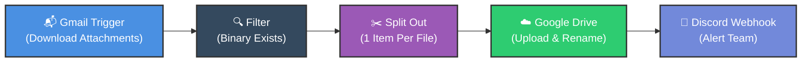
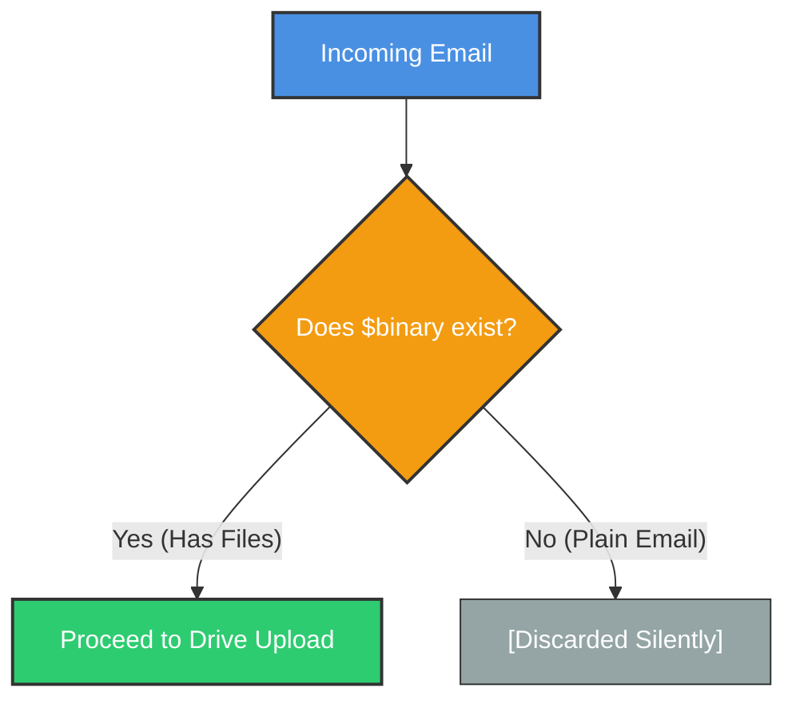

# 📎 Auto-Save Gmail Attachments to Google Drive
## Handling Binary Data, Dynamic File Naming & Multi-File Splitting

<p align="center">
  <a href="15_n8n_HTTP_Request_Node.md">⬅️ Prev: HTTP Request Node</a> •
  <a href="../README.md">Main Hub</a> •
  <a href="17_Pin_Edit_and_Reuse_Data_in_n8n.md">Next: Pin, Edit & Reuse Data ➡️</a> •
  <a href="https://github.com/shashilabs-io/n8n-docs">GitHub Repository</a>
</p>

---

## 🧭 How to Use This Chapter

> [!TIP]
> **Binary Data Mastery:** Unlike plain JSON text payloads, email attachments arrive as raw binary buffers. This chapter details how to capture inbound email streams, filter out non-attachment messages, unpack multi-file bundles into distinct items using **Split Out**, generate collision-free dynamic file names, and archive them in Google Drive with instant Discord alerts.

### 🎯 Key Outcomes of this Chapter:
- Configure the **Gmail Trigger** to download binary attachments automatically.
- Filter out plain text emails using `{{ $binary }}` validation.
- Unpack multiple attachments from a single email item using the **Split Out** node.
- Dynamically resolve variable binary property keys (`Object.keys($binary)[0]`).
- Construct clean, traceable file names: `{{ $json.subject }}_{{ $binary.fileName }}`.
- Dispatch team notifications via Discord webhooks.

---

## 📸 Workflow Architecture




---

# 1. The Core Nodes & Pipeline Roles

| Node | Functional Role | Key Configuration |
|---|---|---|
| **Gmail Trigger** | Ingests incoming emails on schedule or push. | Event: `Message Received`, `Download Attachments: true`. |
| **Filter** | Discards emails without attachments. | Condition: `{{ $binary }}` exists. |
| **Split Out** | Transforms 1 email with $N$ files into $N$ distinct items. | Field: `{{ $binary }}`. |
| **Google Drive** | Stores file stream in target cloud directory. | Operation: `Upload`, Input Field: Dynamic expression. |
| **Discord** | Broadcasts completion alert to team channel. | Webhook URL, Embed subject metadata. |

---

# 2. Step-by-Step Implementation

### Step 1: Ingest Email & Attachments
1. Add a **Gmail Trigger** node.
2. Select Event: **Message Received**.
3. Toggle **Download Attachments** to **True** (critical: otherwise only email metadata arrives, without file content).
4. Fetch a test event to verify that the item contains both a `json` tab (headers, subject, sender) and a `binary` tab.

> [!NOTE]
> When an email has multiple attachments, n8n names binary properties sequentially: `attachment_0`, `attachment_1`, `attachment_2`, etc.

---

### Step 2: Filter Emails with Binary Data
Add a **Filter** node to discard standard text emails:
- **Condition:** `{{ $binary }}` **is not empty** (or exists).
- Rename node to: `Filter Emails with Attachments`.



---

### Step 3: Split Multiple Attachments into Individual Items
If an email contains 4 PDF receipts, it arrives as **1 item** with 4 binary properties. If wired straight to Google Drive, the upload node will only execute **1 time**.

Insert a **Split Out** node:
- **Binary Property:** `{{ $binary }}`
- **Result:** Emits 4 separate n8n items, ensuring the downstream Google Drive node executes 4 distinct upload operations!

---

### Step 4: Dynamically Resolve the Binary Key
Because each item now has a different binary key (`attachment_0`, `attachment_1`, etc.), hardcoding `attachment_0` in Google Drive fails for subsequent items.

Use this dynamic expression in **Input Data Field Name**:
```javascript
{{ Object.keys($binary)[0] }}
```

This dynamically grabs the exact binary key name for the current item!

---

### Step 5: Construct Traceable File Names
Avoid generic file names like `download.pdf`. Combine the email subject with the original attachment filename:

```javascript
{{ $('Filter Emails with Attachments').item.json.subject }}_{{ Object.values($binary)[0].fileName }}
```

### Evaluated Output Example:
```text
Q3_Tax_Invoices_receipt_nov.pdf
```

---

### Step 6: Dispatch Discord Team Notification
Connect a **Discord** node after Google Drive to alert your operations team:
```text
📁 *New Attachment Archived!*
• *Subject:* {{ $('Filter Emails with Attachments').item.json.subject }}
• *File:* {{ Object.values($binary)[0].fileName }}
• *Folder:* Accounting / Invoices
```

---

# 3. Common Troubleshooting & Gotchas

| Symptom | Probable Cause | Actionable Fix |
|---|---|---|
| **No binary data in Gmail output** | "Download Attachments" toggle was left disabled. | Open Gmail Trigger settings and turn **Download Attachments** to On. |
| **Only 1st file uploaded from 5-file email** | Missing Split Out node. | Insert **Split Out** node to convert binary properties into individual items. |
| **Drive error: "Binary property not found"** | Hardcoded `attachment_0` on items where key is `attachment_1`. | Use dynamic expression: `{{ Object.keys($binary)[0] }}`. |
| **File name shows as `undefined_invoice.pdf`** | Upstream node renamed without updating expression reference. | Update node name in expression: `$('Exact Node Name').item.json.subject`. |
| **Excessive Discord notifications** | Discord node runs once per item after split. | Insert an **Aggregate** node prior to Discord to send 1 summary message per email. |

---

# 4. Practice Exercises & Active Recall

<details>
<summary><strong>1. Why must "Download Attachments" be enabled in the Gmail Trigger?</strong></summary>

By default, the trigger only retrieves email headers and body text to save bandwidth. Toggling "Download Attachments" fetches the raw binary file buffers into n8n memory.
</details>

<details>
<summary><strong>2. If an email has 3 attachments, how many items does Gmail Trigger emit?</strong></summary>

It emits **1 item** containing 3 binary properties (`attachment_0`, `attachment_1`, `attachment_2`).
</details>

<details>
<summary><strong>3. Why is the Split Out node necessary for multi-attachment emails?</strong></summary>

Downstream upload nodes execute once per incoming item. Split Out converts the single email item into 3 separate items so each file triggers an independent upload.
</details>

<details>
<summary><strong>4. What expression dynamically retrieves the binary key name of the current item?</strong></summary>

```javascript
{{ Object.keys($binary)[0] }}
```
</details>

<details>
<summary><strong>5. How do you prevent Discord from sending 10 notifications for a 10-file email?</strong></summary>

Insert an **Aggregate** node after the Google Drive upload to gather all uploaded filenames into a single summary array, then dispatch 1 summary alert to Discord.
</details>

---

# 5. Key Takeaways

- Binary data lives inside `$binary`, separate from standard JSON properties.
- Use **Filter** to ensure only emails with attachments proceed downstream.
- Use **Split Out** to unpack multiple attachments into individual items.
- Avoid hardcoded field names (`attachment_0`); use `{{ Object.keys($binary)[0] }}`.
- Combine email metadata with `fileName` to build self-documenting cloud archives.

---

<p align="center">
  <b>Next Step:</b> Accelerate workflow development in <a href="17_Pin_Edit_and_Reuse_Data_in_n8n.md">Chapter 17: Pin, Edit & Reuse Data</a> or return to the <a href="../README.md">Main Hub</a>.
</p>
