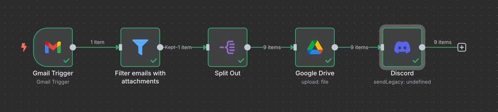

# Chapter 16: Automatically Save Gmail Attachments to Google Drive with n8n

## Learning objectives

By the end of this chapter, you will be able to:

- Build an n8n workflow that watches Gmail for incoming messages.
- Check whether an email contains binary attachment data.
- Upload an attachment to a selected Google Drive folder.
- Send a Discord notification after an upload.
- Handle emails containing multiple attachments.
- Use expressions to select each attachment's binary field and construct useful file names.



## 1. The problem this workflow solves

Saving email attachments manually usually means opening an email, downloading a file, locating the download, and uploading it to cloud storage. Repeating these steps for invoices, contracts, résumés, or other recurring documents wastes time and makes it easy to miss a file.

This workflow automates the process:

**Gmail message received → Filter emails with attachments → Split attachments when needed → Upload to Google Drive → Notify Discord**

The workflow can be adapted to shared team inboxes and recurring document-management tasks. Before using it for sensitive files, choose an appropriate Drive folder and check who can access it.

## 2. Workflow architecture

### Main nodes

| Node | Purpose |
|---|---|
| Gmail Trigger | Detects incoming email and downloads attachment data when configured to do so. |
| Filter | Keeps items that contain binary data; messages without attachments are discarded. |
| Split Out | Turns attachment fields on one email item into separate items so each file can be handled individually. |
| Google Drive | Uploads each attachment to a selected folder. |
| Discord | Sends a notification after the upload path runs. |

For a single attachment, the Split Out step may not be necessary. For multiple attachments, splitting them into separate items makes per-file processing much easier.

## 3. Step 1 — Configure the Gmail Trigger

1. Add a **Gmail Trigger** node.
2. Choose the **Message Received** event.
3. Connect your Gmail account using the credential setup supported by your n8n instance.
4. Enable **Download Attachments** so the attachment content is available as binary data.
5. Run **Fetch Test Event** to inspect a sample email.

The example workflow checks the Inbox periodically (the demonstrated configuration checks every minute). Exact trigger options can vary by n8n version and credential setup.

### Understand the output

The trigger can return email metadata in JSON and file content in binary data. In the example, binary attachment fields use names such as:

- `attachment_0`
- `attachment_1`
- `attachment_2`

An email with nine attachments may therefore have one item whose binary section contains nine attachment fields. That distinction matters: **one email item is not necessarily the same thing as one attachment item.**

## 4. Step 2 — Filter emails that have attachments

Add a **Filter** node after the Gmail Trigger.

Configure the condition to check whether the incoming item's binary data exists. In expression form, the object being checked is:

```text
{{ $binary }}
```

Use the Filter condition settings to test for an existing object, following the options available in your n8n version. Rename the node to something clear, such as **Filter Emails with Attachments**.

Expected behavior:

- If binary attachment data exists, the item continues.
- If it does not exist, the item is filtered out.

Test this with an email that has an attachment and, if possible, one without an attachment.

## 5. Step 3 — Upload a single attachment to Google Drive

Add a **Google Drive** node after the Filter.

Configure it to upload a file, then set:

- **Resource:** File
- **Operation:** Upload
- **Input Data Field Name:** the binary property containing the attachment, for example `attachment_0`
- **Parent Drive / Folder:** choose the destination Drive and folder
- **File Name:** choose a suitable name or expression

For the single-attachment test, `attachment_0` can work. A simple file name can combine the email subject with a suffix, such as:

```text
{{ $json.subject + "_first_attachment_upload" }}
```

The exact expression may need to reference the JSON structure returned by your Gmail Trigger. Execute the Google Drive node and verify that the file appears in the selected folder and opens correctly.

### Limitation of a hard-coded field

The field name `attachment_0` only points to that particular binary property. If the email contains multiple attachments, the other properties will not automatically be uploaded by a node configured to read only `attachment_0`.

## 6. Step 4 — Split multiple attachments into separate items

When one email contains several binary attachment properties, insert a **Split Out** node before Google Drive.

The goal is to convert the attachment properties into separate items, so the Google Drive node can process each file individually.

In the example, the Split Out field is configured around the binary object:

```text
{{ $binary }}
```

Use the Split Out node's field settings appropriate to your n8n version and confirm the output in the execution view. The expected result is one output item per attachment. For example, nine attachments should result in nine items.

### Why this step matters

n8n nodes normally process each incoming item. If the Gmail Trigger returns one item containing multiple binary properties, a downstream upload node may execute once for that one item. Splitting the attachments first creates separate items for per-attachment uploads.

**Check the output before continuing.** If the Split Out node does not produce one item per attachment, adjust its field configuration to match the actual input structure rather than assuming the node is configured correctly.

## 7. Step 5 — Select the binary property dynamically

After splitting, each item may have a different binary property name, such as `attachment_0`, `attachment_1`, and so on. Hard-coding one field name will fail for the other items.

Use an expression to retrieve the first key in the current item's binary object:

```text
{{ Object.keys($binary).first() }}
```

This follows the approach demonstrated in the workflow: get the keys of the binary object and select the first key. The expression should resolve to the current item's binary field name, for example `attachment_2`.

Set the Google Drive node's **Input Data Field Name** to this expression. Confirm that the expression preview changes as you inspect different output items.

> If your n8n version does not accept `.first()` on a JavaScript array in this context, use the equivalent JavaScript indexing expression `{{ Object.keys($binary)[0] }}`. Test the expression in the field preview before running the full workflow.

## 8. Step 6 — Build a useful, dynamic file name

A good naming convention helps you find files later. One useful pattern is:

**Email subject + underscore + original attachment file name**

The attachment metadata is available in the binary object. The demonstrated approach obtains the values of that object, selects the first value, and reads its `fileName` property.

Expression:

```text
{{ Object.values($binary).first().fileName }}
```

A complete file-name expression can combine the subject from the earlier email item with the original attachment name:

```text
{{ $('Filter Emails with Attachments').item.json.subject + "_" + Object.values($binary).first().fileName }}
```

Replace `Filter Emails with Attachments` with the exact name of your node. This expression uses the subject from that node and the file name of the current attachment.

### Example

If the email subject is `Unable to renew subscription` and the original attachment is `invoice.pdf`, the generated name is:

```text
Unable to renew subscription_invoice.pdf
```

Check the expression preview. If it shows `undefined`, inspect the previous node's JSON and binary output and confirm the node name and property names.

## 9. Step 7 — Send a Discord notification

Add a **Discord** node after the Google Drive upload node and configure it to send a message. The example uses a Discord webhook integration.

A simple message could be:

```text
A new important attachment has been uploaded to Google Drive.
```

You can include the email subject by inserting an expression that references the relevant upstream node. For example:

```text
New attachment uploaded for email: {{ $('Filter Emails with Attachments').item.json.subject }}
```

Because a workflow with multiple attachments can produce multiple items, this arrangement may send one notification per attachment. If you want one summary message for the entire email, aggregate the per-file results or prepare a combined message before sending the notification.

## 10. Test the complete workflow

Test in stages rather than immediately activating the workflow:

1. **Gmail Trigger:** fetch an email with one attachment.
2. **Filter:** confirm the item continues when binary data exists.
3. **Google Drive:** upload the single attachment and verify the file.
4. **Multiple attachments:** fetch an email containing several files.
5. **Split Out:** confirm there is one output item per attachment.
6. **Dynamic input field:** inspect several items and confirm the expression resolves to the correct binary property.
7. **Dynamic file name:** confirm both subject and original file name appear in the preview.
8. **Discord:** verify that the message arrives in the intended channel.
9. **End-to-end test:** run the workflow and check that every expected attachment is uploaded.

After testing, save the workflow. Activate it only after confirming the credentials, destination folder, file naming, and notification behavior.

## 11. Troubleshooting

| Symptom | Likely cause | What to check |
|---|---|---|
| No item reaches the upload node | The email has no binary data, or the Filter condition is incorrect | Inspect the Gmail Trigger's binary output and the Filter condition. |
| Google Drive says the binary field is missing | The input field is hard-coded as `attachment_0` | Use a dynamic expression for the current item's binary property. |
| Only one attachment is uploaded | Multiple attachments remain inside a single item | Configure Split Out and confirm it emits one item per attachment. |
| File name is `undefined` | The subject is being read from the wrong item, or the binary metadata path is incorrect | Inspect the node's input data and expression preview; reference the correct upstream node. |
| Same name is used for every file | The file name contains only a fixed string | Include the original attachment file name or another unique value. |
| Discord sends many messages | The notification node receives one item per attachment | Aggregate results or construct one summary notification. |
| Files are uploaded to the wrong place | Incorrect Drive or folder was selected | Recheck the destination before activating the workflow. |

## 12. Practical notes and good habits

- Use descriptive node names so expressions remain readable.
- Inspect both JSON and binary output; they serve different purposes.
- Test with single-attachment and multiple-attachment emails.
- Keep the original attachment file name when it helps trace a document.
- Consider duplicate handling if the trigger or workflow can process the same message again.
- Restrict access to the destination folder, especially for invoices, contracts, résumés, or other sensitive files.
- Confirm that the intended people can access the Drive folder before relying on it as a team archive.
- Avoid sending confidential file contents to Discord; a brief notification is usually sufficient.
- Add an error-handling path if failed uploads must be reported or retried.

## 13. Practice exercises

### Exercise 1 — Single attachment
Build a workflow that saves one attachment from a Gmail message to a specific Google Drive folder.

**Expected result:** the file appears in the selected folder.

### Exercise 2 — Ignore emails without attachments
Add a Filter node that allows only items with binary attachment data to continue.

**Expected result:** messages without attachments do not reach Google Drive.

### Exercise 3 — Multiple attachments
Extend the workflow so every attachment in one email is uploaded separately.

**Expected result:** an email with five attachments produces five uploaded files.

### Exercise 4 — Dynamic naming
Name each file using the email subject and the original attachment file name.

**Expected result:** every uploaded file has a meaningful name that includes both pieces of information.

### Exercise 5 — One notification per email
Modify the workflow so several uploaded attachments lead to one Discord summary message instead of a separate message for each attachment.

**Hint:** collect or aggregate the upload results before the notification step.

## 14. Quick revision

- **Gmail Trigger:** detects incoming messages and can download attachments as binary data.
- **Filter:** prevents messages without attachment data from continuing.
- **Split Out:** creates separate items for individual attachments when configured for the incoming structure.
- **Dynamic binary field:** use the current item's binary keys instead of hard-coding `attachment_0`.
- **Dynamic file name:** combine email metadata with the original attachment name.
- **Google Drive:** stores the attachment in the chosen folder.
- **Discord:** notifies the team; aggregate results if you need only one notification per email.

### Workflow summary

```text
Gmail Trigger (download attachments)
        ↓
Filter (binary data exists)
        ↓
Split Out (one item per attachment, when needed)
        ↓
Google Drive (dynamic binary field + dynamic file name)
        ↓
Discord (notification)
```
