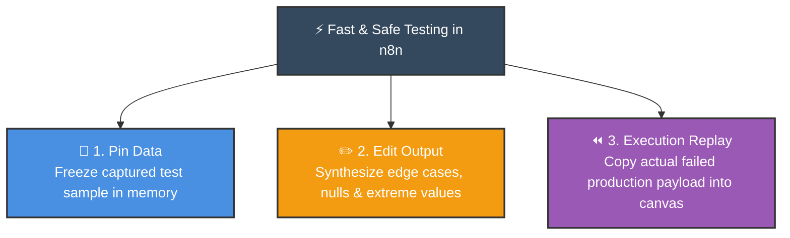
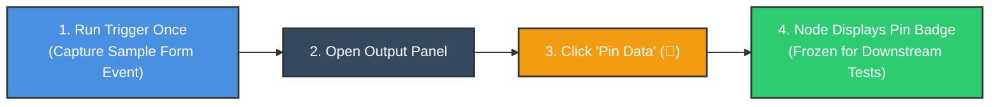
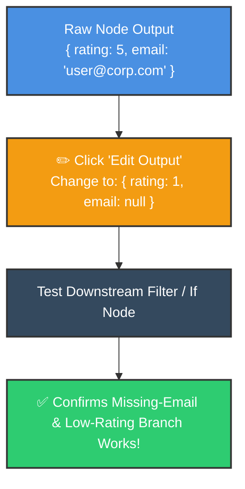

# 📌 Pin, Edit & Reuse Data in n8n
## Supercharge Workflow Development Without Repeated Webhook Triggers

<p align="center">
  <a href="16_Auto_Save_Gmail_Attachments_to_Google_Drive.md">⬅️ Prev: Gmail Attachments to Drive</a> •
  <a href="../README.md">Main Hub</a> •
  <a href="18_How_to_Create_Mock_Data_in_n8n.md">Next: Mock Data Generation ➡️</a> •
  <a href="https://github.com/shashilabs-io/n8n-docs">GitHub Repository</a>
</p>

---

## 🧭 How to Use This Chapter

> [!TIP]
> **10x Development Speed:** Submitting a Google Form or re-triggering a Stripe webhook 50 times just to test field renames in downstream nodes is slow, expensive, and burns API quotas. By mastering **Pin Data**, **Edit Output**, and **Execution Replay**, you can freeze, synthesize, and debug realistic payloads locally in seconds.

### 🎯 Key Outcomes of this Chapter:
- Freeze live node output in memory using **Pin Data** for instant iteration.
- Manually simulate edge cases, null fields, and boundary tests using **Edit Output**.
- Extract real failure payloads from past **Execution Logs** to reproduce production bugs.
- Understand the development vs production boundaries of pinned data.
- Protect real-world systems by disabling side-effect nodes (Email, Slack, Database write) during canvas testing.

---

## 📸 Pinned Data in the Canvas


---

# 1. The Three Testing Paradigms



| Technique | How It Operates | Best Used When |
|---|---|---|
| **Pin Data** | Freezes a node's output in local memory. Downstream nodes reuse this data without triggering upstream calls. | Building downstream logic, mapping fields, and testing expressions without submitting forms repeatedly. |
| **Edit Output** | Lets you manually edit JSON keys and values directly in the node output inspector. | Testing edge cases (e.g. `rating: 1` vs `rating: 5`, missing emails). |
| **Execution Replay** | Copies input payloads from the **Executions** audit log into the editor. | Debugging production errors using the exact customer payload that caused the failure. |

---

# 2. How to Pin Data



### Steps:
1. Trigger your source node (Webhook, Forms, or API) once to obtain a representative payload.
2. In the node's output inspector panel, click the **Pin Data** icon (pushpin).
3. Notice the purple pin badge appearing above the node on your canvas.
4. Downstream nodes can now be executed independently without re-fetching external data!

> [!WARNING]
> **Production Deployment Rule:** Pinned data applies strictly to canvas test runs. However, before publishing a workflow to production, always **unpin** your test data to ensure live dynamic customer requests flow through unimpeded.

---

# 3. Editing Node Outputs to Test Edge Cases

Don't wait for a customer to submit a broken record in production. Manually edit output data to verify your filters and error handlers:



### What You Should Simulate:
- **Null / Missing Fields:** Delete the `email` key to confirm fallback handling.
- **Boundary Numbers:** Test `total: 0`, `total: -50`, `total: 999999`.
- **String Formats:** Test non-English characters, long strings, or malformed phone numbers.

---

# 4. Reproducing Production Bugs with Execution Replay

When a workflow fails in production:
1. Open the **Executions** tab in the left-hand navigation sidebar.
2. Locate the failed run and identify the red node where execution crashed.
3. Inspect the **Input** tab of the failed node and copy the exact JSON payload.
4. Return to your workflow canvas editor, paste the JSON into the node's editor via **Edit Output**, and pin it.
5. You can now step through and debug the exact failure under controlled conditions!

---

# 5. Safe Development Habits: Protecting Production

```mermaid
flowchart LR
    subgraph TESTING["🧪 Safe Canvas Testing"]
        D1["Pinned Customer Data"] --> D2["Logic / Transform Nodes"]
        D2 -.->|DISABLED (Muted)| D3["🚫 Stripe Charge Node"]
        D2 -.->|DISABLED (Muted)| D4["🚫 Send Real Email to Customer"]
    end

    style TESTING fill:#f9f9f9,stroke:#34495E,stroke-width:2px
    style D1 fill:#4A90E2,stroke:#333,stroke-width:2px,color:#fff
    style D2 fill:#F39C12,stroke:#333,stroke-width:2px,color:#fff
    style D3 fill:#E74C3C,stroke:#333,stroke-width:1px,color:#fff
    style D4 fill:#E74C3C,stroke:#333,stroke-width:1px,color:#fff
```

> [!IMPORTANT]
> **Disable Destructive Side-Effects:** While testing transforms with pinned data, select destructive action nodes (e.g. *Send Customer Email*, *Stripe Charge*, *Delete Database Row*) and toggle **Disable Node (`D`)**. This prevents accidental test emails or charges from firing into the real world.

---

# 6. Practice Exercises & Active Recall

<details>
<summary><strong>1. What does Pin Data do inside n8n?</strong></summary>

It freezes the current node's output in local memory so downstream nodes can be built and tested repeatedly without re-querying external APIs or submitting forms.
</details>

<details>
<summary><strong>2. Does editing a node's output update the source database or spreadsheet?</strong></summary>

No. Edited output modifies only the temporary in-memory test payload within n8n's canvas; it does not touch the external source.
</details>

<details>
<summary><strong>3. How do you reproduce a production failure locally in the editor?</strong></summary>

Go to the Executions log, copy the raw JSON input from the node that failed, paste it into the editor using Edit Output, and run the test step.
</details>

<details>
<summary><strong>4. Why should you disable email or payment nodes while experimenting with pinned data?</strong></summary>

To prevent accidental real-world side effects (such as spamming test emails or charging real credit cards) while debugging logic.
</details>

<details>
<summary><strong>5. What must you remember to do before activating a workflow in production?</strong></summary>

Unpin test data so the production engine evaluates fresh live customer inputs instead of stale test records.
</details>

---

# 7. Key Takeaways

- **Pin Data** saves time, preserves API quotas, and makes testing repeatable.
- **Edit Output** allows you to rigorously test boundary values, nulls, and error branches.
- Use **Executions** history to capture real-world failure payloads and fix edge cases.
- Always disable external side-effect nodes while testing with mock data.
- Unpin test samples prior to final production deployment.

---

<p align="center">
  <b>Next Step:</b> Synthesize bulk test payloads in <a href="18_How_to_Create_Mock_Data_in_n8n.md">Chapter 18: Mock Data Generation</a> or return to the <a href="../README.md">Main Hub</a>.
</p>
