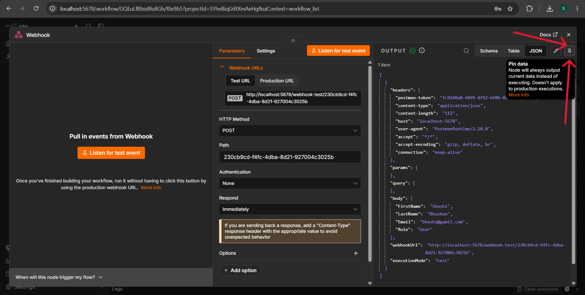

# Chapter 17: Pin, Edit, and Reuse Data in n8n

## Learning objectives

After studying this chapter, you should be able to:

- Pin node output to reuse test data while building a workflow.
- Edit node output to test different data conditions.
- Copy input data from a previous execution to reproduce and investigate an error.
- Explain the practical benefits and limitations of these debugging techniques.



## 1. Why test data matters

Workflow development often involves data from webhooks, forms, APIs, spreadsheets, and other external systems. Repeating the same external request just to test a later node can take time and may consume API quotas or paid usage.

n8n provides ways to reuse data while developing and debugging a workflow:

1. **Pin data** — keep a node's output available for subsequent test runs.
2. **Edit output** — manually change output data to simulate another scenario.
3. **Reuse data from a previous execution** — copy the data that caused a problem and use it to reproduce the issue in the editor.

These techniques help test workflow logic without repeatedly generating the same input data.

## 2. Pin data

### What does pinning mean?

Pinning stores a node's output as test data. During subsequent editor test runs, the node can use the pinned output rather than fetching fresh data from the upstream source.

For example, imagine a workflow starts with a webhook connected to a signup form:

```text
Signup Form → Webhook → Check Email → Continue Workflow
```

You submit the form once, and the webhook receives data such as a name, email address, and company. You can pin that webhook output. While developing later nodes, you can reuse the same sample instead of submitting the form again each time.

### How to pin data

1. Run the trigger or webhook and capture a representative test event.
2. Open the node's output.
3. Use the **Pin Data** control.
4. Return to the workflow canvas and look for the pin indicator on the node.
5. Execute downstream nodes in the editor to test the remaining logic against the saved sample.

The pinned data can remain available after saving the workflow and returning to it later. When you need fresh data, unpin the output and capture a new event.

### Why pin data?

- **Faster iteration:** test downstream nodes without repeatedly submitting forms.
- **Fewer external requests:** avoid unnecessary API calls during development.
- **Quota awareness:** reduce test calls to services with request limits.
- **Repeatable tests:** run the same sample through updated workflow logic.

Pinning is a development/testing aid. Do not assume that pinned test data will be used for live production executions.

## 3. Important pin-data limitations

The source material highlights these considerations:

- Pinning is intended for editor test runs, not live production execution.
- The described workflow uses pinning on nodes with a single output.
- A node has one pinned dataset at a time; pinning again replaces the existing pinned data.
- The source notes that nodes producing binary output cannot be pinned using the demonstrated feature.
- A pin indicator identifies a node with pinned data.
- Pinned data can persist after the workflow is saved and reopened.

Because n8n's interface and supported behavior can vary by version, check the options available in your own instance if a node cannot be pinned.

## 4. Edit node output

### What is editing output?

Editing output lets you manually modify a node's output data for testing. This is useful when you want to simulate a new condition without changing the original data in a spreadsheet or making another request to an external service.

Suppose a workflow receives customer feedback and filters records where `rating` is less than `3`. The filtered records are sent to a code node that builds a summary for the support team.

```text
Customer Feedback + Customer Records
                 ↓
               Merge
                 ↓
       Filter: rating < 3
                 ↓
        Build Support Summary
```

If the merged output contains 38 low-rating records, you can edit a few ratings in the upstream node's output and test how the filter behaves with the changed data.

### How to edit output

1. Run the relevant node so it has output data.
2. Open the node's output and choose **Edit Output** (the exact label or icon may vary).
3. Modify the test values you want to change.
4. Save the edited output.
5. Run downstream nodes and inspect the new results.

In the example, three records originally had ratings below `3`. Changing those ratings to values above `3` means they no longer satisfy the filter condition. The number of filtered records would therefore fall from 38 to 35.

### What can you test?

- Missing fields, such as an absent email address.
- Different numeric values, such as ratings of `1`, `3`, or `5`.
- Unexpected strings or empty values.
- Edge cases that are difficult to reproduce with live data.
- How downstream filters, conditions, and code respond to changed input.

Edited output is test data. It does not, by itself, update the original record in a spreadsheet, database, or other connected application.

## 5. Reuse data from a previous execution

Sometimes a workflow fails because a particular input was incomplete or unexpected. Instead of triggering the whole workflow again, you can inspect the failed execution and reuse the input data that led to the problem.

### Example: an email is missing

Imagine a workflow checks whether an email address exists. If it does, the workflow continues; if not, it stops with a clear error.

```text
Incoming Data
     ↓
Check: Is email present?
   ↙             ↘
 Yes               No
  ↓                 ↓
Continue         Stop and Error
```

A previous execution might have failed because the incoming data had no email field. Reusing that exact input lets you reproduce and investigate the failure.

### Steps to reuse past execution data

1. Open **Executions** in n8n.
2. Open the execution that failed.
3. Find the node where the error occurred.
4. Inspect and copy the relevant input data from the node immediately before the failure point.
5. Return to the workflow editor.
6. Open the node where the copied data should enter the workflow.
7. Use the data-editing/pinning interface available in your n8n version to paste and save the sample.
8. Run the relevant downstream path and inspect the result.

If existing pinned data is blocking the test sample you want to use, unpin or replace it as appropriate. Be careful to use the correct workflow version and node input structure.

### Why this helps

- Reproduces a specific failure.
- Avoids repeated webhook submissions or external calls.
- Makes debugging more controlled.
- Helps test error-handling paths using the exact data that caused the issue.

## 6. Compare the three techniques

| Technique | What it does | Best use |
|---|---|---|
| Pin data | Reuses a node's captured output | Repeatedly testing downstream logic with the same sample |
| Edit output | Changes output values for a test | Testing alternate values, missing fields, and edge cases |
| Reuse past execution data | Brings data from a prior run into the editor | Reproducing a real failure or investigating unexpected behavior |

These methods complement one another. You might copy input from a failed execution, edit it to test nearby edge cases, and pin a representative sample while refining downstream nodes.

## 7. Safe and effective testing habits

- Use sample or appropriately sanitized data when outputs contain personal or confidential information.
- Keep production side-effect nodes disabled while experimenting with copied or edited data. The source example disables nodes that could update customer records or send messages/emails during testing.
- Inspect the input and output of each important node rather than relying only on the canvas.
- Record what changed when testing an edge case, so the expected result is clear.
- Before enabling the workflow, unpin test data when you want the workflow to process fresh live inputs.
- Test both valid and invalid inputs, including missing required fields.
- Be careful with nodes that send emails, update databases, post to chat systems, or perform other real actions.

## 8. Practice exercises

### Exercise 1 — Pin a webhook sample
Submit a test form once, pin the webhook output, then execute a downstream Filter or If node several times without submitting the form again.

**Expected result:** downstream tests reuse the captured sample.

### Exercise 2 — Change a filter result
Create test data with ratings `1`, `2`, `3`, `4`, and `5`. Filter for ratings less than `3`. Edit the output data and change one low rating to `5`.

**Expected result:** that record no longer passes the filter.

### Exercise 3 — Test missing data
Create or edit an input item so that the `email` field is missing. Test a branch that checks whether email is present.

**Expected result:** the workflow follows the missing-email path rather than the valid-email path.

### Exercise 4 — Reproduce a failed execution
Open an earlier failed execution, copy the relevant input, and use it in the editor to test the node that failed.

**Expected result:** you can investigate the same input without recreating the original external event.

### Exercise 5 — Protect side effects
Before running your test workflow, identify nodes that send messages, update records, or send emails. Disable them while testing the data transformations.

**Expected result:** your test does not accidentally affect real users or records.

## 9. Quick revision

- **Pin Data:** reuse captured node output during editor testing.
- **Edit Output:** manually alter test values to simulate different scenarios.
- **Past execution data:** reuse an actual input to reproduce an error.
- **Production caution:** pinned or edited test data is for development workflows; verify live behavior with fresh inputs.
- **Side-effect caution:** disable real-world actions while testing when you do not intend them to run.

### Concept map

```text
                Faster n8n Testing
                       |
       +---------------+----------------+
       |               |                |
    Pin Data       Edit Output     Reuse Past Data
       |               |                |
  Repeat same      Simulate edge     Reproduce an
  test sample      cases/values      actual failure
```
