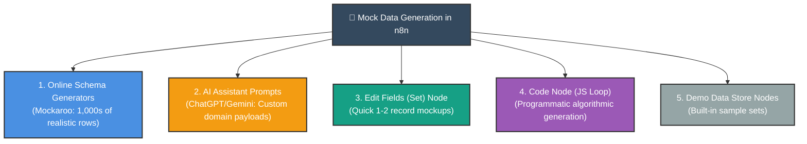
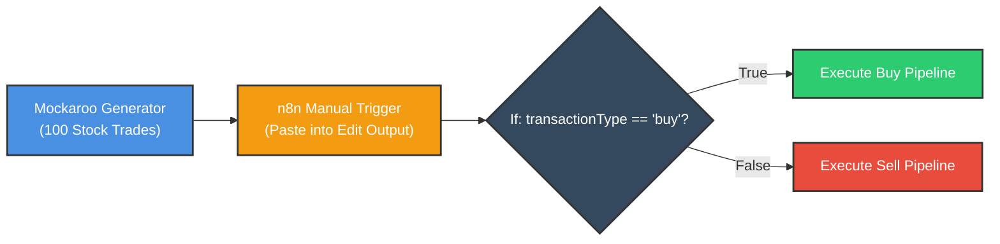

# 🧪 How to Create Mock Data in n8n
## Synthetic Datasets, Schema Generators & Programmatic Testing

<p align="center">
  <a href="17_Pin_Edit_and_Reuse_Data_in_n8n.md">⬅️ Prev: Pin, Edit & Reuse Data</a> •
  <a href="../README.md">Main Hub</a> •
  <a href="19_Creating_Subworkflows_in_n8n.md">Next: Creating Sub-workflows ➡️</a> •
  <a href="https://github.com/shashilabs-io/n8n-docs">GitHub Repository</a>
</p>

---

## 🧭 How to Use This Chapter

> [!TIP]
> **Synthetic Validation:** Developing directly against live production systems is dangerous and slow. Creating high-fidelity synthetic mock data enables you to rigorously stress-test branching logic, simulate missing or corrupted fields, verify rate-limit throttling, and benchmark performance with hundreds of realistic items before writing to live CRMs.

### 🎯 Key Outcomes of this Chapter:
- Understand the 5 distinct methods for generating mock test data in n8n.
- Use online schema generators (e.g. Mockaroo) to produce bulk CSV/JSON payloads.
- Craft prompts for LLMs/AI to generate edge-case datasets with missing attributes.
- Generate algorithmic datasets programmatically using the **Code Node**.
- Avoid common JSON array syntax errors (`{...}{...}` vs `[{...}, {...}]`).
- Implement safe sandbox testing without corrupting production databases.

---

# 1. The 5 Mock Data Methods Compared



| Method | Best Used For | Output Volume | Setup Speed |
|---|---|---|---|
| **Mock Data Generator** ([Mockaroo](https://www.mockaroo.com/)) | Bulk relational data, stock trades, flight logs. | 100 to 10,000+ rows | 2–5 minutes |
| **AI Assistant (LLM)** | Specific business schemas with intentional edge cases. | 20 to 200 items | Instant |
| **Edit Fields (Set)** | Rapid 1-item prototyping and expression testing. | 1 to 5 items | Instant |
| **Code Node (Script)** | Algorithmic series (e.g. every 4th item missing email). | Unlimited | Fast |
| **Demo Data Store** | Quick exploratory learning of basic nodes. | Pre-configured | Instant |

---

# 2. Method 1: Dedicated Mock-Data Generators (Mockaroo)

Online generators let you construct realistic relational models:
1. Define fields: `tradeId`, `symbol`, `transactionType`, `price`, `volume`.
2. Configure probabilistic distributions: set **20% blank values** for phone numbers to test missing data branches.
3. Export as **JSON Array**.
4. In n8n, paste the exported JSON into a **Manual Trigger**'s edited output panel.



---

# 3. Method 2: AI Prompting for Edge-Case Generation

Copy and paste this structured prompt into an LLM to generate test payloads that strictly conform to n8n's array-of-objects expectation:

```text
I am testing an n8n workflow that processes inbound leads.
Generate a dataset of 50 fake user records for testing.

Requirements:
- Return strictly valid JSON as ONE single array of objects: [ { ... }, { ... } ].
- Include these fields: userId, firstName, lastName, email, company, signupDate, country.
- Make all contact information completely fictional.
- Leave email empty ("") on approximately 20% of records to test fallback logic.
- Ensure 5 records have country as "US", 5 as "DE", and others worldwide.
- Return ONLY the raw JSON array without markdown backticks or conversational text.
```

> [!WARNING]
> **Array Syntax Trap:** Ensure the AI produces a single JSON array `[ {...}, {...} ]`. If it emits multiple unbracketed objects `{...} {...}`, n8n's JSON parser will throw `Unexpected token { after JSON`.

---

# 4. Method 3: Rapid Prototyping with Edit Fields (Set)

When you only need a single item to test downstream string formatting:
1. Insert an **Edit Fields (Set)** node after your trigger.
2. Add fields manually or switch to JSON mode.
3. Define your target test structure:

```json
{
  "orderNumber": "ORD-1001",
  "customerName": "Demo Customer",
  "email": "customer@example.test",
  "order": {
    "products": [
      { "name": "Notebook", "quantity": 2 },
      { "name": "Pen", "quantity": 5 }
    ]
  }
}
```

---

# 5. Method 4: Programmatic Generation with the Code Node

Use a JavaScript loop to generate hundreds of structured items with controlled variance:

```javascript
// Mode: Run Once for All Items
const users = [];

for (let i = 1; i <= 20; i++) {
  users.push({
    json: {
      userId: `USR-${1000 + i}`,
      firstName: `User_${i}`,
      email: (i % 4 === 0) ? "" : `user_${i}@example.test`,
      country: (i % 2 === 0) ? "Germany" : "Canada",
      score: Math.floor(Math.random() * 100),
      createdAt: new Date().toISOString()
    }
  });
}

return users;
```

### Why Programmatic Generation Shines:
- **Zero External Dependencies:** Runs natively inside n8n without copy-pasting files.
- **Deterministic Edge Cases:** Every 4th user has an empty email, making filter verification 100% predictable.

---

# 6. Production Safety Checklist

Before running tests with mock datasets:
- [ ] Ensure all generated email addresses use safe test domains (e.g. `@example.com` or `@test.org`).
- [ ] Confirm outbound nodes (Stripe, Twilio SMS, Email) are muted/disabled.
- [ ] Connect database nodes to development/sandbox tables, never production tables.
- [ ] Validate that downstream If/Filter nodes handle empty strings without crashing.

---

# 7. Practice Exercises & Active Recall

<details>
<summary><strong>1. Why is mock data preferred over live customer data during development?</strong></summary>

It prevents accidental modifications to live databases, avoids spamming real customer emails, eliminates API query costs, and lets you safely test broken edge cases.
</details>

<details>
<summary><strong>2. What is the syntax difference between CSV and JSON mock data?</strong></summary>

CSV is a flat row-and-column table with headers; JSON supports deeply nested objects, key-value pairs, and child arrays.
</details>

<details>
<summary><strong>3. Why does n8n reject multiple JSON objects pasted without brackets?</strong></summary>

A valid JSON document must have a single root entity. Multiple consecutive unbracketed objects (`{...} {...}`) violate JSON grammar. They must be enclosed in an array: `[ {...}, {...} ]`.
</details>

<details>
<summary><strong>4. How do you programmatically simulate missing emails for 25% of users in a Code node?</strong></summary>

Use a modulo check inside the generation loop:
```javascript
email: (i % 4 === 0) ? "" : `user_${i}@example.com`
```
</details>

---

# 8. Key Takeaways

- Use **Mockaroo** for bulk realistic datasets (hundreds to thousands of rows).
- Use **AI prompts** for custom domain-specific schemas with intentional edge cases.
- Use **Edit Fields** for instant 1-to-2 item tests.
- Use the **Code Node** for programmatic datasets with mathematical patterns.
- Always use `@example.com` domains to guarantee test communications never reach real individuals.

---

<p align="center">
  <b>Next Step:</b> Build modular, reusable micro-workflows in <a href="19_Creating_Subworkflows_in_n8n.md">Chapter 19: Creating Sub-workflows</a> or return to the <a href="../README.md">Main Hub</a>.
</p>
