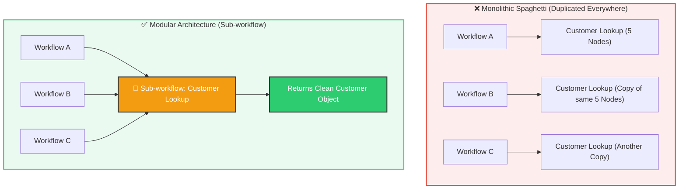
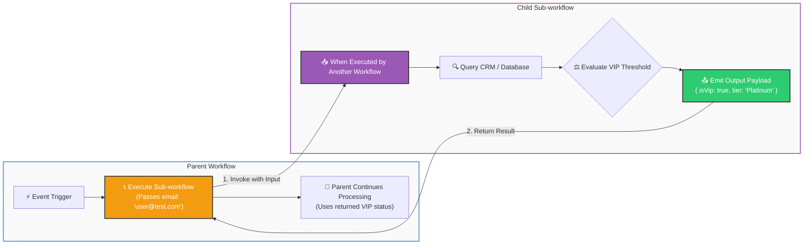
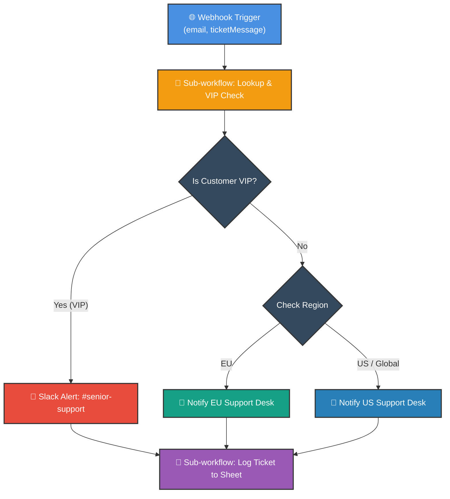

# 🧩 Creating Sub-workflows in n8n
## Modular Architecture, Reusable Pipelines & Micro-Automations

  <a href="18_How_to_Create_Mock_Data_in_n8n.md">⬅️ Prev: Mock Data Generation</a> •
  <a href="../README.md">Main Hub</a> •
  <a href="20_Automate_File_Management_with_n8n.md">Next: Automate File Management ➡️</a> •
  <a href="https://github.com/shashilabs-io/n8n-docs">GitHub Repository</a>

---

## 🧭 How to Use This Chapter

> [!TIP]
> **Modular Architecture:** When multiple workflows need to look up customers, validate email addresses, or log tickets to a central spreadsheet, copy-pasting the same 5 nodes across 10 canvases is an unmaintainable nightmare. **Sub-workflows** allow you to encapsulate shared logic into callable microservices with strict input/output contracts.

### 🎯 Key Outcomes of this Chapter:
- Understand the Parent-Child architecture of n8n **Sub-workflows**.
- Configure the **Execute Workflow / Execute Sub-workflow** caller node.
- Build sub-workflows using the **When Executed by Another Workflow** trigger.
- Pass input parameters from parent to child and return processed payloads back to the parent.
- Decouple a monolithic customer support pipeline into clean, independently testable modules.
- Maintain single-point-of-truth logic across your entire enterprise workspace.

---

# 1. Monoliths vs. Modular Micro-Workflows

### Core Advantages:
1. **DRY (Don't Repeat Yourself):** Update CRM lookup logic once, and all 10 calling workflows automatically benefit.
2. **Independent Testing:** Unit-test the sub-workflow in isolation without triggering parent events.
3. **Clean Canvas:** Keeps parent canvases readable and executive-friendly.

---

# 2. How Data Flows Between Workflows

1. **Parent** calls **Execute Sub-workflow**, supplying input data items.
2. **Sub-workflow** wakes up via **When Executed by Another Workflow** trigger.
3. **Sub-workflow** runs internal logic, transforms data, and finishes.
4. **Parent** receives the returned output and resumes execution seamlessly.

---

# 3. Practical Architecture: Enterprise Support Ticket Routing

A support ticket arrives via a public webhook. The workflow must qualify the user, route VIPs to senior reps, distribute regional tickets, and log the interaction.

### VIP Qualification Logic:
A customer qualifies as a VIP if **either** rule is satisfied:
$$\text{Order History} > \$5,000 \quad \mathbf{OR} \quad \text{Average Satisfaction Rating} > 4.5$$

By placing this rule inside a sub-workflow, sales, marketing, and support pipelines all share the exact same definition of VIP!

---

# 4. How to Configure Sub-workflows in n8n

### In the Sub-workflow (The Child):
1. Create a new canvas named: `[Module] Customer Lookup & VIP Qualifier`.
2. Add the trigger node: **When Executed by Another Workflow**.
3. Wire your lookup, formatting, and calculation nodes.
4. Ensure the final node outputs clean, structured JSON properties needed by callers.
5. Save the workflow and copy its Workflow ID (from the browser URL).

### In the Parent Workflow:
1. Insert the **Execute Sub-workflow** node.
2. Under **Source**, select **Database** or paste the target Workflow ID.
3. Choose **Mode**:
   - *Run Once for All Items:* Sends the entire batch to the sub-workflow at once.
   - *Run Once for Each Item:* Calls the sub-workflow sequentially per item.
4. Click **Test step** to verify data round-trip.

---

# 5. Best Practices for Modular Workflows

- **Explicit Contracts:** Document expected incoming fields in node descriptions (e.g. `Requires: email, customerId`).
- **Handle Missing Inputs:** Include fallback values inside the sub-workflow so bad parent data doesn't crash the child.
- **Single Responsibility:** A sub-workflow should do one job well (e.g. *Format Date*, *Lookup User*, or *Send Slack Digest*).
- **Error Propagation:** Decide whether the child should handle its own errors or throw them back to the parent for dead-letter queuing.

---

# 6. Common Mistakes & Troubleshooting

| Problem | Cause | Fix |
|---|---|---|
| Child receives empty items | Input mapping in parent wasn't configured, or property names don't match. | Inspect the child's trigger input inspector to verify property names. |
| Parent hangs indefinitely | Child workflow has an unhandled error without an exit node. | Enable error handling inside the child workflow. |
| Parent misses returned fields | Final node in child dropped properties. | Ensure the last node in the child outputs the full required schema. |
| Duplicate sub-workflow execution | Parent called child in *Each Item* mode instead of *All Items* mode. | Switch Execute Sub-workflow node to **All Items** if batching is supported. |

---

# 7. Practice Exercises & Active Recall

<strong>1. What is a sub-workflow in n8n?</strong>

A separate workflow designed to perform a modular, reusable task when called by an Execute Sub-workflow node in a parent workflow.

<strong>2. Which trigger node must be used in a callable sub-workflow?</strong>

The **When Executed by Another Workflow** trigger node.

<strong>3. What are two major architectural benefits of using sub-workflows?</strong>

Reusability (write once, use everywhere) and single-point maintenance (updating the sub-workflow immediately updates all calling pipelines).

<strong>4. Why is hashing a ticket message not a reliable strategy for unique ticket IDs?</strong>

Because identical message bodies (e.g. *"I need a password reset"*) produce the identical hash, causing duplicate ID collisions in databases.

---

# 8. Key Takeaways

- Sub-workflows decouple monolithic pipelines into manageable, reusable components.
- Connect parent and child using **Execute Sub-workflow** &rarr; **When Executed by Another Workflow**.
- Always define clear input/output data contracts.
- Centralize critical business logic (e.g. VIP calculations, logging) to prevent logic drift across teams.

---

  <b>Next Step:</b> Master reading, writing, and compressing files in <a href="20_Automate_File_Management_with_n8n.md">Chapter 20: Automate File Management</a> or advance to <a href="../4_Error%20Handling/1_Debugging_and_Error_Handling_in_n8n.md">Module 4: Debugging & Error Handling</a>.

