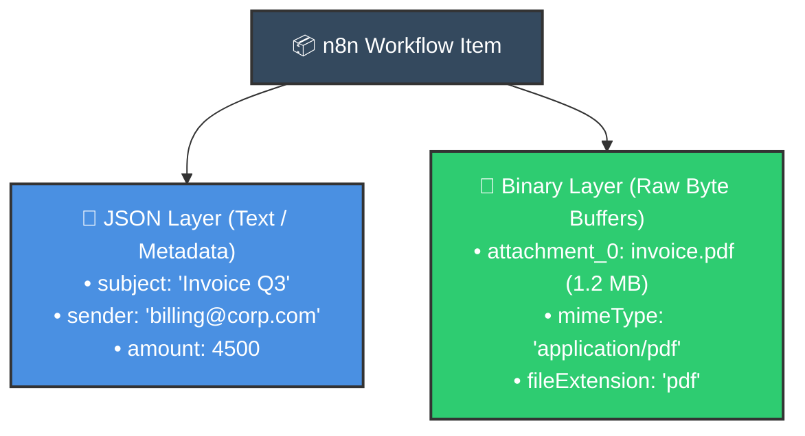
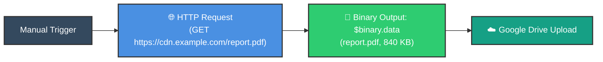
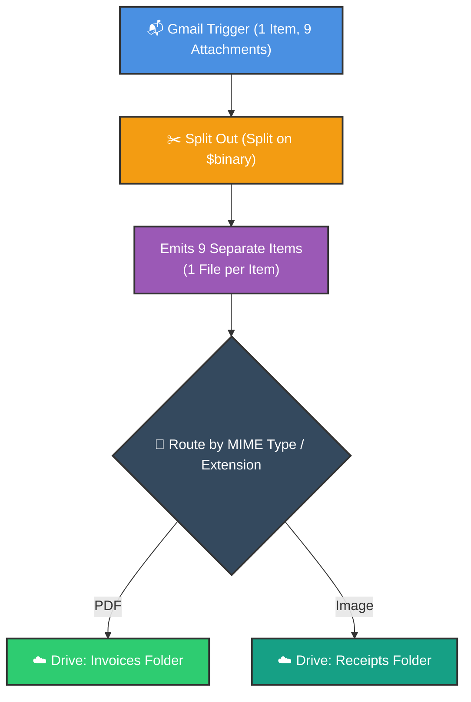
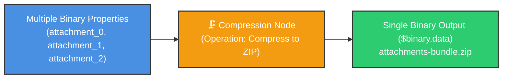

# 📁 Automate File Management with n8n
## Master Binary Data, Multi-File Compression, Extraction & Storage

  <a href="19_Creating_Subworkflows_in_n8n.md">⬅️ Prev: Creating Sub-workflows</a> •
  <a href="../README.md">Main Hub</a> •
  <a href="../4_Error%20Handling/1_Debugging_and_Error_Handling_in_n8n.md">Next: Debugging & Error Handling ➡️</a> •
  <a href="https://github.com/shashilabs-io/n8n-docs">GitHub Repository</a>

---

## 🧭 How to Use This Chapter

> [!TIP]
> **Enterprise File Operations:** Automations do not live by JSON alone. Enterprise pipelines constantly ingest PDF invoices, compress gigabytes of images, parse CSV rosters, unpack ZIP archives, and sync with FTP or Google Drive. This chapter is your definitive blueprint for handling binary buffers, compression, and cross-platform file routing.

### 🎯 Key Outcomes of this Chapter:
- Master the fundamental distinction between **JSON Structured Data** vs **Binary File Streams**.
- Fetch and download remote files from public URLs using the **HTTP Request** node.
- Unpack multi-attachment email bundles into distinct per-file items using **Split Out**.
- Compress multiple files into a single `.zip` archive and extract compressed archives back into files.
- Upload binary assets to **Google Drive**, **AWS S3**, or **SFTP** destinations.
- Understand local disk access limitations (Docker mounts vs self-hosted vs n8n Cloud).

---

# 1. JSON Data vs. Binary Data in n8n

Every item passing through n8n can contain two distinct data layers:

| Dimension | JSON Data | Binary Data |
|---|---|---|
| **What it holds** | Key-value pairs, strings, numbers, booleans, nested arrays. | Raw file byte streams (PDFs, images, ZIPs, spreadsheets). |
| **Inspection UI** | Table View / JSON Schema View. | **Binary Tab** (with built-in preview and download buttons). |
| **Metadata** | Direct JSON properties (`$json.key`). | Embedded metadata (`$binary.data.fileName`, `mimeType`, `fileSize`). |

---

# 2. Downloading Files from Remote URLs

To download a remote asset via URL:
1. Add an **HTTP Request** node.
2. Method: `GET`.
3. Set **Response Format** to `File / Binary Data`.
4. Leave Authentication unset for public URLs, or configure Bearer tokens for private assets.
5. In the node output panel, inspect the **Binary** tab to confirm the file downloaded successfully.

---

# 3. Handling Multi-Attachment Emails

When a Gmail message arrives with 9 PDF attachments:
- The Gmail node outputs **1 item** representing the email.
- The item's binary section holds 9 distinct keys: `attachment_0`, `attachment_1`, ..., `attachment_8`.

> [!TIP]
> Always insert a **Split Out** node when multiple attachments must be evaluated, converted, or uploaded to different folders individually.

---

# 4. Compressing Files into a ZIP Archive

The **Compression** node packages multiple binary properties into a single `.zip` file:

### Configuration:
- **Operation:** `Compress`
- **Binary Property Names:** Comma-separated list (`attachment_0, attachment_1, attachment_2`) or dynamic expression.
- **Output Format:** `zip`
- **Archive File Name:** `gmail-attachments.zip`
- **Output Property:** `data`

---

# 5. Decompressing Archives

To unpack incoming `.zip` files:
1. Add the **Compression** node and set Operation to **Decompress**.
2. Specify the source binary property (usually `data`).
3. Set an **Output Prefix** (e.g. `extracted_file_`).
4. Follow with a **Split Out** node to separate the unpacked files into distinct items for downstream processing.

---

# 6. Ecosystem of File-Related Nodes

| Node Name | Operational Capability | Ideal Use Case |
|---|---|---|
| **Read/Write Files from Disk** | Reads or writes directly to server filesystem paths. | Self-hosted instances processing local hot-folders. |
| **Convert to File** | Serializes structured JSON records into CSV, XLSX, or plain text. | Automated weekly CSV report generation. |
| **Extract From File** | Parses binary CSV, XLSX, or HTML files into structured JSON items. | Ingesting spreadsheet uploads from customer forms. |
| **FTP / SFTP** | Lists, uploads, downloads, or deletes files on remote servers. | Legacy banking and EDI integrations. |
| **Cloud Storage Nodes** | Google Drive, AWS S3, Dropbox, Microsoft OneDrive. | Scalable enterprise archiving. |

> [!WARNING]
> **Filesystem Access Boundaries:** An n8n Cloud instance cannot access files located on your local laptop's `C:\Downloads` folder. The "Read/Write Files from Disk" node operates strictly on the filesystem environment where the n8n container or server process runs.

---

# 7. Common Troubleshooting & Gotchas

| Symptom | Probable Cause | Fix |
|---|---|---|
| **No Binary tab in node output** | Upstream node did not download file content. | Check HTTP Request format (`File / Binary`) or Gmail *Download Attachments* toggle. |
| **PDF has no preview button** | n8n only previews certain images/text inline. | Click the **Download** icon to view the PDF in your native viewer. |
| **Compression node errors: "No file found"** | Provided file contents instead of binary property name strings. | Pass property keys (e.g. `attachment_0, attachment_1`) in the node settings. |
| **Google Drive upload fails on item 2** | Input Field Name was hardcoded to `attachment_0`. | Use dynamic expression: `{{ Object.keys($binary)[0] }}`. |
| **Local disk node throws `ENOENT: no such file`** | Path doesn't exist inside the n8n Docker container. | Map the folder via Docker volumes (e.g. `-v /local/path:/data`). |

---

# 8. Practice Exercises & Active Recall

<strong>1. What is the fundamental difference between JSON output and Binary output in n8n?</strong>

JSON output holds structured text, numbers, and key-value properties; Binary output holds raw file byte buffers (PDFs, images, ZIPs) and file metadata.

<strong>2. Why does an email with 5 attachments initially arrive as only 1 n8n item?</strong>

The item represents the single email message, with all 5 attachments attached as separate binary properties on that item.

<strong>3. Which node splits a single item containing 5 attachments into 5 distinct items?</strong>

The **Split Out** node, configured to split on `{{ $binary }}`.

<strong>4. What does the Compression node expect in its "Binary Property Names" field?</strong>

The string names of the binary properties containing the files to compress (e.g. `attachment_0, attachment_1`), not the raw file contents.

<strong>5. Can an n8n Cloud workflow read a file from C:\Users\me\Documents directly?</strong>

No. The cloud instance has zero network or filesystem visibility into your private local machine. Files must be pushed via Webhooks, HTTP, or Cloud Storage.

---

# 9. Key Takeaways

- File data flows through n8n via the `$binary` pipeline layer.
- Use **Split Out** to turn multi-file items into single-file items for discrete uploads.
- The **Compression** node seamlessly creates and extracts `.zip` archives.
- Always use dynamic binary key references (`{{ Object.keys($binary)[0] }}`) when uploading collections.
- Leverage **Convert to File** and **Extract From File** to bridge the gap between binary files and JSON arrays.

---

  <b>Congratulations!</b> You have completed Module 3. Advance to <a href="../4_Error%20Handling/1_Debugging_and_Error_Handling_in_n8n.md">Module 4: Debugging & Error Handling in n8n</a> or return to the <a href="../README.md">Main Hub</a>.

