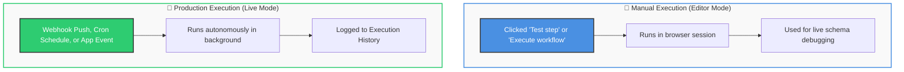
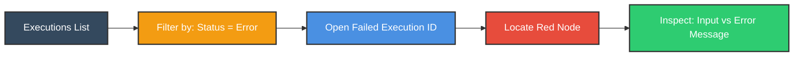
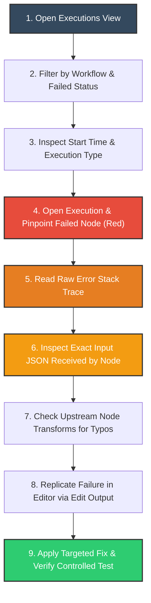
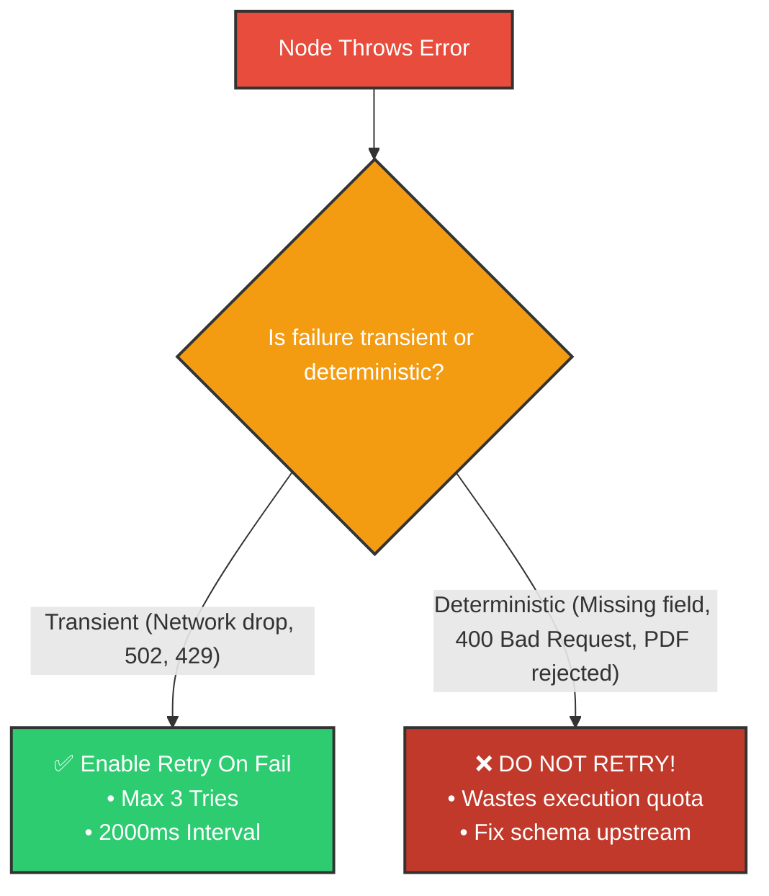
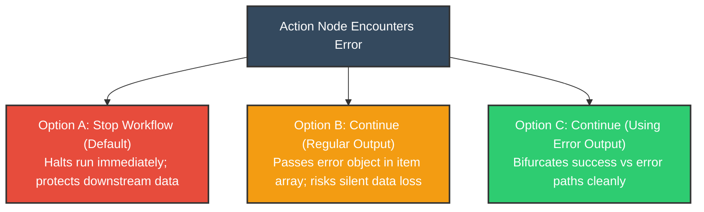
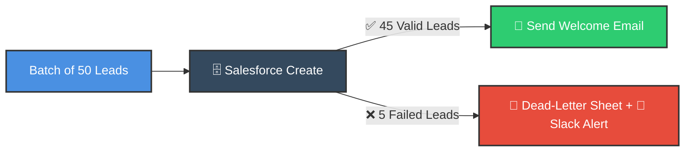

# 🔍 Debugging and Error Handling in n8n
## Master Automation Workflows with Execution Logs & Incident Triage

  <a href="../3_deep%20dive%20concepts/20_Automate_File_Management_with_n8n.md">⬅️ Prev: Automate File Management</a> •
  <a href="../README.md">Main Hub</a> •
  <a href="2_Fixing_AI_Automation_Workflows_Fast_in_n8n.md">Next: Fixing AI Workflows Fast ➡️</a> •
  <a href="https://github.com/shashilabs-io/n8n-docs">GitHub Repository</a>

---

## 🧭 How to Use This Chapter

> [!TIP]
> **Production Reliability:** Automations succeed in tests and fail in production because real users supply empty names, expired tokens, and malformed files. Mastering n8n's **Execution Logs**, stack trace inspection, data-saving retention policies, and the difference between "Workflow Completed" vs "Business Success" turns you into a fearless production engineer.

### 🎯 Key Outcomes of this Chapter:
- Differentiate between **Manual/Test Executions** vs automated **Production Executions**.
- Navigate and filter the **Executions Hub** by workflow, status, and duration.
- Inspect incoming payloads, outgoing schemas, and remote API error stack traces.
- Diagnose the 6 most frequent production workflow failure archetypes.
- Know when **Retry On Fail** helps vs when it wastes API rate limits.
- Implement explicit **Error Output Routing** to prevent silent data loss.

---

# 1. Understanding Workflow Executions

A **workflow execution** represents a single discrete run of an automated pipeline from its trigger through all terminal action nodes.

> [!NOTE]
> A workflow must be toggled **Active** and possess a valid trigger node (Cron, Webhook, App Trigger) to execute automatically in production.

---

# 2. Navigating the Executions Hub

The **Executions Hub** (accessible via the left sidebar) is your flight data recorder:

| Column | Information Captured | Triage Value |
|---|---|---|
| **Status** | `Success` (Green), `Error` (Red), `Waiting` (Blue). | Instant health overview. |
| **Start Time** | Exact timestamp of trigger activation. | Correlating with customer incident reports. |
| **Duration** | Total milliseconds/seconds to complete. | Detecting sudden API latency or rate throttling. |
| **Type** | Manual vs Production. | Discarding developer test runs from customer runs. |
| **Execution ID** | Immutable unique identifier. | Programmatic retrieval via n8n REST API. |

> [!CAUTION]
> **Data Privacy in Execution Logs:** Saved inputs and outputs contain real customer records, email addresses, and occasionally sensitive tokens. Review your **Execution Data Retention** settings (`Save Failed Executions`, `Save Successful Executions`) to ensure compliance with GDPR and company privacy policies.

---

# 3. Systematic 9-Step Debugging Checklist

When a production workflow crashes, follow this disciplined diagnostic sequence:

> [!IMPORTANT]
> **Core Debugging Maxim:** Never stop at *"the node failed."* Determine:
> 1. Which node failed?
> 2. What exact input did it receive?
> 3. What exact error code/message was emitted?

---

# 4. The 6 Most Frequent Production Failure Archetypes

| Archetype | Common Symptom | Diagnostic Investigation |
|---|---|---|
| **Missing / Null Field** | `Cannot read property of undefined` | Upstream form omitted an optional field (e.g. `companyName: null`). |
| **Malformed Data Format** | `Invalid email` or `Date out of bounds` | User entered `"none"` in an email field or submitted European date formats. |
| **API Auth Expiration** | `401 Unauthorized` or `Invalid Token` | OAuth2 refresh token revoked or API key expired. |
| **Rate Limit Throttling** | `429 Too Many Requests` | Burst of items overwhelmed external API; needs a **Wait** node or batching. |
| **Schema / File Type Mismatch** | `Expected image/*, received application/pdf` | User uploaded an unsupported attachment format. |
| **Incorrect Logic Inversion** | Items take wrong branch on edge case | Evaluated `AND` instead of `OR`, or neglected `0` vs `null`. |

---

# 5. When to Use "Retry On Fail" vs When It Hurts

Under node **Settings &rarr; Retry On Fail**, you can specify automatic retries with backoff intervals:

---

# 6. Node Error Policies: Stop vs Continue vs Route

### The Gold Standard: Error Output Routing (Option C)
Routing failed items through a dedicated error terminal enables fault-tolerant processing:

> [!WARNING]
> **Workflow Completion $\neq$ Business Success:** A workflow can show a green checkmark if configured with "Continue on Fail", even while 90% of your records failed to send! Always verify business-level item metrics, not just canvas exit status.

---

# 7. Production Debugging Checklist

Before concluding an incident investigation:
- [ ] Confirmed whether the failed run was manual or triggered by production.
- [ ] Located the red failure node and copied the raw JSON input that triggered the bug.
- [ ] Verified whether third-party API credentials, scopes, or rate limits caused the crash.
- [ ] Replicated the error locally inside the canvas editor using **Edit Output**.
- [ ] Implemented upstream validation or dead-letter error routing.
- [ ] Confirmed that retries are restricted strictly to transient network glitches.

---

# 8. Practice Exercises & Active Recall

<strong>1. What is the fundamental operational difference between a Manual and Production execution?</strong>

A manual execution is triggered by a human developer in the editor during testing; a production execution runs autonomously in the background via live webhooks, cron schedules, or app event triggers.

<strong>2. Why is inspecting node input data the most critical step in debugging?</strong>

Because 90% of workflow errors stem from unexpected data shapes (missing properties, null values, or bad types) passed in by upstream nodes.

<strong>3. Give two examples of errors where Retry On Fail is appropriate, and two where it is useless.</strong>

- **Appropriate:** HTTP 502 Bad Gateway (temporary server blip) and HTTP 429 Rate Limit (service recovers after delay).
- **Useless:** HTTP 400 Bad Request (missing required JSON key) and passing a PDF to an image-only node.

<strong>4. What is the architectural danger of setting On Error to "Continue (Regular Output)" without an audit step?</strong>

It causes silent data loss. The workflow completes with a green success status while failed records vanish without alerting the engineering team.

<strong>5. How does a dedicated Error Output terminal resolve silent failures?</strong>

It separates successful records from failing records, allowing valid items to proceed while routing failed items to logging sheets and Slack alerts.

---

# 9. Key Takeaways

- Use the **Executions Hub** to inspect historical run parameters, durations, and error messages.
- Always check the exact input payload that reached a failed node before attempting a fix.
- Apply **Retry On Fail** only to transient network and server outages.
- Distinguish between **Workflow Completion** (green run) and **Business Success** (all records processed).
- Route failed items to a dead-letter queue or incident alert rather than silently swallowing errors.

---

  <b>Next Step:</b> Troubleshoot and stabilize AI LLM pipelines in <a href="2_Fixing_AI_Automation_Workflows_Fast_in_n8n.md">Chapter 2: Fixing AI Automation Workflows Fast</a> or return to the <a href="../README.md">Main Hub</a>.

