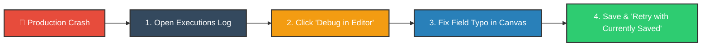
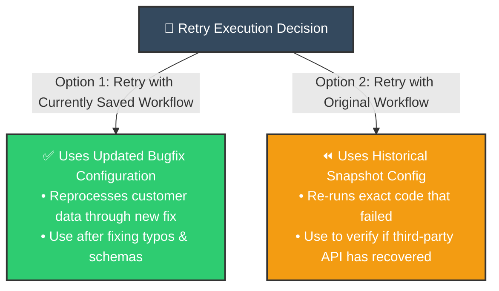
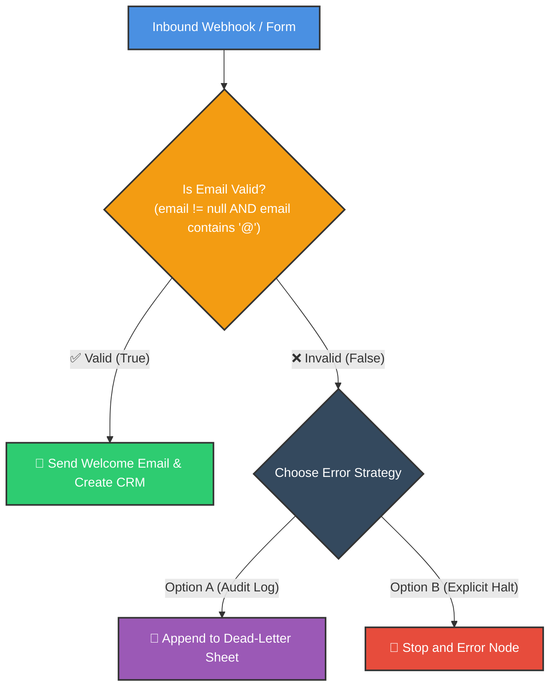

# 🛠️ Fixing AI Automation Workflows Fast in n8n
## Rapid Incident Recovery, Debug in Editor & Version Rollbacks

<p align="center">
  <a href="1_Debugging_and_Error_Handling_in_n8n.md">⬅️ Prev: Debugging & Executions</a> •
  <a href="../README.md">Main Hub</a> •
  <a href="3_Error_Workflows_in_n8n.md">Next: Dedicated Error Workflows ➡️</a> •
  <a href="https://github.com/shashilabs-io/n8n-docs">GitHub Repository</a>
</p>

---

## 🧭 How to Use This Chapter

> [!TIP]
> **Rapid Incident Triage:** Production automations rarely fail from catastrophic infrastructure crashes—they fail because of minor property typos (`userEmail` vs `email`), unverified email senders, or unexpected null inputs. By using **Debug in editor**, understanding the difference between retrying with original vs current workflow versions, and rolling back bad commits via **Version History**, you can resolve production incidents in minutes.

### 🎯 Key Outcomes of this Chapter:
- Pinpoint and diagnose failing nodes directly inside the **Executions Hub**.
- Clone failure states into the canvas using the **Debug in editor** feature.
- Master the two retry modes: **Retry with currently saved workflow** vs **Retry with original workflow**.
- Roll back breaking workflow edits safely using built-in **Workflow Version History**.
- Guard downstream actions by attaching an **If Validation Gate**.
- Eliminate silent failures by routing invalid data to **Stop and Error** or audit logs.

---

# 1. Why Workflows Fail in Production

Even functionally sound workflows break when exposed to real-world edge cases:
- **Property Casing / Typo:** Code references `{{ $json.userEmail }}`, but the API returned `{{ $json.email }}`.
- **Missing / Blank Input:** A customer submitted a contact form without an email.
- **Unverified Third-Party Sender:** AWS SES / SendGrid rejected an email because the sender domain lacked SPF/DKIM verification.
- **Regression Bugs:** A developer updated a node to fix one problem, accidentally breaking downstream connections.



---

# 2. Using "Debug in Editor"

Historical execution runs are read-only. To test a fix without asking a real user to submit the form again:

1. Open the failed run in **Executions**.
2. Click the **Debug in editor** button in the top action bar.
3. n8n duplicates the exact historical input payload into your canvas editor.
4. Locate the red node and inspect the exact property name in the incoming JSON inspector.
5. Correct the expression or configuration.
6. Test the step to verify the green success checkmark.
7. Save the workflow.

### Example: Field Name Typo

**Incoming Live JSON:**
```json
{
  "firstName": "Riya",
  "lastName": "Sharma",
  "email": "riya@example.com",
  "company": "Example Co",
  "role": "Developer"
}
```

```text
❌ Broken Expression:   {{ $json.userEmail }}  -> Evaluates to: undefined
✅ Correct Expression:  {{ $json.email }}      -> Evaluates to: "riya@example.com"
```

> [!TIP]
> **Fix One Issue at a Time:** Correcting the field name might reveal a subsequent error (e.g. an unverified email sender). Don't panic—fixing one bug unblocks the pipeline to reveal downstream requirements. Fix one node, test, and proceed.

---

# 3. Retrying Failed Executions: The Two Modes

Once a workflow is corrected and saved, how do you reprocess the failed customer record?



| Retry Mode | Underlying Mechanics | Best Scenario |
|---|---|---|
| **Retry with Currently Saved Workflow** | Replays the historical input data through the *latest saved* canvas logic. | You fixed a typo, updated a node, or corrected a field mapping. |
| **Retry with Original Workflow** | Replays the input data against the *historical snapshot* at the time of failure. | An external API had an outage (503 Service Unavailable) and is now back online. |

> [!CAUTION]
> **Check for Duplicate Side Effects:** Before hitting Retry, check whether earlier nodes in that failed run already executed (e.g. charged a credit card or inserted a database row). Ensure your workflow is idempotent before retrying!

---

# 4. Safe Rollbacks via Workflow Version History

If recent edits caused widespread failures across your automations, restore a known good commit:

1. Open the workflow canvas.
2. Click **Workflow History** (clock icon in the top header).
3. Browse past timestamps to see who edited the canvas and when.
4. Preview earlier versions side-by-side.
5. Click **Restore Version** to roll back.

> [!WARNING]
> Restoring a past version permanently overwrites your active canvas. Any new nodes added after that version will be deleted. Clone the historical version to a separate test workflow first if you want to inspect differences safely.

---

# 5. Shielding Sensitive Nodes with Validation Gates

Never let invalid or empty inputs reach critical third-party action nodes:



### The Two Non-Silent Handling Paths:
- **Option A (Log & Continue):** Record bad entries in a quarantine spreadsheet for customer support review.
- **Option B (Stop and Error):** Terminate execution with an explicit incident message:
  ```text
  Registration Rejected: Incoming 'email' parameter was empty or malformed.
  ```

---

# 6. Common Incident Traps & Solutions

| Incident | Root Cause | Triage Fix |
|---|---|---|
| Downstream node receives `undefined` | Key name changed between form versions. | Open **Debug in editor**, inspect incoming JSON, and update expressions. |
| Retried run immediately fails with identical error | Selected *Retry with original workflow* instead of *currently saved*. | Choose **Retry with currently saved workflow**. |
| Customer received 2 duplicate emails | Upstream email node re-executed during an un-checkpointed retry. | Separate workflow into idempotent sub-workflows or check status flags. |
| Invalid records vanished without a trace | False branch of validation If node was left unwired. | Attach a **Stop and Error** or logging node. |

---

# 7. Practice Exercises & Active Recall

<details>
<summary><strong>1. What does the "Debug in editor" button do?</strong></summary>

It loads the exact input payload from a historical failed execution into your workflow editor, allowing you to test and fix expressions without recreating the source event.
</details>

<details>
<summary><strong>2. An input payload has email, but your expression reads userEmail. What is the fix?</strong></summary>

Change the expression from `{{ $json.userEmail }}` to `{{ $json.email }}`. Always match exact keys from the incoming JSON inspector.
</details>

<details>
<summary><strong>3. When should you choose "Retry with currently saved workflow"?</strong></summary>

When you have modified and saved the workflow (e.g. fixed a typo or expression) and want the failed historical data to run through the new fix.
</details>

<details>
<summary><strong>4. Why is leaving the False branch of a validation node empty dangerous?</strong></summary>

It creates silent data loss. The workflow marks the execution as green/successful even though invalid customer records were completely dropped.
</details>

<details>
<summary><strong>5. What does the Stop and Error node accomplish?</strong></summary>

It explicitly forces the execution to halt with an Error status and logs a custom incident reason, ensuring it surfaces in monitoring dashboards.
</details>

---

# 8. Key Takeaways

- Use **Debug in editor** to instantly clone production failures into your development canvas.
- After fixing a bug, use **Retry with currently saved workflow** to reprocess stranded records.
- Guard external APIs with an **If Validation Gate** before dispatching messages.
- Never leave invalid data branches empty: always log to a quarantine sheet or trigger **Stop and Error**.
- Use **Workflow Version History** to quickly rollback accidental breaking changes.

---

<p align="center">
  <b>Next Step:</b> Centralize enterprise incident handling in <a href="3_Error_Workflows_in_n8n.md">Chapter 3: Dedicated Error Workflows</a> or return to the <a href="../README.md">Main Hub</a>.
</p>
