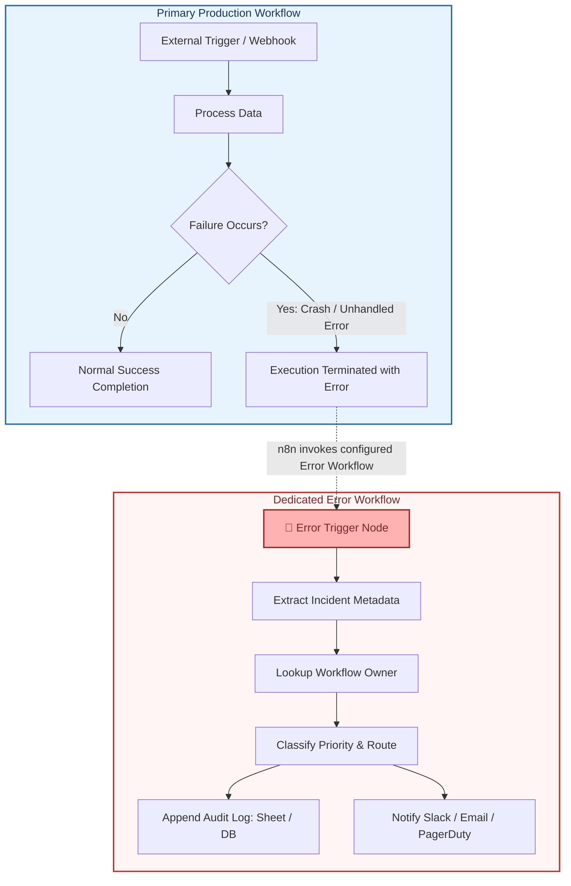
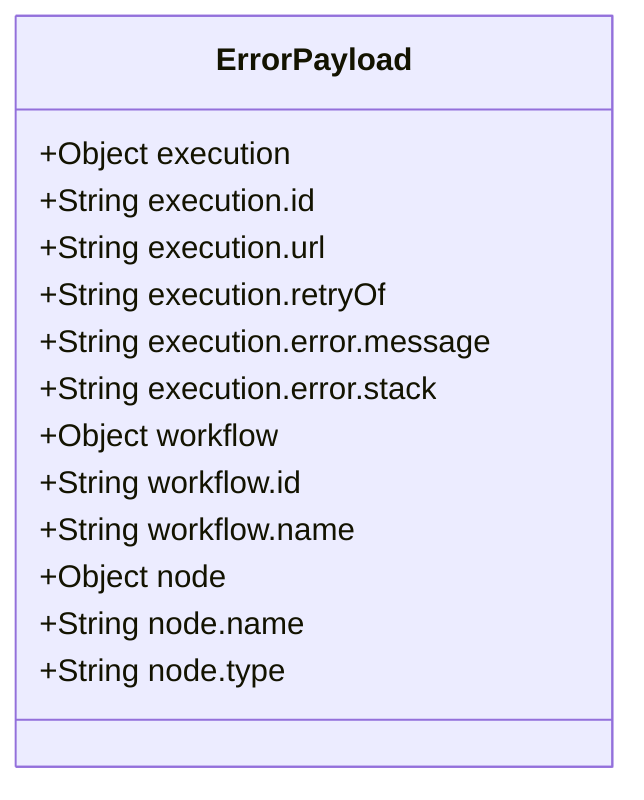
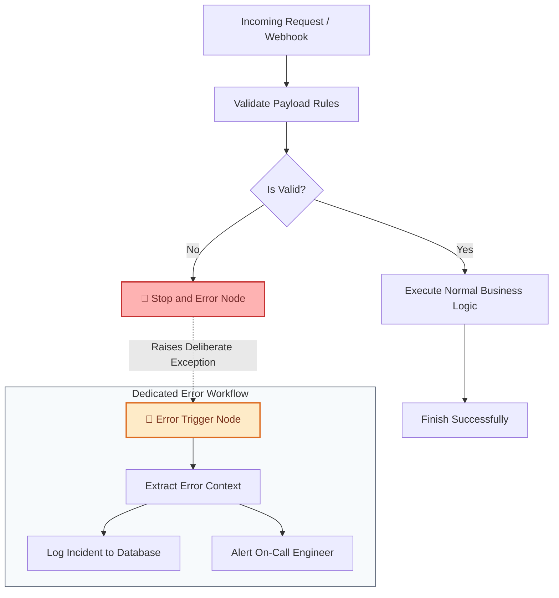
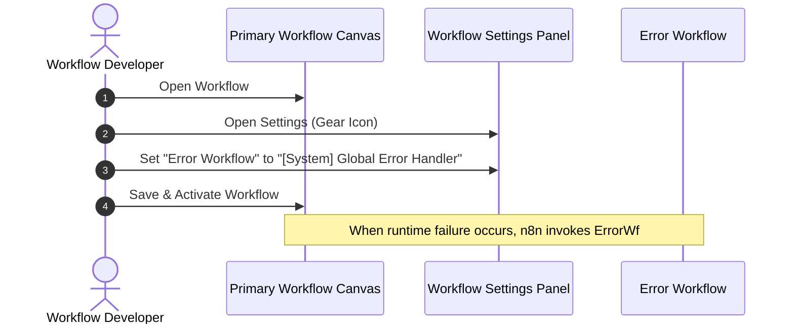
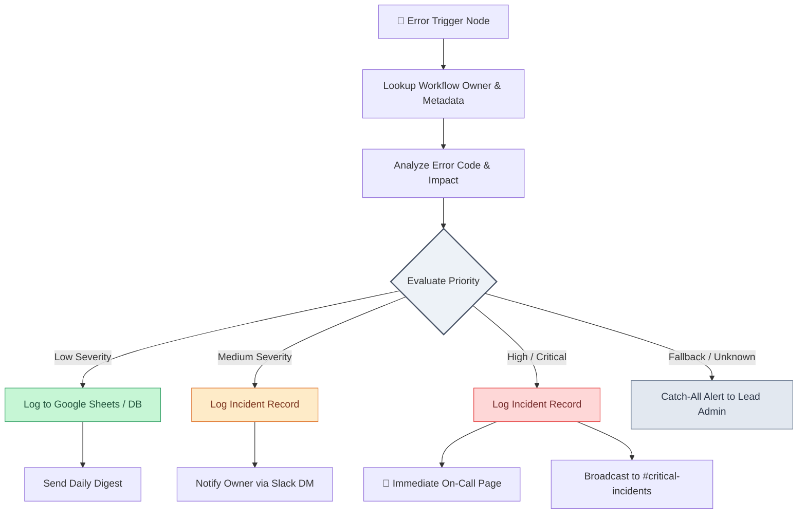
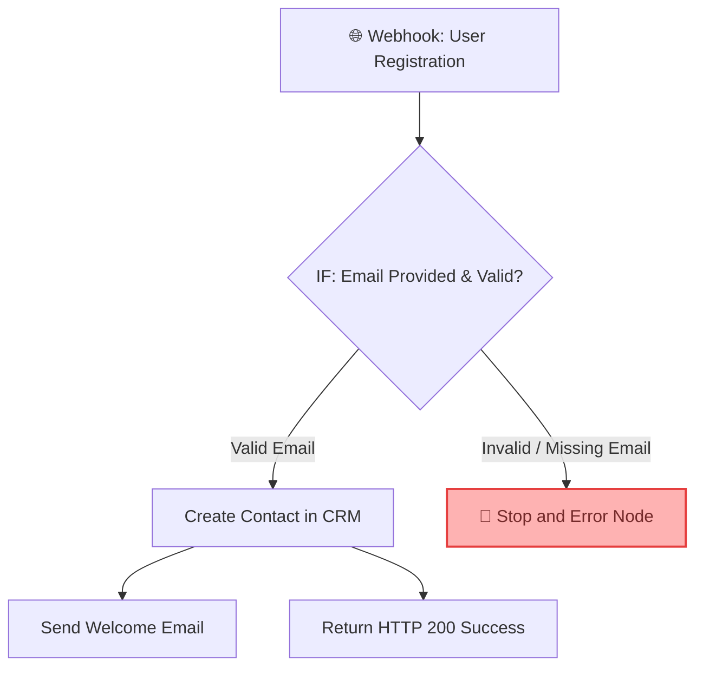

# 🚨 Dedicated Error Workflows in n8n

> **Centralized Error Triggers, Global Alert Handlers, and Production Incident Management**

---

<p align="center">
  ⬅️ <b>Prev:</b> <a href="file:///c:/Users/Shashi%20Bhushan/Desktop/n8n/docs/4_Error%20Handling/2_Fixing_AI_Automation_Workflows_Fast_in_n8n.md">Fixing AI Automation Workflows Fast in n8n</a> • 
  <a href="file:///c:/Users/Shashi%20Bhushan/Desktop/n8n/docs/README.md"><b>📚 Course Hub</b></a> • 
  <b>Next:</b> <a href="file:///c:/Users/Shashi%20Bhushan/Desktop/n8n/docs/README.md">Course Completion & Resources</a> ➡️ • 
  <a href="https://github.com/shashilabs-io/n8n-docs"><b>GitHub Repository</b></a>
</p>

---

## 🧭 How to Use This Chapter

> [!TIP]
> **Pro Production Habit:** Never allow production workflows to fail silently. In production environments, an unhandled crash damages data integrity and customer trust. Setting up a single, well-architected global Error Workflow guarantees instant visibility across your entire n8n automation fleet whenever an execution breaks.

### 🎯 Key Outcomes of this Chapter:
- Explain what an error workflow is and why it is critical for production reliability.
- Master the distinct roles of the **Error Trigger** and **Stop and Error** nodes.
- Build a generic notification and dead-letter error workflow from scratch.
- Attach an error workflow to primary workflows via Workflow Settings.
- Route error notifications intelligently using workflow-to-owner lookups and incident priority rules.
- Maintain a compliant, secure, and searchable failure audit log.

---

## 1. What Is an Error Workflow?

An **error workflow** is a dedicated workflow configured to execute automatically when another primary workflow encounters an unhandled runtime error during an execution. It collects detailed diagnostics about the failure, writes them to persistent logs, and notifies the responsible teams or on-call engineers.



> [!IMPORTANT]
> **The Silent Failure Trap:** Without deliberate error handling, a workflow can silently fail or skip downstream steps without alerting anyone. An error workflow transforms silent crashes into actionable, timestamped incident tickets.

### Four Primary Purposes of Error Workflows:
1. **Capture Error Details:** Record workflow name, workflow ID, execution ID, execution URL, error message, and the specific node where the failure occurred.
2. **Notify Responsible Owners:** Dispatch real-time alerts via Email, Slack, Teams, or PagerDuty.
3. **Maintain an Audit Log:** Store structured records of failures for triage, root-cause analysis, and uptime reporting.
4. **Prioritize Incidents:** Differentiate between low-severity validation drops and critical production outages.

---

## 2. The Two Key Nodes

n8n provides two complementary built-in nodes designed specifically for failure management:

| Node | Type | Execution Context | Core Function |
|---|---|---|---|
| **`Error Trigger`** | Trigger Node | Runs inside the **Error Workflow** | Fires automatically when an attached primary workflow crashes, receiving comprehensive diagnostic metadata. |
| **`Stop and Error`** | Action / Flow Node | Runs inside the **Primary Workflow** | Deliberately halts execution and raises a controlled exception when business logic or validations fail. |

---

### 2.1 Error Trigger

The **Error Trigger** node serves as the entry point for your dedicated error handling pipeline. When an attached workflow fails, this node receives an incident payload containing:

- **Workflow Information:** Workflow Name and Workflow ID (`$json.workflow.id`, `$json.workflow.name`).
- **Execution Information:** Execution ID and Direct Execution URL (`$json.execution.id`, `$json.execution.url`).
- **Error Diagnostics:** Error message, error description, stack trace, and HTTP status code.
- **Node Context:** Name and type of the exact node where the execution halted.



> [!TIP]
> The exact properties available depend on the node type and n8n version. Always inspect the output of an actual **Error Trigger** test event before hardcoding expression paths.

---

### 2.2 Stop and Error

The **Stop and Error** node intentionally halts a workflow and triggers an error state. It is invaluable for data validation gates where continuing execution would corrupt downstream systems.

**Example Scenario:** A registration webhook must contain a valid corporate email. If missing, route the execution to **Stop and Error** rather than letting subsequent API nodes crash with opaque HTTP 400 errors.

```text
Registration rejected: Mandatory email field is missing from incoming payload.
```

When supported, passing a structured JSON error object through **Stop and Error** transmits rich context into the Error Workflow for faster troubleshooting.

---

### How the Two Nodes Work Together



> [!NOTE]
> **Key Distinction:** `Stop and Error` deliberately triggers a failure **inside** the main workflow. `Error Trigger` receives that failure **inside** the external error workflow.

---

## 3. Build a Basic Error Workflow

Follow this step-by-step recipe to construct a reusable notification handler for your n8n workspace:

### Step 1: Create a Dedicated Workflow
Create a new workflow and assign a clear, identifiable name:
```
[System] Global Error Handler
```

### Step 2: Add an Error Trigger Node
1. Add the **Error Trigger** node as the canvas trigger.
2. Click **Test Step** or populate mock event data to inspect incoming schema fields.
3. Review the available execution ID, workflow name, and error message fields.

### Step 3: Add an Incident Notification Node
Connect a communication node (e.g., Slack, Discord, Microsoft Teams, or Gmail) downstream from the Error Trigger.

#### Recommended Alert Template:
```text
Subject: 🚨 Workflow Failure Alert — {{ $json.workflow.name }}

An automated workflow execution has encountered an unhandled error.

• Workflow Name: {{ $json.workflow.name }}
• Workflow ID:   {{ $json.workflow.id }}
• Failed Node:   {{ $json.execution.error.node?.name || "Unknown Node" }}
• Error Message: {{ $json.execution.error.message }}
• Execution ID:  {{ $json.execution.id }}

🔍 Inspect Execution Trace:
{{ $json.execution.url }}
```

### Step 4: Test the Alert Delivery
Trigger a test run using mock data to verify message formatting, links, and notification channel routing.

> [!WARNING]
> While mock testing confirms email/Slack formatting, it does **not** prove that production workflows are correctly linked to this handler. Always perform an end-to-end test with an active test workflow.

---

## 4. Attach the Error Workflow to a Main Workflow

Creating an error workflow does not automatically connect it to existing automations. You must explicitly link each primary workflow to the error handler.

### Configuration Walkthrough:



1. Open your primary production workflow.
2. Open the **Workflow Settings** (gear icon in the top navigation bar).
3. Locate the **Error workflow** dropdown setting.
4. Select your created error handler (e.g., `[System] Global Error Handler`).
5. Save and **Activate** the primary workflow.

> [!IMPORTANT]
> **Manual Runs vs. Production Executions:** In many n8n versions, Error Workflows are triggered exclusively by **production executions** (executions triggered by webhooks, schedules, or external events), not by manual test clicks inside the editor. Test by activating the workflow and sending a live test event.

---

## 5. Make Alerts More Actionable

Generic alerts often cause alert fatigue or get ignored. Scale your incident management with automated owner routing.

### Maintain a Workflow-to-Owner Lookup Table

Store a lightweight mapping table in Google Sheets, Airtable, or PostgreSQL:

| Workflow ID | Workflow Name | Lead Owner | Owner Email | Slack Channel / User ID | Escalation Tier |
|---|---|---|---|---|---|
| `wf_crm_sync_01` | HubSpot CRM Contact Sync | Alex Chen | `alex@company.com` | `@alex.chen` | Tier 1 (DevOps) |
| `wf_stripe_inv_04`| Stripe Invoice Dispatcher | Sarah Kim | `sarah@company.com` | `#finance-alerts` | Tier 2 (Finance Ops)|
| `wf_ai_extract_09`| AI Document Classifier | Riya Patel | `riya@company.com` | `#ai-workflows` | Tier 1 (ML Ops) |

### Dual Notification Strategy:
- **Direct Notification:** Send a direct Slack ping or email to the primary workflow engineer.
- **Shared Incident Room:** Post to a communal `#alerts-automation` channel so the wider engineering team has transparency if the primary owner is on leave or unavailable.

---

## 6. Classify Errors by Priority

Not all failures require waking up an on-call engineer. Implement priority routing to triage issues proportionally:

| Priority Level | Typical Scenarios | Recommended Operational Response |
|---|---|---|
| 🟢 **Low** | Input schema validation drops, non-critical webhooks with missing optional fields. | Log incident to database; send daily or weekly digest. |
| 🟡 **Medium** | Rate limit throttles (HTTP 429), transient timeout errors, malformed third-party payloads. | Log event; notify workflow owner; trigger auto-retry pipeline. |
| 🔴 **High / Critical** | Authentication failures (HTTP 401/403), expired tokens, database outages, payment webhook failures. | Immediate paging alert (PagerDuty/OpsGenie) to owner & team channel. |

### Error Priority Routing Pipeline



> [!TIP]
> **Always Implement a Fallback Branch:** When using Switch or conditional nodes to categorize errors, always include an unclassified fallback branch. Otherwise, an unfamiliar error type could silently vanish without notifying anyone.

---

## 7. Maintain a Persistent Error Audit Log

While chat notifications provide immediate alerts, a persistent incident log enables systematic tracking of recurring bugs, service degradation, and SLA compliance.

### Essential Audit Log Schema:
- `timestamp`: UTC timestamp of the crash.
- `workflow_id` & `workflow_name`: Unique identifier and title of the failed workflow.
- `execution_id`: Direct n8n execution reference.
- `execution_url`: One-click hyperlink to the failed execution run in the n8n UI.
- `failed_node`: Node name and node type that raised the exception.
- `error_message`: Error summary and status code.
- `priority`: Evaluated priority level (`Low`, `Medium`, `High`).
- `owner`: Assigned engineer or department.
- `status`: Incident resolution status (`Open`, `Investigating`, `Resolved`).

> [!CAUTION]
> **Security & Compliance Warning:** Never log raw credentials, authorization tokens, passwords, credit card numbers, or PII (Personally Identifiable Information) into incident logs or chat notifications. Sanitize headers and request bodies before storing them.

---

## 8. Practical Example: Form Validation Failure

Consider a customer registration workflow receiving submissions via Webhook:

### Primary Workflow Architecture:



### Stop and Error Configuration:
- **Error Message:** `Registration rejected: Mandatory email field is missing or invalid.`
- **Custom JSON Data:**
  ```json
  {
    "validationError": true,
    "missingField": "email",
    "receivedPayload": "={{ $json.body }}"
  }
  ```

### Handling Execution in the Global Error Workflow:
1. **Error Trigger** captures the rejection event.
2. Workflow categorizes this as **Low Priority** (User Validation Error).
3. Appends the event to the `Form_Submissions_Errors` sheet.
4. Alerts the marketing operations channel with the submission timestamp and link to inspect the lead data.

---

## 9. Production Troubleshooting Checklist

Before deploying your error handling infrastructure to production, audit your workflows against this checklist:

- [ ] **First Node Placement:** The **Error Trigger** node is the first node in your error handling workflow.
- [ ] **Workflow Settings Linked:** The main workflow's **Workflow Settings &gt; Error workflow** references your error workflow.
- [ ] **Workflow Activated:** Both the primary workflow and the error workflow are saved and **Activated**.
- [ ] **Error Workflow Reliability:** Test that the error workflow itself does not contain broken credentials or syntax errors.
- [ ] **Expressions Verified:** Expressions accurately reference `$json.workflow.name`, `$json.execution.id`, and `$json.execution.error`.
- [ ] **Credentials Tested:** Notification nodes (Slack token, SMTP, Sheets API) have valid credentials with appropriate write scopes.
- [ ] **Fallback Routing Exists:** The routing logic handles unexpected error types gracefully without dropping events.
- [ ] **Actionable Alert Messages:** Every alert includes direct links to the failed execution URL for instant debugging.
- [ ] **Sanitized Log Storage:** Secrets, sensitive authorization headers, and personal customer identifiers are stripped before logging.

---

## 10. Interactive Practice & Knowledge Check

Test your understanding of error workflows in n8n with these active recall questions:

<details>
<summary><strong>1. What is an error workflow in n8n?</strong></summary>

An error workflow is a dedicated, standalone workflow configured to trigger automatically whenever an attached primary workflow encounters an unhandled runtime error during an execution. It automates diagnostics capture, logging, and notifications.
</details>

<details>
<summary><strong>2. What is the fundamental difference between the Error Trigger and Stop and Error nodes?</strong></summary>

- **`Stop and Error`** is an action node placed inside the **primary workflow** to deliberately halt execution and raise a controlled error when conditions are violated.
- **`Error Trigger`** is a trigger node placed inside the **error workflow** to receive the error event and metadata when an attached workflow fails.
</details>

<details>
<summary><strong>3. Where do you configure a primary workflow to use a specific error workflow?</strong></summary>

In the primary workflow's **Settings** panel (accessible via the gear icon in the workflow editor). Under the **Error workflow** dropdown, select your dedicated error workflow and save the changes.
</details>

<details>
<summary><strong>4. Why do manual test executions sometimes fail to trigger an Error Workflow?</strong></summary>

By design in n8n, Error Workflows are generally invoked only by active **production executions** (triggered by webhooks, cron schedules, or external app events). Manual test runs in the canvas editor display errors directly in the UI and typically bypass external error workflows.
</details>

<details>
<summary><strong>5. Why is it important to inspect real Error Trigger output data before writing node expressions?</strong></summary>

Different nodes, trigger types, and versions of n8n emit slightly different error object structures (e.g., nested inside `$json.execution.error` vs `$json.error`). Inspecting live execution data ensures your expression paths resolve correctly without `undefined` errors.
</details>

<details>
<summary><strong>6. What are the benefits of a dual notification strategy (owner DM + shared channel)?</strong></summary>

Direct messages alert the primary engineer responsible for fixing the bug immediately, while shared team channels ensure the incident remains visible and actionable even if the primary owner is offline, on vacation, or in a meeting.
</details>

<details>
<summary><strong>7. Name five critical fields that should be stored in a centralized incident audit log.</strong></summary>

1. Execution Timestamp (UTC)
2. Workflow Name and Workflow ID
3. Execution ID and Direct Execution URL
4. Failed Node Name
5. Error Message / HTTP Status Code
</details>

<details>
<summary><strong>8. Why must error priority routing logic always include an unclassified fallback path?</strong></summary>

If a Switch or IF node only checks for specific anticipated error patterns (e.g., HTTP 400 or HTTP 401), an unanticipated error (such as an unhandled node crash or database connection drop) would fall through all rules and be completely dropped without sending an alert.
</details>

<details>
<summary><strong>9. Give an example of when you should intentionally use the Stop and Error node.</strong></summary>

During form or webhook input validation: when mandatory data (such as a customer email address or transaction amount) is missing or malformed, continuing execution would cause corrupt records or downstream API errors. Routing to `Stop and Error` halts execution cleanly and reports a descriptive validation failure.
</details>

<details>
<summary><strong>10. Why should automated error logs and notification alerts avoid storing raw request payloads?</strong></summary>

Raw request payloads frequently contain sensitive personal data (PII) or confidential secrets (passwords, bearer tokens, credit card details). Storing raw payloads in shared Slack channels or spreadsheets introduces severe compliance and security vulnerabilities.
</details>

---

## 📌 Key Takeaways

- **Make Failures Visible:** Never let production workflows fail silently. Set up an Error Workflow to transform unexpected crashes into structured, trackable incidents.
- **Node Partnership:** Pair `Stop and Error` (inside your primary flow to stop bad data) with `Error Trigger` (inside your error flow to process the incident).
- **Configure & Activate:** Explicitly assign the error workflow inside your primary workflow's settings and ensure both workflows are active.
- **Deliver Context-Rich Alerts:** Always include the workflow name, failed node, error message, and direct execution URL so engineers can triage issues in one click.
- **Triage by Priority:** Route routine validation rejections to batch logs while escalating critical outages with high-priority paging alerts.
- **Protect Sensitive Data:** Filter passwords, API keys, and PII before writing error traces to logs or public chat rooms.

---

<p align="center">
  ⬅️ <b>Prev:</b> <a href="file:///c:/Users/Shashi%20Bhushan/Desktop/n8n/docs/4_Error%20Handling/2_Fixing_AI_Automation_Workflows_Fast_in_n8n.md">Fixing AI Automation Workflows Fast in n8n</a> • 
  <a href="file:///c:/Users/Shashi%20Bhushan/Desktop/n8n/docs/README.md"><b>📚 Course Hub</b></a> • 
  <b>Next:</b> <a href="file:///c:/Users/Shashi%20Bhushan/Desktop/n8n/docs/README.md">Course Completion & Resources</a> ➡️
</p>
