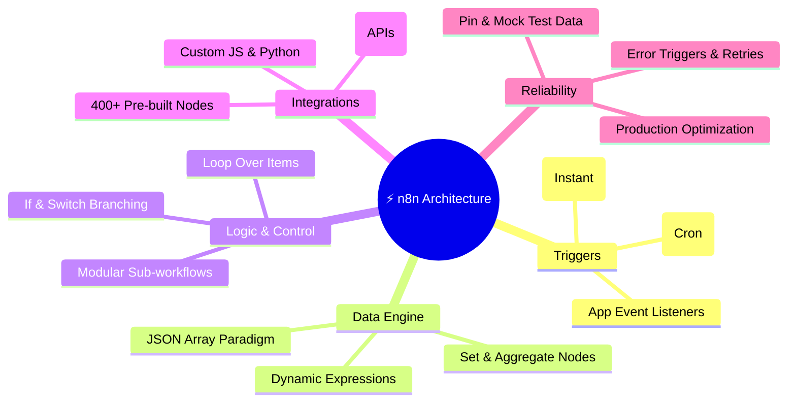
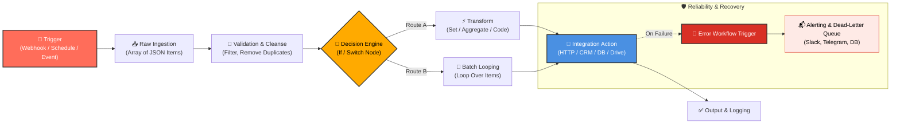

# ⚡ n8n Workflow Automation: The Complete Blueprint & Knowledge Base

<p align="center">
  <a href="https://github.com/shashilabs-io/n8n-docs"></a>
  
  
  
  
</p>

---

## 🎯 Why Master n8n?

> **"Stop copying and pasting between tabs. Stop paying exorbitant per-task penalties to proprietary black-boxes. Start building self-healing, code-extensible data pipelines that you truly own."**

Most automation tools force an uncomfortable trade-off: **simple no-code tools** like Zapier or Make hit a wall the moment you need complex nested JSON transforms, custom algorithms, or privacy-compliant self-hosting. Meanwhile, **custom backend code** takes days to write, debug, deploy, and maintain.

**n8n bridges this exact chasm.** It delivers:
- 🔓 **Zero Vendor Lock-in & Full Sovereignty**: Run on your local laptop, your private cloud, Docker, or managed n8n Cloud. Your sensitive tokens and customer data never leave your infrastructure unless you tell them to.
- 💡 **Visual Clarity + Code Power**: Drag-and-drop triggers and nodes for speed, then drop into JavaScript or Python expressions whenever business logic gets sophisticated.
- 🔁 **Enterprise Data Handling**: Native list-of-objects JSON processing, item-linking across disparate branches, chunked looping, sub-workflows, and dead-letter error handling.
- 🤖 **Next-Gen AI Orchestration**: Seamlessly chain LLMs, vector memory, tools, and agents into live business pipelines with deterministic reliability.

---

### 🎬 Live in Action: Autonomous Telegram Bot Workflow
Watch how an n8n webhook workflow processes incoming requests and delivers rich automated responses in real-time:

<div align="center">
  <video src="https://www.softlabsgroup.com/blogs/wp-content/uploads/2025/10/telegram-response-n8n-gif.mp4" controls width="100%" style="max-width: 780px; border-radius: 12px; box-shadow: 0 8px 30px rgba(0,0,0,0.12);" autoplay muted loop>
    Your browser does not support the video tag.
  </video>
</div>

---


## 📚 Repository Map & Course Navigation

This repository is curated as an exhaustive, masterclass-level documentation collection. Jump directly to any module:

### 🔰 1. Introduction & Strategy
| Chapter | Topic | Highlights |
|---|---|---|
| [01_Introduction_Beginner_Book.md](1_n8n_Introduction/01_Introduction_Beginner_Book.md) | **Beginner Book Intro** | The philosophy of automation, cognitive load reduction, and roadmapping. |
| [02_Chapter_What_is_Automation.md](1_n8n_Introduction/02_Chapter_What_is_Automation.md) | **What is Automation?** | Core trigger-action mechanics, ROI calculation, and time-saving patterns. |
| [03_Chapter_What_is_n8n.md](1_n8n_Introduction/03_Chapter_What_is_n8n.md) | **What is n8n?** | The node-based paradigm, fair-code licensing, and privacy advantages. |
| [04_vs_Make_Zapier_Beginner_Guide.md](1_n8n_Introduction/04_vs_Make_Zapier_Beginner_Guide.md) | **n8n vs Zapier vs Make** | In-depth cost comparison, feature matrix, and architectural trade-offs. |

### 🚀 2. Getting Started & Core Fundamentals
| Chapter | Topic | Highlights |
|---|---|---|
| [01_Cloud_Setup.md](2_getting%20started/01_Cloud_Setup.md) | **Cloud Setup** | Spin up an n8n managed instance in under 3 minutes. |
| [02_Local_Installation_NPM.md](2_getting%20started/02_Local_Installation_NPM.md) | **Local NPM & CLI** | Install and execute n8n locally on your machine with zero cloud dependency. |
| [03_Interface.md](2_getting%20started/03_Interface.md) | **Canvas & Interface** | Mastering hotkeys, canvas panning, node configuration panels, and executions. |
| [04_Node_Types.md](2_getting%20started/04_Node_Types.md) | **Node Typology** | Triggers vs Regular Nodes vs Sub-nodes and their structural differences. |
| [05_First_Workflow_Welcome_Email.md](2_getting%20started/05_First_Workflow_Welcome_Email.md) | **First Workflow** | Build an end-to-end welcome email pipeline from scratch. |
| [06_Understanding_Data.md](2_getting%20started/06_Understanding_Data.md) | **Understanding Data Structure** | The foundational rule: everything in n8n is an array of JSON objects. |

### 🛠️ 3. Deep Dive Concepts & Node Mastery
| Chapter | Topic | Highlights |
|---|---|---|
| [01_Branching_Workflows.md](3_deep%20dive%20concepts/01_Branching_Workflows.md) | **Branching Workflows** | Multi-path routing without duplicating nodes or cluttering canvases. |
| [02_Merge_Node.md](3_deep%20dive%20concepts/02_Merge_Node.md) | **Merge Node** | Append, Combine by Key, Multiplex, or Choose Branch like a pro. |
| [03_Set_Node.md](3_deep%20dive%20concepts/03_Set_Node.md) | **Set / Edit Fields** | Add, rename, transform types, or remove fields with high performance. |
| [04_Aggregate_Node.md](3_deep%20dive%20concepts/04_Aggregate_Node.md) | **Aggregate Node** | Collapse multiple incoming items into single arrays or aggregated summaries. |
| [05_Remove_Duplicates_Node.md](3_deep%20dive%20concepts/05_Remove_Duplicates_Node.md) | **Remove Duplicates** | In-memory and persistent deduplication across runs based on key fields. |
| [06_Google_Forms_Webhook.md](3_deep%20dive%20concepts/06_Google_Forms_Webhook.md) | **Webhooks & Google Forms** | Instant event-driven processing without slow polling intervals. |
| [07_Quick_Start_Multi_App_Lead_Management.md](3_deep%20dive%20concepts/07_Quick_Start_Multi_App_Lead_Management.md) | **Multi-App Lead Pipeline** | Ingest leads, score them, update CRM, and trigger Slack notifications. |
| [08_Master_Conditional_Logic.md](3_deep%20dive%20concepts/08_Master_Conditional_Logic.md) | **Conditional Logic (If / Switch)** | Complex nested conditions, regex checks, and multi-tier routing. |
| [09_Loop_Over_Items_Node.md](3_deep%20dive%20concepts/09_Loop_Over_Items_Node.md) | **Loop Over Items** | Batch processing, rate limit protection, and loop termination criteria. |
| [10_Master_Error_Handling.md](3_deep%20dive%20concepts/10_Master_Error_Handling.md) | **Master Error Handling** | On-error actions, retry on fail, fallback values, and alert webhooks. |
| [11_How_to_Optimize_Workflows.md](3_deep%20dive%20concepts/11_How_to_Optimize_Workflows.md) | **Workflow Optimization** | Minimizing execution overhead, pruning unnecessary fields, and memory hygiene. |
| [12_How_to_Use_Expressions_in_n8n.md](3_deep%20dive%20concepts/12_How_to_Use_Expressions_in_n8n.md) | **Expressions & Functions** | JavaScript interpolation, Luxon dates, math helpers, and string manipulations. |
| [13_How_to_Use_Code_Node_in_n8n.md](3_deep%20dive%20concepts/13_How_to_Use_Code_Node_in_n8n.md) | **Code Node (JS & Python)** | Execute bespoke algorithms directly inside the pipeline. |
| [14_n8n_Item_Linking.md](3_deep%20dive%20concepts/14_n8n_Item_Linking.md) | **Item Linking Deep Dive** | How n8n tracks paired inputs across transforms without losing context. |
| [15_n8n_HTTP_Request_Node.md](3_deep%20dive%20concepts/15_n8n_HTTP_Request_Node.md) | **HTTP Request Node** | Connect to ANY API: headers, query params, pagination, and multi-part bodies. |
| [16_Auto_Save_Gmail_Attachments_to_Google_Drive.md](3_deep%20dive%20concepts/16_Auto_Save_Gmail_Attachments_to_Google_Drive.md) | **Gmail to Drive Blueprint** | Filter incoming emails, parse binary attachments, and upload to organized folders. |
| [17_Pin_Edit_and_Reuse_Data_in_n8n.md](3_deep%20dive%20concepts/17_Pin_Edit_and_Reuse_Data_in_n8n.md) | **Pin & Edit Data** | Speed up development by 10x with test data pinning without re-triggering apps. |
| [18_How_to_Create_Mock_Data_in_n8n.md](3_deep%20dive%20concepts/18_How_to_Create_Mock_Data_in_n8n.md) | **Mock Data Generation** | Synthesize edge cases, null fields, and bulk records for rigorous QA. |
| [19_Creating_Subworkflows_in_n8n.md](3_deep%20dive%20concepts/19_Creating_Subworkflows_in_n8n.md) | **Sub-workflows** | Decouple massive workflows into microservice-style reusable sub-processes. |
| [20_Automate_File_Management_with_n8n.md](3_deep%20dive%20concepts/20_Automate_File_Management_with_n8n.md) | **File Management** | Read, parse, write, compress, and archive files seamlessly. |

### 🛡️ 4. Enterprise Reliability & Debugging
| Chapter | Topic | Highlights |
|---|---|---|
| [1_Debugging_and_Error_Handling_in_n8n.md](4_Error%20Handling/1_Debugging_and_Error_Handling_in_n8n.md) | **Debugging Mastery** | Inspecting executions, reading stack traces, and fixing silent failures. |
| [2_Fixing_AI_Automation_Workflows_Fast_in_n8n.md](4_Error%20Handling/2_Fixing_AI_Automation_Workflows_Fast_in_n8n.md) | **AI Workflow Recovery** | Handling LLM hallucinations, rate limits, schema mismatches, and timeouts. |
| [3_Error_Workflows_in_n8n.md](4_Error%20Handling/3_Error_Workflows_in_n8n.md) | **Dedicated Error Triggers** | Centralized dead-letter routing, Slack/Email alert dispatchers, and replay cues. |

### 📑 5. Visual Cheat Sheets
Explore visual reference sheets tailored for data pipeline engineers in [`CheatSheet/`](CheatSheet/):
- **n8n Cheat Sheet**: [`CheatSheet/n8n_cheatsheet_202504_datapopcorn.jpg`](CheatSheet/n8n_cheatsheet_202504_datapopcorn.jpg)
- **Data Pipeline Engineering Matrix**: [`CheatSheet/n8n_cheatsheet_for_datapipeline_eng.jpg`](CheatSheet/n8n_cheatsheet_for_datapipeline_eng.jpg)
- **Workflow Pipeline Architecture**: [`CheatSheet/workflow_for_datapipeline.jpg`](CheatSheet/workflow_for_datapipeline.jpg)

---

## 🧠 The n8n Big Picture: Architecture Mind Map

The following mind map synthesizes the complete learning path and engineering architecture contained within this documentation repository:



---

## 🔄 End-to-End Execution Lifecycle in n8n

Every production automation in n8n follows a structured data pipeline lifecycle:



---

## 💡 The 4 Invariants of n8n Mastery

To master n8n, internalize these four core principles:

### 1. The List-of-Objects Rule
Every node in n8n receives an **array of JSON items** and outputs an array of JSON items:
```json
[
  {
    "json": {
      "id": 101,
      "email": "user@example.com",
      "name": "Jane Doe"
    }
  }
]
```
If a node receives 10 items, standard action nodes will execute **10 times automatically** without needing an explicit `for` loop!

### 2. Expression Resolution & Item Matching
n8n uses `{{ $json.field }}` to refer to the current item's data. If you reference another node:
```javascript
// Accesses the matching item from a previous node called 'Validate Lead'
{{ $('Validate Lead').item.json.leadScore }}
```
n8n automatically matches items pairwise through the pipeline, keeping data aligned across branching steps.

### 3. Pinning Data for Frictionless Testing
Never spam your third-party API or submit Google Forms 50 times during testing:
1. Run the trigger once.
2. Click **Pin Data** on the trigger or transform node.
3. Rapidly tweak and iterate your downstream nodes with real, static payloads without leaving the canvas.

### 4. Resilient Fallbacks
Never deploy a production workflow without setting:
- **Retry On Fail**: For volatile external network requests.
- **On Error -> Continue Regular Output**: When one bad record shouldn't kill the batch of 1,000 items.
- **Workflow Settings -> Error Workflow**: Global crash notification to your team's Slack or monitoring webhook.

---

## 🚦 Pre-Flight Deployment Checklist

Before toggling your workflow from **Inactive** to **Active**:

- [ ] **Trigger Verification**: Is the polling interval appropriate, or is a webhook configured for instant triggers?
- [ ] **Credential Scoping**: Are API keys scoped with least privilege?
- [ ] **Item Multiplicity Tested**: Have you tested with:
  - 1 item (Standard flow)
  - 0 items (Empty response edge case)
  - 50+ items (Batch & rate-limit behavior)
- [ ] **Null-Safety in Expressions**: Are you using optional chaining (e.g. `{{ $json.user?.address?.city ?? 'N/A' }}`)?
- [ ] **Deduplication Active**: Are duplicate entries filtered before hitting external write nodes?
- [ ] **Error Path Defined**: Is an error workflow attached or an error branch explicitly handled?
- [ ] **Production Cleanliness**: Removed all `console.log` statements and unpinned test mock data.

---

## 🏁 Quickstart: Launch n8n in 60 Seconds

Ready to build? Run n8n instantly using `npx`:

```bash
# Launch n8n locally (requires Node.js 18+)
npx n8n
```

Or run via Docker:

```bash
docker run -it --rm \
  --name n8n \
  -p 5678:5678 \
  -v ~/.n8n:/home/node/.n8n \
  n8nio/n8n
```

Then open your browser at:
👉 **`http://localhost:5678`**

---

<p align="center">
  <b>Built for builders, developers, and automation engineers.</b><br>
  <i>Star the repo on <a href="https://github.com/shashilabs-io/n8n-docs">GitHub</a>, keep your canvas open, and build without limits.</i>
</p>